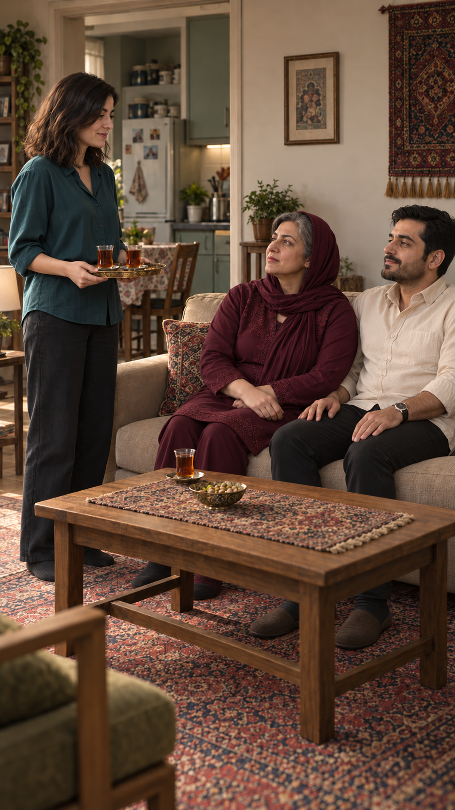
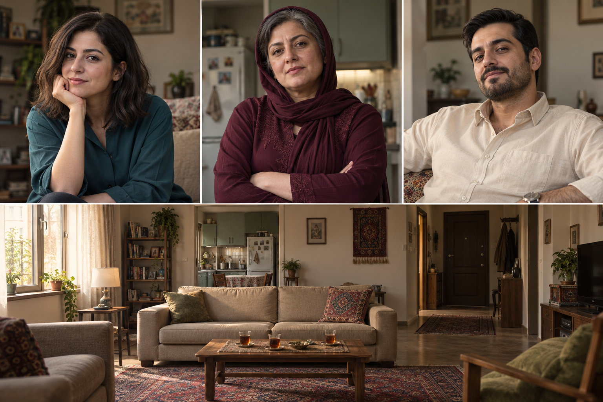

# مهلت امشب

شناسهٔ روایی پیشین: SC-01
قسمت: [EP-01](episode.md)
مرجع روایت: [سند سریال](../../film.md#ep-01)
وضعیت متن/جهت بازی/نوبت‌ها: نسخهٔ۲ تأییدشده؛ اصلاح تولید به درخواست کاربر در حال آماده‌سازی
مدت هدف: نزدیک یک دقیقه؛ طرح کاغذی نسخهٔ۳ 63.2 ثانیه. زمان نهایی با گفتار واقعی سنجیده شود.

## کارکرد

نازلی برای فرار از ازدواج تحمیلی نامزد خیالی می‌سازد؛ مادر برای همان شب مهلت می‌دهد.

## موقعیت و پیوستگی

- زمان: عصر روز اول
- مکان: پذیرایی خانهٔ نازلی
- حاضرها: نازلی، مادر نازلی، فرهاد
- ویژگی‌های پایدار، لباس‌های هر روز و روابط فقط در [سند سریال](../../film.md) تعریف می‌شوند.
- مرجع هویت/لباس/خانه v1 مصوب است؛ قاب‌های اختصاصی ساخته شده‌اند؛ قاب‌های نازلی به علت خطای جهت اتاق در نسخهٔ قبلی در حال اصلاح‌اند.

## چیدمان و پیوستگی اجرایی — اصلاح رابطهٔ میزبان و مهمان‌ها

مرجع کنترل فضایی؛ جزو ۱۶ نوبت گفتار نیست. جزئیات زاویهٔ باز راهنمای تولید است؛ قاب‌های نزدیک باید همین رابطهٔ میزبان، میز و مهمان را حفظ کنند.

- مکان و نور همان خانهٔ مصوب v1 است؛ این نقشهٔ اجرایی مبنای قاب‌های در حال آماده‌سازی است؛ خود قاب‌ها هنوز باید بازبینی شوند. جهت‌ها به نقشهٔ اتاق اشاره می‌کنند، نه وارونه‌کردن تصویر در نمای مقابل.
- مادر روی بخش چپ مبلِ دیوار عقب، فرهاد روی بخش راست آن، و نازلی در سمت آشپزخانه و روبه‌روی مبل مهمان‌ها، کنار میز و رو به مادر و فرهاد ایستاده است. نازلی در این قسمت نمی‌نشیند؛ فقط جهت نگاهش را به مخاطب همان جمله تغییر می‌دهد. هیچ‌کس وارد یا خارج اتاق نمی‌شود.
- درِ ورودی در عمق راست، در همهٔ نماهای این قسمت بسته و بی‌حرکت می‌ماند. کنش بازشدن در در این قسمت وجود ندارد؛ سمت لولا برای قسمت بعد پیش از ساخت کنش در باید از مرجع روشن تعیین شود، نه حدس زده شود.
- سه استکان داریم: دو استکان روی سینی و یکی از ابتدا روی میز. تا پایان نوبت ۹ نازلی با هر دو دست لبه‌های همان سینی را در ارتفاع کمر نگه می‌دارد؛ هیچ استکانی جداگانه وارد دستش نمی‌شود و کسی چای نمی‌ریزد.
- پس از دستور مادر در نوبت ۹، هنگام باقی‌ماندن قاب روی مادر، نازلی سینی را خارج قاب روی ضلع نزدیک و راست میز می‌گذارد؛ صدای تماس کوتاه علتِ تغییر را روشن می‌کند. نوبت ۱۰ با سینیِ روی میز و دست‌های خالی نازلی شروع می‌شود. دو استکان روی سینی و سومی روی میز باقی می‌مانند؛ این برش جابه‌جاییِ بی‌علت یا حذف شیء نیست.
- از نوبت ۱۰ تا پایان، سینی و استکان‌ها بی‌حرکت‌اند؛ دست‌ها و بدن هیچ شخصیت دیگری ناگهان وارد قاب نزدیک گوینده نمی‌شوند. فقط نگاه و تغییر کوچک چهره اجرا می‌شود.
- هر نوبت در یک نمای تک‌گوینده است؛ فقط همان جمله، صدای همان شخصیت و لب‌خوانی خودش. دو نفر دیگر در جای واقعی خود خارج قاب، ساکت و شنونده‌اند. این قسمت صدای گویندهٔ خارج قاب و گفتار هم‌زمان ندارد.
- لباس، مو، جای نور، مبل، پنجره و در بین نماها ثابت‌اند. مرجع‌های تصویری مصوب ورودی‌اند؛ نماهای جدید نباید با آینه‌ای‌کردن چهره یا محیط ساخته شوند.

- اصلاح چیدمان پس از بازخورد کاربر: میز چای بین نازلی و مهمان‌ها و جلوی زانوی مهمان‌های نشسته است؛ استکان سوم جلوی مادر قرار دارد. دوربین نماهای نازلی از سمت مهمان‌ها رو به آشپزخانه است؛ پشت نازلی فقط آشپزخانه/دیوار همان سمت دیده می‌شود. مبل مهمان‌ها و میز در سمت جلوی نازلی و بیرون کادر پرترهٔ او هستند. تکرار مبل خالی و چای پشت نازلی خطای نسخهٔ قبلی است و نباید به تولید منتقل شود. نمای بازِ کنترل چیدمان فقط مرجع فضایی است، نه نوبت گفتار اضافه.

## وضعیت ابتدا و انتهای اشیای حساس

| مورد | آغاز | تغییر مجاز | پایان |
|---|---|---|---|
| نازلی و دست‌ها | ایستاده؛ هر دو دست سینی را نگه می‌دارند | گذاشتن سینی فقط بین نوبت ۹ و۱۰ با علت صوتی روشن | همان جای بدن، دست‌ها خالی کنار بدن |
| سینی و دو استکان | در دست نازلی تا نوبت ۹ | یک‌بار روی میز گذاشته می‌شوند | دو استکان همچنان روی همان سینی |
| استکان سوم | از ابتدا روی میز | جابه‌جایی ندارد | همان جای ثابت روی میز |
| مادر و فرهاد | نشسته در دو جای ثابت مبل | فقط نگاه و تغییر کوچک حالت | همان جای نشسته |
| درِ ورودی | بسته در عمق راست | هیچ کنشی ندارد | بسته در همان جای محیط |

## راهنمای تلفظ برای تولید گفتار — نسخهٔ اعراب‌گذاری EP-01

درخواست کاربر در ۲۰۲۶/۱۰/۱۳: فتحه، کسره، ضمه و سکونِ لازم به دیالوگ‌ها اضافه شود تا خوانش فارسی کمتر مبهم باشد. حروف، ترتیب واژه‌ها، فاصله‌ها، نیم‌فاصله‌ها و نشانه‌گذاری متن پذیرفته‌شده تغییر نکرده‌اند. «چی؟» مصوت بلند روشن دارد و حرکت اضافی لازم ندارد.

- فتحه /a/، کسره /e/، ضمه /o/ و سکون برای نشان‌دادن نبود مصوت کوتاه‌اند؛ مدل نباید بین هر دو حرفِ نشانه‌دار مکث کند.
- کسرهٔ اضافه در «بَعْدِ عَروسی»، «سَرِ کار» و «بَرایِ خَرْج» شنیده شود؛ اضافه‌کردن مصوت بین «خَرْج» و «قَبْل» یا شکستن همخوان‌های این واژه‌ها مجاز نیست.
- خوانش محاوره‌ای حفظ شود: «بِری»، «می‌رَم»، «نِمی‌تونِه»، «بِذار» و «بِشین» به شکل رسمی بازنویسی/خوانده نشوند.
- املای محاوره‌ای «رُو» = ro، «تُو» = to و بخش آغاز «خُودَم» = kho-dam؛ مصوت کوتاه /o/ را به /uː/ نکشید. بخش پایانی «اِسْتِکانُو» = estekāno و «حَرْفامونُو» = harfāmuno است؛ وِ پایانی در این دو، نشانهٔ گفتاری /o/ است.
- «اِسْمِش» = esmesh؛ «چیِه» = chi-ye؛ «نازْلی» = nāzli و بدون مصوت اضافی بین ز و ل؛ «می‌خواسْتَم» = mi-khāstam و بدون تلفظ وِ خوا؛ «می‌بینَمِش» = mi-bina-mesh؛ «میارَمِش» = mi-yāra-mesh.
- بخش لاتین بالا فقط راهنمای خوانش است و جزو دیالوگ نیست. نام گوینده و شناسهٔ جمله نیز خوانده نشوند.
- اعراب‌گذاری راهنمای تولید است، نه تضمین صحت خروجی. پذیرش تلفظ، اتصال طبیعی واژه‌ها و روانی بازی فقط با شنیدن برداشت انجام می‌شود؛ هنوز برداشت صوتی/ویدیویی تولید نشده است.

## تأیید پاسخ نازلی و درخواست تولید نسخهٔ۳

کاربر پاسخ D27 را تأیید و ساخت ۱۰ برداشت تازه و جایگزینی در تدوین را صریحاً درخواست کرد؛ مجوز ادامه برای همین نسخه ثبت است و تأیید دوبارهٔ متن لازم نیست. در تلاش تازه، ابزار کنترل مرورگر با پیام «could not verify whether the current browser URL is allowed» متوقف شد. تولید ارسال نشده، برداشت تازه نداریم و تدوین نسخهٔ۱ تغییر نکرده است. این مانع دسترسی است، نه نیاز به تأیید دوبارهٔ کاربر. پس از بازگشت دسترسی عادی به Flow، قیمت/مدت زنده بررسی و تولید از SH17 ادامه یابد؛ نتیجهٔ اول از نظر صدا و لب‌خوانی کنترل، سپس بقیه تولید و در تدوین تازه جایگزین شوند.

## اصلاح فعال نسخهٔ۳ — ادغام برداشت و تکمیل پاسخ

مقدم بر توضیح‌های تاریخی نسخهٔ۲: D17 و D18 در یک برداشت SH17، شمارهٔ۱۳، اجرا می‌شوند؛ SH18 برداشت مستقل ندارد. لحن و حالت اختصاصی این دو جمله به درخواست کاربر حذف شد. پاسخ تازهٔ D27/SH27 پس از D25 و پیش از D26 می‌آید؛ متن کوتاه و بازی این پاسخ برای بازبینی پیشنهادی است. شماره‌های پایانی:۲۰ دعوت مادر،۲۱ پاسخ نازلی،۲۲ پیشنهاد رفتن خانواده،۲۳ پاسخ نهایی نازلی. یک سکانس و۲۳ برداشت باقی می‌ماند؛ ۱۳ موجود و۱۰ تازه. زمان کاغذی 63.2ثانیه؛ هیچ رسانهٔ تازه ساخته نشده است.

## سابقهٔ اصلاح گفت‌وگوی مادر — ۲۰۲۶/۱۰/۱۳

وضعیت متن و جهت بازی تازه: تأییدشده توسط کاربر؛ ساخت اصلاح قسمت اول درخواست شد. کاربر جهش ناگهانی از افشای علاقه به دعوت همان شب را ایراد اصلی نسخهٔ حدود۳۸ثانیه‌ای دانست. هدف نزدیک یک دقیقه است، با اولویت پیوستگی؛ زمان با اجرای طبیعی سنجیده شود و سکوت برای پرکردن مدت اضافه نشود.

ترتیب فعال: D01 تا D12، سپس D17/D18 در یک برداشت، D19 تا D25، D27، D26 و در پایان D16. این بخش جایگزین D13 تا D15 است؛ متن مصوب قدیمی برای سابقه در پایین محفوظ است. پرامپت‌ها، review.md، فهرست ضبط و زمان‌بندی نسخهٔ۲ از همین مرجع بازسازی شده‌اند. هنوز رسانهٔ تازه یا تدوین اصلاح‌شده نداریم. ارسال تولید به دلیل توقف ابزار کنترل مرورگر پیش از هر کلیک تولید انجام نشد.

اصلاح کاربر: سامان همسایهٔ همین ساختمان است و ممکن است مادر قبلاً او را دیده باشد؛ نازلی نباید ندیدن او را قطعی اعلام کند. مادر ابتدا امکان آمدن امشب را می‌پرسد، سپس در پاسخ به بهانهٔ زمانی نازلی اصرار می‌کند امشب به خانه بیاید تا هویتش و ماجرا روشن شود. متن و بازی تازه با درخواست شروع ساخت تأیید شدند؛ پذیرش برداشت واقعی هنوز انجام نشده است.

دستور اجرا؛ خوانده نشود: در هر نوبت فقط گوینده داخل قاب و با صدای ثابت خودش لب‌خوانی می‌کند؛ مخاطب و فرهاد خارج قاب، در جای قبلی و ساکت‌اند. نوبت‌ها بدون هم‌پوشانی. مادر روی بخش چپ مبل نشسته، نازلی مقابل او در سمت آشپزخانه ایستاده است. سینی از قبل روی میز و دست‌های نازلی خالی‌اند؛ سه استکان ثابت و در بسته می‌ماند. وضعیت ابتدا/انتها یکسان است؛ فقط نگاه و تغییر کوچک چهره. مرجع قاب مادر SH07 و مرجع نازلی SH16 نسخهٔ۲ است؛ این تصاویر مرجع هویت/هندسه‌اند، نه برداشتِ گفتار تازه.

متن و بازی تازه تأیید شد؛ [جدول فعال ۲۳نما](#active-shot-order-v2) و مدخل‌های مرجع D17 تا D26 در ادامه قرار دارند.

اصلاح تازهٔ کاربر: مادر برای دیدن و شناختن فرد از طرف خانواده با فعل جمع حرف می‌زند؛ اصرارش برای فهم سریع ماجراست و بازی نباید دیکتاتورمآبانه شود. D26 جایگزین جمعِ D15 قدیمی است تا پایان هم به اول‌شخص مفرد برنگردد؛ سپس D16 با متن و جهت بازی مصوب می‌آید. اتصال D17/D18، D22/D23 و D25/D26 با یک گوینده می‌تواند پیوسته باشد؛ برش میان هر دو جمله اجباری نیست. مالکیت هر جمله جدا بماند. جمعِ خانواده به معنی افزودن پدر یا شخصیت تازه نیست.

معیار بازبینی: سؤال آشنایی ← درخواست شناختن ← مقاومت دختر ← سؤال امکان دیدار امشب ← بهانه ← اصرار برای دیدار خانواده ← راه دیگر دیدار ← پذیرش دختر؛ هر مرحله باید فشار یا اطلاعات تازه بدهد. پس از تأیید، برداشت‌های D13/SH07، D14/SH16 و D15/SH08 در نسخهٔ۱ جایگزین و زمان نهایی از صدای واقعی سنجیده شود. تلفظ، ثبات صدا، لب‌خوانی و پیوستگی دست‌ها/سینی در حرکت و اتصال به D12 و D16 واقعاً بازبینی شوند؛ ثبت این طرح به معنی اصلاح فیلم نیست.

## دیالوگ مرجع

نسخهٔ فعال: D01–D12، D17–D26، D16. مدخل‌های D13–D15 فقط سابقهٔ نسخهٔ۱ هستند؛ برای تولید استفاده نشوند.

متن و بازی نسخهٔ۲ تأیید شده و کاربر شروع ساخت اصلاح را درخواست کرده است. پذیرش صدای واقعی، حرکت و تدوین مستقل از تأیید متن است.

### EP01-D01

[دیالوگ، بازی و تمام فایل‌های EP01-SH01](shots/EP01-SH01/shot.md#ep01-d01)

### EP01-D02

[دیالوگ، بازی و تمام فایل‌های EP01-SH10](shots/EP01-SH10/shot.md#ep01-d02)

### EP01-D03

[دیالوگ، بازی و تمام فایل‌های EP01-SH11](shots/EP01-SH11/shot.md#ep01-d03)

### EP01-D04

[دیالوگ، بازی و تمام فایل‌های EP01-SH12](shots/EP01-SH12/shot.md#ep01-d04)

### EP01-D05

[دیالوگ، بازی و تمام فایل‌های EP01-SH02](shots/EP01-SH02/shot.md#ep01-d05)

### EP01-D06

[دیالوگ، بازی و تمام فایل‌های EP01-SH13](shots/EP01-SH13/shot.md#ep01-d06)

### EP01-D07

[دیالوگ، بازی و تمام فایل‌های EP01-SH03](shots/EP01-SH03/shot.md#ep01-d07)

### EP01-D08

[دیالوگ، بازی و تمام فایل‌های EP01-SH14](shots/EP01-SH14/shot.md#ep01-d08)

### EP01-D09

[دیالوگ، بازی و تمام فایل‌های EP01-SH04](shots/EP01-SH04/shot.md#ep01-d09)

### EP01-D10

[دیالوگ، بازی و تمام فایل‌های EP01-SH05](shots/EP01-SH05/shot.md#ep01-d10)

### EP01-D11

[دیالوگ، بازی و تمام فایل‌های EP01-SH06](shots/EP01-SH06/shot.md#ep01-d11)

### EP01-D12

[دیالوگ، بازی و تمام فایل‌های EP01-SH15](shots/EP01-SH15/shot.md#ep01-d12)

### EP01-D13

[دیالوگ، بازی و تمام فایل‌های EP01-SH07](shots/EP01-SH07/shot.md#ep01-d13)

### EP01-D14

[دیالوگ، بازی و تمام فایل‌های EP01-SH16](shots/EP01-SH16/shot.md#ep01-d14)

### EP01-D15

[دیالوگ، بازی و تمام فایل‌های EP01-SH08](shots/EP01-SH08/shot.md#ep01-d15)

### EP01-D16

[دیالوگ، بازی و تمام فایل‌های EP01-SH09](shots/EP01-SH09/shot.md#ep01-d16)

## اجرای قسمت اول — پیش‌نویس اجرایی

- ورود مستقیم روی خواستهٔ فرهاد؛ بدون لوگو، تیتراژ یا نمای بی‌کارِ معرفی خانه.
- نازلی سینی سبکِ دو استکان را کنار میز نگه داشته؛ استکان سوم از ابتدا روی میز است. مادر نوبت ۵ را می‌گوید اما نازلی هنوز سینی را زمین نمی‌گذارد؛ پس نوبت ۹ انگیزه دارد. پس از نوبت ۹ سینی خارج قاب روی همان میز گذاشته می‌شود و صدای تماس، برش به دست‌های خالی نازلی در نوبت ۱۰ را توجیه می‌کند.
- فرهاد از راحتی و قطعیت به ناباوری می‌رود؛ مادر ابتدا میزبان است و بعد مهلت می‌دهد. نازلی تهدید را با یک دروغ ناگهانی پس می‌زند؛ شوخیِ کلامی اضافی وارد نکنید.
- پایان روی تصمیم شتاب‌زدهٔ «خودم میارمش»؛ واکنش کوتاه مادر فقط اگر فشار مهلت را بیشتر کند.
- چیدمان پیشنهادی دقیق در بخش چیدمان و پیوستگی همین سکانس ثبت است؛ ظاهر و خانه مصوب‌اند، جای اجرای اشخاص و قاب‌های باقی‌مانده هنوز نیازمند تأییدند.

## بستهٔ نما و دستور تولید

کارت‌های نما و پرامپت‌ها از جدول همین سکانس مشتق می‌شوند؛ رجوع به . متن جمله‌ها فقط از شناسه‌های همین فایل خوانده شود.

## صدا و تدوین

- گفتار فارسی محاوره‌ای طبیعی؛ واضح، سریع در پیشرفت معنا و بدون تندکردن مصنوعی صدا.
- صدای محیط خانه بسیار کم؛ زیر جمله‌ها مزاحم نباشد. نسخهٔ پایه بدون موسیقی و نریشن است.
- برش روی تغییر خواسته، واکنش لازم یا کنش، نه فاصلهٔ زمانی یکسان.
- متن تأییدشده، صدای تولیدشده و اجرای پذیرفته سه وضعیت جدا هستند.
- یادداشت برش و منبع برداشت در [فهرست تدوین](edit/editorial-notes.md) ثبت شود.

## بازبینیِ لازم پیش از تولید

- [ ] زمان‌گیری اجرای طبیعی و کنترل سقف انتشار.
- [ ] چهره، لباس، جهت نگاه، جای دست‌ها و اشیا ثابت‌اند.
- [ ] هر نما اطلاعات، کنش یا واکنش تازه دارد.
- [ ] صدا، تلفظ و نوبت گوینده شنیده و تأیید شده‌اند.

### EP01-D17

[دیالوگ، بازی و تمام فایل‌های EP01-SH17](shots/EP01-SH17/shot.md#ep01-d17)

### EP01-D18

[دیالوگ، بازی و تمام فایل‌های EP01-SH17](shots/EP01-SH17/shot.md#ep01-d18)

### EP01-D19

[دیالوگ، بازی و تمام فایل‌های EP01-SH19](shots/EP01-SH19/shot.md#ep01-d19)

### EP01-D20

[دیالوگ، بازی و تمام فایل‌های EP01-SH20](shots/EP01-SH20/shot.md#ep01-d20)

### EP01-D21

[دیالوگ، بازی و تمام فایل‌های EP01-SH21](shots/EP01-SH21/shot.md#ep01-d21)

### EP01-D22

[دیالوگ، بازی و تمام فایل‌های EP01-SH22](shots/EP01-SH22/shot.md#ep01-d22)

### EP01-D23

[دیالوگ، بازی و تمام فایل‌های EP01-SH23](shots/EP01-SH23/shot.md#ep01-d23)

### EP01-D24

[دیالوگ، بازی و تمام فایل‌های EP01-SH24](shots/EP01-SH24/shot.md#ep01-d24)

### EP01-D25

[دیالوگ، بازی و تمام فایل‌های EP01-SH25](shots/EP01-SH25/shot.md#ep01-d25)

### EP01-D26

[دیالوگ، بازی و تمام فایل‌های EP01-SH26](shots/EP01-SH26/shot.md#ep01-d26)

### EP01-D27

[دیالوگ، بازی و تمام فایل‌های EP01-SH27](shots/EP01-SH27/shot.md#ep01-d27)

## ترتیب فعال نسخهٔ۲ — یک سکانس، ۲۳ نما

شمارهٔ نمایش ۱ تا۲۳ ترتیب تدوین است؛ شناسه‌های پایدار تغییر نمی‌کنند. سه نمای قدیمی SH07/SH16/SH08 کنار می‌روند؛ ۱۰ نمای تازه SH17–SH26 جای آن‌ها می‌آیند. نمای SH09 از نوبت۱۶ به نوبت۲۳ منتقل می‌شود. قاب‌های تازه از مرجع موجود استفاده می‌کنند؛ فیلم جدید هنوز تولید نشده.

| ترتیب | شناسهٔ نما | مرجع گفتار | وضعیت | بازهٔ تخمینی |
|---|---|---|---|---|
| 01 | EP01-SH01 | [EP01-D01](#ep01-d01) | حفظ برداشت موجود | 0–3.5 ثانیه |
| 02 | EP01-SH10 | [EP01-D02](#ep01-d02) | حفظ برداشت موجود | 3.5–6.3 ثانیه |
| 03 | EP01-SH11 | [EP01-D03](#ep01-d03) | حفظ برداشت موجود | 6.3–9.5 ثانیه |
| 04 | EP01-SH12 | [EP01-D04](#ep01-d04) | حفظ برداشت موجود | 9.5–12.7 ثانیه |
| 05 | EP01-SH02 | [EP01-D05](#ep01-d05) | حفظ برداشت موجود | 12.7–16.0 ثانیه |
| 06 | EP01-SH13 | [EP01-D06](#ep01-d06) | حفظ برداشت موجود | 16.0–19.2 ثانیه |
| 07 | EP01-SH03 | [EP01-D07](#ep01-d07) | حفظ برداشت موجود | 19.2–21.9 ثانیه |
| 08 | EP01-SH14 | [EP01-D08](#ep01-d08) | حفظ برداشت موجود | 21.9–22.7 ثانیه |
| 09 | EP01-SH04 | [EP01-D09](#ep01-d09) | حفظ برداشت موجود | 22.7–26.0 ثانیه |
| 10 | EP01-SH05 | [EP01-D10](#ep01-d10) | حفظ برداشت موجود | 26.0–28.2 ثانیه |
| 11 | EP01-SH06 | [EP01-D11](#ep01-d11) | حفظ برداشت موجود | 28.2–29.5 ثانیه |
| 12 | EP01-SH15 | [EP01-D12](#ep01-d12) | حفظ برداشت موجود | 29.5–31.3 ثانیه |
| 13 | EP01-SH17 | [EP01-D17](#ep01-d17)، [EP01-D18](#ep01-d18) | تولید تازه | 31.3–34.2 ثانیه |
| 14 | EP01-SH19 | [EP01-D19](#ep01-d19) | تولید تازه | 34.2–36.5 ثانیه |
| 15 | EP01-SH20 | [EP01-D20](#ep01-d20) | تولید تازه | 36.5–40.8 ثانیه |
| 16 | EP01-SH21 | [EP01-D21](#ep01-d21) | تولید تازه | 40.8–43.8 ثانیه |
| 17 | EP01-SH22 | [EP01-D22](#ep01-d22) | تولید تازه | 43.8–45.9 ثانیه |
| 18 | EP01-SH23 | [EP01-D23](#ep01-d23) | تولید تازه | 45.9–47.9 ثانیه |
| 19 | EP01-SH24 | [EP01-D24](#ep01-d24) | تولید تازه | 47.9–52.3 ثانیه |
| 20 | EP01-SH25 | [EP01-D25](#ep01-d25) | تولید تازه | 52.3–55.7 ثانیه |
| 21 | EP01-SH27 | [EP01-D27](#ep01-d27) | تولید تازه | 55.7–57.6 ثانیه |
| 22 | EP01-SH26 | [EP01-D26](#ep01-d26) | تولید تازه | 57.6–60.2 ثانیه |
| 23 | EP01-SH09 | [EP01-D16](#ep01-d16) | حفظ برداشت موجود | 60.2–63.2 ثانیه |

## کارت‌های نما — مالک پرامپت‌های مشتق‌شده

کارت‌های زیر سابقهٔ نماهای نسخهٔ۱ را هم حفظ می‌کنند. فقط جدول فعال نسخهٔ۲ و manifest جاری تعیین‌کنندهٔ ترتیب و مصرف‌اند؛ کارت‌های SH07/SH16/SH08 برای تولید فعال نیستند. کارت‌های تازه در انتهای همین سندند.

### EP01-SH01

[کارت کامل، قاب و قالب‌های این نما](shots/EP01-SH01/shot.md)

### EP01-SH10

[کارت کامل، قاب و قالب‌های این نما](shots/EP01-SH10/shot.md)

### EP01-SH11

[کارت کامل، قاب و قالب‌های این نما](shots/EP01-SH11/shot.md)

### EP01-SH12

[کارت کامل، قاب و قالب‌های این نما](shots/EP01-SH12/shot.md)

### EP01-SH02

[کارت کامل، قاب و قالب‌های این نما](shots/EP01-SH02/shot.md)

### EP01-SH13

[کارت کامل، قاب و قالب‌های این نما](shots/EP01-SH13/shot.md)

### EP01-SH03

[کارت کامل، قاب و قالب‌های این نما](shots/EP01-SH03/shot.md)

### EP01-SH14

[کارت کامل، قاب و قالب‌های این نما](shots/EP01-SH14/shot.md)

### EP01-SH04

[کارت کامل، قاب و قالب‌های این نما](shots/EP01-SH04/shot.md)

### EP01-SH05

[کارت کامل، قاب و قالب‌های این نما](shots/EP01-SH05/shot.md)

### EP01-SH06

[کارت کامل، قاب و قالب‌های این نما](shots/EP01-SH06/shot.md)

### EP01-SH15

[کارت کامل، قاب و قالب‌های این نما](shots/EP01-SH15/shot.md)

### EP01-SH07

[کارت کامل، قاب و قالب‌های این نما](shots/EP01-SH07/shot.md)

### EP01-SH16

[کارت کامل، قاب و قالب‌های این نما](shots/EP01-SH16/shot.md)

### EP01-SH08

[کارت کامل، قاب و قالب‌های این نما](shots/EP01-SH08/shot.md)

### EP01-SH09

[کارت کامل، قاب و قالب‌های این نما](shots/EP01-SH09/shot.md)

## مرجع بصری v1 — تأییدشده توسط کاربر

هدف: انتخاب جهت چهره‌ها، لباس روز اول و حال‌وهوای خانه. این سه هویت و خانه، مرجع فعال مصوب v1 هستند. نقش چهره‌ها برای هویت پیشنهادی، لباس برای طراحی پیشنهادی و نمای پایین برای هندسه/نور پیشنهادی جداست. ژست‌های پرتره و چینش چندقابی برای نماهای فیلم مرجع نیستند. مادر در خروجی شال زرشکی دارد؛ همین ظاهر تأیید شده و در نماهای روز اول ثابت می‌ماند. در ادامه، پرترهٔ تمیز هر شخصیت و قاب اختصاصی نماها با خود همین ورودی تصویری ساخته می‌شوند.

## قاب شروع آزمون SH03 — نامزد اجرایی

**قاب آزمون قدیمی کنار گذاشته شد:** فایل 02-EP01-SH03-start-v1.png فقط سابقه است؛ به علت مبل و چای پشت نازلی برای تولید استفاده نشود. مرجع فعال SH03 همان قاب نسخهٔ جدید در کارت نماست.

مرجع هویت، لباس و خانه همان v1 مصوب است. این قاب برای آزمون تک‌جمله‌ای «من یکی دیگه رو دوست دارم.» آماده شد. دست‌ها سینی را نگه می‌دارند؛ حرکت فقط توقف خدمت‌کردن، بالاگرفتن جزئی چانه و گفتار است. چهره و لباس نباید عوض شوند؛ ژست سینی و جای استکان‌ها در همین نما ثابت بمانند. بازبینی قبلی نقص چیدمان داشت؛ این قاب قدیمی رد شده است. حرکت و صدا هنوز ساخته نشده‌اند. سابقهٔ ساخت در episodes/episode-01/shots/EP01-SH03/records/SH03-start-generation-v1.json پروژه است.

## کارت‌های نماهای تازهٔ نسخهٔ۲

### EP01-SH17

[کارت کامل، قاب و قالب‌های این نما](shots/EP01-SH17/shot.md)

### EP01-SH18

[کارت کامل، قاب و قالب‌های این نما](shots/EP01-SH18/shot.md)

### EP01-SH19

[کارت کامل، قاب و قالب‌های این نما](shots/EP01-SH19/shot.md)

### EP01-SH20

[کارت کامل، قاب و قالب‌های این نما](shots/EP01-SH20/shot.md)

### EP01-SH21

[کارت کامل، قاب و قالب‌های این نما](shots/EP01-SH21/shot.md)

### EP01-SH22

[کارت کامل، قاب و قالب‌های این نما](shots/EP01-SH22/shot.md)

### EP01-SH23

[کارت کامل، قاب و قالب‌های این نما](shots/EP01-SH23/shot.md)

### EP01-SH24

[کارت کامل، قاب و قالب‌های این نما](shots/EP01-SH24/shot.md)

### EP01-SH25

[کارت کامل، قاب و قالب‌های این نما](shots/EP01-SH25/shot.md)

### EP01-SH26

[کارت کامل، قاب و قالب‌های این نما](shots/EP01-SH26/shot.md)

### EP01-SH27

[کارت کامل، قاب و قالب‌های این نما](shots/EP01-SH27/shot.md)
