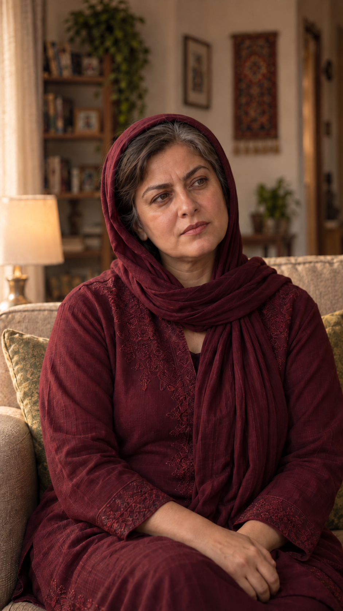

# قاب‌های فعال — episode-01

این گالری از قاب فعال کارت نما ساخته شده؛ نسخه‌های قدیمی در پوشهٔ همان نما محفوظ‌اند.

### EP01-SH01

[متن، بازی و وضعیت](shots/EP01-SH01/shot.md)

### EP01-SH10

[متن، بازی و وضعیت](shots/EP01-SH10/shot.md)

### EP01-SH11

[متن، بازی و وضعیت](shots/EP01-SH11/shot.md)

### EP01-SH12

[متن، بازی و وضعیت](shots/EP01-SH12/shot.md)

### EP01-SH02

[متن، بازی و وضعیت](shots/EP01-SH02/shot.md)

### EP01-SH13

[متن، بازی و وضعیت](shots/EP01-SH13/shot.md)

### EP01-SH03

[متن، بازی و وضعیت](shots/EP01-SH03/shot.md)

### EP01-SH14

[متن، بازی و وضعیت](shots/EP01-SH14/shot.md)

### EP01-SH04

[متن، بازی و وضعیت](shots/EP01-SH04/shot.md)

### EP01-SH05

[متن، بازی و وضعیت](shots/EP01-SH05/shot.md)

### EP01-SH06

[متن، بازی و وضعیت](shots/EP01-SH06/shot.md)

### EP01-SH15

[متن، بازی و وضعیت](shots/EP01-SH15/shot.md)

### EP01-SH17

[متن، بازی و وضعیت](shots/EP01-SH17/shot.md)

### EP01-SH19

[متن، بازی و وضعیت](shots/EP01-SH19/shot.md)

### EP01-SH20

[متن، بازی و وضعیت](shots/EP01-SH20/shot.md)

### EP01-SH21

[متن، بازی و وضعیت](shots/EP01-SH21/shot.md)

### EP01-SH22

[متن، بازی و وضعیت](shots/EP01-SH22/shot.md)

### EP01-SH23

[متن، بازی و وضعیت](shots/EP01-SH23/shot.md)

### EP01-SH24

[متن، بازی و وضعیت](shots/EP01-SH24/shot.md)

### EP01-SH25

[متن، بازی و وضعیت](shots/EP01-SH25/shot.md)

### EP01-SH26

[متن، بازی و وضعیت](shots/EP01-SH26/shot.md)

### EP01-SH09

[متن، بازی و وضعیت](shots/EP01-SH09/shot.md)

