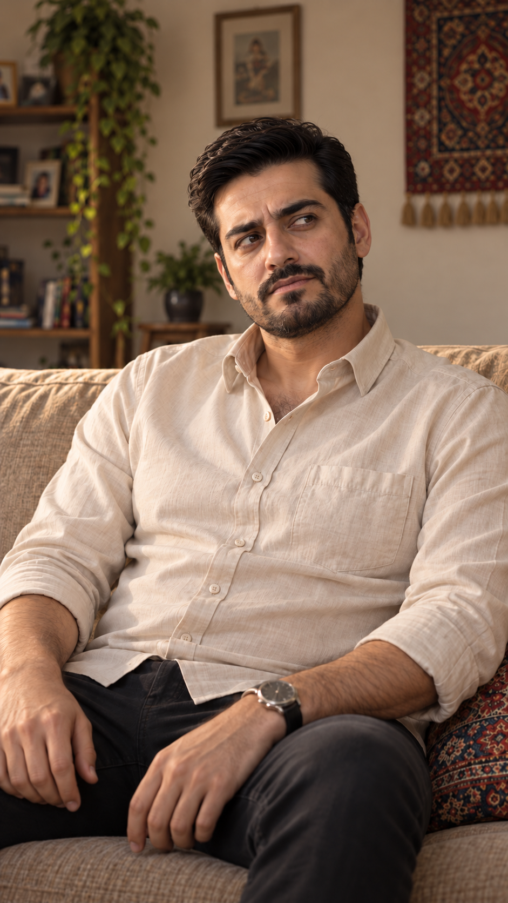

# EP01-SH06

## وضعیت فعلی

- برداشت منتخب: take-01 — در خروجی پذیرفته‌شده.
- اجازهٔ ارسال تازه: **مسدود؛ مجوز بستهٔ تازه کامل نیست**.
- مورد باز: کیفیت اجرای آینده و اجازهٔ هزینه جدا از تأیید متن بررسی شوند.
- قدم بعد: آماده‌سازی بستهٔ دقیق، بررسی پیش از ارسال و دریافت تأیید نسخه و هزینه.
- [ویدیوی منتخب](takes/take-01/video.mp4)
- [قاب فعال](images/EP01-SH06-start-v1.png)

## اطلاعات فعال برای ابزارها

این بلوک تنها مرجع انتخاب برداشت و درخواست ارسال است؛ جدول‌های قسمت از آن ساخته می‌شوند. `send_request: null` یعنی هیچ درخواست ارسال فعالی وجود ندارد. تأییدهای تاریخی مجوز تازه نیستند.

<!-- shot-state -->
```json
{
  "shot": "EP01-SH06",
  "active": true,
  "order": 11,
  "selected_take": "take-01",
  "selected_video": "takes/take-01/video.mp4",
  "selected_sha256": "d7aa2205726552833b41b07701157e2e6f1c5ed9716180ed261e9b93df2428f8",
  "selection_status": "accepted_episode_cut",
  "selection_evidence": "episodes/episode-01/edit/v3/timeline.json",
  "trim": {
    "in": 1.036,
    "out": 2.288
  },
  "active_frame": "images/EP01-SH06-start-v1.png",
  "send_request": null
}
```
<!-- /shot-state -->

## متن و دستور اجرا

مرجع اصلی این نما؛ دیالوگ، بازی، نوبت گوینده و وضعیت برداشت‌ها در همین پوشه نگه‌داری می‌شوند.

[پیوستگی قسمت](../../continuity.md) · [قواعد پروژه](../../../../project-rules.md)

<a id="ep01-d11"></a>
### `EP01-D11` — فرهاد
- متن: «اِسْمِش چیِه؟»
- وضعیت متن: تأییدشده توسط کاربر در گفت‌وگو؛ صدای واقعی تولید نشده.
- شناسهٔ گوینده: CH-FAR
- مخاطب و نما: نازلی؛ EP01-SH06
- جای گوینده و شنونده‌ها: نشسته روی بخش راست مبلِ دیوار عقب در نقشهٔ ثابت اتاق؛ رو به جای نازلی کنار میز. گوینده داخل قاب و تنها چهرهٔ خوانا است؛ نازلی و مادر در جای ثابت خود خارج قاب‌اند.
- نوبت و بازهٔ گفتار: نوبت 11 از ۲۳؛ بازهٔ تخمینی 28.2–29.5 ثانیه؛ بدون هم‌پوشانی.
- مالک صدا و لب‌خوانی: فرهاد / CH-FAR؛ فقط همین شخصیت و همین جمله. مرجع صدای فعال هنوز انتخاب و تأیید نشده؛ لب‌های تنها چهرهٔ قابل‌دیدن باید با صدای او هماهنگ شود.
- رفتار شنونده‌ها: نازلی و مادر ساکت می‌مانند؛ واکنش کوچک و طبیعی مجاز است ولی کلمات گوینده را لب نمی‌زنند و صدای دیگری نمی‌آید. در قاب این نوبت دهان آن‌ها دیده نمی‌شود.
- وضعیت نوبت و چیدمان: تأییدشده در طرح مطالعهٔ قسمت اول در ۲۰۲۶/۱۰/۱۳؛ قاب‌های اجرایی هنوز جداگانه بازبینی می‌شوند.
- حالت و شدت: حسادت و سوءظن؛ شدت ۳ از۵.
- قصد گوینده: گرفتن نام رقیب و بازپس‌گرفتن کنترل گفت‌وگو.
- نوع جمله و شیوهٔ بیان: پرسشیِ مطالبه‌گر؛ کوتاه و خشک، تأکید روی «اِسْمِش»؛ حجم معمولی و بدون فریاد.
- رفتار قابل‌دیدن: فرهاد به نازلی خیره می‌شود؛ یک خم‌شدن بسیار جزئی رو به جلو کافی است، بدون اشارهٔ تهدیدآمیز.
- وضعیت جهت بازی: تأییدشده توسط کاربر در ۲۰۲۶/۱۰/۱۳؛ پذیرش برداشت واقعی هنوز انجام نشده.

## مشخصات قاب، اتصال و معیار رد

### EP01-SH06

<!-- frame-asset:EP01-SH06 -->
[](images/EP01-SH06-start-v1.png)

مرجع اجرایی این نما: [تصویر کامل](images/EP01-SH06-start-v1.png). نقش: قاب شروع با هویت، لباس، نور، جهت نگاه و وضعیت وسایل ثابت. نامزد بازبینی‌شدهٔ تصویر ثابت؛ صدا، حرکت، لب‌خوانی و پذیرش نهایی هنوز وجود ندارند.
<!-- end-frame-asset -->

- نوبت: 11 از ۲۳؛ EP01-D11؛ فقط گویندهٔ تعیین‌شده داخل قاب.
- بازهٔ پیشنهادی در قسمت: 28.2–29.5s؛ زمان واقعی هنوز اندازه‌گیری نشده.
- گویندهٔ داخل قاب: فقط فرهاد؛ شنونده‌ها خارج قاب و ساکت‌اند.
- آغاز/پایان: مطابق جدول اشیا و دادهٔ همان جمله؛ هیچ انتقال صدایی به دهان شخصیت دیگر مجاز نیست.
- مرجع: خودِ مرجع بصری مصوب v1 برای صورت/لباس/خانه؛ قاب اختصاصی SH03 موجود، قاب‌های دیگر در انتظارند.
- رد: گوینده یا صدای اشتباه، لب‌خوانی شنونده، هم‌پوشانی ناخواسته، اعراب‌خوانی مکانیکی، تغییر صورت/لباس/اشیا، ورود دست بی‌صاحب یا حذف بی‌علت.

## قالب‌های اختصاصی

#### قالب قاب شروع EP01-SH06
```text
Photorealistic contemporary Iranian romantic comedy, vertical 9:16, soft late-afternoon light from the approved camera-left window. Preserve the actual approved identity, wardrobe and apartment references. A single-speaker close-up or medium close-up of فرهاد (CH-FAR), seated in the same fixed sofa position established in the scene map. The other two characters remain silent and offscreen in their fixed physical positions; do not show their mouths or add any other dialogue. Only a small eye/head/expression change required by the per-line performance direction. No walking, pouring, gesturing with extra hands or moving the door.
Use the scene's physical map, not a mirrored room. Exactly three tea glasses exist: two on the tray and one on the table in front of the seated Mother, never behind Nazli. Objects outside this close-up stay in their physical positions. One coherent still frame, no montage, titles, logos or subtitles.
```
#### قالب ویدئو EP01-SH06
```text
Animate the approved starting frame at natural speed, vertical 9:16. Maintain exact identity, wardrobe, room geometry, eyelines and prop state. A single-speaker close-up or medium close-up of فرهاد (CH-FAR), seated in the same fixed sofa position established in the scene map. The other two characters remain silent and offscreen in their fixed physical positions; do not show their mouths or add any other dialogue. Only a small eye/head/expression change required by the per-line performance direction. No walking, pouring, gesturing with extra hands or moving the door.
One speaking turn only. Only فرهاد owns the voice and the visible lip movements; never assign these words to another character. Start after the preceding turn, no overlap or extra voice. Use the user-approved per-line emotion, intent and delivery below; directions and IDs are not spoken.
Read Persian vowel marks as pronunciation cues, not pauses. Natural colloquial Persian; رو and تو have short /o/, final و in استکانو and حرفامونو is /o/, نازلی is nāzli with no extra vowel between z and l. Do not rewrite the wording or speed up speech. Quiet apartment ambience, no music, narration or subtitles.
{{DIALOGUE:EP01-D11}}
Target usable shot duration about 1.3s, subject to natural spoken delivery. If the selected tool length cannot fit the line, revise the shot timing before generating.
```

## برداشت‌ها و تاریخچه

- [take-01](takes/take-01/review.md)

؛ اطلاعات تکراری قدیمی فقط سابقه‌اند.
