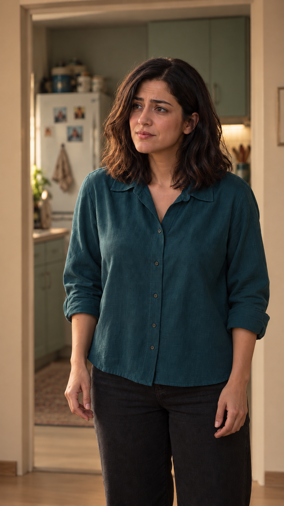

# EP01-SH16

## وضعیت فعلی

- برداشت منتخب: هنوز انتخاب نشده.
- اجازهٔ ارسال تازه: **ندارد؛ مسدود**. هیچ تأیید تازهٔ هزینه در این مرتب‌سازی ثبت نشده است.
- مورد باز: کیفیت اجرای آینده و اجازهٔ هزینه جدا از تأیید متن بررسی شوند.
- قدم بعد: آماده‌سازی بستهٔ دقیق، بررسی پیش از ارسال و دریافت تأیید نسخه و هزینه.
- [قاب فعال](images/EP01-SH16-start-v2.png)

## اطلاعات فعال برای ابزارها

این بلوک تنها مرجع انتخاب برداشت و درخواست ارسال است؛ جدول‌های قسمت از آن ساخته می‌شوند. `send_request: null` یعنی هیچ درخواست ارسال فعالی وجود ندارد. تأییدهای تاریخی مجوز تازه نیستند.

<!-- shot-state -->
```json
{
  "shot": "EP01-SH16",
  "active": false,
  "order": null,
  "selected_take": null,
  "selected_video": null,
  "selected_sha256": null,
  "selection_status": "not_selected",
  "selection_evidence": null,
  "trim": null,
  "active_frame": "images/EP01-SH16-start-v2.png",
  "send_request": null
}
```
<!-- /shot-state -->

## متن و دستور اجرا

مرجع اصلی این نما؛ دیالوگ، بازی، نوبت گوینده و وضعیت برداشت‌ها در همین پوشه نگه‌داری می‌شوند.

[پیوستگی قسمت](../../continuity.md) · [قواعد پروژه](../../../../project-rules.md)

<a id="ep01-d14"></a>
### `EP01-D14` — نازلی
- متن: «اِمْشَب نِمی‌تونِه.»
- وضعیت متن: تأییدشده توسط کاربر در گفت‌وگو؛ صدای واقعی تولید نشده.
- شناسهٔ گوینده: CH-NAZ
- مخاطب و نما: مادر؛ EP01-SH16
- جای گوینده و شنونده‌ها: ایستاده کنار ضلع نزدیک و راست میز در نقشهٔ ثابت اتاق؛ برای مخاطبِ هر جمله فقط نگاه را تغییر می‌دهد. گوینده داخل قاب و تنها چهرهٔ خوانا است؛ مادر و فرهاد در جای ثابت خود خارج قاب‌اند.
- نوبت و بازهٔ گفتار: نوبت 14 از ۱۶؛ بازهٔ پیشنهادی نما 34.5–36.1 ثانیه در قسمت. شروع جمله پس از پایان جملهٔ نوبت قبل؛ هم‌پوشانی ندارد. زمان گفتار واقعی هنوز اندازه‌گیری نشده.
- مالک صدا و لب‌خوانی: نازلی / CH-NAZ؛ فقط همین شخصیت و همین جمله. مرجع صدای فعال هنوز انتخاب و تأیید نشده؛ لب‌های تنها چهرهٔ قابل‌دیدن باید با صدای او هماهنگ شود.
- رفتار شنونده‌ها: مادر و فرهاد ساکت می‌مانند؛ واکنش کوچک و طبیعی مجاز است ولی کلمات گوینده را لب نمی‌زنند و صدای دیگری نمی‌آید. در قاب این نوبت دهان آن‌ها دیده نمی‌شود.
- وضعیت نوبت و چیدمان: تأییدشده در طرح مطالعهٔ قسمت اول در ۲۰۲۶/۱۰/۱۳؛ قاب‌های اجرایی هنوز جداگانه بازبینی می‌شوند.
- حالت و شدت: نگرانی و تلاش برای وقت‌خریدن؛ شدت ۳ از۵.
- قصد گوینده: عقب‌انداختن دیدار تا فرصتی برای پیدا کردن راه‌حل داشته باشد.
- نوع جمله و شیوهٔ بیان: خبریِ بهانه‌آور؛ پاسخ کمی زودتر از معمول، روشن و کوتاه؛ پایان مرددِ خفیف بدون تبدیل به سؤال.
- رفتار قابل‌دیدن: نازلی یک دم کوتاه می‌گیرد و نگاه را لحظه‌ای جمع می‌کند؛ بدون اغراق در ترس یا بازی کمیک.
- وضعیت جهت بازی: تأییدشده توسط کاربر در ۲۰۲۶/۱۰/۱۳؛ پذیرش برداشت واقعی هنوز انجام نشده.

## مشخصات قاب، اتصال و معیار رد

### EP01-SH16

<!-- frame-asset:EP01-SH16 -->
[](images/EP01-SH16-start-v2.png)

نسخهٔ ۲: آشپزخانه پشت نازلی؛ مهمان‌ها و میز چای در جلوی او و بیرون کادرند. مبل خالی و چای پشت نازلی از نسخهٔ فعال حذف شده‌اند. قاب ثابت برای بازبینی؛ حرکت/صدا تولید نشده.
<!-- end-frame-asset -->

- نوبت: 14؛ EP01-D14؛ گوینده: نازلی.
- بازهٔ پیشنهادی در قسمت: 34.5–36.1s؛ مصرف هدف 1.6s. زمان واقعی اندازه‌گیری نشده.
- گویندهٔ داخل قاب: فقط نازلی؛ شنونده‌ها خارج قاب و ساکت‌اند.
- آغاز/پایان: مطابق جدول اشیا و دادهٔ همان جمله؛ هیچ انتقال صدایی به دهان شخصیت دیگر مجاز نیست.
- مرجع: خودِ مرجع بصری مصوب v1 برای صورت/لباس/خانه؛ قاب اختصاصی SH03 موجود، قاب‌های دیگر در انتظارند.
- رد: گوینده یا صدای اشتباه، لب‌خوانی شنونده، هم‌پوشانی ناخواسته، اعراب‌خوانی مکانیکی، تغییر صورت/لباس/اشیا، ورود دست بی‌صاحب یا حذف بی‌علت.

## قالب‌های اختصاصی

#### قالب قاب شروع EP01-SH16
```text
Photorealistic contemporary Iranian romantic comedy, vertical 9:16, soft late-afternoon light from the approved camera-left window. Preserve the actual approved identity, wardrobe and apartment references. A single-speaker close-up or medium close-up of نازلی (CH-NAZ), standing with both hands empty near her body; the same tray and its two glasses stay on the near-right side of the coffee table. The other two characters remain silent and offscreen in their fixed physical positions; do not show their mouths or add any other dialogue. Only a small eye/head/expression change required by the per-line performance direction. No walking, pouring, gesturing with extra hands or moving the door. CAMERA/BLOCKING OVERRIDE: camera is on the seated guests side looking toward Nazli and the kitchen. Behind Nazli show the same sage-green kitchen doorway/fridge and warm wall only. No sofa, coffee table or served glass behind Nazli. The coffee table is between Nazli and seated guests, in FRONT of her on camera side, outside the portrait crop; the third glass is in front of Mother. Preserve this reverse angle in every Nazli shot.
Use the scene's physical map, not a mirrored room. Exactly three tea glasses exist: two on the tray and one on the table in front of the seated Mother, never behind Nazli. Objects outside this close-up stay in their physical positions. One coherent still frame, no montage, titles, logos or subtitles.
```
#### قالب ویدئو EP01-SH16
```text
Animate the approved starting frame at natural speed, vertical 9:16. Maintain exact identity, wardrobe, room geometry, eyelines and prop state. A single-speaker close-up or medium close-up of نازلی (CH-NAZ), standing with both hands empty near her body; the same tray and its two glasses stay on the near-right side of the coffee table. The other two characters remain silent and offscreen in their fixed physical positions; do not show their mouths or add any other dialogue. Only a small eye/head/expression change required by the per-line performance direction. No walking, pouring, gesturing with extra hands or moving the door. CAMERA/BLOCKING OVERRIDE: camera is on the seated guests side looking toward Nazli and the kitchen. Behind Nazli show the same sage-green kitchen doorway/fridge and warm wall only. No sofa, coffee table or served glass behind Nazli. The coffee table is between Nazli and seated guests, in FRONT of her on camera side, outside the portrait crop; the third glass is in front of Mother. Preserve this reverse angle in every Nazli shot.
One speaking turn only. Only نازلی owns the voice and the visible lip movements; never assign these words to another character. Start after the preceding turn, no overlap or extra voice. Use the user-approved per-line emotion, intent and delivery below; directions and IDs are not spoken.
Read Persian vowel marks as pronunciation cues, not pauses. Natural colloquial Persian; رو and تو have short /o/, final و in استکانو and حرفامونو is /o/, نازلی is nāzli with no extra vowel between z and l. Do not rewrite the wording or speed up speech. Quiet apartment ambience, no music, narration or subtitles.
{{DIALOGUE:EP01-D14}}
Target usable shot duration about 1.6s, subject to natural spoken delivery. If the selected tool length cannot fit the line, revise the shot timing before generating.
```

## برداشت‌ها و تاریخچه

- [take-01](takes/take-01/review.md)

؛ اطلاعات تکراری قدیمی فقط سابقه‌اند.
