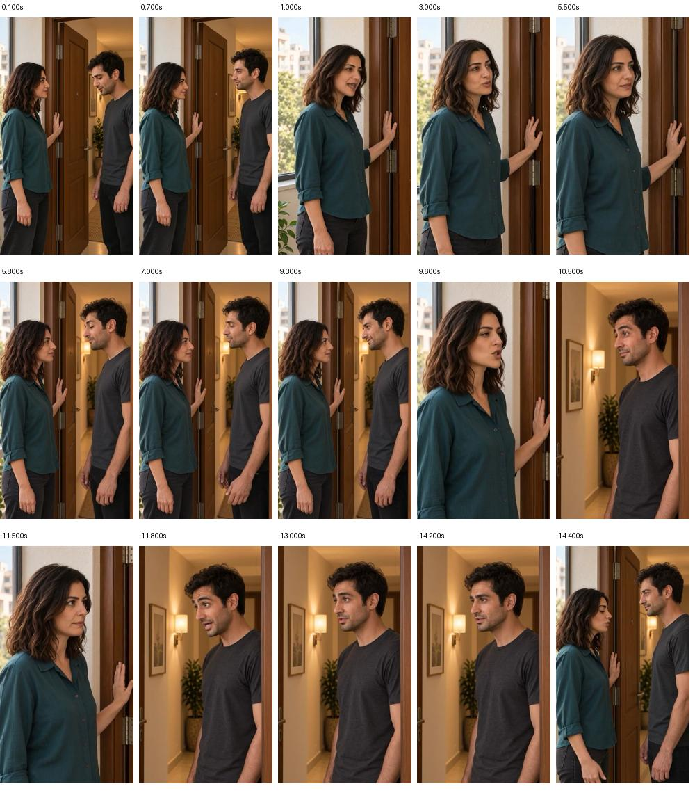
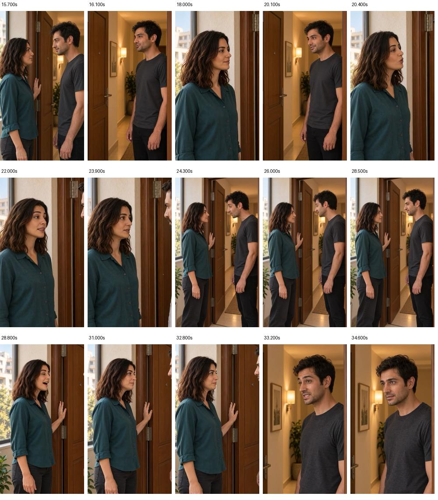
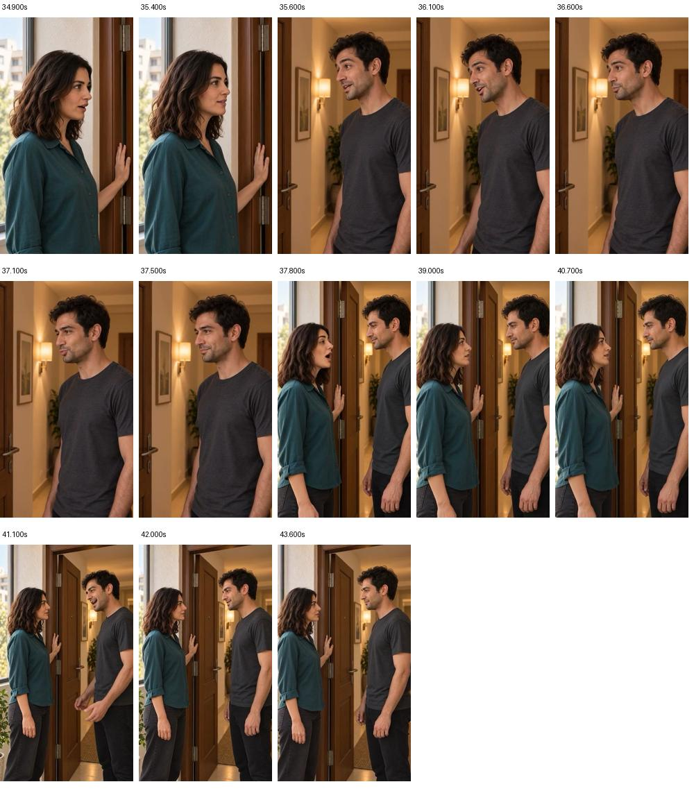
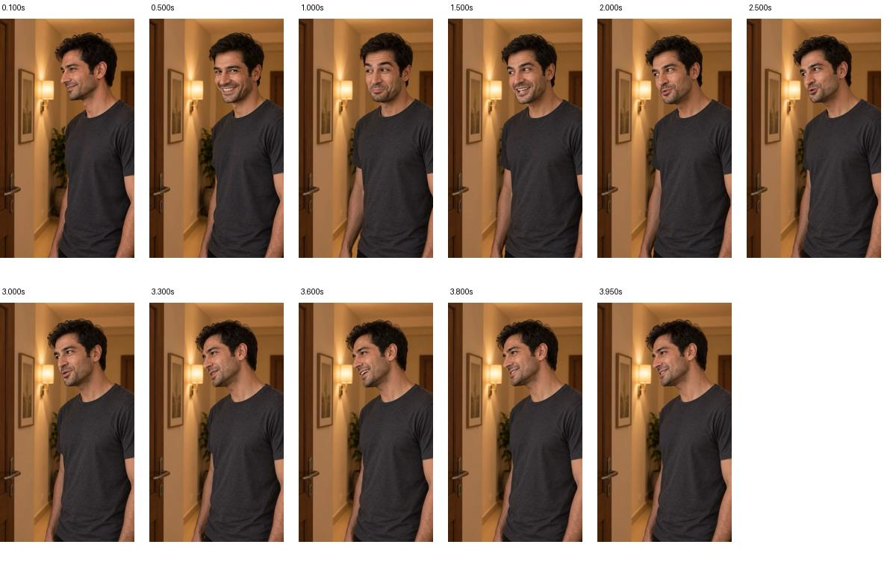
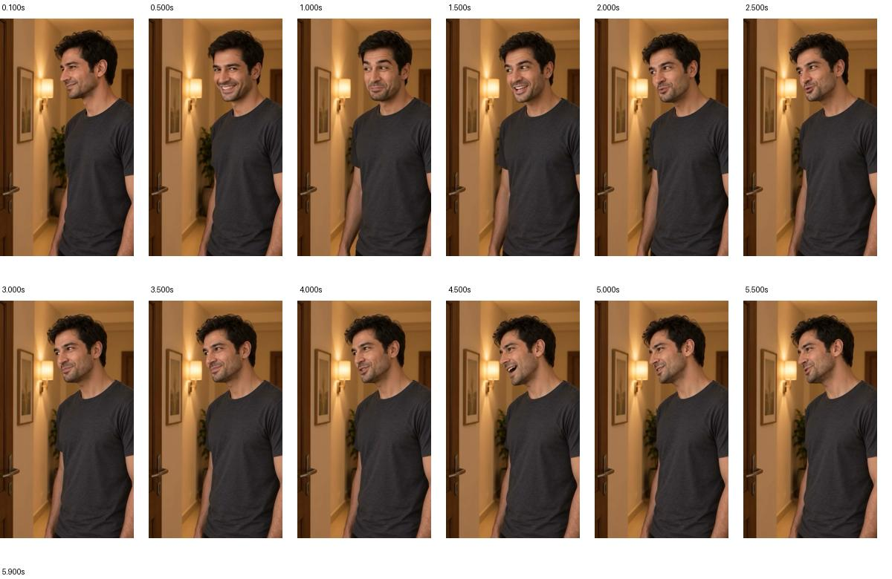

# بازبینی نهایی‌سازی قسمت۲ — ۲۰۲۶/۱۰/۱۴

وضعیت: نیازمند اصلاح؛ پذیرش کامل ثبت نشده است. تولید، تغییر انتخاب برداشت و بازتدوین انجام نشد.

## روش و حدود بررسی

منبع: [تدوین جاری نسخهٔ۳](../EP02-review-with-short-SH01.mp4) و [جدول منبع و زمان](../timeline.json). اثرانگشت `SHA-256`:

```text
a3030fa62d32ad3a4e17184abf47bf6123878f4da895ddbfe706899bac4ea1a1
```

- تطبیق وجود و اثرانگشت هر۱۵منبع اصلی جدول تدوین انجام شد؛ اختلافی نبود. منابع نمای واکنش جداگانه هش‌گیری مجدد نشدند.
- خواندن اطلاعات و استخراج۴۳فریم از همین فایل با `AVFoundation` انجام شد؛ مدت مسیر ویدیویی۴۳٫۸۳۳ثانیه، اندازهٔ `360×640` و نرخ `30fps` است. زمان گزارش قبلی با احتساب فایل۴۳٫۸۳۶۴۱۷ثانیه است.
- فریم‌های همهٔ۱۵نما و نمونه‌های ابتدا/انتهای نماها دیده شدند؛ این مشاهدهٔ نمونه‌ای جای پخش پیوسته یا کنترل تک‌تک فریم‌ها نیست.
- از اصل برداشت۷ یازده فریم و از اصل برداشت۸ سیزده فریم استخراج و دیده شدند؛ هر دو `360×640` و `24fps`، با مدت مسیر ویدیویی۴ و۶ثانیه‌اند.
- نمونه‌های موجودِ نماهای واکنش نسخهٔ۲ نیز دیده شدند. اتصال زمانی و احساس سرعتِ واقعی در پخش پیوسته همچنان باز است.
- شنیدن مستقیم صدا در این نوبت ممکن نبود. تلفظ، پایان واژه، آهنگ سؤال، ثبات صدا، میکس و هماهنگی پیوستهٔ لب تأیید نشده‌اند. ایراد صوتی برداشت۷ از بازخورد ثبت‌شدهٔ کاربر نقل می‌شود، نه شنیدن تازه.

## موارد باز برای نهایی‌شدن

| مورد | شاهد | نتیجه و اقدام |
|---|---|---|
| نمای۱۳ هنوز اجرای متن فعلی را ندارد | بازهٔ۳۵٫۵۱۴تا۳۷٫۶۴۷ثانیه؛ جدول تدوین از برداشت۲ استفاده می‌کند؛ پرامپت برداشت۲ جملهٔ خبری قبلی دارد، کارت فعلی سؤال مقایسهٔ دو پیراهن است | نیازمند اصلاح؛ برداشت مناسبِ متن فعلی باید پس از پذیرش واقعی جایگزین شود. تطبیق صوتی متن قدیم در این نوبت شنیده نشده است. |
| پایان واژهٔ برداشت۷ ناقص گزارش شده | [گزارش مالک برداشت۷](../../../shots/EP02-SH13/takes/take-07/review.md) و بازخورد تاریخی کاربر | مانع پذیرش همین برداشت؛ افزودن سکوت یا فریم ثابت تکمیل گفتار نیست. ابتدا امکان استفاده از گفتار واقعیِ موجود بررسی شود. |
| نگاه به دوربین در برداشت۷ و۸ | فریم۰٫۵ثانیه در هر دو منبع؛ جهت صورت و چشم نسبت به فریم۰٫۱ثانیه به سمت لنز می‌چرخد | نیازمند اصلاح تصویری؛ پوشاندن محدودهٔ دقیق با نمای واکنش سالم پیشنهاد است، اجرا یا تأیید نشده. تأیید قبلی ریتم/شیطنت برداشت۷ لغو یا بازنویسی نشده است. |
| برداشت۸ هنوز راه‌حل پذیرفته‌شده نیست | [گزارش مالک برداشت۸](../../../shots/EP02-SH13/takes/take-08/review.md) و نمونه‌های تازه | پایان صوتی، مکث و حفظ اجرای پسندیده باید شنیده شوند؛ صرفِ مدت۶ثانیه اثبات تکمیل نیست. |
| اتصال نمای۱۳ به۱۲و۱۴ | مرزهای۳۵٫۵۱۴و۳۷٫۶۴۷ثانیه در نسخهٔ۳ | پس از جایگزینی با زمان تازه، پایان سؤال، واکنش نازلی، خط نگاه و برش بدون بریدن واژه دوباره بررسی شوند. |
| بررسی صوتی و پیوستهٔ قسمت | هنوز در این نوبت انجام نشده | پیش از پذیرش نهایی، پخش کامل برای تلفظ، مالک صدا، لب‌خوانی، میکس و ریتم لازم است. نماهای واکنش۲۵۰میلی‌ثانیه‌ای در نماهای۲،۴،۷،۸ هم در سرعت واقعی کنترل شوند. |
| کیفیت تحویل | فایل جاری `360×640` است؛ هدف `1080×1920` در قواعد پروژه پیشنهاد اجرایی است | خروجی فعلی نسخهٔ بازبینی است. پیش از تحویل، کیفیت مورد پذیرش مشخص و منابع با وضوح بالاتر بررسی شوند؛ بزرگ‌کردن تصویر جزئیات ازدست‌رفته را بازسازی نمی‌کند و به‌تنهایی دلیل تولید تازه نیست. |

در نمونه‌های دیده‌شده، تغییر لباس، جابه‌جایی بزرگ موقعیت افراد، حرکت بی‌دلیل در یا شیء تازه‌ای تشخیص داده نشد. این نتیجهٔ محدود، اثبات سلامت تمام حرکت‌ها و دست‌ها نیست. بر مبنای این شواهد، تولید مجددِ سایر۱۴نما توجیه ندارد. مدت۴۳٫۸ثانیه با سقف حدود یک دقیقه سازگار است؛ برای پُرکردن زمان نما اضافه نشود.

## ترتیب اقدام پیشنهادی

۱. شنیدن مقایسه‌ای برداشت۷و۸ برای تعیین اینکه گفتار سالم و قابل‌استفاده در منابع موجود هست یا نه؛ هیچ اصلاح صوتی انجام‌شده تلقی نشود.
۲. اگر دادهٔ سالم موجود است، کوچک‌ترین اصلاح محلی همراه پوشش تصویریِ نگاه تهیه و اتصال۱۲←۱۳←۱۴ بازبینی شود. اگر دادهٔ لازم موجود نیست، فقط بستهٔ تولید لازم با بررسی مستند و هزینهٔ زنده آماده و برای تأیید صریح ارائه شود.
۳. پس از پذیرش نمای۱۳، تدوین تازه در نسخهٔ جدا ساخته و کامل پخش شود؛ سپس کیفیت تحویل و پذیرش قسمت ثبت شوند.

## شاهد تصویری از فایل جاری

[](current-cut-1.jpg)

[](current-cut-2.jpg)

[](current-cut-3.jpg)

[](../../../shots/EP02-SH13/takes/take-07/visual-review-2026-10-14.jpg)

[](../../../shots/EP02-SH13/takes/take-08/visual-review-2026-10-14.jpg)
