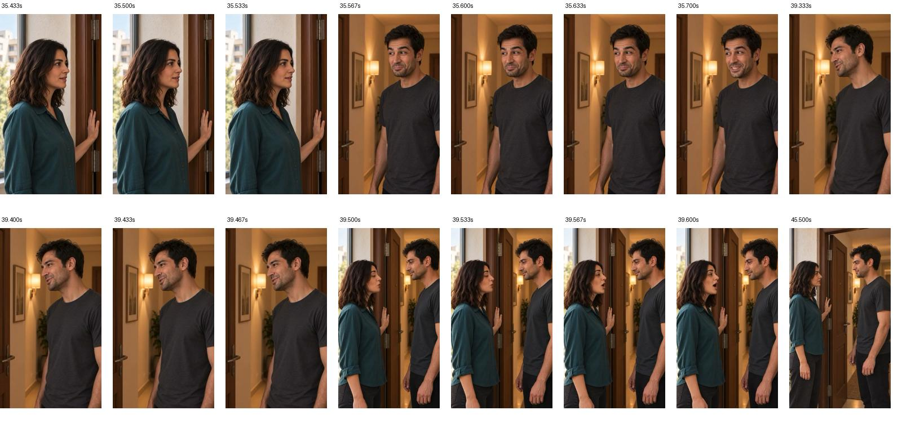

# تدوین تازهٔ قسمت۲ با نمای۱۳ پذیرفته‌شده

[پخش خروجی تازه](EP02-review-with-repaired-SH13.mp4) · [منابع و محدوده‌های برش](timeline.json) · [اسکریپت تدوین محلی](render-local-replacement.swift)

نسخهٔ۴، حدود۴۵٫۶۳ثانیه؛ فقط نمای۱۳ با [اصلاح محلی پذیرفته‌شده](../../shots/EP02-SH13/takes/take-07/edits/local-repair-v1/review.md) جایگزین شد. قسمت پیش و پس از این نما از خود فایل نسخهٔ۳ گرفته شد تا برش مکث‌ها و نمای۱ کوتاه‌شده حفظ شوند. نسخهٔ۳ و منابع با همان اثرانگشت محفوظ‌اند؛ هیچ تولید هزینه‌دار انجام نشد.

مرز واقعی نمای۱۳ در نسخهٔ۳ از زمان خود فریم‌ها تعیین شد:۳۵٫۵۶۶تا۳۷٫۶۹۹۳۳۳ثانیه. جدول قدیمی حدود۵۲میلی‌ثانیه زودتر بود و برای برش دقیق استفاده نشد. در نسخهٔ تازه، نمای۱۳ از۳۵٫۵۶۶تا۳۹٫۴۸۶ثانیه است؛ برای مرور اتصال، از حدود۳۴٫۵تا۴۱ثانیه پخش کنید.

خروجی `360×640` و `30fps` است؛ سرعت گفتار تغییر نکرد. تمام۱۳۶۹فریم ویدیو و نمونه‌های صوت رمزگشایی شدند؛ نمونهٔ صوتی با دامنهٔ حداقل۰٫۹۹۹ وجود نداشت. فریم‌های دو اتصال دیده شدند: نمای۱۲ به نسخهٔ اصلاحی و سپس مستقیم به نمای۱۴ می‌رسد؛ فریمی از نمای۱۳ قبلی در نمونه‌های اتصال دیده نشد. این کنترل، تأیید شنیداری یا نرمی اتصال در پخش واقعی نیست؛ شنیدن مستقیم در این محیط پشتیبانی نمی‌شود.

کاربر خودِ نسخهٔ اصلاحی را پذیرفت و جایگزینی را درخواست کرد. پذیرش اتصال و تدوین کامل هنوز در انتظار پخش کاربر است. بازتولید رسانه، تغییر متن یا مصرف اعتبار صفر بود.

