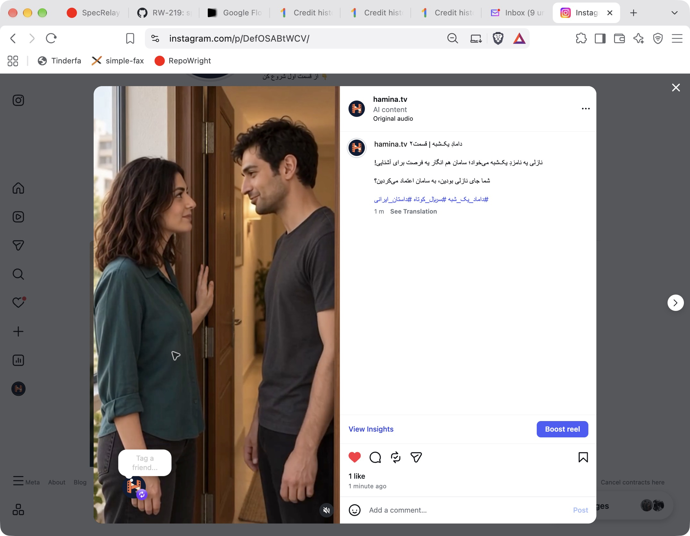

# بستهٔ انتشار قسمت۲ — نسخهٔ۵

مدت حدود۵۱٫۸ثانیه؛ عمودی `1080×1920`، `30fps`، ویدیوی `H.264` و صدای `AAC`. همان تدوین نسخهٔ۵ است؛ نمای۳ کامل و نمای۱۳ اصلاح‌شده محفوظ‌اند. دو نمای افزودهٔ۱۶و۱۷ در این خروجی نیستند.

منبع `360×640` است؛ خروجی بزرگ شده، جزئیات تصویری تازه تولید نشده است. صدا از منبع پذیرفته‌شده رمزگشایی و دوباره در `AAC` کدگذاری شده؛ صدای شخصیت یا گفتار تازه ساخته نشد. مدت صوت رمزگشایی‌شده با منبع برابر و همبستگی سیگنال حدود۰٫۹۹۹۷۷است؛ این کنترل فنی جای شنیدن نهایی انسان نیست.

فایل کامل با رمزگشایی نرم‌افزاری بررسی شد و زمان فریم‌ها پیوسته‌اند. مسیر کنترل بومی `AVFoundation` در این محیط هم برای اصلِ نسخه۵ و هم خروجی خطای یکسان می‌دهد؛ پخش بومی مستقل تأیید نشد. خطای مشابه منبعِ قبلاً قابل‌پخش، اثبات خرابی فایل تازه نیست. تلاش اولیهٔ خروجی با کپی خام `AAC` کنار گذاشته شد چون قطعه‌بندی/زمان‌های منبع باید در خروجی عادی بازکدگذاری شوند.

[کپشن آمادهٔ کپی](caption.txt) · [کاور هماهنگ قسمت۲](../cover/README.md) · [مشخصات و اثرانگشت‌ها](manifest.json)

کپشن پیشنهادی:

دامادِ یک‌شبه | قسمت۲

نازلی یه نامزدِ یک‌شبه می‌خواد؛ سامان هم انگار یه فرصت برای آشنایی!

شما جای نازلی بودین، به سامان اعتماد می‌کردین؟

#داماد_یک_شبه #سریال_کوتاه #داستان_ایرانی

کاور گرافیکی هماهنگ با قسمت۱ در پوشهٔ کاور همین قسمت با تأیید صریح کاربر پذیرفته شد.  فایل و کپشن برای مرور و بارگذاری آماده‌اند؛ انتشار در حساب `hamina.tv` انجام شد و اعتبار تولیدی مصرف نشده است.

## انتشار انجام‌شده — ۲۰۲۶/۱۰/۱۴

[پست قسمت۲](https://www.instagram.com/p/DefOSABtWCV/) با همین ویدیو، کاور تأییدشده و کپشن آماده در `Brave` منتشر شد. کاور روی پروفایل، کپشن روی پست و برچسب `AI content` بررسی شدند.

