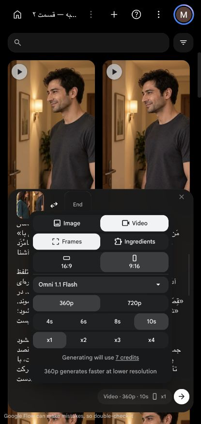

# بررسی امکان مدت۱۲ثانیه — ۲۰۲۶/۱۰/۱۴

کاربر خواست طول نما تا۱۲ثانیه باشد و اگر اجرای کامل زودتر تمام شد، خروجی کوتاه‌تر پذیرفتنی است. خوانش۱۱ثانیه‌ای گزارش‌شدهٔ او با حاشیهٔ۰٫۵ثانیه در۱۲ثانیه جا می‌شود؛ این اجازهٔ پُرکردن مدت یا کندکردن گفتار نیست.

## شواهد قابلیت ابزار

در رابط جاری پروژهٔ قسمت۲، مدل `Omni 1.1 Flash` با تصویر ورودی، در هر دو حالت `Frames` و `Ingredients`، فقط گزینه‌های۴،۶،۸و۱۰ثانیه داشت؛۱۲ثانیه و مدت خودکار دیده نشدند. این نتیجه دربارهٔ مسیر تصویرِ دیده‌شده است، نه اثبات محدودیت همهٔ حالت‌های ویرایش ویدیو یا همهٔ حساب‌ها.

مدل‌های `Veo 3.1 - Fast`، `Veo 3.1 - Quality` و `Veo 3.1 - Lite` نیز در رابط بررسی شدند؛ مدت نمایش‌داده‌شده۸ثانیه و کنترل مدت۱۲ثانیه یا خودکار وجود نداشت. هیچ تولیدی ارسال نشد. مدل و حالت به `Omni 1.1 Flash`، `Frames`، `360p`،۱۰ثانیه و یک خروجی بازگردانده شدند؛ متن و تصویر پیش‌نویس محفوظ‌اند.

مشخصات ابزار متصل `Runway` مدل‌هایی با قابلیت مدت بیش از۱۰ثانیه و صدا را توصیف می‌کند؛ ولی درخواست فقط‌خواندنیِ بررسی حساب با خطای نیاز به اتصال مجدد برگشت. دسترسی واقعی حساب به هیچ مدل جایگزین، قیمت آن یا قابلیت فارسی تأیید نشده است. هیچ فایل به آن سرویس بارگذاری و هیچ تولید، خرید یا تغییر اشتراکی انجام نشد.

## نتیجه

۱۲ثانیه برای زمان‌گیری ثبت‌شده مناسب است؛ مسیر فعلیِ ساخت از تصویر در این رابط آن را ارائه نمی‌کند. نوشتن۱۲ثانیه در پرامپت یا سپردن مدت به مدل، جای پارامتر واقعیِ مدت را نمی‌گیرد. برای تک‌برداشت۱۲ثانیه‌ای باید یک مسیر پشتیبان با دسترسی واقعی و قیمت روشن آماده شود؛ راه دیگر تقسیم گفتار و تدوین محلی است که هنوز بسته و هزینهٔ تازه‌اش آماده یا تأیید نشده‌اند.

مجوز قبلی یک خروجی۱۰ثانیه‌ای تا۷کریدیت بود؛ هزینهٔ بستهٔ۱۲ثانیه‌ای نامشخص و تأیید نشده است. تعداد ارسال و مصرف اعتبار صفر؛ تدوین نسخهٔ۴ تغییر نکرد.
