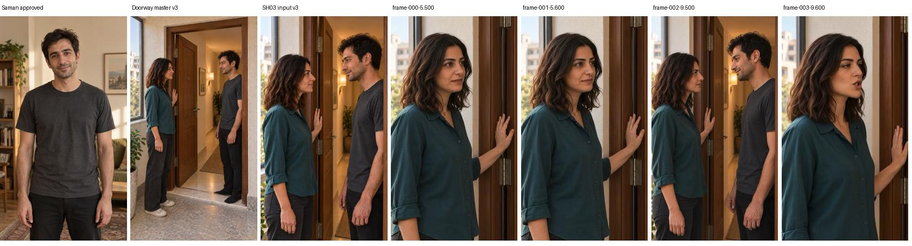
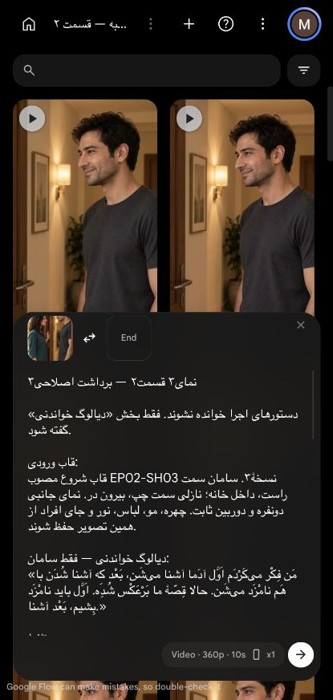
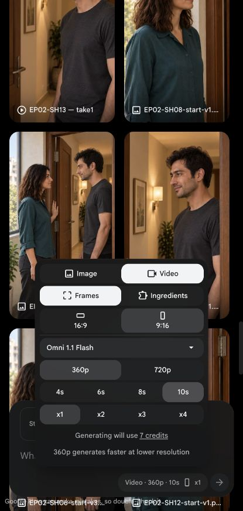

# بررسی پیش از ارسال — برداشت۳

وضعیت: بررسی کامل شد؛ ارسال به علت مدت ناکافی مسدود است. هیچ اعتبار مصرف نشد.

[کارت نما](../../shot.md) · [پرامپت تأییدشده](prompt.txt) · [مجوز و وضعیت اجرا](execution.json)

کاربر همین پرامپت، یک خروجی۱۰ثانیه‌ای و سقف۷کریدیت را صریحاً تأیید کرد؛ تولید مشروط به جا شدن طبیعی متن و بدون تلاش مجدد است. قیمت زنده و تنظیمات با بسته مطابقت داشتند. قاب مصوب از فایل‌های موجود پروژه انتخاب و عین پرامپت در رابط چیده شد؛ دکمهٔ تولید زده نشد.

قاب ورودی با مرجع مصوب سامان، چیدمان نسخهٔ۳ و فریم‌های نماهای۲و۴ در تدوین فعلی مقایسه و هویت، لباس، نگاه، دست و در و پیوستگی پیشنهادی بررسی شدند. نتیجهٔ تصویر ثابت و برنامهٔ اجرا به‌تنهایی تضمین سلامت حرکت، گفتار یا اتصالِ خروجی آینده نیست. پرامپت از نظر مالک دیالوگ، نوبت، لحن، اعراب و نبود دستور قدیمی در بخش خواندنی کنترل شد.

## زمان‌گیری واقعی و علت توقف

از کاربر خواسته شد متن را با ریتم طبیعی بلند بخواند و زمان اندازه‌گیری‌شده را بگوید؛ پاسخ او «۱۱» بود. این اندازه‌گیری گزارش‌شدهٔ کاربر است، نه شنیدن مستقل یا اندازه‌گیری از فایل صوتی توسط دستیار. با حدود۰٫۵ثانیه حاشیهٔ مجموع آغاز/پایان، طول لازم حدود۱۱٫۵ثانیه است و در خروجی۱۰ثانیه‌ای جا نمی‌شود. کوتاه‌کردن متن یا سرعت‌دهی برای عبور از این بررسی انجام نشد.

سقف مجاز همان۷کریدیت برای یک خروجی۱۰ثانیه‌ای است؛ بستهٔ تقسیم‌شده یا مدت تازه تأیید نشده. ارسال انجام نشد، تعداد تلاش و هزینهٔ واقعی صفر و تدوین نسخهٔ۴ و برداشت منتخب قبلی محفوظ‌اند.

[](preflight-visual-comparison.jpg)

[](staged-not-submitted.png)

[](live-price-10s-360p.png)

<!-- preflight-state -->
```json
{
  "shot": "EP02-SH03",
  "take": "take-03",
  "ready": false,
  "open_issues": [
    "خوانش اندازه‌گیری‌شدهٔ کاربر۱۱ثانیه است؛ با حاشیهٔ۰٫۵ثانیه در خروجی۱۰ثانیه‌ای مصوب جا نمی‌شود."
  ],
  "checks": {
    "dialogue": {
      "status": "pass",
      "evidence": "متن عین آخرین درخواست کاربر؛ نامزد می‌شَن و جملهٔ قصهٔ ما برعکس شده محفوظ؛ اعراب و انطباق با کارت مرور شد. صحت تلفظ خروجی هنوز باید پس از تولید شنیده شود.",
      "reason": ""
    },
    "delivery": {
      "status": "pass",
      "evidence": "پرامپت کاملِ تأییدشده مرور شد: سه جملهٔ خبری روان؛ تأکید معنایی و نفس طبیعی، بدون مکث نمایشی و یک‌نفس‌گویی اجباری. حفظ ریتم وابسته به مدت کافی است و duration رد شد.",
      "reason": ""
    },
    "duration": {
      "status": "fail",
      "evidence": "پاسخ همین نوبت کاربر به درخواست زمان‌گیری بلندخوانی طبیعی: 11؛ زمان خوانش۱۱ثانیه. حاشیهٔ آغاز/پایان۰٫۵ثانیه پیشنهادی، مجموع۱۱٫۵>۱۰ثانیه. صوت خام دریافت/شنیده نشد؛ عدد اندازه‌گیری‌شدهٔ کاربر منبع است.",
      "reason": "شرط جا شدن طبیعی در مدت مصوب برقرار نیست."
    },
    "performance": {
      "status": "pass",
      "evidence": "کاربر عین پرامپت را تأیید کرد؛ حالت، شدت، قصد، بیان و رفتار هر سه جمله در shot.md و prompt.txt مطابق‌اند؛ هیچ تغییر معنایی بعد از تأیید داده نشد.",
      "reason": ""
    },
    "speaker": {
      "status": "pass",
      "evidence": "shot.md: هر سه جمله فقط سامان؛ نازلی ساکت، هر دو داخل قاب؛ فقط لب‌های سامان فعال.",
      "reason": ""
    },
    "identity": {
      "status": "pass",
      "evidence": "preflight-visual-comparison.jpg: قاب ورودی v3 با پرترهٔ مصوب سامان، چیدمان v3 و نماهای مجاورِ خروجی v4 مقایسه شد؛ ناسازگاری آشکار چهره/مو/لباس تشخیص داده نشد. ثبات حرکتِ تولیدنشده تضمین نیست.",
      "reason": ""
    },
    "eyeline": {
      "status": "pass",
      "evidence": "تصویر واقعی ورودی دیده شد: سامان راست رو به چشم نازلی با نگاه کمی پایین، نازلی چپ با نگاه کمی بالا؛ هر دو نیم‌رخ، بدون نگاه به لنز. چشم مخاطب واقعی در قاب قابل تعیین است.",
      "reason": ""
    },
    "geometry": {
      "status": "pass",
      "evidence": "قاب و چیدمان v3 دیده شدند: نازلی بیرون و سامان داخل؛ در نیمه‌باز، لولا سمت ثابت چهارچوب؛ دست راست نازلی روی سطح بیرونی چوب، دست آزاد پایین. لنگه و دست‌ها در پرامپت ثابت‌اند. سلامت حرکت پس از تولید باید کنترل شود.",
      "reason": ""
    },
    "continuity": {
      "status": "pass",
      "evidence": "preflight-visual-comparison.jpg: فریم‌های5.5/5.6ثانیهٔ نمای۲ و9.5/9.6ثانیهٔ اتصال به۴ از تدوین v4 دیده شدند؛ لباس، مکان و دست روی چهارچوب سازگارند. نمای جدید ورود/خروج یا تغییر شیء ندارد؛ اتصال واقعی پس از تولید/تدوین همچنان باید بازبینی شود.",
      "reason": ""
    },
    "camera": {
      "status": "pass",
      "evidence": "قاب فعال دیده شد؛ تصویر جانبی دونفره، دوربین ثابت؛ هیچ حرکت جدید تعریف نشده است.",
      "reason": ""
    },
    "prompt": {
      "status": "pass",
      "evidence": "انطباق متن کارت و prompt.txt و متن چیده‌شدهٔ رابط پس از یکسان‌سازی فاصله‌ها بررسی شد؛ پرامپت دقیقاً همان نسخهٔ تأییدشده است. هیچ مرجع اشتباه یا متن گفتاری قدیمی در بخش خواندنی وجود ندارد.",
      "reason": ""
    },
    "local_alternative": {
      "status": "pass",
      "evidence": "متن تازه حاوی دو جملهٔ تازه و واژگان متفاوت است؛ برداشت قدیمیِ همین نما آن‌ها را ندارد. برش، سکوت یا فریم ثابت این گفتار را تولید نمی‌کند. تولید گفتار تازه لازم است؛ روش هنوز قطعی نشده.",
      "reason": ""
    },
    "settings": {
      "status": "pass",
      "evidence": "رابط زنده دوباره بررسی شد: Omni 1.1 Flash؛ Video/Frames؛ 9:16؛ 360p؛ 10s؛ x1. قاب EP02-SH03-start-v3.png انتخاب شد؛ تصویر رابط941×1672، مطابق فایل ورودی؛ قاب پایان خالی است. دکمهٔ تولید زده نشد.",
      "reason": ""
    },
    "cost": {
      "status": "pass",
      "evidence": "قیمت زنده۷کریدیت دوباره خوانده شد؛ کاربر سقف۷ برای دقیقاً یک ارسال۱۰ثانیه‌ای و بدون retry را تأیید کرد. این مجوز مشروط به duration است و مصرف واقعی صفر است.",
      "reason": ""
    }
  },
  "bundle_sha256": "9cb44237373570b9666e890b1e39a1c947e47c4f3439a94c4f4a75a1e5e1721f",
  "content_approval": {
    "approved": true,
    "bundle_sha256": "9cb44237373570b9666e890b1e39a1c947e47c4f3439a94c4f4a75a1e5e1721f",
    "user_reply": "خوبه، همین پرامپت و سقف ۷ کریدیت برای یک برداشت ۱۰ثانیه‌ای رو تأیید می‌کنم. بررسی‌های باقی‌مونده رو کامل کن؛ اگر متن با ریتم طبیعی جا می‌شه، فقط یک برداشت بساز و قبل از جایگزینی نشونم بده. تلاش مجدد نکن.",
    "evidence_ref": "Human user message in this chat, 2026-10-14; timing answer11 followed. Approval conditional on natural fit in10s."
  },
  "cost_approval": {
    "approved": true,
    "bundle_sha256": "9cb44237373570b9666e890b1e39a1c947e47c4f3439a94c4f4a75a1e5e1721f",
    "user_reply": "خوبه، همین پرامپت و سقف ۷ کریدیت برای یک برداشت ۱۰ثانیه‌ای رو تأیید می‌کنم. بررسی‌های باقی‌مونده رو کامل کن؛ اگر متن با ریتم طبیعی جا می‌شه، فقط یک برداشت بساز و قبل از جایگزینی نشونم بده. تلاش مجدد نکن.",
    "evidence_ref": "Human user message in this chat, 2026-10-14; timing answer11 followed. Approval conditional on natural fit in10s."
  },
  "consumed_attempts": 0,
  "timing": {
    "source": "user reported measured natural read aloud",
    "user_reply": "11",
    "speech_seconds": 11,
    "proposed_start_end_margin_seconds": 0.5,
    "required_seconds": 11.5,
    "approved_seconds": 10,
    "fits": false,
    "raw_audio_reviewed": false
  }
}
```
<!-- /preflight-state -->
