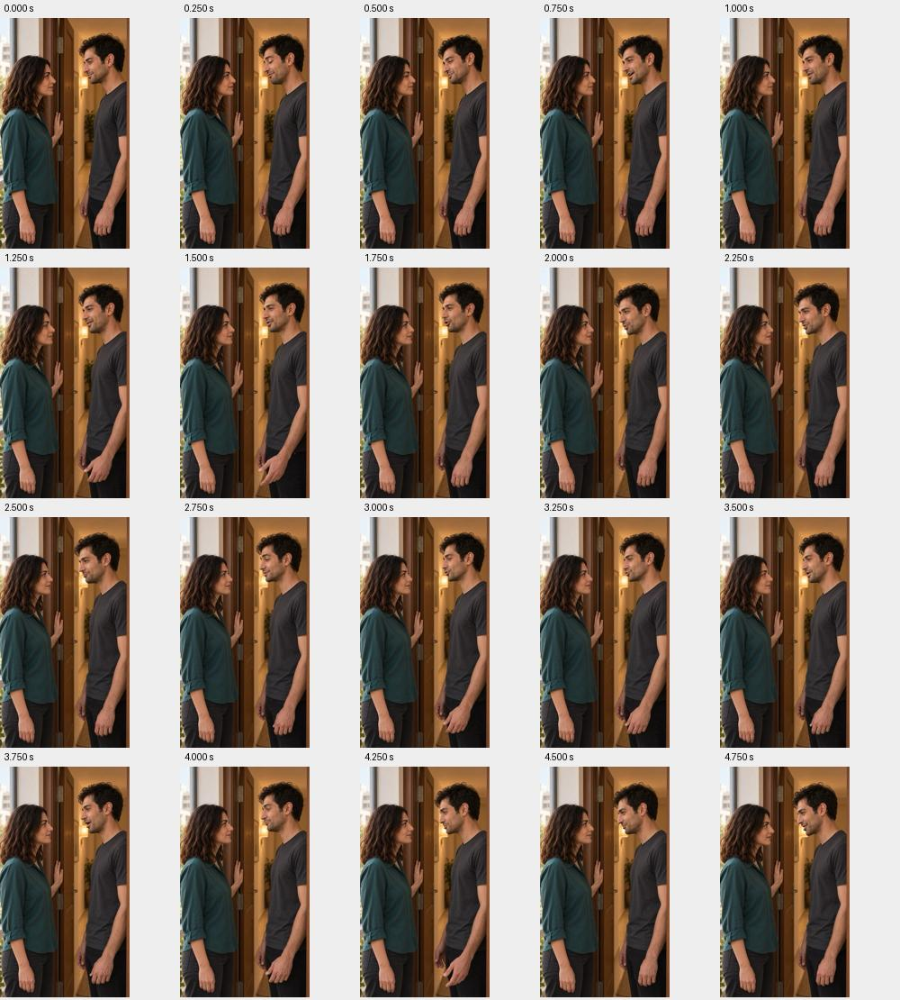
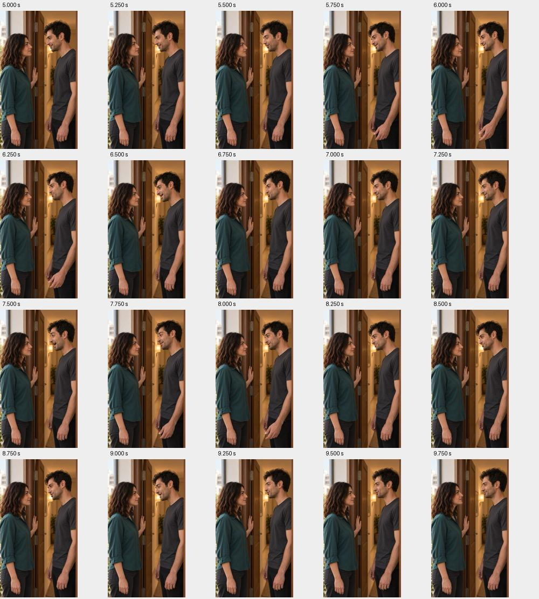
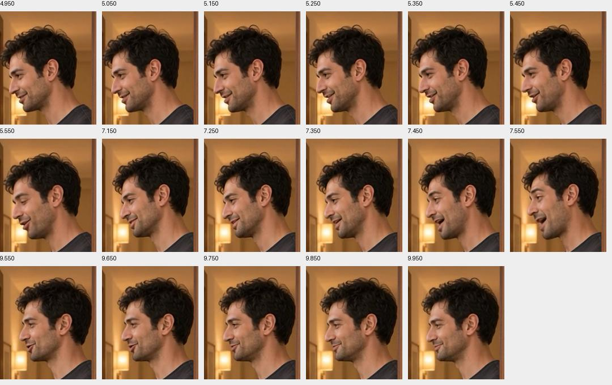

# برداشت۳ — نسخهٔ جمع‌وجور، ذخیره‌شده برای بازبینی

[پخش فایل اصلی](video.mp4) · [صفحهٔ نتیجه در Flow](https://flow.google.com/project/b375b947-7a79-4f37-bb43-0231a2960464/edit/6694979f-0e0e-4903-bdb7-fa4ea8f2d933) · [مجوز و سابقهٔ اجرا](pace-proposal-v2/execution.json) · [پرامپت استفاده‌شده](pace-proposal-v2/prompt.txt)

تنها یک تولید با قیمت نمایش‌داده‌شده۷کریدیت انجام شد؛ هیچ تلاش مجددی صورت نگرفت. برداشت با مجوز صریح تازهٔ کاربر از مسیر رسمی `Download media` و `360p Original size` دانلود و در همین پوشه ذخیره شد. مانع قبلی رد مجوز دانلود بود؛ مسیر دیگری برای دورزدن آن استفاده نشد.

فایل اصلی بدون تغییر کپی شد و اثرانگشت نسخهٔ دانلودی و نسخهٔ پروژه برابر است. ویدیو `360×640`، `24fps` و مدت مسیر تصویری۱۰ثانیه است؛ صدا نیز رمزگشایی شد. این کنترل فنی، تأیید کامل تلفظ، ریتم، پایان جمله یا لب‌خوانی نیست. فایل برای دیدن و شنیدن کاربر باز شد؛ پذیرش هنوز ثبت نشده است.

```text
SHA-256: f27bc84034384f469ebfd5dd4f5fd3b6f4031aae94614062fc977f9d50f816e1
```

برداشت منتخب همچنان۱ و تدوین جاری همچنان نسخهٔ۴ است؛ هیچ جایگزینی، تولید تازه یا هزینهٔ تازه انجام نشد. سابقهٔ رد مجوز اولیه در گزارش اجرا محفوظ است و اکنون رفع شده است.

## بازبینی محدودِ برداشت — ۲۰۲۶/۱۰/۱۴

درخواست فعلی فقط بررسی است؛ هیچ انتخاب تازه، جایگزینی یا تولیدی انجام نشده است. [شاهدهای ثبت‌شده](review-evidence/checks.json).

- کامل‌بودن دیالوگ، تلفظ، طبیعی‌بودن گفتار و هماهنگی آوایی لب: **بررسی نشده**؛ دسترسی شنیداری به محتوای فایل در این محیط فراهم نیست. متن پرامپت و سلامت صدا، شاهد اجرای کامل دیالوگ نیستند.
- تصویر: ۴۰ فریم با فاصلهٔ یک‌چهارم‌ثانیه بررسی شدند. در نمونه‌ها نگاه سامان رو به نازلی است؛ نگاه به لنز دیده نشد. لب‌های نازلی ظاهراً بسته‌اند. این نمونه‌برداری، کنترل تمام فریم‌ها یا هماهنگی دقیق لب با صدا نیست.
- بازی: حرکت‌های دست سامان تقریباً در ثانیه‌های۱٫۵،۳،۴٫۷۵،۶و۸ دیده می‌شوند؛ با دستور «بدون حرکت دست» اختلاف دارند. بدون مشاهدهٔ اجرای پیوسته همراه صدا، طبیعی‌بودن نهایی بازی تأیید نمی‌شود.
- صدا: قلهٔ دامنه حدود۰٫۷۷۱ است و نمونهٔ نزدیک سقف دامنه دیده نشد. نزدیک ثانیهٔ۵ افت تا نزدیک سکوت وجود دارد؛ نوع و محل زبانی این مکث بدون شنیدن مشخص نیست.

[](review-evidence/frames-1.jpg)

[](review-evidence/frames-2.jpg)

نتیجه: برداشت برای تأیید کامل گفتار و لب همچنان `unreviewed` است؛ تأیید یا رد نهایی صادر نشد. برداشت منتخب۱ و تدوین۴ محفوظ‌اند.

## تکمیل بررسی محلی صدا — ۲۰۲۶/۱۰/۱۴

راه بدون اعتبار اجرا شد: `mlx-whisper 0.4.3` با دو مدل محلی `whisper-turbo` و `whisper-small-mlx`؛ بدون متن راهنما یا ارائهٔ دیالوگ مصوب به مدل، زبان فارسی، دمای صفر و استخراج زمان واژه‌ها. فایل اصلی ارسال خارجی نشد؛ فقط ابزار و وزن‌های عمومی دانلود شدند. مدل کوچک خطاهای املایی و تشخیص بیشتری دارد و شاهد مستقلِ قطعی نیست.

### نتیجهٔ دیالوگ

- مدل اصلی هر سه جمله و واژهٔ پایانی را تشخیص داد. پایان «آشنا» حدود۹٫۶۲ثانیه است و۰٫۳۸ثانیه تا انتهای تصویر باقی می‌ماند. بنابراین شواهد تشخیص گفتار از کامل‌بودن پایان حمایت می‌کنند؛ این جای شنیدن تلفظ آخر را نمی‌گیرد.
- **مغایرت مشکوک:** در ثانیه‌های۳٫۲۶تا۳٫۵۶، متن مصوب «آشنا شُدَن» است، ولی مدل اصلی «آشنا شُدَم» تشخیص داده. مدل کوچک نیز «اشنا شودم» و بازشناسی مستقلِ برش۲٫۵تا۴٫۳ثانیه با مدل اصلی «آشنا شدم» ثبت کرده‌اند. احتمال تغییر فعل جدی است؛ آمیختگی آوایی با «با هَم» یا خطای مشترک تشخیص‌گر هنوز رد نشده است. ایراد قطعیِ شنیده‌شده ادعا نمی‌شود.
- زمان جمله‌ها از مدل اصلی:۰تا۴٫۹۴،۵٫۳۰تا۷٫۱۲ و۷٫۳۶تا۹٫۶۲ثانیه. زمان‌های واژه تخمینی‌اند؛ مرز دقیق سکوت و واج نیستند. هیچ حذف جملهٔ کامل در بازشناسی اصلی دیده نشد. طبیعی‌بودن لحن و ادای واژه‌ها همچنان نیازمند شنیدن است.

[متن و زمان‌های مدل اصلی](review-evidence/transcript-turbo.json) · [مدل دوم](review-evidence/transcript-small.json) · [تشخیص برش عبارت](review-evidence/transcript-phrase-turbo.json)

### نتیجهٔ هماهنگی لب

`SyncNet v2` روی نسخهٔ صرفاً تحلیلی با نمونه‌برداری۲۵فریم و صدای اصلی اجرا شد. دو محدودهٔ ثابت از صورت سامان، بدون تغییر زمان صدا، کنترل شدند. برآورد کل در هر دو برش منفی۰٫۵۶ثانیه بود، اما امتیاز اطمینان فقط۰٫۲۷و۰٫۳۷است و برآورد نیمه‌های کلیپ پایدار نیست. بنابراین خروجی عددی برای جابه‌جایی صدا یا اعلام ناهماهنگی قابل‌اتکا نیست. هماهنگی دقیق واج و لب **تأیید نشد و رد قطعی هم نشد**. هیچ جابه‌جایی زمانی روی منبع یا تدوین اعمال نشد.

[آزمون صورت با محدودهٔ بازتر](review-evidence/syncnet-wide.json) · [آزمون با محدودهٔ بسته‌تر](review-evidence/syncnet-tight.json)

[](review-evidence/pause-and-end-frames.jpg)

برای بازبینی شنیداریِ فعل، برش محلی۲٫۶۲تا۴٫۹۸ثانیه بدون تغییر سرعت/متن ساخته شد؛ این فایل فقط شاهد بررسی است و جایگزین برداشت یا تدوین نیست:


نتیجهٔ نهاییِ این مرحله: شواهد قوی‌تر برای وجود هر سه جمله و پایان کامل داریم، ولی فعل میانی مشکوک و هماهنگی دقیق لب حل‌نشده است. وضعیت پذیرش همچنان `unreviewed`؛ تولید تازه، مصرف اعتبار و جایگزینی ممنوع و انجام‌نشده‌اند.

روش‌ها: [مستندات تشخیص گفتار](https://github.com/ml-explore/mlx-examples/tree/main/whisper) و [مستندات هماهنگی صدا و تصویر](https://github.com/joonson/syncnet_python).

## پذیرش انسانی و استفاده در تدوین — ۲۰۲۶/۱۰/۱۴

کاربر گفت اجرای سکانس خوب است و صریحاً خواست برداشت اصلی۱۰ثانیه‌ای جایگزین قبلی شود. نتیجهٔ خودکار قبلی و محدودیت‌هایش سابقه‌اند؛ پذیرش بر اساس تأیید مستقیم کاربر است. فایل اصلی کامل از۰تا۱۰ثانیه در [خروجی کامل نسخهٔ۵](../../../../edit/v5/EP02-full-with-approved-SH03.mp4) استفاده شد؛ برش کوتاه بررسی وارد تدوین نشد.
