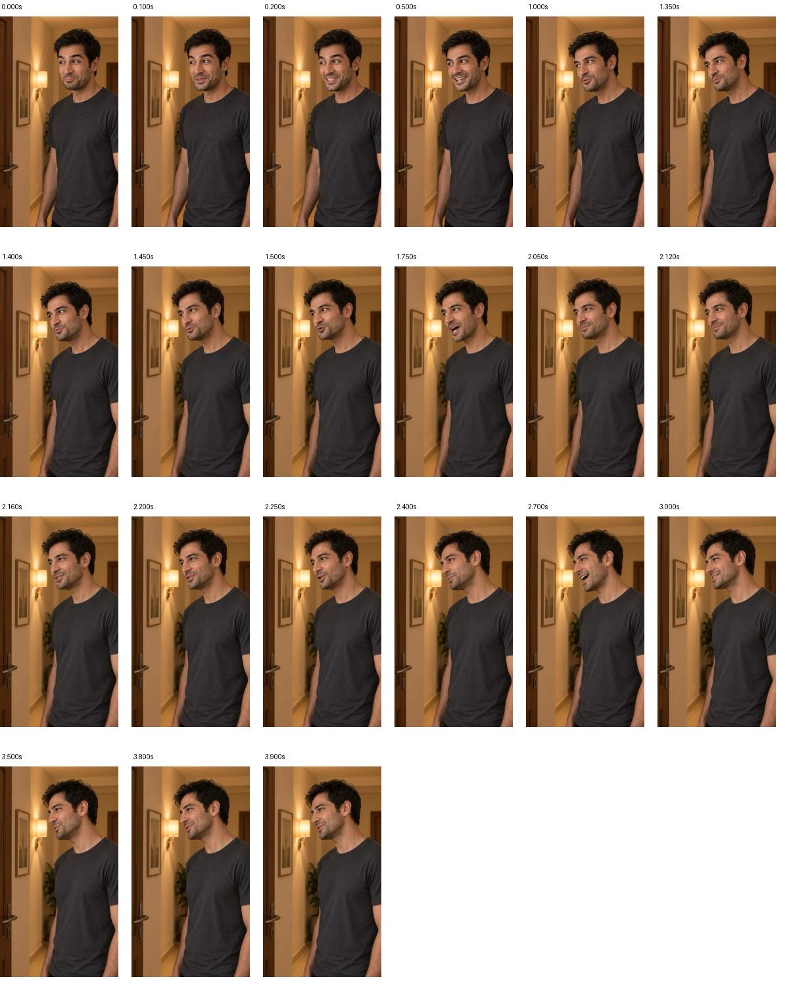

## وضعیت تازه — پذیرش کاربر و جایگزینی

در۲۰۲۶/۱۰/۱۴ کاربر همین نمونه را پذیرفت و جایگزینی در قسمت را خواست؛ در [نسخهٔ۴ تدوین](../../../../../../edit/v4/README.md) اعمال شد. گزارش زیر شرح آزمایش پیش از پذیرش است؛ محدودیت شنیدن مستقل دستیار همچنان برقرار است و پذیرش کامل قسمت هنوز ثبت نشده.

# آزمایش اصلاح محلی نمای۱۳ — ۲۰۲۶/۱۰/۱۴

وضعیت: نمونهٔ قابل‌مرور؛ پذیرش نهایی ندارد. اعتبار مصرف‌شده صفر؛ فقط فایل‌های موجود برداشت۷ و۸ استفاده شدند. انتخاب نما هنوز برداشت۲ است و تدوین کامل تغییر نکرد.

[پخش نمونهٔ۳٫۹۲ثانیه‌ای](EP02-SH13-local-repair-review.mp4) · [منابع و زمان‌ها](manifest.json) · [اسکریپت بازتولید محلی](render-local-repair.swift)

## نتیجهٔ بررسی امکان اصلاح

- نگاه به دوربین در مقدمهٔ هر دو برداشت، پیش از گفتار اصلی دیده شد؛ فریم۰٫۸ثانیهٔ برداشت۸ هنوز به سمت لنز است، در۱٫۰ثانیه جهت نگاه به سمت مخاطب برمی‌گردد. مقدمه تا۱٫۰ثانیه حذف شد. در۲۱فریم نمونهٔ تازه نگاه مستقیم به لنز تشخیص داده نشد؛ این داوری نمونه‌ای است، نه ادعای مشاهدهٔ تک‌تک فریم‌ها.
- برداشت۸ دنبالهٔ صوتی واقعی از حدود۴٫۰۴تا۵٫۵۹ثانیه دارد؛ این بخش سکوت یا فریم ثابتِ افزوده‌شده نیست. بین۳٫۱۶تا۳٫۹۹ثانیه سکوتی با انرژی میانگین `-85.75 dBFS` دارد و در نمونهٔ محلی حذف شد.
- مقایسهٔ موج صدا در پنجره‌های۰٫۱ثانیه‌ای در۱٫۱۵،۱٫۵،۲،۲٫۵و۲٫۷۵ثانیه، همبستگی حدود۰٫۹۵۶تا۰٫۹۸۹ در تأخیر صفر نشان داد. این شاهد شباهت زیاد بخش آغازینِ دو فایل است، نه اثبات کامل‌بودن کلمه یا یکسان‌بودن کل صدا.
- اتصال برداشت۷به۸ در۲٫۴۳ثانیه، داخل بخش کم‌صدا انتخاب شد؛ انرژی بازهٔ۲٫۴۰تا۲٫۴۶ثانیه در۷ حدود `-46.69 dBFS` و در۸ حدود `-48.56 dBFS` است. این برش وسط بخش پرانرژی انتخاب نشد؛ مرز واژه با شنیدن مستقیم تعیین نشده است.
- سرعت صدا و تصویر تغییر نکرد. بخش آغاز از۷ محفوظ ماند؛ صدای بخش‌های۸ با ضریب۱٫۲۰، حدود `+1.58 dB`، برای نزدیک‌کردن بلندی به۷ تنظیم شد. حفظ کامل میکس و حس اجرای مصوب هنوز نیازمند شنیدن است.

## محدوده‌های اعمال‌شده

| ترتیب | منبع | ورود/خروج در منبع؛ ثانیه | زمان در نمونه |
|---|---|---|---|
|۱| برداشت۷ |۱٫۰۰تا۲٫۴۳|۰تا۱٫۴۳|
|۲| برداشت۸ |۲٫۴۳تا۳٫۱۶|۱٫۴۳تا۲٫۱۶|
|۳| برداشت۸ |۳٫۹۹تا۵٫۷۵|۲٫۱۶تا۳٫۹۲|

هیچ نمای واکنش، تولید تازه، فریم ثابت، تغییر زیر و بمی یا سرعت‌دهی اضافه نشد. حذف مقدمه، مشکل نگاهِ آن بازه را با خود منابع حل می‌کند؛ دنبالهٔ برداشت۸ فقط یک راه محتمل برای پایان جمله است، نه پایانِ اصلاح‌شدهٔ تأییدشده.

## کنترل واقعی خروجی و موارد باز

فایل تازه با `AVFoundation` ساخته شد؛ صدا رمزگشایی و۲۱فریم شامل نقاط اتصال استخراج و مشاهده شدند. مدت فایل۳٫۹۲۰ثانیه و اندازهٔ `360×640` است؛ نرخ اسمی گزارش‌شده حدود `23.86fps` است و این نمونه خروجی نهایی با نرخ ثابت مصوب نیست. قلهٔ صوت حدود۰٫۵۵۶، معادل حدود `-5.1 dBFS`، و تعداد نمونه‌های با دامنهٔ حداقل۰٫۹۹۹ صفر است. این کنترل‌ها اثبات کیفیت شنیداری یا لب‌خوانی نیستند. هش دو منبع با گزارش‌های قبلی مطابق و منابع محفوظ‌اند.

شنیدن مستقیم با ابزار این گفتگو پشتیبانی نشد. بنابراین کامل‌بودن واژهٔ پایانی، نبود تکرار هجا، آهنگ پرسشی، یکدستی رنگ صدا، صدای اتصال، حفظ ریتم پسندیده و هماهنگی پیوستهٔ لب‌ها تأیید نشده‌اند. نمونه باید توسط کاربر پخش شود. اگر گفتار لازم در۸ هم ناقص یا نامناسب باشد، این تدوین ادعای بازسازی آن را ندارد.

پس از پذیرش شنیداری/بصری نمونه، اتصال به نماهای۱۲و۱۴ در تدوین تازه بررسی شود؛ این نمونه هنوز در قسمت جایگزین نشده و هیچ مجوز تولید هزینه‌دار ثبت نشده است.

