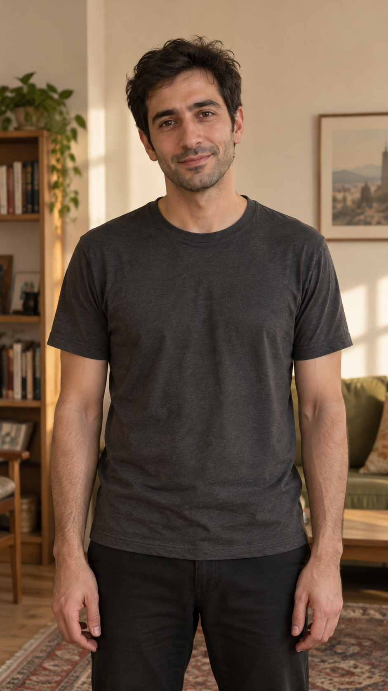
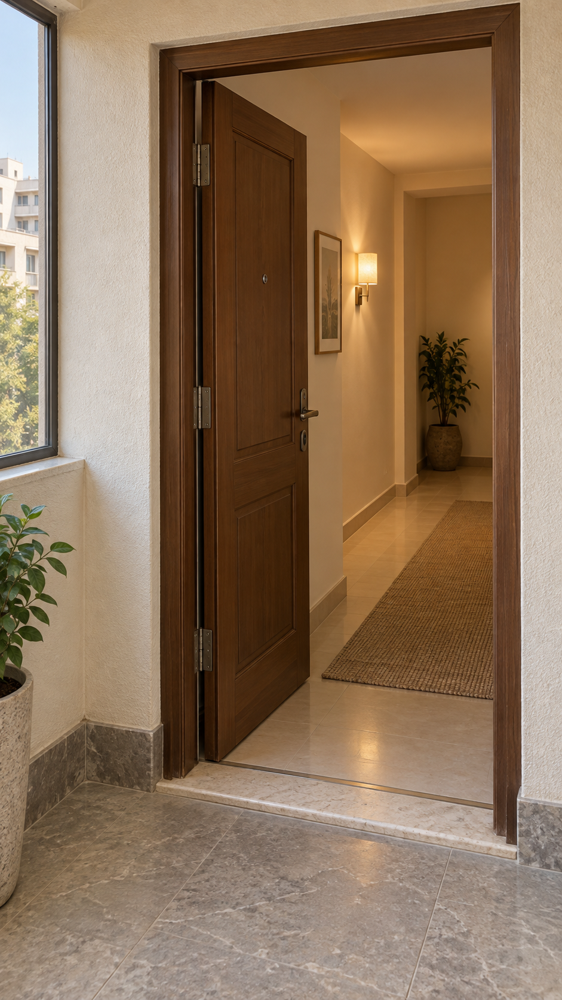
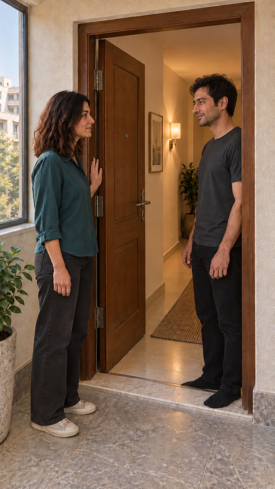

# تصویرهای مرجع قسمت دوم

ظاهر سامان، لباس و مکان توسط کاربر پذیرفته شدند؛ جای دست راست نازلی طبق درخواست کاربر در نسخهٔ ۲ اصلاح شد؛ هیچ ویدیو یا صدایی تولید نشده و اعتبار Flow مصرف نشده است.

## ۱. سامان — ظاهر پیشنهادی

ظاهر و لباس این مرحله پیشنهادی‌اند؛ پیراهن آبیِ دیالوگ برای آماده‌شدن بعدی است.

## ۲. پاگرد و در — مرجع هندسه

از پاگرد: لولا چپ، در به داخل نیمه‌باز؛ زاویهٔ واقعی تصویر مبناست و در طول گفتگو تغییر نمی‌کند.

## ۳. نازلی و سامان — چیدمان گفتگو

نازلی بیرون آستانه، سامان داخل؛ دست راست نازلی روی چهارچوبِ ثابتِ سمت لولا قرار دارد؛ دستگیره آزاد است و دست چپ کنار بدن. خبری از سینی/چای نیست. این قاب فقط مرجع چیدمان است؛ در تولید، مالکیت گفتار و لب هر نوبت جدا کنترل می‌شود.

[طرح دیالوگ و دوربین](review.md) ·

قدم بعد پس از تأیید: ساخت قاب‌های اختصاصی ۱۵ نما با همین هویت و هندسه، شامل نماهای روی شانه/نزدیک و قاب آغاز حرکت‌های کوتاه دوربین.

نسخهٔ فعال چیدمان v3 است: انگشت‌ها روی سطح بیرونیِ چوب قرار گرفته‌اند. در تولید حرکت، فاصله از شکاف لولا صریحاً حفظ و بازبینی شود.
