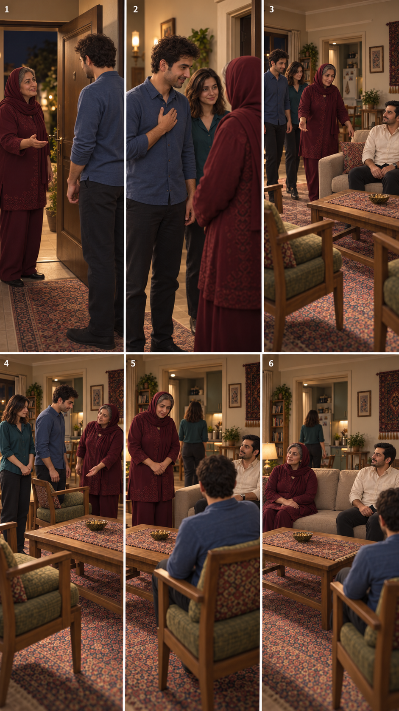
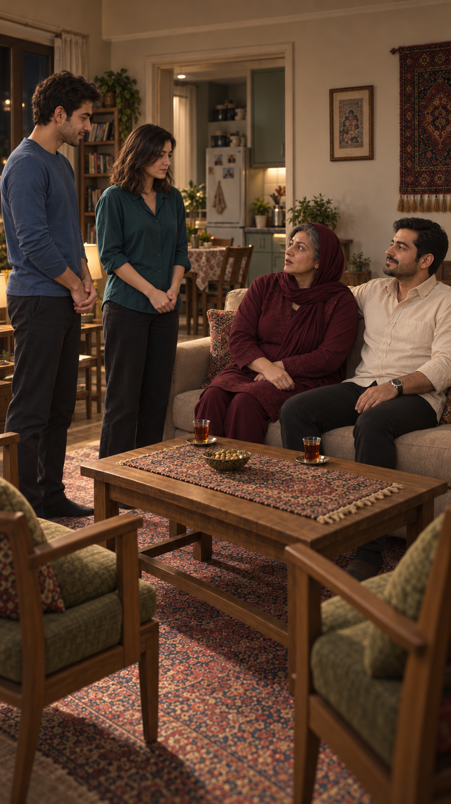
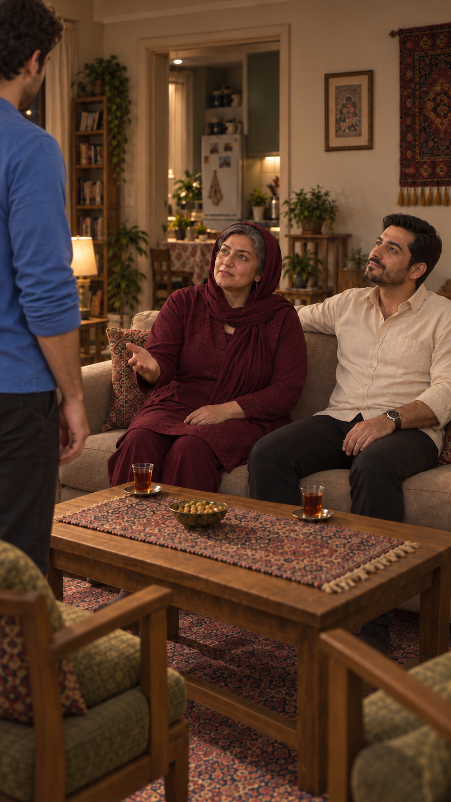
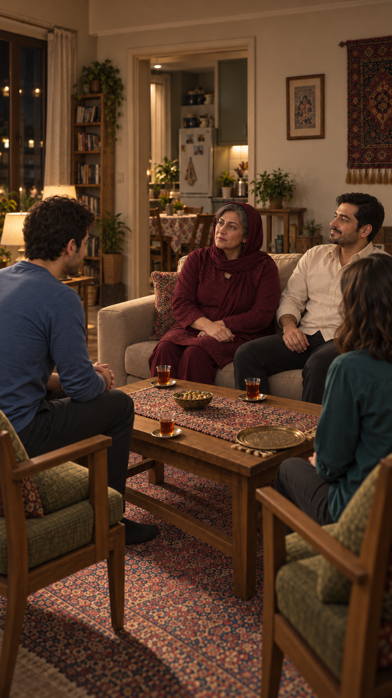
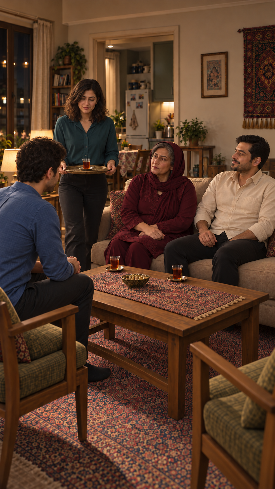
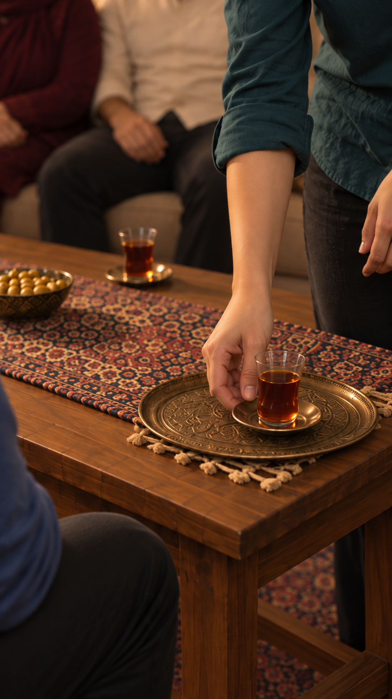
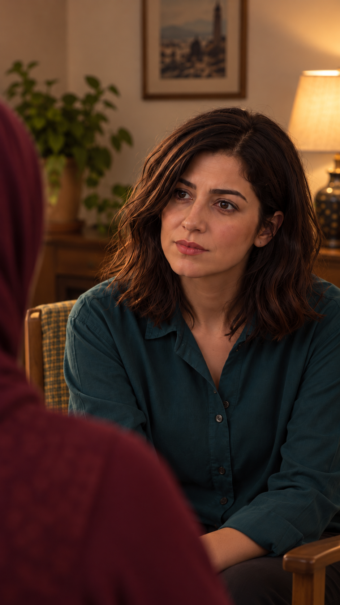

## اصلاح صریح تازهٔ نشستن — ۲۰۲۶/۱۰/۱۵

سامان، مادر نازلی و فرهاد هم‌زمان می‌نشینند؛ ترتیب قبلی مهمان‌اول لغو شد. سامان صندلی اصلی راست، مادر نشیمن چپ و فرهاد نشیمن راست کاناپه. دقیقاً دو صندلی تکی و یک کاناپه؛ صندلی سوم ممنوع. نازلی برای چای خارج قاب. `SH21` در `SH20` ادغام و غیرفعال شد؛ شمار کارت‌های فعال اکنون۲۰است، تعداد کلیپ‌های تولیدی مستقل است. تصویب این طرح مجوز هزینه نیست.

## اصلاح تازهٔ ورود — ترتیب تأییدشده

[ترتیب خوشامد، آشنایی، دست‌دادن و دعوت به صندلی](entry-revision-review.md). ترتیب با پیام تازهٔ کاربر تأیید شد: خوشامد و معرفی، برخاستن و دست‌دادن و گفتار متقابل، سپس دعوت همراه خوشامد دوم. متن دقیق و جهت بازی در کارت‌های مالک ثبت‌اند؛ نسبت خانوادگی مرجع حفظ شده. طرح بی‌گفتار قبلی برای تولید تازه معتبر نیست.

# خواستگاری ناخواسته

## وضعیت فعال — ۲۰۲۶/۱۰/۱۵

پنج قاب باقی‌مانده پذیرفته و به کارت‌ها متصل شدند؛ ترتیب طراحی۲۱نما فعال شد:۱۴گفتار و۷کنش/واکنش. [گالری فعال](frames.md) و [مرور اتصال و زمان‌گیری](continuity-and-timing-review.md) ملاک وضعیت جاری‌اند؛ مطالب قدیمی پایین سابقه‌اند و در تعارض مبنا نیستند. فقط یک استکان برای سامان، سینی خالی سمت نازلی، آجیل وسط؛ پیشنهاد قدیمی سه استکان اعمال نشود. حرکت/صدا/زمان واقعی و مجوز هزینه هنوز نداریم.

## بستن اصلاح واکنش و جمع‌بندی اجرایی

عکس واکنش نازلی نسخهٔ۳ با دستور صریح کاربر کفایت و پذیرفته شد؛ اصلاح بیشتر لب انجام نشود. [همین عکس](shots/EP03-SH18/images/EP03-SH18-reaction-v3.png) در کارت و گالری فعال شد. [پایان نسخهٔ۲](references/EP03-ending-storyboard-v2.png) دست مادر را اصلاح کرده؛ برای واکنش قاب۴، عکس مستقل ملاک است. [طرح کامل پیشنهادی](production-plan-v2.md): یک سکانس،۲۱نما شامل۱۴گفتار و۷کنش/واکنش، با تخمین۵۱٫۴ثانیه؛ هنوز تصویب شمار و زمان‌گیری واقعی نداریم. مجوز تولید ثبت نشده است.

## آماده‌سازی پایان قسمت — ۲۰۲۶/۱۰/۱۴

کاربر قاب‌های قصد سامان و پاسخ نازلی را پذیرفت؛ `SH10` نسخهٔ۴ و `SH11` نسخهٔ۳ به تصاویر فعال و گالری وصل شدند. [پیش‌نمایش چهارقابی پایان](references/EP03-ending-storyboard-v1.png) و [گزارش محدودیت‌ها](references/EP03-ending-storyboard-v1-review.md) برای مرور آماده‌اند: سؤال اطلاع مادر سامان، پاسخ او، دعوت آینده و واکنش خاموش نازلی. ژست دستِ تازهٔ مادر در قاب۳ و لبِ اندکی باز نازلی در۴ هنوز برای اجرای مستقل نیازمند تعیین/اصلاح‌اند. ویدیو و زمان‌گیری انجام نشده؛ متن مصوب محفوظ است.

## قصد سامان و واکنش نازلی — ۲۰۲۶/۱۰/۱۴

قاب پاسخ نازلی نسخهٔ۴ و پرسش مادر نسخهٔ۳ با تأیید کاربر به تصویر فعال کارت‌ها و گالری وصل شدند. [قصد ازدواج سامان](shots/EP03-SH10/images/EP03-SH10-intent-v4.png) و [واکنش نازلی خطاب به مادر](shots/EP03-SH11/images/EP03-SH11-brake-v3.png) اکنون برای مرور پیشنهادی‌اند. نقش صندلی سامان اصلاح شد؛ مدل دقیق نعلبکی و اتصال هندسهٔ نمای مقابل هنوز باز است. ادامهٔ روایت: سؤال مادر دربارهٔ اطلاع مادر سامان، پاسخ صادقانهٔ سامان و دعوت برای دیدار آینده. متن مصوب تغییر نکرد؛ ویدیو تولید نشده است.

## پاسخ نازلی و پرسش مادر — ۲۰۲۶/۱۰/۱۴

قاب‌های گذاشتن چای `SH17` نسخهٔ۴ و جمع نشسته `SH07` نسخهٔ۳ با «خب خوبه. پس برو به قدم بعدی» پذیرفته و به کارت/گالری فعال وصل شدند؛ پذیرش حرکت یا مجوز ویدیو نیست. [پاسخ نازلی `SH08`](shots/EP03-SH08/images/EP03-SH08-reply-v3.png) و [پرسش مادر `SH09`](shots/EP03-SH09/images/EP03-SH09-direction-v3.png) اکنون پیشنهادی‌اند. در قاب نازلی پارچهٔ صندلی ناسازگار است و هندسهٔ نمای معکوس و جای استکان هنوز نیازمند تطبیق‌اند؛ این قاب آمادهٔ تولید نیست. ادامهٔ روایت پس از این دو نوبت: اعلام قصد ازدواج سامان، مشروط به خواست نازلی. متن۱۴ نوبت بازنویسی نشد.

## آماده‌سازی تماس چای و استقرار نازلی — ۲۰۲۶/۱۰/۱۴

قاب برگشت چای `SH16` نسخهٔ۵ با «خوبه، برو جلو» پذیرفته و در کارت به‌عنوان تصویر فعال وصل شد. اکنون [نمای نزدیک چای `SH17`](shots/EP03-SH17/images/EP03-SH17-serving-close-v4.png) و [نمای جمع نشسته `SH07`](shots/EP03-SH07/images/EP03-SH07-seated-after-tea-v3.png) برای مرور آماده‌اند. [گزارش تماس و نسخهٔ ردشده](shots/EP03-SH17/appearance-review-v4.md) و [گزارش استقرار و سؤال فرهاد](shots/EP03-SH07/appearance-review-v3.md). یک نسخهٔ متوسط به علت مبل خالی رد شد و استفاده نشود. ترتیب: برگشت با سینی، قرارگرفتن سینی، گذاشتن نعلبکی، رهاکردن دست و نشستن نازلی، سپس سؤال فرهاد. حرکت این اتصال و زمان واقعی هنوز تولید/بررسی نشده‌اند؛ عکس‌های تازه و مجوز ویدیو در انتظارند.

## گام تازهٔ قاب مستقل برگشت چای — ۲۰۲۶/۱۰/۱۴

[نسخهٔ۵ قاب برگشت چای](shots/EP03-SH16/images/EP03-SH16-tea-return-spacing-v5.png) جایگزین پیشنهادی قاب۳ صفحهٔ ادامه است؛ [تطبیق هر شخصیت و اتصال قبل/بعد](shots/EP03-SH16/appearance-review-v5.md). سمت پنجره اصلاح شد و فاصله و پوشش سر حفظ شدند؛ قبول کل قسمت یا مجوز تولید نیست. ترتیب اتصال: پایان گفتار سامان در `SH06`، برگشت چای در `SH16`، تماس نعلبکی و نشستن نازلی در `SH17`، سپس سؤال فرهاد در `SH07`. عکس مستقل هنوز منتظر مرور کاربر است. دیگر نماهای مستقل و زمان‌گیری۱۴ نوبت هنوز تکمیل نشده‌اند.

## مرور پوشش سر اصلاح‌شده — ۲۰۲۶/۱۰/۱۴

به درخواست کاربر پوشش سر مادر در سه پیش‌نمایش جاری قسمت۳ به یک روسری زرشکی بدون پوشش داخلی و با کمی موی جلوی سر نمایان اصلاح شد. [ورود نسخهٔ۵](references/EP03-arrival-storyboard-v5.png)، [ادامه نسخهٔ۲](references/EP03-continuation-storyboard-v2.png) و [عکس مستقل جایگزین قاب۳](shots/EP03-SH16/images/EP03-SH16-tea-return-spacing-v4.png) برای مرورند؛ [گزارش و محدودیت‌ها](references/EP03-mother-scarf-review.md). پذیرش ورود نسخهٔ۴ مربوط به اتفاق و چیدمان قبلی است؛ ظاهر اصلاح‌شده هنوز نیازمند پذیرش است. قاب۳ صفحهٔ ادامه همچنان از نظر فاصله رد است و عکس مستقل جایگزین آن مرور شود؛ اختلاف پنجره در عکس مستقل همچنان باز است.

## اصلاح هدفمند قاب سوم ادامه — ۲۰۲۶/۱۰/۱۴

کاربر چسبیدن مادر و فرهاد در قاب۳ صفحهٔ ادامه را رد کرد. [عکس مستقل اصلاح‌شده](shots/EP03-SH16/images/EP03-SH16-tea-return-spacing-v3.png) برای مرور آماده است؛ [گزارش مالک](shots/EP03-SH16/image-review-spacing-v3.md). صفحهٔ اصلی هشت‌قابی هنوز قاب۳ قدیمی را دارد؛ برای این لحظه عکس مستقل را مرور کنید. فاصلهٔ معمولی و بدن‌های مستقل دیده می‌شود؛ پذیرش هنوز در انتظار و هندسهٔ پنجره ناسازگار است. سایر قاب‌ها در این نوبت تغییر نکردند.

## پذیرش شروع و ورود به مرور ادامه — ۲۰۲۶/۱۰/۱۴

کاربر پیش‌نمایش ورود نسخهٔ۴ را پذیرفت و خواست مرحلهٔ بعد شروع شود. [صفحهٔ ورود پذیرفته‌شده](references/EP03-arrival-storyboard-v4.png) مرجع بصری ادامه است؛ پذیرش تصویر، تأیید حرکت و مجوز ویدیو نیست. [ادامهٔ هشت‌قابی پیشنهادی](references/EP03-continuation-storyboard-v1.png) با همان چیدمان و لباس تهیه شد و منتظر مرور است. [نگاشت به نماها و موارد باز](references/EP03-continuation-storyboard-v1-review.md). متن۱۴ نوبت تغییر نکرده؛ شمار نهایی نماها و زمان واقعی هنوز قطعی نیستند.

## جهت فعال تازهٔ استقبال و فاصلهٔ نشستن — ۲۰۲۶/۱۰/۱۴

این تصمیم‌های تازه بر پیشنهادهای قبلیِ نشیمن خالی میان مادر و فرهاد و نشسته‌ماندن فرهاد هنگام ورود مقدم‌اند. کاناپه دو نفره با مادر وسط نشیمن چپ و فرهاد وسط نشیمن راست، فاصلهٔ معمولی بدون چسبیدن و بدون یک جای خالی میانی. فرهاد با ورود سامان بلند می‌شود، ایستاده دست می‌دهد و پس از نشستن سامان به همان جای خود برمی‌گردد. مادر نیز بعد از مهمان می‌نشیند. لباس زرشکی مادر با برش خوش‌دوخت و اندازهٔ طبیعی اصلاح شود؛ نمونهٔ عکس هنوز نیازمند پذیرش است.

[مرور و محدودیت‌ها](references/EP03-arrival-storyboard-v4-review.md). صفحهٔ هشت‌قابی شامل ورود، سلام، برخاستن فرهاد، دست‌دادن، دعوت، نشستن سامان، نشستن فرهاد و نشستن مادر است؛ این هشت قاب به معنی تعداد نهایی نماهای قسمت نیست. قاب۶ جای فرهاد را نشان نمی‌دهد؛ هندسه و پذیرش لباس هنوز بازند. کارت‌های تولید و انتخاب برداشت تغییر نکرده‌اند؛ هیچ ویدیویی تولید نشده. مطالب پایین سابقهٔ تصمیم‌های قبلی‌اند و در موارد متعارض مبنای ادامه نیستند.

## اصلاح تازهٔ جهت ورود و نشستن — ۲۰۲۶/۱۰/۱۴

وضعیت: پیشنهادی برای مرور، انتخاب رسمی نماها تغییر نکرد. [ورودی اصلاح‌شده، قاب۱و۲](references/EP03-arrival-storyboard-v2.png) و [پذیرایی تازه، قاب۳تا۶](references/EP03-seating-storyboard-v1.png) مبنای مرور تازه‌اند؛ قاب۳تا۶ در صفحهٔ ورود همچنان طرح قبلی‌اند. [گزارش اصلاح و محدودیت‌ها](references/EP03-arrival-revision-review.md). مادر داخل و مهمان بیرون آستانه؛ فرهاد ثابت سمت راست مبل؛ سامان ابتدا روی صندلی مقابل او، سپس مادر سمت چپ همان مبل با جای خالی میانی می‌نشیند. مسیر نازلی به آشپزخانه و هندسهٔ دقیق هنوز نیازمند اصلاح‌اند. پذیرش نهایی ثبت نشده است.

## پیش‌نمایش تازهٔ استقبال — ۲۰۲۶/۱۰/۱۴

وضعیت: پیشنهادی، نه قاب فعال تولید. [گزارش ایرادها](references/EP03-arrival-storyboard-v1-review.md). دستور تازهٔ کاربر: اول سامان بنشیند، سپس مادر؛ مادر و فرهاد با یک جای خالی میانشان روی دو سر مبل باشند. ترتیب کنش‌ها در صفحه نشان داده شد؛ فضای پشت در در قاب۱ و اتصال صندلی در۴تا۶ هنوز نیازمند اصلاح‌اند. این درخواست جای دستور قبلیِ توقف ساخت عکس را برای همین پیش‌نمایش گرفته است؛ مجوز تولید ویدیو یا مصرف اعتبار خارجی نیست.

## پیشنهاد چیدمان و ترتیب ورود تا نشستن — ۲۰۲۶/۱۰/۱۴

وضعیت: پیشنهادی برای مرور کاربر؛ اصل استقبال و صندلی سامان روبه‌روی فرهاد از قبل مصوب است. هیچ عکس، ویدیو یا دیالوگ تازه تولید نشده و ترتیب فنی کارت‌ها هنوز تغییر نکرده است.

### جای افراد

جهت چپ و راست در این طرح از پشت دو صندلی مهمان و رو به مبل تعریف می‌شود؛ جهت جغرافیایی خانه نیست.

| شخصیت | دم در و مسیر ورود | پایان استقرار در پذیرایی |
|---|---|---|
| مادر نازلی | داخل آستانه ایستاده؛ رو به سامان؛ پس از سلام جلوتر راهنمایی می‌کند | کنار صندلی سامان دعوت می‌کند؛ پس از نشستن مهمان، سمت چپ مبل کنار فرهاد می‌نشیند |
| سامان | در آستانه روبه‌روی مادر؛ پس از استقبال او را دنبال می‌کند | صندلی سمت راست، دقیقاً روبه‌روی فرهاد؛ از کنار صندلی نزدیک می‌شود و از روی میز عبور نمی‌کند |
| نازلی | کنار سامان با فاصله‌ای که صورت و مسیر مادر را نپوشاند؛ همراه او وارد می‌شود | کنار صندلی سمت چپ، روبه‌روی جای مادر؛ پس از پاسخ به درخواست چای به آشپزخانه می‌رود؛ جای نشستن او برای بازگشت محفوظ است |
| فرهاد | در دم در حضور ندارد؛ از قبل در پذیرایی است | سمت راست مبل می‌ماند و ورود جمع را دنبال می‌کند |

میز بین مبل و صندلی‌هاست؛ دسترسی سامان به چای و گذر نازلی کنار میز حفظ شود. آشپزخانه همان فضای دارای یخچال در تصاویر است؛ این دهانه در ورودی خانه تلقی نشود. در واقعی ورودی و اتصال مسیر آن به پذیرایی در عکس‌های مرورشده دیده نشده‌اند و پیش از طراحی قاب ورود باید تثبیت شوند. هندسه، سمت لولا و جهت حرکت در هنوز بررسی نشده‌اند.

### پنج نما برای مرور — تعداد و زمان هنوز مصوب نیست

| ترتیب پیشنهادی | شناسهٔ محفوظ | قاب و دوربین | ابتدا، کنش و انتها | زمان تخمینی |
|---|---|---|---|---|
| ۱ | `EP03-SH01` | متوسط مادر در دم در، ثابت؛ بخشی از سامان در حاشیه | مادر ایستاده؛ شناختن و استقبال با نوبت اول متن مصوب؛ سامان و نازلی ساکت، فرهاد در پذیرایی خارج قاب |۳–۴ثانیه|
| ۲ | `EP03-SH02` | متوسط سامان از سمت مادر، ثابت؛ محور مشترک با نمای۱ | پاسخ و سلام با نوبت دوم؛ نگاه به مادر ایستاده، بدون خط نگاهِ مادر نشسته؛ نازلی خاموش |۲–۳ثانیه|
| ۳ | `EP03-SH15` | باز مورب پذیرایی، ثابت؛ مبل، دو صندلی و مسیر باز کنار میز دیده شوند | مادر جلو و سامان/نازلی پشت او وارد می‌شوند؛ فرهاد نشسته؛ پایان کنار صندلی سامان؛ تمام مسیر راهرو نمایش داده نمی‌شود |۱٫۵–۲٫۵ثانیه|
| ۴ | `EP03-SH03` | متوسط مادر ایستاده، ثابت؛ صندلی مقصد قابل‌فهم | دعوت به نشستن و درخواست چای با همان نوبت سوم؛ نگاه ابتدا سامان سپس نازلی؛ اشارهٔ کوچک به صندلی سمت راست؛ همهٔ شنونده‌ها خاموش |۳–۴ثانیه|
| ۵ | `EP03-SH04` | متوسط باز نازلی و سامان، ثابت؛ صندلی سامان دیده شود | نازلی نوبت چهارم را می‌گوید؛ سپس به سمت آشپزخانه خارج می‌شود و سامان با خم‌شدن و تماس واقعی با صندلی می‌نشیند؛ مادر هنوز ایستاده؛ پایان، سامان مستقر است |۳–۴٫۵ثانیه|

جمع اولیه۱۲٫۵تا۱۸ثانیه است؛ زمان‌گیری واقعی نیست. شماره‌های شناسه ثابت می‌مانند؛ ترتیب پیشنهادی با فهرست قبلی فرق دارد و تا پذیرش در بلوک‌های انتخاب اعمال نشود. نمای بعدی باید مادر را پس از نشستن نشان دهد؛ در صورت نامفهوم‌شدن این گذار، پایان نمای۵ تنظیم شود، نه اینکه نشستن بی‌علت فرض شود. مالک گفتار در هر نما فقط گویندهٔ همان نوبت است. مادر از کنار صندلی‌ها به سمت آزاد مبل می‌رود؛ مسیر دقیق و نبود برخورد با مهمان و میز هنوز نیازمند نقشهٔ واقعی است.

### تطبیق عکس‌های موجود

نامناسب برای شروع جدید: مادر نشسته و مهمان‌ها ایستاده‌اند؛ استقبال و راهنمایی دیده نمی‌شوند. وسایل و ظاهر خانه می‌توانند مرجع بمانند، ولی وضعیت بدن‌ها باید بازطراحی شود.

نامناسب برای دعوت تازه: مادر باید ایستاده و صندلی مقصد سامان روشن باشد. [قاب سلام مادر](shots/EP03-SH01/images/EP03-SH01-start-v3.png) نیز همین ناسازگاری را دارد. [پاسخ سامان](shots/EP03-SH02/images/EP03-SH02-start-v4.png) با پس‌زمینهٔ پذیرایی و مادر نشسته ساخته شده؛ جای گفتگو و محور نگاه آن برای دم در معتبر نیست. [پاسخ نازلی](shots/EP03-SH04/images/EP03-SH04-start-v2.png) فقط نمای نزدیک اوست؛ برای نشان‌دادن هم‌زمان خروج او و نشستن سامان قاب کافی نیست.

سامان در این عکس مقابل مادر است، نه مقابل فرهاد؛ جای سامان و صندلی محفوظ نازلی باید با طرح تازه هماهنگ شود. عکس بعد از پذیرایی است: سه استکان دارد؛ برای پایان بخش ورود، چای سامان هنوز آورده نشده است. عکسِ صحیحِ دم در، همراهی مادر و پایان نشستن با چیدمان تازه: در انتظار تهیه، پس از تثبیت طرح و مجوز مستقل تولید.

## اصلاح مصوب استقبال و جای نشستن — ۲۰۲۶/۱۰/۱۴

این تصمیم تازهٔ کاربر بر چیدمان آغازِ نسخهٔ قبلی مقدم است. اصل استقبال و جای سامان تأییدشده است؛ تعداد و ترکیب نماهای تازه هنوز پیشنهادی‌اند. متن دیالوگ‌های مصوب در این نوبت بازنویسی نشده است.

۱. مادر نازلی از جای خود بلند می‌شود و به دم در می‌رود؛ هنگام استقبال از سامان ایستاده است. نازلی همراه سامان وارد می‌شود. فرهاد از قبل در پذیرایی نشسته است.
۲. مادر در دم در از سامان استقبال می‌کند و سامان و نازلی را به پذیرایی راهنمایی می‌کند. جای سلام و شناختن همسایه در این مرحله است؛ طرح قبلیِ خطابِ مادر نشسته به مهمان ایستاده مبنای ادامه نیست.
۳. مادر در پذیرایی سامان را به نشستن روی صندلی روبه‌روی فرهاد دعوت می‌کند. اتصال دعوت به نشستن باید روشن باشد. نقشهٔ جای نازلی، جای مادر پس از استقبال، دوربین و مسیر دسترسی به میز و چای در بازطراحی مشخص می‌شوند؛ هنوز تصویب‌شده تلقی نشوند.
۴. پس از استقرار مهمان، پذیرایی و گفتگوی اصلی ادامه می‌یابند. نمایش تمام قدم‌ها لازم نیست؛ برش کوتاه فقط با حفظ استقبال، راهنمایی، دعوت و نتیجهٔ نشستن مجاز است.

**اثر بر فایل‌ها:** قاب‌های آغازین و آزمون قبلی بر مبنای چیدمان مادرِ نشسته ساخته شده‌اند و برای شروع تازه قابل پذیرش نیستند. نماهای `SH15` و `SH01` تا `SH04` نیازمند بازطراحی‌اند؛ تعداد نهایی نماها هنوز۱۸ اعلام نشود. قاب‌های بعدی و مرجع نشسته نیز باید با صندلی سامان روبه‌روی فرهاد تطبیق داده شوند. پذیرش تاریخی تصاویر، تأیید چیدمان تازه نیست.

نوبت بعد ابتدا نقشهٔ اتفاق‌ها و چیدمان تازه با کاربر مرور شود، سپس عکس‌ها به ترتیب روایت بررسی شوند. فعلاً تولید جدید انجام نشود.

**وضعیت فعلی:** [نسخهٔ سوم پیشنهادی](#dialogue-revision-v3) با اصلاح D08 در ۲۰۲۶/۱۰/۱۴ از نظر متن به تأیید کاربر رسید؛ طرح نما و جهت بازی با دستور کاربر برای ساخت قاب‌ها در ۲۰۲۶/۱۰/۱۴ تأیید شد؛ کاربر۱۷ قاب دیگر را پذیرفت؛ نسخهٔ۳ SH01 برای تأیید تازه آماده است. دو نسخهٔ قدیمی پایین فقط سابقه‌اند؛ کارکرد، کنش، دستور بازی و پایان آن‌ها برای تولید معتبر نیست. ۱۸ قاب اختصاصی و یک مرجع نشسته ساخته شد؛ پرامپت‌های تصویر در گزارش تولید ثبت‌اند. ویدیو، صوت و پرامپت تولید ویدیو ساخته نشده است.  تأییدشده است؛ [گالری قاب‌های نامزد](frames.md) برای مرور تصویری آماده است. [تحلیل وابستگی‌های داستان](story-review.md).

### قاب‌های فضایی و بی‌گفتار ساخته‌شده

حفظ شود: هویت، لباس، هندسهٔ خانه، جای دو ردیف نشیمن و وضعیت چای/سینی. فقط مرجع است: حالتِ لحظه‌ای صورت و نورِ قاب ثابت تضمین‌کنندهٔ حرکت یا بازی ویدیویی نیست. ۱۷ قاب اختصاصی پذیرفته شدند؛ فقط نسخهٔ تازهٔ SH01 منتظر تأیید است. مرجع نشسته صرفاً مرجع چیدمان است. نسخه‌های کنارگذاشته‌شده در  ثبت‌اند و ورودی فعال تولید نباشند.

## نسخهٔ سوم — دیدار اولیهٔ محترمانه؛ متن و طرح اجرای مصوب

تاریخ: ۲۰۲۶/۱۰/۱۴. وضعیت **متن هر۱۴ نوبت: تأییدشده توسط کاربر، با حذف نام فرهاد از پایان D08**. وضعیت **جهت بازی: تأییدشده با دستور ساخت قاب‌ها در ۲۰۲۶/۱۰/۱۴؛ پذیرش تصویر و برداشت جداست**. تأیید متن به معنی تأیید جداگانهٔ بازی، صدا یا برداشت نیست. توضیحات بازی دستور اجرا هستند و خوانده نشوند. بازه‌های گفتار پس از زمان‌گیری مشخص می‌شوند؛ هیچ هم‌پوشانی یا تندکردن مصنوعی گفتار طراحی نشده است.

کارکرد پیشنهادی: سامان برای نخستین بار مقابل خانواده علاقه و قصد جدی خودش را بیان می‌کند، بدون تصمیم‌گرفتن به‌جای نازلی. مادر خواستار آشنایی با مادر سامان می‌شود؛ قبولِ صحبت‌کردن دربارهٔ این درخواست، اجرای یک‌شبه را در خطر ادامه‌پیداکردن قرار می‌دهد. دیدار هنوز مراسم نامزدی یا توافق ازدواج نیست؛ شوخی، حلقه، جعبه و تناقض ساختگیِ مدت آشنایی وجود ندارند.

### وضعیت اجرا و پیوستگیِ پیشنهادی

- شبِ روز اول، همان پذیرایی؛ سامان با لباس دیدارِ ثبت‌شده آمده است. سلام و شناختن او نزدیک شروع دیدار اتفاق می‌افتد. ورود از در و نشستن کامل در صورت نداشتن کارکرد روایی حذف شوند؛ هندسه و وضعیت نشستهٔ نماهای بعد ثابت بماند.
- مادر، فرهاد و جای خالی مهمان در چیدمان روشن‌اند؛ جای صندلی‌های سامان و نازلی روبه‌روی مبل و نقشهٔ پیشنهادی در طرح دوربین ثبت شد؛ قاب بازِ آغاز و مرجع نشسته ساخته و بصری بررسی شدند؛ پذیرش کاربر هنوز در انتظار است. فرهاد به‌عنوان پسرخاله و رقیبِ ازقبل‌حاضر در جمع است؛ سامان گفتگو را عمدتاً با مادر پیش می‌برد.
- چای سامان از قبل جلوی او نیست. پس از D04 نازلی به آشپزخانه می‌رود. D05 و D06 میان مادر و سامان اجرا می‌شوند؛ نازلی در آشپزخانه خارج قاب و ساکت است. شنیدن کامل این دو جمله توسط نازلی فرض نشود.
- پس از پایان D06، نازلی با سینی و یک استکان چای با نعلبکی برمی‌گردد؛ آن را جلوی سامان و در دسترس او می‌گذارد. سینی خالی روی بخش مشخص دیگری از میز گذاشته شود و دست‌ها آزاد شوند؛ جای دقیق و دست حامل در طرح دوربین مشخص شد: سینی ابتدا با هر دو دست روی میز، سپس نعلبکی با دست راست به جلوی سامان منتقل می‌شود. D07 پس از قرارگرفتن ایمن چای شروع شود؛ کل مسیر رفت‌وبرگشت لازم نیست نمایش داده شود، اما تماسِ گذاشتن و وضعیت بعد قابل‌فهم باشند.
- برای حفظ سه استکان مرجع، پیشنهاد این است که مادر و فرهاد هر کدام از قبل یک استکان داشته باشند و استکان سوم برای سامان آورده شود؛ نازلی هنوز برای خودش چای نیاورده است. این تقسیم و نقشهٔ میز هنوز نیازمند تصویب‌اند. هیچ استکان یا نعلبکی هنگام برش ظاهر یا حذف نشود.
- در نوبت‌های گفتار فقط گوینده مالک صدا و لب‌خوانی است. طبق طرح دوربین، برخی شنونده‌ها به‌صورت پشت سر/شانه یا در حاشیهٔ قاب دیده می‌شوند و ساکت‌اند. جزئیات حضور آن‌ها کنار هر نوبت ثبت شد؛ شناسه‌های SH01 تاSH14 حفظ و چهار نمای بی‌دیالوگ SH15 تاSH18 افزوده شدند. اندازه، زاویه، حرکت و بازی در طرح تأیید شدند؛ قاب‌های واقعی نامزدند و حرکت هنوز تولید نشده است.

### EP03-D01

[متن مصوب، بازی و فایل‌های EP03-SH01](shots/EP03-SH01/shot.md#v3-ep03-d01)

### EP03-D02

[متن مصوب، بازی و فایل‌های EP03-SH02](shots/EP03-SH02/shot.md#v3-ep03-d02)

### EP03-D03

[متن مصوب، بازی و فایل‌های EP03-SH03](shots/EP03-SH03/shot.md#v3-ep03-d03)

### EP03-D04

[متن مصوب، بازی و فایل‌های EP03-SH04](shots/EP03-SH04/shot.md#v3-ep03-d04)

### EP03-D05

[متن مصوب، بازی و فایل‌های EP03-SH05](shots/EP03-SH05/shot.md#v3-ep03-d05)

### EP03-D06

[متن مصوب، بازی و فایل‌های EP03-SH06](shots/EP03-SH06/shot.md#v3-ep03-d06)

### EP03-D07

[متن مصوب، بازی و فایل‌های EP03-SH07](shots/EP03-SH07/shot.md#v3-ep03-d07)

### EP03-D08

[متن مصوب، بازی و فایل‌های EP03-SH08](shots/EP03-SH08/shot.md#v3-ep03-d08)

### EP03-D09

[متن مصوب، بازی و فایل‌های EP03-SH09](shots/EP03-SH09/shot.md#v3-ep03-d09)

### EP03-D10

[متن مصوب، بازی و فایل‌های EP03-SH10](shots/EP03-SH10/shot.md#v3-ep03-d10)

### EP03-D11

[متن مصوب، بازی و فایل‌های EP03-SH11](shots/EP03-SH11/shot.md#v3-ep03-d11)

### EP03-D12

[متن مصوب، بازی و فایل‌های EP03-SH12](shots/EP03-SH12/shot.md#v3-ep03-d12)

### EP03-D13

[متن مصوب، بازی و فایل‌های EP03-SH13](shots/EP03-SH13/shot.md#v3-ep03-d13)

### EP03-D14

[متن مصوب، بازی و فایل‌های EP03-SH14](shots/EP03-SH14/shot.md#v3-ep03-d14)

### پایان و اتصال پیشنهادی

پس از دعوت، نمای واکنش کوتاه نازلی: نگاه از مادر به سامان؛ نگرانی مهارشده، ۳/۵؛ قصد بررسی واکنش سامان به ادامه‌دارشدن قرار؛ لب‌ها بسته، بدون گفتار یا حرکت اضافه. این جهت بازی همراه طرح نما تأیید شد؛ پذیرش تصویر و ویدیو جداست. برش پس از فهم نگرانی؛ نیازی به جواب فوری سامان، قول زمان مشخص یا مکث طولانی نیست. دعوت پیشنهادِ یک دیدار دیگر است، نه موافقت با ازدواج.

آغاز پیشنهادی قسمت چهارم: نازلی پیش از پاسخ قطعی و برنامه‌ریزی دیدار، فرصتی برای گفتگوی خصوصی با سامان می‌گیرد تا توافقِ یک‌شبه را یادآوری کند. این انتقال هنوز در متن قسمت چهارم اعمال نشده است. دعوت قسمت پنجم باید به پیگیری/تعیین زمان همین پیشنهاد تبدیل شود، نه دعوت اولیهٔ دوباره. سامان هنوز با مادرش صحبت نکرده؛ ورود مادر در قسمت ششم نیازمند کنش هماهنگی در فاصلهٔ قسمت‌هاست. متن‌های وابسته به حلقه در قسمت‌های چهار، نه و ده همچنان نیازمند بازنویسی‌اند. چیدمان و قاب‌ها در سطح تصویر ثابت بررسی شدند و برای پذیرش کاربر بازند؛ مدت واقعی، حرکت، صدا و لب‌خوانی هنوز کنترل نشده‌اند.

---

### اصلاح لباس و خط نگاه — مجموعهٔ۲

با درخواست کاربر، ثبات رنگ و مدل لباس و سمت نگاه همهٔ قاب‌های فعال مرور شد. مرجع پیراهن سامان [نسخهٔ۴ SH02](shots/EP03-SH02/images/EP03-SH02-start-v4.png) است؛ یقه، نوار دکمه، جیب چپ و آستین تاخورده حفظ شوند و تی‌شرت/پلیور جایگزین نشود. سه لباس دیگر از مرجع مصوب تغییر نکنند. SH03 نسخهٔ۲ و SH02 نسخهٔ۴ که پیش از پیام تازه ساخته شده بودند، به مجموعه منتقل شدند. کاربر فقط SH01 را دوباره رد کرد؛ نسخهٔ۳ آن با چشم سامان داخل قاب و اصلاح زاویهٔ سر/مردمک مادر و فرهاد ساخته شد و در انتظار تأیید است. بعد از پیام تازه هیچ قاب دیگری دوباره تولید نشد. .

## تاریخچه

نسخه‌های۱ و۲ کنارگذاشته‌شده‌اند و در  محفوظ‌اند. برای تولید، فقط کارت‌های فعال نماها استفاده شوند.
