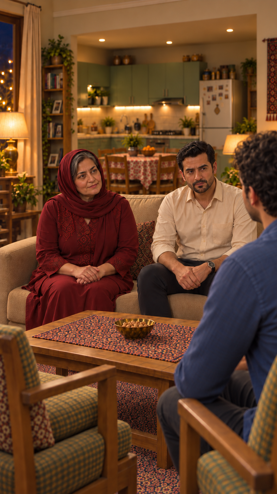
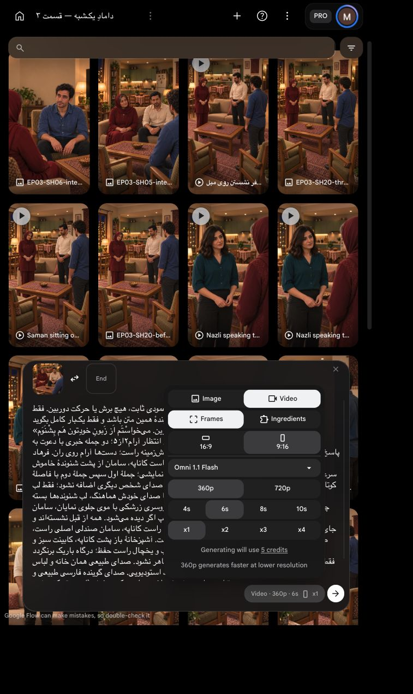

# بستهٔ بعدی گفت‌وگو — دو نما با یک تأیید هزینه

دو ارسال جدا، هرکدام۶ثانیه ویک خروجی، `Omni 1.1 Flash`، `Frames`، عمودی، `360p`؛۵اعتبار برای هر نما و سقف کل۱۰اعتبار. هر دو با تأیید صریح کاربر یک‌بار ارسال و ذخیره شدند؛ مجموع قیمت اعلام‌شده۱۰اعتبار، بدون تکرار. اکنون منتظر بازبینی خروجی‌اند. ضبط‌های کاربر مرجع محلی زمان/تلفظ‌اند، در حالت فعلی ورودی قفل صوت نیستند.

## نمای `05` — مادر

«نازْلی می‌گِه بِه هَم عَلاقِه دارین. می‌خواسْتَم اَز زَبونِ خودِتون هَم بِشْنَوَم.»

[پرامپت کامل و بررسی مستقل](shots/EP03-SH05/takes/take-01/preflight.md)

## نمای `06` — سامان

«مَن بِه نازْلی عَلاقِه دارَم. بَرایِ هَمین هَم اومَدَم با شُما حَرْف بِزَنَم.»

[پرامپت کامل و بررسی مستقل](shots/EP03-SH06/takes/take-01/preflight.md)

تأییدهای بعدی بنا به درخواست کاربر با گزینهٔ کلیکی ارائه شوند؛ هر گزینه باید شناسه بسته و سقف هزینه همان اقدام را روشن کند.
