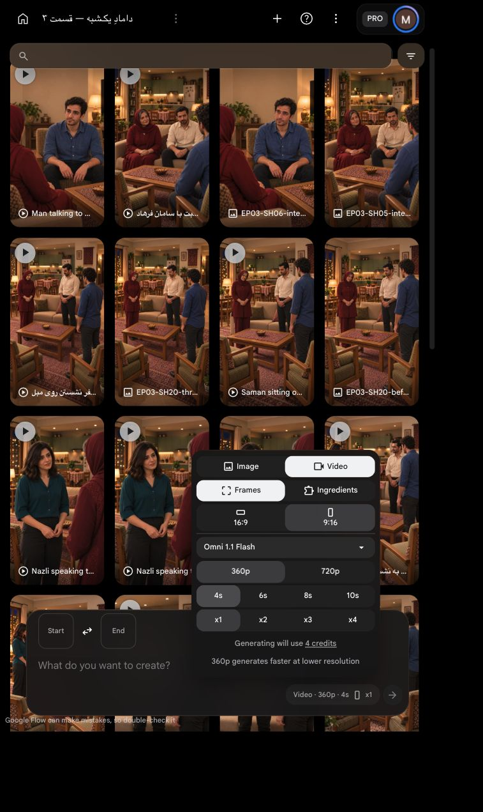

# بستهٔ برگشت و سرو چای — نسخهٔ۱

وضعیت: هر دو نما با تأیید صریح کاربر، هرکدام یک‌بار تولید و ذخیره شدند؛ نسخه اتصال محلی آماده بازبینی است. دو ارسال مستقل، هرکدام۴ثانیه، یک خروجی، `Omni 1.1 Flash`، `Frames`، `9:16`، `360p`، با صدای محیط و بدون گفتار. قیمت زنده۴اعتبار برای هر ارسال؛ سقف کل۸اعتبار. تکرار مجاز نیست.

## نمای 16

[](shots/EP03-SH16/images/EP03-SH16-tea-return-house-v6.png)

[گزارش مستقل و پرامپت کامل](shots/EP03-SH16/takes/take-01/preflight.md)

```text
دستور ساخت؛ خوانده نشود. هیچ دیالوگ، نریشن، زمزمه، موسیقی یا زیرنویس وجود ندارد؛ فقط صدای طبیعی اتاق، لباس و تماس آرام سینی با میز.
شروع دقیقاً قاب ورودی. دوربین عمودی ثابت از جلو و راست پذیرایی به کاناپه؛ بدون حرکت یا برش داخلی. مادر روی نشیمن چپ و فرهاد روی راست کاناپه با فاصله عادی؛ سامان روی تک‌صندلی اصلی راست، تک‌صندلی نازلی در چپ خالی. فقط همین دو تک‌صندلی. آشپزخانه کاملاً باز پشت کاناپه، پنجره چپ، کابینت سبز و یخچال راست ثابت.
نازلی با همان بلوز سبزآبی دکمه‌دار و شلوار تیره و چهره و موی مرجع، کنار چپ میز ایستاده و هر دو دست لبه‌های سینی چوبی را گرفته‌اند. دقیقاً یک استکان کمرباریک چای روی یک نعلبکی سفید گل‌قرمز در سینی است؛ میز فقط آجیل و رومیزی دارد.
کنش واحد: بدون انتظار نمایشی، نازلی از همان جای نزدیک میز کمی به جلو خم می‌شود، با دو دست سینی را افقی روی بخش آزاد سمت چپ میز نزدیک خودش پایین می‌گذارد. بعد از تماس کامل کف سینی با میز، هر دو دست از لبه‌ها جدا می‌شوند. چای و نعلبکی داخل سینی باقی می‌مانند؛ هنوز نعلبکی برداشته یا جلوی سامان گذاشته نشود. نازلی هنوز ایستاده بماند.
بازی تأییدشده: تمرکز عادی، نگاه نازلی به سطح امن میز، بدون لب‌زدن؛ دیگران فقط نگاه کوتاه طبیعی و سپس توجه معمول، بدون دنبال‌کردن اغراق‌آمیز یا گفتار. دست‌های سامان روی ران‌ها، دست به چای نبرد. چهره و مو و لباس ثابت؛ مادر تونیک خوش‌دوخت و تک‌روسری زرشکی با موی جلوی سر نمایان، فرهاد پیراهن کرم و ساعت چپ، سامان پیراهن آبی.
حرکت طبیعی و پیوسته؛ سینی یا دست از بدن و صندلی عبور نکند، استکان نریزد یا تکثیر نشود. پایان پس از رهاشدن هر دو دست با سینی روی میز و نازلی ایستاده؛ آغاز انتقال نعلبکی متعلق به نمای بعد است. برای پرکردن چهار ثانیه حرکت را کند یا تکرار نکن.
```

## نمای 17

[](shots/EP03-SH17/images/EP03-SH17-serving-start-v5.png)

[گزارش مستقل و پرامپت کامل](shots/EP03-SH17/takes/take-01/preflight.md)

```text
دستور ساخت؛ خوانده نشود. نمای نزدیک ثابت و عمودی، از همان قاب ورودی. بدون دیالوگ، نریشن، موسیقی یا زیرنویس؛ صدای طبیعی اتاق و تماس آرام نعلبکی روی میز حفظ شود.
شروع: دست راستِ متصل به آستین سبزآبی و تنه نازلی، نعلبکی سفید گل‌قرمز را از زیر گرفته و بالای میز نزدیک سینی چوبی سمت چپ نگه داشته است؛ دقیقاً یک استکان کمرباریک چای روی آن. سینی روی میز خالی است؛ چای دیگری وجود ندارد. دست چپ نازلی آزاد کنار بدن. آستین آبی و زانوی سامان سمت راست، دستش روی ران و دور از استکان.
کنش واحد: نازلی نعلبکی و استکان قائم روی آن را با همان دست راست، در یک مسیر کوتاه و بدون عبور از کاسه آجیل به بخش آزاد سمت راست میز جلوی سامان منتقل می‌کند. نعلبکی آرام روی چوب میز می‌نشیند. فقط پس از تماس و ثبات کامل نعلبکی، انگشتان از زیر آن خارج می‌شوند و دست راست به سمت بدن نازلی برمی‌گردد. دست به شیشه داغ تماس نگیرد؛ استکان تا پایان روی نعلبکی، چای درون آن و سینی در چپ ثابت بمانند.
رفتار تأییدشده: دقت عادی بدون نمایش اغراق‌آمیز؛ سامان دست به استکان نمی‌برد. بدون چرخش صندلی، تکان میز یا جابه‌جایی آجیل و رومیزی. صاحب دست راست همیشه تنه نازلی باشد؛ انگشت یا دست اضافی، نعلبکی شناور پس از رهاکردن و ظهور ناگهانی شیء ممنوع. دوربین ثابت، هیچ برش یا حرکت اضافه. صورت‌ها عمداً خارج قاب‌اند و چهره تازه وارد نشود.
پایان پس از تماس سالم و برگشت دست؛ نازلی فقط آغاز عقب‌کشیدن بدن برای برگشت به صندلی را انجام دهد، نشستن کامل در این نمای نزدیک دیده نمی‌شود. برای پرکردن چهار ثانیه حرکت تکرار یا مصنوعی کند نشود.
```

## قیمت زنده

[](next-silent-batch-price.png)

تأیید فقط همین دو ارسال و همین قاب‌ها و پرامپت‌ها با سقف۸اعتبار است؛ پیش از دکمه تولید باز هم قیمت و ورودی‌های زنده تطبیق داده شوند.


[نمونه متصل دو نما](edit/EP03-tea-batch-review-v1.mp4)؛ هزینه اضافه برای تدوین صفر. پذیرش نهایی خروجی در انتظار کاربر است.
