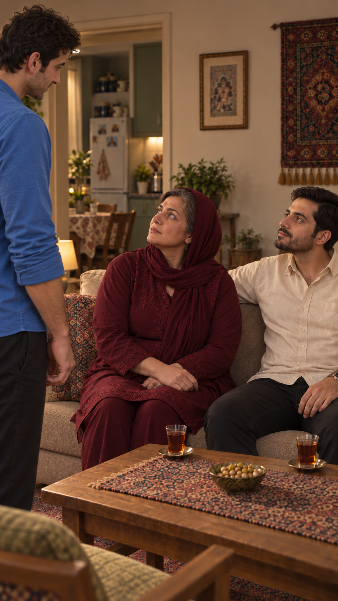

# بررسی آمادگی قسمت سوم — ۲۰۲۶/۱۰/۱۴

وضعیت: آماده‌سازی آغاز شد؛ آمادهٔ ارسال به تولید نیست. این گزارش نتیجهٔ خواندن اسناد و کنترل فایل‌هاست؛ پذیرش تازهٔ متن، تصویر، صدا یا برداشت نیست.

## مبنای فعلی

- پروژه: دامادِ یک‌شبه؛ دیدار اولیهٔ سامان با خانواده در نقش تازه. علاقه و قصد او جدی است؛ تصمیم نازلی همچنان شرط ادامه است. پایان، درخواست مادر برای گفتگو با مادر سامان و دیدار آینده است؛ مراسم نامزدی یا حلقه نداریم.
- متن نسخهٔ سوم با اصلاح جملهٔ هشتم و جهت بازی طبق ثبت پروژه تأیید شده‌اند؛ متن پذیرفته‌شده تغییر نکرد.
- هر۱۸ کارت فعال و فایل قابِ ارجاع‌شده در آن‌ها موجودند؛۱۴ نوبت گفتار و۴ نمای بی‌گفتار. طبق ثبت پذیرش قبلی،۱۷ قاب پذیرفته‌اند؛ نسخهٔ۳ نمای نخست هنوز منتظر تأیید است. این نوبت همهٔ۱۸ تصویر دوباره دیده نشدند.
- هیچ کارت برداشت منتخب یا درخواست ارسال ندارد. گزارش بررسی پیش از ارسال در پوشهٔ برداشت‌های این قسمت موجود نیست.
- برخلاف عبارت قدیمی «تولید شروع نشده»، یک [ویدیوی آزمایشی موجود](shots/EP03-SH01/takes/take-01/video.mp4) همراه [پرامپت تاریخی](shots/EP03-SH01/takes/take-01/prompt.txt) و [گزارش مالک](shots/EP03-SH01/takes/take-01/review.md) وجود دارد. وجود فایل اثبات کیفیت نیست؛ صدا، حرکت، مدت فنی و لب‌خوانی آن در این نوبت بررسی نشده‌اند. این برداشت انتخاب نشده است. نسخهٔ تدوین کامل موجود نیست.

## موارد باز و ترتیب آماده‌سازی

| مورد | شاهد | اقدام بعدی |
|---|---|---|
| پذیرش قاب نخست | [کارت مالک](shots/EP03-SH01/shot.md)؛ نسخهٔ۳ منتظر تأیید | مرور کاربر؛ مشاهدهٔ ثابت در این نوبت انجام شد، پذیرش ثبت نشد. |
| استفاده از آزمون موجود | فایل برداشت۱ در نمای نخست | نخست همین منبع از نظر گفتار، تلفظ، مالک صدا، نگاه و لب‌خوانی بررسی شود؛ پیش از تشخیص ایراد، تکرار پیشنهاد نشود. |
| مدت قسمت | [طرح و یادداشت تدوین](edit/editorial-notes.md)؛ بودجهٔ اولیه۴۹تا۶۶ثانیه | اجرای طبیعی و زمان‌گیری واقعی؛ سقف یک دقیقه با حذف زمان بی‌کار کنترل شود، نه تندکردن گفتار. |
| چای و وضعیت نشستن | [پیوستگی مشترک](continuity.md#dialogue-revision-v3)؛ تقسیم سه استکان و نقشهٔ میز هنوز پیشنهادی است | مسیر خروج نازلی، برگشت سینی، دست راست، تماس نعلبکی و نشستن تا نمای۷ تثبیت و در اتصال‌ها کنترل شوند. |
| اتصال روایت به قسمت‌های بعد | [تحلیل وابستگی‌ها](story-review.md)؛ سند سریال هنوز خلاصهٔ قدیمی حلقه را دارد | پیشنهاد هماهنگی قسمت۴، ترتیب دعوت در۵و۶ و جایگزین وابستگی حلقه در۹و۱۰ تهیه شود؛ متن مصوب قسمت‌های بعد بدون تأیید بازنویسی نشود. |
| بستهٔ ارسال | همهٔ کارت‌ها بدون درخواست ارسال؛ پرامپت آزمون موجود انگلیسی و تاریخی است | پس از رفع موارد بالا، پرامپت فارسیِ مشتق از کارت فعال، ورودی دقیق، زمان اجرا، تنظیمات و گزارش مستقل هر برداشت آماده شوند؛ بررسی زندهٔ هزینه و تأیید صریح بستهٔ نهایی لازم‌اند. |

## مشاهدهٔ محدود قاب نخست

سامان سمت چپ ایستاده، مادر و فرهاد نشسته‌اند؛ نگاه هر دو به سمت صورت سامان بالا رفته و دو استکان جلوی افراد نشسته دیده می‌شود. نازلی داخل قاب نیست. این مشاهدهٔ ثابت، استمرار نگاه، ثبات هویت در سایر نماها یا سلامت حرکت را اثبات نمی‌کند.

این نوبت هیچ تولید، مصرف اعتبار، تغییر انتخاب برداشت یا ویرایش قسمت دوم انجام نشد. قدم نخست ادامه: بازبینی آزمون موجود و تعیین وضعیت قاب نخست؛ هم‌زمان پیشنهاد اتصال قسمت چهارم آماده شود.
