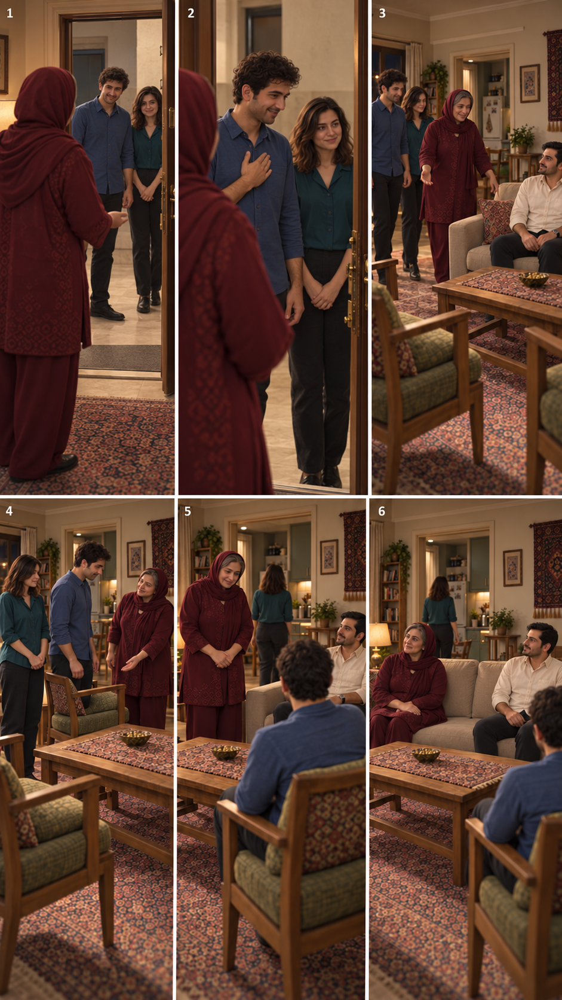
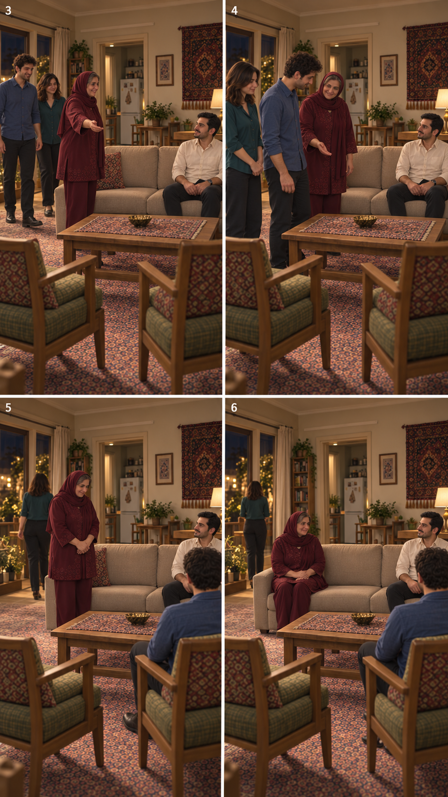

# اصلاح جهت ورود و ثبات نشستن — ۲۰۲۶/۱۰/۱۴

وضعیت: پیش‌نمایش پیشنهادی برای مرور کاربر؛ پذیرش نهایی یا ورودی فعال تولید نیست. دو اقدام با ابزار داخلی `image_gen` انجام شد؛ ارسال به `Flow` یا تولید ویدیو انجام نشد. تصاویر قبلی محفوظ‌اند.

## ورودی

در قاب۱و۲ مادر داخل خانه در پیش‌زمینه و سامان/نازلی بیرون آستانه در پاگرد دیده می‌شوند؛ فضای بازِ اشتباهِ نسخهٔ۱ حذف شد. هندسهٔ حرکت در و تطبیق با پلان واقعی خانه هنوز تأیید نهایی ندارند. قاب۳تا۶ همین صفحه اصلاح کامل چیدمان را انجام نداده‌اند؛ مبنای ادامهٔ مرور پذیرایی نباشند.

## پذیرایی — چهار قاب تازه

در این چهار قاب فرهاد سمت راست تصویر روی همان انتهای مبل باقی می‌ماند. مادر تا قاب۵ ایستاده است؛ سامان در قاب۵ روی صندلی راست مقابل فرهاد نشسته و مادر در قاب۶ انتهای چپ همان مبل می‌نشیند. نشیمن خالی بین مادر و فرهاد دیده می‌شود. این ترتیب جای ترکیب قاب‌های۳تا۶ صفحهٔ شش‌قابی قبلی را می‌گیرد؛ انتخاب رسمی کارت‌ها تغییر نکرده است.

محدودیت باقی‌مانده: نازلی در۵و۶ نزدیک پنجره سمت چپ است، نه در دهانهٔ آشپزخانهٔ دارای یخچال؛ مسیر رفتن او برای چای هنوز با پلان مطلوب تطبیق ندارد. مقیاس و برش دوربین و مبلمان در چهار قاب کاملاً یکسان نیست؛ ثبات سمت فرهاد به معنی پذیرش کامل هندسه یا حرکت نیست. هیچ ادعای بازبینی ویدیویی، لب‌خوانی یا اتصال واقعی نشستن مطرح نمی‌شود.
