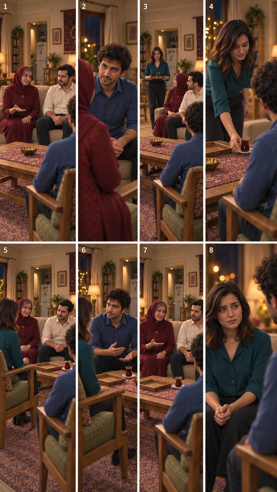

# مرحلهٔ بعد: مرور ادامهٔ قسمت سوم

تاریخ: ۲۰۲۶/۱۰/۱۴. کاربر پیش‌نمایش ورود نسخهٔ۴ را با «به نظر اوکیه… بریم مرحله بعدی» پذیرفت. این پذیرش مربوط به پیش‌نمایش تصویری است؛ نه حرکت، صدا، لب‌خوانی یا مجوز ارسال ویدیو. خارج قاب بودن فرهاد در قاب۶ همچنان در اجرای ویدیویی باید پیوستگی منطقی داشته باشد.

وضعیت صفحهٔ تازه: پیشنهادی، در انتظار مرور کاربر؛ تولید با ابزار داخلی `image_gen`. مرجع ورودی [پیش‌نمایش ورود پذیرفته‌شده](EP03-arrival-storyboard-v4.png) است. متن دیالوگ‌های مصوب تغییر نکرده، کارت‌های نما و مجوز ارسال تغییر نکرده‌اند؛ هیچ ویدیویی تولید نشده.

| قاب صفحه | اتفاق و مرجع کارت | وضعیت تصویر |
|---|---|---|
|۱|پرسش مادر دربارهٔ علاقه، نازلی در آشپزخانه؛ `SH05`|پیشنهادی|
|۲|پاسخ صادقانهٔ سامان؛ `SH06`|پیشنهادی|
|۳|برگشت نازلی با سینی و یک استکان؛ `SH16`|پیشنهادی|
|۴|گذاشتن همان استکان با نعلبکی جلوی سامان؛ `SH17`|پیشنهادی|
|۵|سؤال محتاطانهٔ فرهاد پس از نشستن نازلی؛ `SH07`|پیشنهادی|
|۶|بیان قصد ازدواج سامان مشروط به خواست نازلی؛ `SH10`|پیشنهادی|
|۷|درخواست گفتگو با مادر سامان و دعوت آینده؛ `SH14`|پیشنهادی|
|۸|نگرانی پایانی نازلی از ادامهٔ نقش؛ `SH18`|پیشنهادی|

این صفحه هشت لحظهٔ کلیدی است، نه فهرست نهایی تمام نماها. پاسخ نازلی، سؤال جهت آشنایی، تلاش نازلی برای آهسته‌کردن ماجرا و سؤال/پاسخ اطلاع مادر سامان در متن‌های `SH08`، `SH09`، `SH11`، `SH12` و `SH13` همچنان محفوظ‌اند و نماهای مستقلشان هنوز از این صفحه استخراج یا آماده نشده‌اند.

مشاهدهٔ اولیه: کاناپهٔ دو نفره، جای مادر چپ و فرهاد راست، صندلی سامان راست و نازلی چپ و لباس‌ها در این صفحه حفظ شده‌اند. چای در۱و۲ روی میز نیست، در۳ با سینی آورده شده و از۴ به بعد جلوی سامان دیده می‌شود؛ سینی خالی در ادامه روی میز باقی است. شمار دقیق وسایل، نسبت ارتفاع بدن و نگاه‌ها و هندسه در قاب‌های مستقل دوباره بررسی شوند. حالت صورت، جای درست دست و تصویرِ تماس نعلبکی به معنی تأیید حرکت واقعی نیستند. زمان‌گیری گفتار و پذیرش صدا هنوز انجام نشده است.

قدم بعد: مرور همین صفحه با کاربر، سپس تکمیل تمام کارت‌ها و قاب‌های مستقل بر اساس همین چیدمان، زمان‌گیری واقعی۱۴ نوبت با کنش‌های تازه و کنترل سقف حدود یک دقیقه. اضافه‌شدن دست‌دادن و استقبال نیازمند بازبینی بودجه است؛ جمع قبلی۴۹تا۶۶ثانیه مبنای قطعی نیست. تولید ویدیو فقط پس از بررسی مستقل هر نما، نمایش بستهٔ نهایی و قیمت زنده و تأیید صریح هزینه مجاز است. وابستگی داستانی قسمت‌های بعد به حلقه و دعوت همچنان باز است.

## رد قاب۳ و اصلاح مستقل

کاربر فاصلهٔ نشستن در قاب۳ را رد کرد؛ این قابِ صفحهٔ اصلی مبنای تولید نیست. [عکس مستقل اصلاح‌شده](../shots/EP03-SH16/images/EP03-SH16-tea-return-spacing-v3.png) و [گزارش مالک و محدودیت هندسه](../shots/EP03-SH16/image-review-spacing-v3.md) برای مرور جایگزین‌اند؛ هنوز تأیید کاربر ثبت نشده است.
