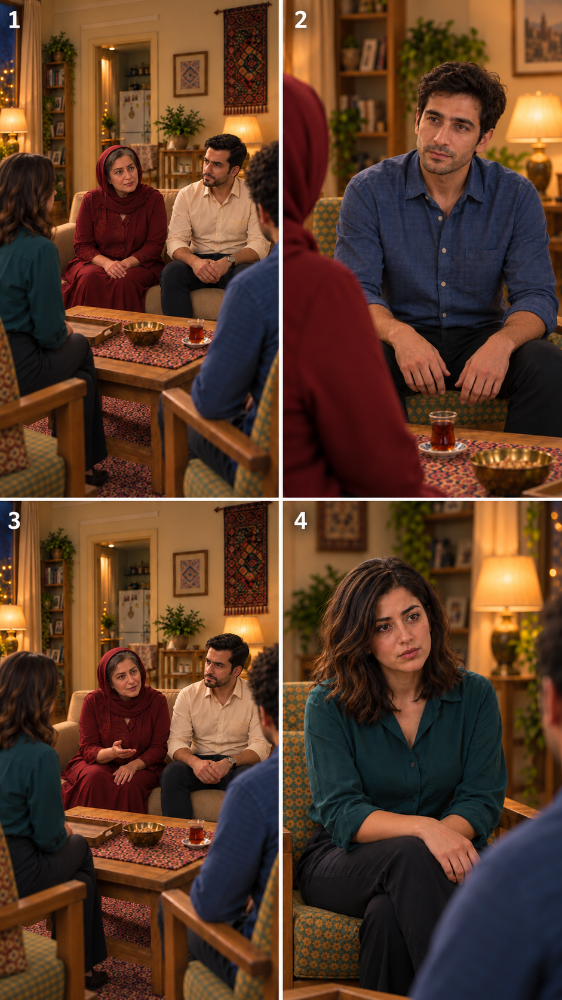

# پیش‌نمایش پایان قسمت — ۲۰۲۶/۱۰/۱۴

وضعیت: پیشنهادی؛ در انتظار مرور کاربر. یک صفحهٔ چهارقابی با ابزار داخلی `image_gen` ساخته شد؛ این‌ها هنوز قاب‌های مستقل آمادهٔ تولید نیستند و شمار کل نماهای قسمت را تعیین نمی‌کنند. ویدیو تولید نشده است.

مرجع‌ها: [جمع پذیرفته‌شده](../shots/EP03-SH07/images/EP03-SH07-seated-after-tea-v3.png) برای محیط و فاصله و اشیا؛ [سامان پذیرفته‌شده](../shots/EP03-SH10/images/EP03-SH10-intent-v4.png) و [نازلی پذیرفته‌شده](../shots/EP03-SH11/images/EP03-SH11-brake-v3.png) برای ظاهر و صندلی‌ها. مرجع واحد هویت در [سند ظاهر](../../../references/visuals/character-bible.md) حفظ شده؛ این صفحه مرجع تازهٔ صورت ایجاد نمی‌کند.

| قاب | مالک و کارکرد |
|---|---|
|۱|`SH12`: پرسش مادر دربارهٔ اطلاع خانوادهٔ سامان؛ کنجکاوی محتاط و نگاه به سامان|
|۲|`SH13`: پاسخ صادقانهٔ سامان؛ هنوز با مادرش صحبت نکرده، نه وعدهٔ آوردن او|
|۳|`SH14`: درخواست گفتگو با مادر سامان و پیشنهاد دیدار آینده؛ نه نامزدی قطعی|
|۴|`SH18`: نازلی بعد از تمام‌شدن دعوت ساکت و نگران؛ بدون جمله یا آه اضافه|

متن‌های مصوب در کارت‌های مالک محفوظ‌اند و تغییر نکردند. لباس و مو و صورت‌های قابل‌دیدن با سه مرجع ورودی تطبیق داده شدند؛ تغییر آشکار تشخیص داده نشد، ولی این مقیاس صفحه جای کنترل قاب مستقل نیست. فاصلهٔ مادر و فرهاد و کاناپهٔ دو نفره حفظ شده‌اند؛ بدن‌ها به هم تکیه ندارند. پنجره چپ، آشپزخانه عقب، بافته راست، سینی خالی نزدیک نازلی و یک استکان جلوی سامان دیده می‌شوند. حرکت، لب‌خوانی، زمان واقعی و تطبیق دقیق مدل نعلبکی هنوز بررسی نشده‌اند.

قاب۳ یک اشارهٔ دست مادر اضافه کرده، درحالی‌که طرح قبلی دست ثابت داشت؛ این ژست فقط پیشنهادی است و با پذیرش متن قدیمی مصوب تلقی نشود. قاب۴ لب نازلی اندکی باز به نظر می‌رسد؛ برای واکنش بی‌گفتار، بسته‌بودن لب و نبود آه یا جمله در بستهٔ مستقل اصلاح و کنترل شود. این‌ها مانع آماده‌اعلام‌کردن بستهٔ تولیدند، نه مجوز تلاش هزینه‌دار.

قدم بعد: مرور پایان با کاربر، تکمیل قاب‌های مستقل و گزارش هر نما، سپس زمان‌گیری۱۴ نوبت همراه استقبال/دست‌دادن/پذیرایی و کنترل ریتم زیر حدود یک دقیقه. پذیرش تصویر به معنی اجازهٔ مصرف اعتبار نیست.
