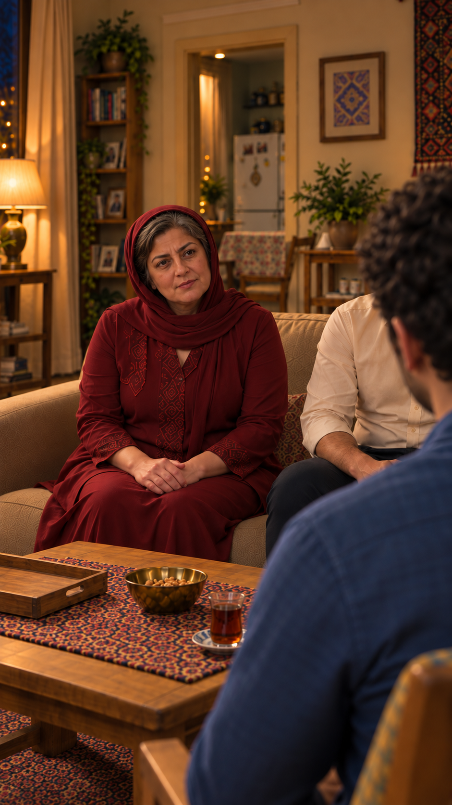
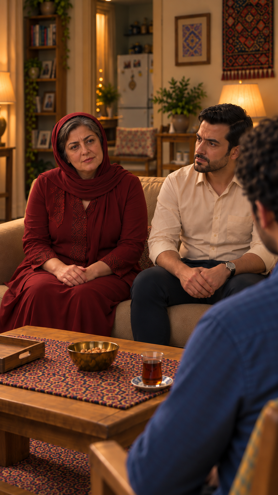

# مرور پنج قاب باقی‌ماندهٔ قسمت سوم

۲۰۲۶/۱۰/۱۵ — پیشنهادی برای پذیرش کاربر؛ تصویر ثابت، نه تأیید حرکت یا مجوز ارسال. متن و جهت بازی مصوب کارت‌ها محفوظ است. قاب‌های تازه با ابزار داخلی `image_gen` تهیه شدند. منابع صورت از مرجع ثابت شخصیت‌ها؛ چیدمان از قاب‌های پذیرفته‌شده. واکنش نازلی دست‌نخورده ماند.

## `EP03-SH15` — هدایت به پذیرایی، پیش از دست‌دادن

مادر ایستاده داخل پذیرایی، فرهاد نشسته در نشیمن راست؛ سامان و نازلی ایستاده. دست‌دادن هنوز شروع نشده، چای و سینی نیست. مسیر کنار میز و صندلی راست مهمان دیده می‌شود. صورت سامان عمدتاً پشت و سه‌رخ است؛ تطبیق کامل اجزای صورت او در این قاب ممکن نیست.

[گزارش و پرامپت](shots/EP03-SH15/remaining-frame-review.md)

## `EP03-SH04` — پذیرفتن درخواست چای، پیش از خروج

نازلی ایستاده به مادر در پیش‌زمینه راست نگاه می‌کند؛ جهت چپِ نسخه اولیه رد شد. دست‌ها خالی، بلوز سبزآبی و موی تا شانه ثابت. مادر پشت به دوربین است؛ صورت او بررسی کامل‌پذیر نیست. دیگران با برش خارج قاب‌اند.

[گزارش و پرامپت](shots/EP03-SH04/remaining-frame-review.md)

## `EP03-SH12` — پرسش دربارهٔ اطلاع مادر سامان

مادر نشیمن چپ، شانه سامان پیش‌زمینه راست، نگاه به مخاطب. بخشی از فرهاد در نشیمن راست دیده می‌شود؛ بدن‌ها تماس ندارند. دست مادر روی ران، تک‌روسری با موی پیشانی، چای یک‌عدد جلوی سامان و سینی خالی ثابت.

[گزارش و پرامپت](shots/EP03-SH12/remaining-frame-review.md)

## `EP03-SH13` — پاسخ سامان؛ هنوز صحبت نکرده

سامان در صندلی سبز با نقش طلایی، شانه مادر پیش‌زمینه چپ، نگاه به مادر؛ پشت مهمان کتابخانه و چراغ و دیوار است و آشپزخانه تکرار نشده. دست‌ها روی ران، چای دست‌نخورده. صورت سامان با پرتره مصوب تطبیق بصری شد؛ صورت مادر خارج دید است.

[گزارش و پرامپت](shots/EP03-SH13/remaining-frame-review.md)

## `EP03-SH14` — دعوت مادر برای دیدار آینده

مادر چپ کاناپه و فرهاد راست با فاصله عادی و بدون تماس؛ دست‌ها روی ران، شانه سامان راست. چای جلوی سامان و سینی خالی سمت نازلی حفظ شده. حالت محتاطانه است؛ گرمی دعوت باید در اجرای آتی صدا و حرکت بررسی شود، عکس اثبات اجرا نیست.

[گزارش و پرامپت](shots/EP03-SH14/remaining-frame-review.md)

## قدم بعد

پس از پذیرش، قاب‌های فعال و ترتیب کارت‌ها با طرح۲۱نما یکپارچه شوند؛ سپس زمان‌گیری واقعی گفتار و کنش و بررسی مستقل پیش از آزمون. اختلاف قدیمی مدل نعلبکی و نگاه نازلی در قاب آستانه هنوز باید در مرور کل اتصال‌ها بررسی شود. این صفحه به معنی آماده‌بودن بستهٔ اعتباری نیست.

پذیرش پنج قاب توسط کاربر در ۲۰۲۶/۱۰/۱۵ ثبت شد؛ [گالری فعال](frames.md) از کارت‌های به‌روز ساخته شد.
