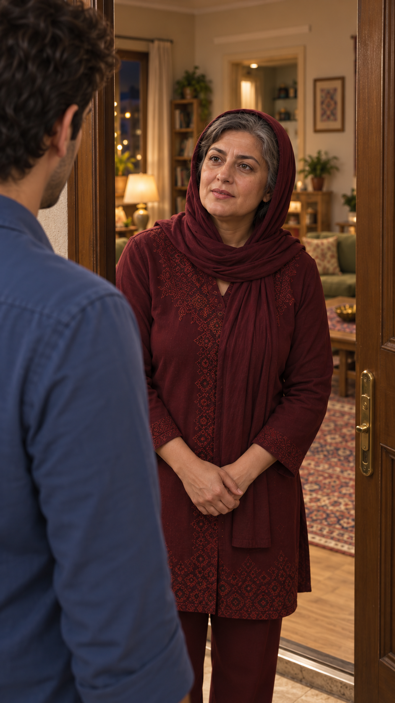

# مرور قاب مستقل ورود — EP03-SH01

تاریخ: ۲۰۲۶/۱۰/۱۴. وضعیت: پیشنهادی، در انتظار مرور کاربر؛ نه مجوز ارسال. [مرجع ظاهر](../../../../references/visuals/character-bible.md)، [چهره‌های مصوب](../../../episode-01/references/01-casting-and-living-room-concept-v1.png)، [پرترهٔ سامان](../../../episode-02/references/01-saman-portrait-v1.png) و [صفحهٔ ورود](../../references/EP03-arrival-storyboard-v5.png) با نقش‌های مشخص ورودی ابزار داخلی `image_gen` بودند.

مادر داخل خانه ایستاده، سامان بیرون آستانه؛ صورت مادر و روسری واحد و موی نمایان و لباس خوش‌دوخت با مرجع تطبیق داده شدند؛ تغییر آشکار تشخیص داده نشد. دست‌ها طبیعی روی هم و جهت نگاه به سامان. پیکره و صورت پنهان سامان و هندسهٔ کامل لولا و مسیر حرکت در هنوز بررسی نشده‌اند.

تطبیق مشخصات قابل‌دیدن: بررسی شد و قبول در حد مشاهدهٔ ثابت؛ نگاه نازلی در نمای۲ ایراد باز است. حرکت و صدا و لب‌خوانی: بررسی نشده. پذیرش تصویر تازه هنوز ثبت نشده. زمان‌گیری واقعی و هزینه/مجوز ویدیو وجود ندارد. متن گفتار مصوب بازنویسی نشده است.
