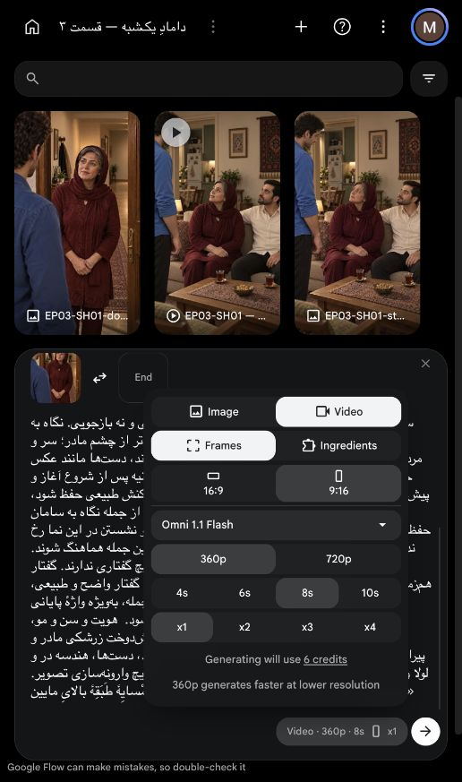

# بستهٔ نمونهٔ کامل نمای اول — در انتظار تأیید هزینه

کاربر ادامه با روش `Seed-VC` را پذیرفت؛ مرجع صوتی مادر همان نمونهٔ اصلی است. نمونهٔ قبلی فقط آزمایش هویت بود و پایان جمله‌اش قابل‌اتکا نیست. منبعی برای جایگزینی مطمئن همان پایان در فایل‌های موجود مشخص نشد؛ افزودن سکوت یا کش‌دادن فایل اصلاح محسوب نمی‌شود. برداشت قدیمیِ نشسته نیز تصویر معتبرِ استقبال نیست. بنابراین یک برداشت تازهٔ کامل با قاب ایستاده لازم است؛ تکرار خودکار مجاز نیست.

## ورودی و متن نهایی

متن دقیق مصوب: «اِ، آقا سامان! شُما کِه هَمْسایِهٔ طَبَقِهٔ بالایِ مایین.»

بازی مصوب: مادر داخل آستانه ایستاده، تعجب گرم و خفیف۲از۵ برای شناختن همسایه؛ خطاب تعجبی کوتاه و ادامه خبری. نگاه به سامان بیرون، نه لنز. سامان ساکت با شانهٔ آبی در پیش‌زمینه؛ نازلی و فرهاد خارج برش. در از قبل باز و ثابت؛ ورود، نشستن و دست‌دادن اینجا اتفاق نمی‌افتد.

[پرامپت کامل نهایی](prompt.txt) از همان متن و بازی ساخته شده است؛ دستور صریح کامل‌شدن واژهٔ آخر و اتمام گفتار پیش از ثانیهٔ ششم اضافه شد. دستور نامعتبرِ تقلید صدای مرجعِ بارگذاری‌نشده حذف شد؛ صدای نهایی با تبدیل محلی پس از خروجی تأمین خواهد شد.

## بررسی پیش از ارسال

| مورد | نتیجه و شاهد |
|---|---|
| متن، اعراب، گوینده و بازی | عین کارت مصوب؛ فقط مادر، پایان خبری، بدون دیالوگ اضافه؛ تأییدهای قبلی حفظ شده‌اند |
| تصویر، هویت و هندسه | همان قاب پذیرفته و تطبیق‌شده با خانه؛ فایل تغییر نکرده. [گزارش واقعی فضا](../../house-review.md). محدودیتِ چهرهٔ پنهان سامان پابرجاست و مدل باید شانهٔ او را حفظ کند |
| زمان | یک راهنمای محلیِ مصنوعی از کل جمله در سرعت۱۶۵واژه در دقیقه واقعاً ساخته و۴٫۵۳۳ثانیه اندازه‌گیری شد. [روش و محدودیت](timing-guide/scratch-only.json). این راهنما صدای نهایی یا اجرای بازی طبیعی نیست؛ زمان خروجی آینده را تضمین نمی‌کند.۸ثانیه ظرفیت تولید با حاشیه، بدون کندکردن گفتار، پیشنهاد می‌شود؛ اضافهٔ بیرونی پس از بازبینی محلی کوتاه خواهد شد |
| بازاستفاده | صوت موجود پایان مطمئن ندارد، تصویر قدیمی جای استقبال ایستاده نیست؛ اصلاح صرفاً تدوینی کافی نیست |
| ابزار و هزینه | در مرورگر داخلی: `Frames`، `Omni 1.1 Flash`، عمودی۹:۱۶، `360p`،۸ثانیه،۱خروجی؛ قیمت مشاهده‌شده۶اعتبار `Flow` |
| صدا و لب | ادامه با `Seed-VC` پذیرفته شد؛ مرجع اصلی ثابت. تبدیل محلی پس از استخراج گفتار، بدون هزینهٔ اعتباری؛ تطبیق واج‌به‌واج و هویت صدای همان برداشت پس از تولید بررسی می‌شود. تبدیل کوتاه‌ترین مدت به‌تنهایی تضمین لب‌خوانی نیست |
| ابتدا و انتها | طرح و قاب بدون تغییر مکان و حرکت در؛ فقط گفتار و واکنش کوچک. فیزیک و اتصال واقعی خروجی هنوز تولید نشده و پس از تولید باید بررسی شود |
| مصرف و مجوز | یک ارسال، سقف۶اعتبار `Flow`؛ تبدیل و تدوین محلی صفر اعتبار خارجی. تأیید هزینه هنوز دریافت نشده؛ هیچ ارسال یا برداشت تازه انجام نشده |

خطرهای مولد: امکان تلفظ غلط، تغییر چهره/فضا یا هماهنگی نامناسب لب قابل تضمین پیشاپیش نیست؛ خروجیِ خطادار پذیرفته نخواهد شد و شکست، مجوز ارسال دوباره نیست. وضعیت: بسته برای مرور هزینه آماده است، نه مجوز فشردن تولید. درخواست ارسال کارت همچنان خالی است.

