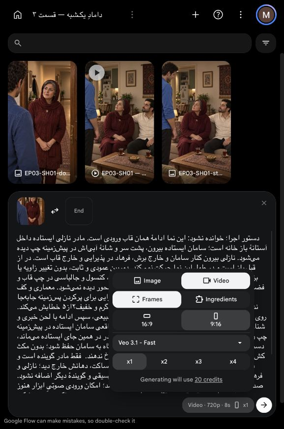
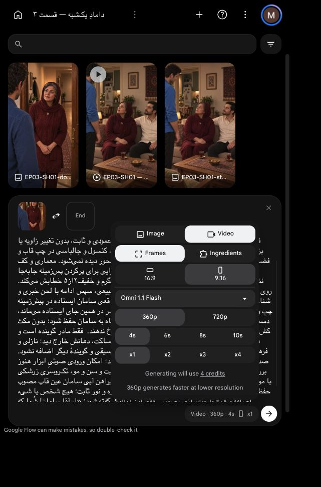

# وضعیت جاری: برداشت ساخته و با روش مصوب تبدیل شد

[دیدن نمونه و گزارش بازبینی](review.md). تنها ارسال مجاز انجام شد؛ مجوز دیگری باقی نیست. گزارش زیر سابقهٔ پیش از ارسال است.

# مرور نمای اول — پیش‌نویس برداشت دوم

**نسخهٔ جاری:** [بستهٔ کامل و بررسی نهایی](final-package-review.md). ادامهٔ روش `Seed-VC` توسط کاربر پذیرفته شد؛ متن پایان و زمان راهنما بررسی و پرامپت تازه در مرورگر داخلی درج شد. قیمت زنده۶اعتبار، هنوز بدون تأیید هزینه و بدون ارسال. بخش‌های پایین سابقهٔ آماده‌سازی‌اند.

**قاب تازه پذیرفته و در مرورگر داخلی چیده شد:** نسخهٔ راهرو فعال است؛ تنظیمات زنده و قیمت در بخش تازه پایین ثبت‌اند. این بسته هنوز به دلیل موارد لازمِ بررسی‌نشده و تأیید هزینه، آماده ارسال نیست.

وضعیت: **برای مرور محتوایی؛ آمادهٔ ارسال نیست**. هنوز هیچ تولید یا مصرف اعتبار ثبت نشده است. [کارت مالک متن و بازی](../../shot.md)؛ درخواست ارسال خالی می‌ماند.

[](../../images/EP03-SH01-door-welcome-house-v1.png)

## روایت و اجرا

مادر داخل آستانه ایستاده و سامان بیرون است. فرهاد در پذیرایی خارج قاب، نازلی کنار سامان خارج برش. تنها مادر صحبت می‌کند: غافلگیری گرم۲از۵ برای شناختن همسایه؛ خطاب تعجبی کوتاه، سپس جمله خبری. نگاه به چشم سامان، نه لنز؛ دست‌ها آرام جلوی بدن؛ در از قبل باز و ثابت. پایان: مادر هنوز ایستاده، منتظر جواب سامان. ورود و دست‌دادن و نشستن به نماهای بعد تعلق دارند.

[پرامپت کامل فارسی](prompt.txt) شامل متن دقیق اعراب‌گذاری‌شده از کارت مالک و دستورهای جدا از گفتار است. متن اصلی بازنویسی نشده. مرجع صدا، نمونهٔ اصلی پذیرفته‌شدهٔ مادر در [مرجع ثابت صدا](../../../../../../references/voice/voice-bible.md) است؛ امکان کاربرد مستقیم آن در ابزار هنوز بررسی نشده.

## بررسی و موارد باز

| مورد | نتیجه | شاهد و حدود |
|---|---|---|
| متن و گوینده | بررسی شد و قبول در متن | دیالوگ عین کارت مصوب، فقط مادر گوینده؛ پایان خبری، نه سؤال |
| بازی و ریتم طراحی | برای مرور محتوایی کاربر | تعجب خفیف، فاصله طبیعی پس از خطاب؛ اجرای واقعی هنوز نیست |
| قاب و نگاه | بررسی شد و قبول در تصویر ثابت | عکس نسخه۴ واقعاً دیده شد؛ مادر ایستاده در آستانه، مخاطب سمت چپ و بالاتر، بدون نگاه مستقیم لنز |
| هویت | محدود به بخش دیده‌شده | مادر صورت و مو و سن و تک‌روسری و لباس با مرجع پذیرفته‌شده تطبیق بصری؛ سامان از پشت است و صورت کاملش بررسی‌پذیر نیست؛ دیگران خارج قاب |
| هندسه و ابتدا/انتها | بررسی شد و قبول در طرح | در از پیش باز و بدون حرکت، افراد جای ثابت؛ حرکت خروجی هنوز بررسی نشده |
| مدت | بررسی نشده | سهم تدوین قبلی۳تا۴ثانیه تخمین است؛ زمان‌گیری اجرای این جمله نداریم. مدت ارسال و حاشیه پایان هنوز انتخاب نشده |
| ابزار و تنظیمات | بررسی نشده | مدل، مدتهای مجاز، کیفیت، صدا و پشتیبانی مرجع صوتی باید زنده بررسی شوند؛ هدف عمودی۹:۱۶ و یک خروجی، تنظیم قطعی نیست |
| هزینه و تأیید | بررسی نشده | قیمت و سقف اعلام/تأیید نشده؛ تأیید محتوایی به معنی مجوز هزینه نیست |
| امکان استفاده محلی | محدود | برداشت قدیمی با اجرای نشسته جایگزین قاب استقبال ایستاده نیست؛ منبع مطابق جدید منتخب نیست |

تا تعیین زمان، قابلیت ابزار، تنظیمات و هزینه و تأیید صریح بستهٔ نهایی، ارسال ممنوع است. موفقیت حرکت و تلفظ و ثبات صدا از روی پرامپت تضمین نمی‌شود؛ بازبینی واقعی برداشت لازم است.

## آماده‌سازی زنده در مرورگر داخلی — ۲۰۲۶/۱۰/۱۵

[پروژه موجود قسمت سوم](https://flow.google.com/project/0290053e-8dcd-4881-91ca-09cde9a42b7c) در مرورگر داخلی باز است. قاب راهرو بارگذاری و در جای شروع انتخاب شد؛ پرامپت کامل همین پوشه در کادر قرار گرفت. تصاویر قدیمی گالری پروژه فقط سابقه‌اند، ورودی فعلی نیستند. دکمه تولید زده نشد.

[](ui-prepared.png)

مدل مشاهده‌شده `Veo 3.1 - Fast`، حالت `Frames`، عمودی۹:۱۶، رابط `720p` و۸ثانیه، یک خروجی. هزینه زنده۲۰اعتبار برای همان یک ارسال است؛ قیمت پیش از ارسال باید دوباره تطبیق داده شود. مدت۸ثانیه مدت فایل تولیدی است، نه زمان واقعی دیالوگ یا سهم اجباری تدوین. کنترل گفتار و مدت واقعی و قابلیت ورودی مرجع صوت هنوز کامل نشده؛ تأیید هزینه دریافت نشده و درخواست ارسال کارت خالی است.

### تفکیک نشست مرورگر

پیش از دستور کاربر برای استفاده انحصاری از مرورگر داخلی، در نشست متفاوت مرورگر بیرونی یک پروژه خالی با شناسه `b1509190-bb43-4412-b45b-8660ee8152b5` ساخته شد؛ هیچ رسانه یا تولیدی در آن انجام نشد. پس از دستور کاربر تمام تعامل تولیدیِ آماده‌سازی فقط در مرورگر داخلی و پروژه موجود قسمت سوم انجام شد. پروژه خالی بیرونی حذف نشده و پروژه فعال این بسته نیست.

## انتخاب کم‌هزینه به درخواست کاربر — ۲۰۲۶/۱۰/۱۵

گزینه جاری جایگزین تنظیم قبلی۲۰اعتباری شد: `Omni 1.1 Flash`، حالت `Frames`، عمودی۹:۱۶، وضوح `360p`،۴ثانیه، یک خروجی، قیمت زنده۴اعتبار برای یک ارسال. این کمترین قیمت در مقایسه‌های ثبت‌شده است؛ جدول مقایسه در پرونده بسته ثبت شد. گزینه۶ثانیه۵اعتبار و۸ثانیه۶اعتبار در همین وضوح دیده شدند. قاب و پرامپت ثابت‌اند؛ هیچ تولیدی ارسال نشد.

[](ui-cheapest.png)

این انتخاب تنظیمات است، نه تأیید کیفیت یا کفایت زمان.۴ثانیه برای گفتار کامل هنوز زمان‌گیری نشده و ریسک بریدن جمله باز است؛ ارزان‌ترین گزینه الزاماً کم‌هزینه‌ترین خروجی قابل‌استفاده نیست. پشتیبانی واقعی گفتار/مرجع صوتی همین مدل و تطبیق با صدای مادر هنوز تأیید نشده. درخواست ارسال خالی و بسته آماده تولید نیست؛ هزینه تازه هنوز صریحاً تأیید نشده است.

## نتیجه بررسی سازگاری صدا و تنظیم جاری

۸ثانیه، `360p`، یک خروجی، `Omni 1.1 Flash`، حالت `Frames`، قیمت زنده۶اعتبار؛ [شاهد تنظیم](ui-eight-seconds.png). به دلیل بسته‌شدن تب قبلی، قاب شروع و پرامپت از فایل اصلی دوباره انتخاب/درج شدند. هیچ تولیدی ارسال نشد.

[راهنمای رسمی گوگل](https://support.google.com/flow/answer/16353334?co=GENIE.Platform%3DDesktop&hl=en) می‌گوید مرجع صدا فقط در حالت `Ingredients` قابل استفاده است، نه `Frames`. در رابط همین حساب حالت `Ingredients` و دسته `Voices` بررسی شد؛ فهرست صداهای نام‌دار مانند `Gacrux` و `Sulafat` دیده شد، اما مرجع پذیرفته‌شده مادر به آن متصل نبود. صدای تازه انتخاب یا نمونه هزینه‌دار ساخته نشد. به `Frames` برگشتیم تا قاب شروع بدون تغییر معنایی بماند. پس محدودیت مرجع صدا اکنون مسئله مشخص است، نه صرفاً یک گزینه بررسی‌نشده.

طبق مرجع صوتی مصوب، صدای شخصیت بدون تصمیم کاربر جایگزین نشود. راه آزمون صدای تولیدی با همین یک برداشت می‌تواند فقط با دامنه و هزینه مشخص و پذیرش محدودیت توسط کاربر پیشنهاد شود؛ به معنی پذیرش صدای تازه برای سریال نیست. مدت واقعی خوانش نیز هنوز اندازه‌گیری نشده. بسته آماده ارسال نیست و درخواست ارسال کارت خالی است.

## بررسی محلی منبع موجود

[گزارش مسیر صدا و تحلیل اجرا](voice-route-review.md) اضافه شد: فایل موجود حدود۴ثانیه، واژه آخر نزدیک مرز و تشخیص خودکار نامطمئن؛ شنیدن و کامل‌بودن پایان تأیید نشده. صرف وجود اجرای قبلی، زمان‌گیری معتبر اجرای کامل نیست. تا تعیین دامنه آزمون و مسیر صدا، تولید ارسال نشود.


تبدیل محلی رنگ صدا واقعاً اجرا شد؛ [گزارش و نمونه‌ها](../../audio/voice-lock-test/README.md). مصرف اعتبار صفر؛ پذیرش هویت صوتی و تطبیق واقعی لب هنوز باز است. این آزمون مجوز ارسال یا پذیرش صوت نهایی نیست.


## مجوز صریح همین بسته

تأیید، همین یک برداشت نمای اول رو با سقف ۶ اعتبار بساز، بعد صداش رو با Seed-VC تبدیل کن و نمونهٔ کامل رو نشونم بده.

<!-- preflight-state -->
```json
{
  "shot": "EP03-SH01",
  "take": "take-02",
  "ready": true,
  "open_issues": [],
  "checks": {
    "dialogue": {
      "status": "pass",
      "evidence": "Canonical EP03-D01 unchanged; exact approved fully diacritized line in prompt.txt"
    },
    "delivery": {
      "status": "pass",
      "evidence": "Approved warm mild surprise 2/5; declarative second clause; full final word explicitly required"
    },
    "duration": {
      "status": "pass",
      "evidence": "timing-guide/scratch-only.json: complete synthetic guide measured 4.532653s, not final acting; 8s with line finishing before 6s; output timing remains a post-generation gate"
    },
    "performance": {
      "status": "pass",
      "evidence": "Approved standing doorway recognition; no new acting decision; final-package-review.md"
    },
    "speaker": {
      "status": "pass",
      "evidence": "Only mother speaks; Saman silent back shoulder, others out of crop; prompt.txt"
    },
    "identity": {
      "status": "pass",
      "evidence": "Unchanged accepted frame hash in review-package.json; mother face/scarf/fit checked in house-review.md; Saman face hidden by design"
    },
    "eyeline": {
      "status": "pass",
      "evidence": "Accepted frame and prompt: eyes toward Saman above/left, never lens; no new axis"
    },
    "geometry": {
      "status": "pass",
      "evidence": "Existing house-review.md and unchanged house-aligned frame; door already open static, no hinge motion"
    },
    "continuity": {
      "status": "pass",
      "evidence": "Standing start/end, no seating or entry in this shot; neighbors positions unchanged; actual motion reviewed after output"
    },
    "camera": {
      "status": "pass",
      "evidence": "Approved vertical static doorway medium shot; no zoom or mirror"
    },
    "prompt": {
      "status": "pass",
      "evidence": "Current full prompt matched visible IAB editor by text, whitespace normalized; accepted text unchanged, final word and timing instruction added in approved package"
    },
    "local_alternative": {
      "status": "pass",
      "evidence": "Old audio ending unreliable and old image seated; neither silence nor old seated video repairs accepted welcome; Seed-VC local route tested and user accepted continuation"
    },
    "settings": {
      "status": "pass",
      "evidence": "Live IAB screenshot: Omni 1.1 Flash, Frames, 9:16, 360p,8s,x1"
    },
    "cost": {
      "status": "pass",
      "evidence": "Live panel 6 credits; exact one-attempt ceiling6 explicitly approved in current user message"
    }
  },
  "consumed_attempts": 1,
  "post_generation_review_required": [
    "complete word ending",
    "actual lip synchronization",
    "mother voice identity after conversion",
    "physical and spatial continuity"
  ],
  "bundle_sha256": "7654f8a482313cd3f589a92613b523933b4de811ac4a892da60bb5ca18bec3fb",
  "content_approval": {
    "approved": true,
    "bundle_sha256": "7654f8a482313cd3f589a92613b523933b4de811ac4a892da60bb5ca18bec3fb",
    "user_reply": "تأیید، همین یک برداشت نمای اول رو با سقف ۶ اعتبار بساز، بعد صداش رو با Seed-VC تبدیل کن و نمونهٔ کامل رو نشونم بده.",
    "evidence_ref": "Current chat user message authorizing exactly one SH01 take with 6-credit ceiling and Seed-VC conversion"
  },
  "cost_approval": {
    "approved": true,
    "bundle_sha256": "7654f8a482313cd3f589a92613b523933b4de811ac4a892da60bb5ca18bec3fb",
    "user_reply": "تأیید، همین یک برداشت نمای اول رو با سقف ۶ اعتبار بساز، بعد صداش رو با Seed-VC تبدیل کن و نمونهٔ کامل رو نشونم بده.",
    "evidence_ref": "Current chat user message authorizing exactly one SH01 take with 6-credit ceiling and Seed-VC conversion"
  },
  "submission_state": "submitted_once_waiting"
}
```
<!-- /preflight-state -->
