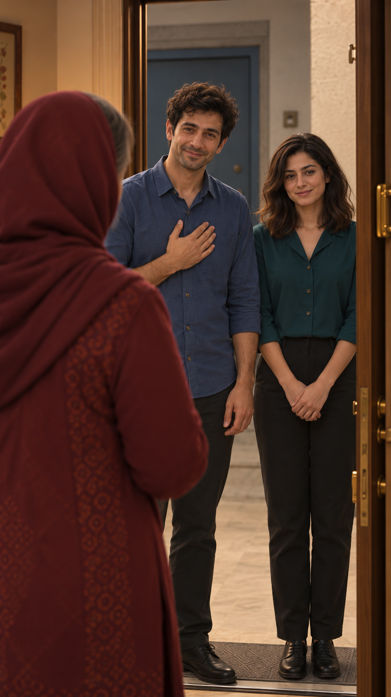

# مرور قاب مستقل ورود — EP03-SH02

تاریخ: ۲۰۲۶/۱۰/۱۴. وضعیت: پیشنهادی، در انتظار مرور کاربر؛ نه مجوز ارسال. [مرجع ظاهر](../../../../references/visuals/character-bible.md)، [چهره‌های مصوب](../../../episode-01/references/01-casting-and-living-room-concept-v1.png)، [پرترهٔ سامان](../../../episode-02/references/01-saman-portrait-v1.png) و [صفحهٔ ورود](../../references/EP03-arrival-storyboard-v5.png) با نقش‌های مشخص ورودی ابزار داخلی `image_gen` بودند.

مادر داخل پیش‌زمینه و سامان/نازلی بیرون آستانه در پاگرد؛ صورت و مو و لباس دو مهمان با مرجع مقایسه شدند، تغییر آشکار تشخیص داده نشد. نگاه نازلی نزدیک لنز است و باید به مادر منتقل شود؛ این ایراد باز است. کفش‌ها جزئیات تازهٔ پیشنهادی‌اند و بدون تصمیم مرجع لباس ثابت تلقی نشوند. هندسهٔ در در اتصال نما۱و۲ هنوز به کنترل نیاز دارد.

تطبیق مشخصات قابل‌دیدن: بررسی شد و قبول در حد مشاهدهٔ ثابت؛ نگاه نازلی در نمای۲ ایراد باز است. حرکت و صدا و لب‌خوانی: بررسی نشده. پذیرش تصویر تازه هنوز ثبت نشده. زمان‌گیری واقعی و هزینه/مجوز ویدیو وجود ندارد. متن گفتار مصوب بازنویسی نشده است.
