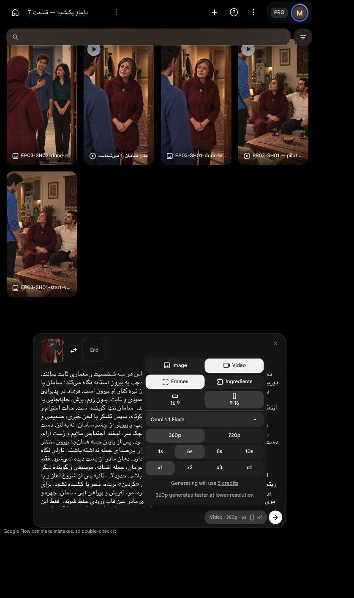

# وضعیت جاری: تولید یک‌بار انجام و صدا تبدیل شد

[نمونه و گزارش بازبینی](review.md). نگاه نازلی نیازمند اصلاح است؛ خروجی نهایی نیست. مجوز۵اعتباری مصرف شده؛ گزارش پایین سابقهٔ پیش از ارسال است.

# بستهٔ نمای دوم — پیش از تولید

وضعیت: **آمادهٔ مرور بسته و هزینه؛ ارسال نشده**. درخواست ارسال در کارت نما همچنان خالی است. هیچ اعتبار تولیدی در این مرحله مصرف نشد.

[](../../images/EP03-SH02-door-reply-v6.png)

## دیالوگ و اجرا

سامان: «بَلِه، سَلام. مَمْنون کِه دَعْوَتَم کَردین.»

وضعیت متن و بازی: همان نسخهٔ مصوب کارت نما. احترام و قدردانی ملایم۲از۵؛ ابتدا تأیید و سلام کوتاه، سپس تشکر خبری و صمیمی. دست راست از شروع روی سینه، تکان کوچک سر و لبخند اجتماعی ملایم؛ نگاه به مادر، نه دوربین. مادر داخل و از پشت در پیش‌زمینه، سامان و نازلی بیرون. مادر و نازلی کاملاً ساکت، فقط سامان لب‌خوانی کند. در و دوربین ثابت؛ ورود، دست‌دادن و نشستن به نمای بعد تعلق دارند.

[پرامپت کامل نهایی](prompt.txt) با دستور اجرا و متن گفتاری جدا، بدون تغییر داستان و دیالوگ. آغاز پیشنهادی حدود۰٫۳ثانیه، تمام‌شدن گفتار پیش از ثانیهٔ پنجم و حفظ کامل «کَردین»؛ ریتم طبیعی کند نشود. اضافهٔ بیرونی پس از بازبینی محلی کوتاه می‌شود.

## مرجع ثابت صدای سامان

[شنیدن مرجع مصوب سامان](../../../../../episode-02/shots/EP02-SH05/audio/EP02-SH05-voice-candidate-v1.wav) از مرجع فعال خود شخصیت در [مرجع صدا](../../../../../../references/voice/voice-bible.md) گرفته شد. وجود و اثرانگشت با مرجع فعال تطبیق داده شد. هیچ مرجع مادر یا صدای آمادهٔ عمومی جایگزین آن نمی‌شود.

روش اجرا: پس از برداشت، گفتار سامان استخراج و محلی با `Seed-VC` به همین مرجع تبدیل شود؛ منبع کامل و بازهٔ گفتار حفظ، سرعت و زیر‌وبمی دستی تغییر نکند، و پیش از پذیرش، هویت صدا و لب‌خوانی واقعی بررسی شوند. پذیرش روش برای مادر تضمین خودکار کیفیت سامان نیست. متن پرامپت از ابزار ادعای دریافت صدای مرجع نمی‌کند؛ فایل مرجع ورودیِ تبدیل محلی است، نه ورودیِ حالت `Frames`.

## کنترل مستند

| مورد | نتیجه و شاهد |
|---|---|
| متن و اعراب | با کارت مالک `EP03-D02` تطبیق داده شد؛ متن و پایان خبری محفوظ |
| بازی و مالکیت گفتار | جهت مصوب۲از۵، فقط سامان؛ سکوت و نبود لب‌خوانی نازلی/مادر صریح در پرامپت |
| زمان | [راهنمای مصنوعی محلی](timing-guide/scratch-only.json) از کل جمله در سرعت۱۶۵ساخته و۳٫۶۹۵ثانیه اندازه‌گیری شد؛ صدای تولیدی نهایی یا تأیید اجرای طبیعی نیست.۴ثانیه با حاشیهٔ ابتدا/انتها کافی نیست؛۶ثانیه حاشیه می‌دهد |
| هویت و لباس | خود قاب، پرتره سامان و تصویر خانواده دیده شدند؛ صورت و موی سامان/نازلی و لباس‌های مصوب این قسمت مقایسه شدند. صورت مادر پشت به دوربین و پوشیده است |
| نگاه، دوربین و فضا | [بازبینی واقعی فضای قاب و اتصال](../../house-review.md)؛ دوربین داخل رو به بیرون. نقشهٔ پاگرد و اندازهٔ لولا مرجع دقیق ندارند؛ در ثابت است و حرکت مکانیکی طراحی نمی‌شود |
| ابتدا و انتها و پیوستگی | همه ایستاده؛ دست سامان از شروع روی سینه، مادر از نمای اول ایستاده می‌ماند؛ پرش ورود یا نشستن وجود ندارد. حرکت واقعی آینده هنوز تولید نشده |
| راه محلی | برای نمای دوم ویدیوی خام موجود نیست. راهنمای ماشینی جای گفتار طبیعی نهایی استفاده نمی‌شود؛ تولید تازه فقط یک برداشت لازم دارد، تبدیل و تدوین محلی انجام می‌شوند |
| پرامپت و ورودی زنده | قاب صحیح بارگذاری و در شروع انتخاب شد، متن کامل در کادر مرورگر داخلی درج و دیده شد؛ تصاویر قدیمی گالری ورودی نیستند |
| تنظیمات و قیمت | `Omni 1.1 Flash`، `Frames`، عمودی۹:۱۶، `360p`،۶ثانیه،۱خروجی؛ قیمت زنده۵اعتبار |
| اجازهٔ هزینه | هنوز دریافت نشده. سقف پیشنهادی۵اعتبار `Flow` فقط برای همین یک برداشت؛ بدون تلاش مجدد. تبدیل و تدوین محلی صفر اعتبار خارجی |

[](ui-prepared.png)

خطرهای خروجی مولد همچنان باقی‌اند: تلفظ، بازی، هویت و لب‌خوانی باید واقعاً بررسی شوند؛ خطا مجوز تکرار خودکار نیست. تأیید نمای اول به نمای دوم تعمیم داده نشده. این بسته تضمین کیفیت خروجی یا اجازهٔ تولید نیست. [جزئیات و اثرانگشت بسته](review-package.json).


## تأیید همین بسته

کاربر در پاسخ به بستهٔ دقیق شش‌ثانیه‌ای با سقف۵اعتبار گفت «تأیید». دامنه فقط یک ارسال و تبدیل محلی صدای سامان است؛ تکرار مجاز نیست.

<!-- preflight-state -->
```json
{
  "shot": "EP03-SH02",
  "take": "take-01",
  "ready": true,
  "open_issues": [],
  "checks": {
    "dialogue": {
      "status": "pass",
      "evidence": "Approved EP03-D02 exact text and diacritics matched prompt and live editor"
    },
    "delivery": {
      "status": "pass",
      "evidence": "Respect and gratitude2/5, brief greeting then declarative thanks; ending کردین explicit"
    },
    "duration": {
      "status": "pass",
      "evidence": "Full local synthetic timing-guide measured3.695s;6s allows boundary margin; natural output timing requires post-generation review"
    },
    "performance": {
      "status": "pass",
      "evidence": "Previously approved hand on chest, slight nod, social smile; preflight.md"
    },
    "speaker": {
      "status": "pass",
      "evidence": "Only Saman speaks; Nazli and mother silent, listener lips still; prompt.txt"
    },
    "identity": {
      "status": "pass",
      "evidence": "Accepted unchanged v6 frame compared to Saman portrait and family reference; hidden mother face not exposed"
    },
    "eyeline": {
      "status": "pass",
      "evidence": "Frame and prompt point Saman and Nazli toward foreground mother, not lens; future eye motion unverified"
    },
    "geometry": {
      "status": "pass",
      "evidence": "house-review.md: inside camera toward outside landing; static door; exact hinge mechanics unmeasured and no door motion requested"
    },
    "continuity": {
      "status": "pass",
      "evidence": "Shot1 accepted standing hosts/guest; no entering or sitting; Saman hand was occluded in shot1 so chest pose no visible contradiction"
    },
    "camera": {
      "status": "pass",
      "evidence": "Approved static vertical over-mother-shoulder reverse; no zoom/mirror"
    },
    "prompt": {
      "status": "pass",
      "evidence": "Prompt SHA unchanged from approved package; full live editor observed matched"
    },
    "local_alternative": {
      "status": "pass",
      "evidence": "No existing shot2 footage; scratch timing voice not final. Seed-VC local route and Saman own reference bound for postprocess"
    },
    "settings": {
      "status": "pass",
      "evidence": "Live IAB screenshot model Omni1.1Flash Frames9:16 360p6s x1"
    },
    "cost": {
      "status": "pass",
      "evidence": "Live price5 credits; user current reply تأیید explicitly responds to exact one-output5-credit package"
    }
  },
  "consumed_attempts": 1,
  "bundle_sha256": "8375e6deaee26f116a4ea76071158d7adda492c29e6e36f4f89729d58416c98c",
  "content_approval": {
    "approved": true,
    "bundle_sha256": "8375e6deaee26f116a4ea76071158d7adda492c29e6e36f4f89729d58416c98c",
    "user_reply": "تأیید",
    "evidence_ref": "Current user reply to exact EP03-SH02 six-second360p one-output 5-credit ceiling package"
  },
  "cost_approval": {
    "approved": true,
    "bundle_sha256": "8375e6deaee26f116a4ea76071158d7adda492c29e6e36f4f89729d58416c98c",
    "user_reply": "تأیید",
    "evidence_ref": "Current user reply to exact EP03-SH02 six-second360p one-output 5-credit ceiling package"
  },
  "submission_state": "submitted_once_waiting"
}
```
<!-- /preflight-state -->
