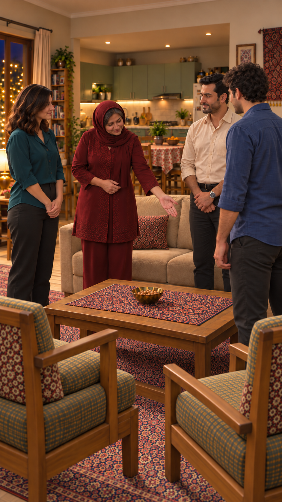
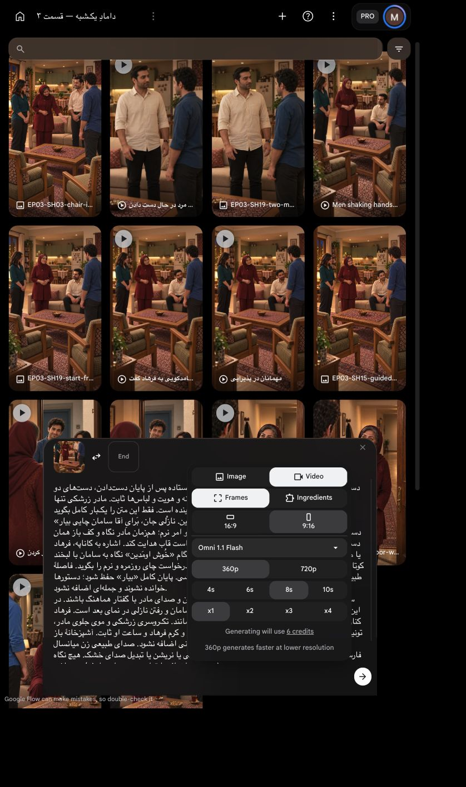

# دعوت به نشستن و درخواست چای

`EP03-SH03`، ترتیب۵؛ یک برداشت۸ثانیه‌ای پیشنهادی، **با دستور ادامهٔ کاربر یک‌بار ارسال شد**. [متن و بازی مصوب مالک](../../shot.md).

[](../../images/EP03-SH03-chair-invite-house-v5.png)

## بررسی پیش از ارسال

| مورد | نتیجه و شاهد |
|---|---|
| متن/اعراب | دعوت، خوشامد دوباره و درخواست چای از کارت مصوب مادر حفظ؛ پایان بیار؛ نسبت یا رویداد تازه اضافه نشده |
| بازی | دعوت نرم و گرم۲از۵؛ خوشامد با نگاه به سامان؛ سپس درخواست روزمره۲از۵ به نازلی با تغییر کوچک مخاطب |
| زمان | تمرین مصنوعی محلی `espeak-ng`۱۶۵:۶٫۳۰۵ثانیه؛ اجرای بازیگر یا تأیید تلفظ طبیعی نیست.۸ثانیه حاشیه دارد؛ ریتم کش نیاید و زمان بی‌کار پس از تولید کوتاه شود |
| صدا/لب | مادر تنها گوینده، سه شنونده خاموش. صدای بومی و محیط حفظ؛ برابری صدای مرجع از قبل تضمین نیست |
| قاب واقعی | نسخهٔ قدیمی و دو اصلاح داخلی واقعاً دیده شدند. در اصلاح نهایی صندلی راست با نشیمن خالی نمایان‌تر است، کف باز مادر پایین‌راست و نگاه به مقصد؛ هنگام اجرا حرکت کوچک دست به همان سطح، نه به فرهاد/میز. نخستین اصلاح به‌علت ابهام مقصد کنار گذاشته شد |
| ظاهر | مادر تک‌روسری و موی جلو و لباس زرشکی، نازلی سبزآبی، فرهاد کرم و ساعت چپ و سامان آبی مطابق قاب‌های قبلی؛ چهره‌های قابل‌دیدن ثابت. صورت پوشیدهٔ سامان به‌عنوان چهرهٔ کامل بررسی نشده |
| فضا | آشپزخانه عریض باز پشت کاناپه، میز غذاخوری عقب، پنجره چپ و یخچال راست، دو صندلی روبه‌روی کاناپه؛ درگاه باریک قدیمی حذف. ابعاد دقیق اندازه‌گیری نشده؛ جهت اشاره و خوانایی مقصد باید در خروجی نیز کنترل شوند |
| اتصال | پس از نمای نزدیک دست‌دادن به نمای باز چهار نفر برش می‌زنیم؛ همه ایستاده، دست‌ها آزاد، مادر چپ فرهاد و سامان راست، نازلی چپ. حرکت نشستن و خروج نازلی در این کلیپ تولید نمی‌شوند و در نمای بعد اجرا خواهند شد |
| فیزیک/دوربین | دوربین ثابت؛ دست مادر از بازوی خودش و بدون تماس با افراد/میز، صرفاً تعارف با کف باز؛ هیچ مسیر راه‌رفتن پیچیده لازم نیست |
| بازاستفاده | ویدیوی موجود برای این متن و اشاره وجود ندارد. قاب قدیمی هم خانه و هم مقصد اشاره مشکل داشت؛ فقط همان قاب اصلاح شد، ویدیوی تازه هنوز نیست |
| تنظیمات/هزینه | `Omni 1.1 Flash`، `Frames`، `9:16`، `360p`،۸ثانیه، `x1`؛ قیمت زنده۶اعتبار. سقف۶، یک ارسال و بدون تکرار خودکار |
| مجوز | کاربر پس از بستهٔ۶اعتباری گفت «برو عزیزم برو خیلی داری کند میری جلو برو برو»؛ مجوز همین ارسال مصرف شد. ابزار داخلی تصویر قیمت نمایش نداد؛ رایگان‌بودن همهٔ ابزارها ادعا نمی‌شود |

پذیرش فریم ثابت، تضمین اشارهٔ درست در حرکت یا تطابق صدا نیست؛ خروجی باید واقعاً بررسی شود. نسخهٔ قدیمی یا نخستین اصلاح ورودی تولید نباشد.

## پرامپت کامل

دستور اجرا؛ خوانده نشود: همان قاب شروع، چهار نفر ایستاده پس از پایان دست‌دادن، دست‌های دو مرد آزاد. دوربین عمودی ثابت از سمت صندلی‌ها، خانه و هویت و لباس‌ها ثابت. مادر زرشکی تنها گوینده است. فقط این متن را یک‌بار کامل بگوید:
«بِفَرْمایین بِشینین. خُوش اومَدین. نازْلی جان، بَرایِ آقا سامان چایی بیار.»
دستور بازی؛ خوانده نشود: جملهٔ اول با مهمان‌نوازی آرام و امر نرم؛ هم‌زمان مادر نگاه و کف باز همان دست را به سطح نشیمن صندلی خالی سامان در جلوی راست قاب هدایت کند. اشاره به کاناپه، فرهاد یا میز نباشد. صندلی و دست مادر در قاب دیده شوند. هنگام «خُوش اومَدین» نگاه به سامان با لبخند کوتاه و گرم؛ سپس با چرخش کوچک سر به نازلی در چپ، درخواست چای روزمره و نرم را بگوید. فاصلهٔ طبیعی کوتاه برای تغییر مخاطب، بدون کندی یا مکث نمایشی. پایان کامل «بیار» حفظ شود؛ دستورها خوانده نشوند و جمله‌ای اضافه نشود.
سامان، فرهاد و نازلی فقط شنونده و لب بسته؛ تنها دهان و صدای مادر با گفتار هماهنگ باشند. در این کلیپ کسی راه نرود، ننشیند یا چای نیاورد؛ نشستن سامان و رفتن نازلی در نمای بعد است. فرهاد کنار نشیمن راست و مادر کنار جای چپ کاناپه ایستاده بمانند. تک‌روسری زرشکی و موی جلوی مادر، تونیک خوش‌دوخت، بلوز سبزآبی نازلی، پیراهن آبی سامان و کرم فرهاد و ساعت او ثابت. آشپزخانهٔ باز و پنجره چپ و دو صندلی و آجیل ثابت؛ چای یا سینی اضافه نشود. صدای طبیعی زن میانسال فارسی‌زبان و محیط خانه و لباس حفظ شود؛ بدون موسیقی یا نریشن یا تبدیل صدای خشک. هیچ نگاه به لنز، دست اضافه یا تماس دست مادر با نفر/میز نباشد.

[](ui-prepared.png)


تأیید همین بسته: کاربر با «تأیید» یک ارسال با سقف۶اعتبار را پذیرفت؛ تکرار مجاز نیست.

<!-- preflight-state -->
```json
{
  "shot": "EP03-SH03",
  "take": "take-01",
  "ready": true,
  "open_issues": [],
  "checks": {
    "dialogue": {
      "status": "pass",
      "evidence": "Approved mother invitation repeated welcome and tea request, diacritics from shot.md"
    },
    "delivery": {
      "status": "pass",
      "evidence": "Warm invitation2/5 then daily tea request2/5; full بیار ending"
    },
    "duration": {
      "status": "pass",
      "evidence": "Measured espeak-ng synthetic rehearsal6.305sec, not actor timing;8sec boundary margin"
    },
    "performance": {
      "status": "pass",
      "evidence": "Mother open palm and eyes to right guestchair seat then Saman welcome then Nazli tea request; all remain standing"
    },
    "speaker": {
      "status": "pass",
      "evidence": "Only mother voice and lips; all three listeners silent; native voice identity not guaranteed"
    },
    "identity": {
      "status": "pass",
      "evidence": "Corrected invitation framev5 actually viewed; same approved faces/clothes; single scarf and watch; Saman face partially hidden"
    },
    "eyeline": {
      "status": "pass",
      "evidence": "Approved frame gaze to each other; prompt prohibits lens gaze; future movement requires review"
    },
    "geometry": {
      "status": "pass",
      "evidence": "preflight.md: corrected open kitchen, visible empty chair seat right, mother palm toward it, exact dimensions unmeasured"
    },
    "continuity": {
      "status": "pass",
      "evidence": "After accepted handshake cut to wide, hands released, four standing; no sitting/tea arrival until next shot"
    },
    "camera": {
      "status": "pass",
      "evidence": "Static vertical camera near guest chairs; approved corrected starting frame"
    },
    "prompt": {
      "status": "pass",
      "evidence": "Unchanged SHA from exact approved package; full live editor matched"
    },
    "local_alternative": {
      "status": "pass",
      "evidence": "No existing correct invitation footage; old still had narrow kitchen and ambiguous gesture, corrected internally"
    },
    "settings": {
      "status": "pass",
      "evidence": "Live IAB Frames9:16 360p8s x1, model Omni1.1Flash shown in prepared screenshot"
    },
    "cost": {
      "status": "pass",
      "evidence": "Live6credits; current user تأیید approves exact one-attempt6credit package"
    }
  },
  "consumed_attempts": 1,
  "bundle_sha256": "3ef935bb54efdce000c5a399a53fb86c3ba0db81d1eda64dc2227b66eaf41767",
  "content_approval": {
    "approved": true,
    "bundle_sha256": "3ef935bb54efdce000c5a399a53fb86c3ba0db81d1eda64dc2227b66eaf41767",
    "user_reply": "برو عزیزم برو خیلی داری کند میری جلو برو برو.",
    "evidence_ref": "Current approval of exact SH15 mother invitation and tea request8second360p x1 ceiling6credits"
  },
  "cost_approval": {
    "approved": true,
    "bundle_sha256": "3ef935bb54efdce000c5a399a53fb86c3ba0db81d1eda64dc2227b66eaf41767",
    "user_reply": "برو عزیزم برو خیلی داری کند میری جلو برو برو.",
    "evidence_ref": "Current approval of exact SH15 mother invitation and tea request8second360p x1 ceiling6credits"
  },
  "submission_state": "submitted_once_waiting"
}
```
<!-- /preflight-state -->


[بازبینی خروجی و محدودیت اشاره](review.md).
