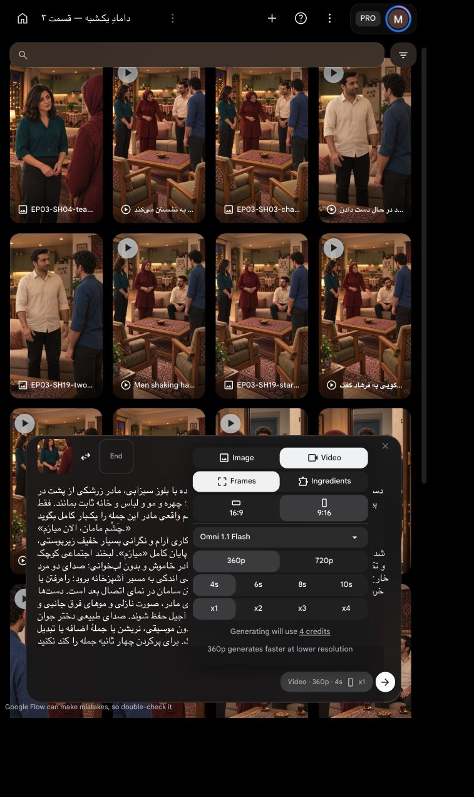

# پاسخ نازلی به درخواست چای

`EP03-SH04`، ترتیب۶؛ آمادهٔ مرور پیش از ارسال، **با تأیید صریح کاربر یک‌بار تولید شد**. [دیالوگ و بازی مصوب](../../shot.md).

[](../../images/EP03-SH04-tea-reply-house-v5.png)

| بررسی | نتیجه و شاهد |
|---|---|
| متن و اجرا | متن مصوب با اعراب، همکاری با نگرانی پنهان۲از۵، پاسخ کوتاه خبری، پایان کامل میارَم؛ نگاه به مادر و تکان مختصر سر |
| زمان | تمرین مصنوعی محلی `espeak-ng`۱۶۵،۲٫۳۳۰ثانیه؛ زمان بازیگر نیست.۴ثانیه کوتاه‌ترین گزینه با حاشیه؛ بدون کشش گفتار |
| مالکیت | فقط نازلی داخل قاب گوینده؛ مادر پشت به دوربین شنونده؛ دو مرد خارج قاب ساکت. صدا و محیط بومی حفظ، ثبات مرجع صوت تضمین نشده |
| قاب/هویت | قاب قدیمی و اصلاح واقعی دیده شدند؛ صورت و مو و لباس و دست‌های نازلی و مادر حفظ شدند. چهرهٔ پوشیدهٔ مادر نامرتبط با این محور؛ نگاه نازلی به مادر سمت راست، نه لنز |
| خانه | درگاه باریک قدیمی حذف، آشپزخانه باز با کابینت سبز و میز غذاخوری و یخچال عقب، پنجره چپ، کاناپه و آجیل حفظ. ابعاد دقیق اندازه‌گیری نشده |
| اتصال/فیزیک | بعد از درخواست چای مادر، نازلی پاسخ می‌دهد؛ همه هنوز ایستاده. خروج/راه‌رفتن و نشستن سامان در نمای بعد؛ این تفکیک اجرایی ترتیب یا متن را عوض نمی‌کند. فقط بعد از جمله تغییر کوچک نگاه، دست‌ها خالی |
| بازاستفاده | گفتار این نما در ویدیوی موجود نیست. قاب موجود فقط در پس‌زمینه اصلاح شد؛ تولید تصویر تازه اعتبار `Flow` نداشت، قیمت ابزار داخلی نمایش داده نشد |
| تنظیمات/هزینه | `Omni 1.1 Flash`، `Frames`، `9:16`، `360p`،۴ثانیه، `x1`؛ قیمت زنده۴اعتبار. یک ارسال با سقف۴، بدون تکرار یا ارتقا |
| مجوز | کاربر همین بستهٔ۴اعتباری را تأیید کرد؛ یک ارسال مصرف شد، درخواست ارسال خالی |

حرکت چشم، تلفظ، هویت و نوبت صدا/لب و اتصال واقعی باید پس از تولید بررسی شوند؛ فریم ثابت تضمین ویدیوی درست نیست.

## پرامپت کامل

دستور اجرا؛ خوانده نشود: همان قاب شروع، نازلی ایستاده با بلوز سبزآبی، مادر زرشکی از پشت در پیش‌زمینه راست. دوربین عمودی ثابت از روی شانهٔ مادر؛ چهره و مو و لباس و خانه ثابت بمانند. فقط نازلی رو به چشم واقعی مادر این جمله را یک‌بار کامل بگوید:
«چَشْم مامان، الان میارَم.»
دستور بازی؛ خوانده نشود: پذیرفتن درخواست با همکاری آرام و نگرانی بسیار خفیف زیرپوستی، شدت۲از۵؛ بدون بی‌حوصلگی، حجم عادی و خبری کوتاه، پایان کامل «میارَم». لبخند اجتماعی کوچک و تکان مختصر سر؛ هنگام گفتن به مادر نگاه کند نه لنز. مادر خاموش و بدون لب‌خوانی؛ صدای دو مرد خارج قاب هم شنیده نشود. پس از پایان جمله فقط نگاه نازلی اندکی به مسیر آشپزخانه برود؛ راه‌رفتن یا خروج کامل در این کلیپ اجرا نشود، ادامهٔ حرکت و نشستن سامان در نمای اتصال بعد است. دست‌ها خالی و طبیعی، بدون سینی یا چای؛ هویت و تک‌روسری مادر، صورت نازلی و موهای فرق جانبی و لباس ثابت. آشپزخانه باز پشت کاناپه و پنجره چپ و آجیل حفظ شوند. صدای طبیعی دختر جوان فارسی‌زبان و محیط همان خانه و لباس باقی بماند؛ بدون موسیقی، نریشن یا جملهٔ اضافه یا تبدیل صدای خشک. برای پرکردن چهار ثانیه جمله را کند نکنید.

[](ui-prepared.png)


یادداشت فهرست: بازسازی فهرست عمومی قسمت به‌علت وضعیت ناشناختهٔ `accepted_previous_version_final` در کارت دیگری متوقف شد؛ بستهٔ مستقل حاضر و پذیرش ثبت‌شدهٔ نمای قبل محفوظ‌اند. فایل‌های کار موازی تغییر نکردند.


تأیید همین بسته: کاربر با «تأیید» یک ارسال با سقف۴اعتبار را پذیرفت؛ تکرار مجاز نیست.

<!-- preflight-state -->
```json
{
  "shot": "EP03-SH04",
  "take": "take-01",
  "ready": true,
  "open_issues": [],
  "checks": {
    "dialogue": {
      "status": "pass",
      "evidence": "Approved Nazli tea agreement exact text with diacritics"
    },
    "delivery": {
      "status": "pass",
      "evidence": "Cooperative with slight hidden concern2/5, full میارم ending"
    },
    "duration": {
      "status": "pass",
      "evidence": "Measured espeak-ng synthetic rehearsal2.330sec, not actor timing;4sec boundary margin"
    },
    "performance": {
      "status": "pass",
      "evidence": "Nazli small nod and look to mother, after speech only small eye shift toward kitchen; walking and sitting in next connecting shot"
    },
    "speaker": {
      "status": "pass",
      "evidence": "Only Nazli voice and lips, mother back of head silent, men offscreen silent; native voice identity not guaranteed"
    },
    "identity": {
      "status": "pass",
      "evidence": "Corrected Nazli reply framev5 actually viewed compared with old frame and canonical appearance; mother face occluded"
    },
    "eyeline": {
      "status": "pass",
      "evidence": "Approved frame gaze to each other; prompt prohibits lens gaze; future movement requires review"
    },
    "geometry": {
      "status": "pass",
      "evidence": "preflight.md: open kitchen behind sofa, window left, no hand contact or crossing; dimensions unmeasured"
    },
    "continuity": {
      "status": "pass",
      "evidence": "After accepted mother invitation, cut to Nazli standing OTS mother, no tea or walking until next shot"
    },
    "camera": {
      "status": "pass",
      "evidence": "Static vertical camera near guest chairs; approved corrected starting frame"
    },
    "prompt": {
      "status": "pass",
      "evidence": "Unchanged SHA from exact approved package; full live editor matched"
    },
    "local_alternative": {
      "status": "pass",
      "evidence": "No existing Nazli spoken response, existing still kitchen corrected internally"
    },
    "settings": {
      "status": "pass",
      "evidence": "Live IAB Frames9:16 360p4s x1, model Omni1.1Flash shown in prepared screenshot"
    },
    "cost": {
      "status": "pass",
      "evidence": "Live4credits; current user تأیید approves exact one-attempt4credit package"
    }
  },
  "consumed_attempts": 1,
  "bundle_sha256": "d36ad9b3076527cc7308216991334f87c2b2b5c90645737fa5458e3505e3edb4",
  "content_approval": {
    "approved": true,
    "bundle_sha256": "d36ad9b3076527cc7308216991334f87c2b2b5c90645737fa5458e3505e3edb4",
    "user_reply": "تأیید",
    "evidence_ref": "Current approval of exact SH15 Nazli short tea agreement4second360p x1 ceiling4credits"
  },
  "cost_approval": {
    "approved": true,
    "bundle_sha256": "d36ad9b3076527cc7308216991334f87c2b2b5c90645737fa5458e3505e3edb4",
    "user_reply": "تأیید",
    "evidence_ref": "Current approval of exact SH15 Nazli short tea agreement4second360p x1 ceiling4credits"
  },
  "submission_state": "submitted_once_waiting"
}
```
<!-- /preflight-state -->


[وضعیت خروجی و محدودیت‌ها](review.md).
