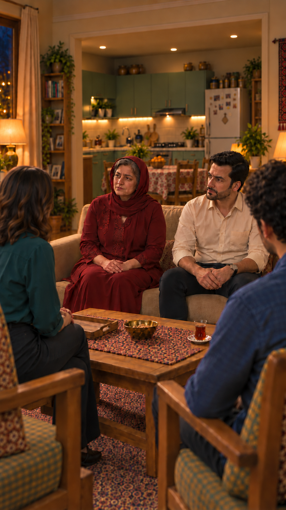

# بررسی پیش از ارسال نمای۷ — برداشت اول

وضعیت: آمادهٔ مرور بسته، منتظر تأیید صریح یک ارسال با سقف۴اعتبار؛ هنوز ارسال نشده.

[](../../images/EP03-SH07-seated-house-v5.png)

[پرامپت کامل](prompt.txt) · [ضبط کاربر](../../../../dialogs-input/07.m4a) · [تحلیل زمان واقعی ضبط](../../../../dialogs-input/analysis/07-analysis.json) · [مرجع خانه](../../../../../../house/apartment-cutaway-v2.png)

| کنترل | نتیجه و شاهد |
|---|---|
| متن و بازی | بررسی شد و قبول: متن دقیق کارت؛ بدگمانی مهارشده۲از۵، قصد پرسش درباره معرفی ناگهانی، بیان پرسشی مستقیم بدون حمله یا پوزخند، نگاه به نازلی. متن و بازی تأییدشده‌اند؛ اجرای آینده هنوز تولید نشده. |
| تلفظ و زمان | متن اعراب‌گذاری‌شده کارت حفظ شده؛ نَشْنیدِه با نفی، پایان بودیم پرسشی. ضبط واقعی کاربر۳٫۱۱۳ثانیه، تشخیص ماشینی پایان جمله۲٫۷۲؛۴ثانیه با حاشیه کافی. شنیدن مستقل انجام نشده و کیفیت آوایی ابزار از قبل تضمین نمی‌شود. این ضبط فقط راهنمای محلی ریتم است، ورودی صوتی قفل هویت نیست. |
| مالک گفتار | فقط فرهاد؛ مادر لب‌بسته، نازلی و سامان خاموش. هیچ گفتار یا ریتم صوتی تازه اختراع نشده. |
| صورت و لباس | تصویر هویت خانواده و سامان و قاب پیشین در همین گفتگو واقعاً دیده شدند؛ صورت/موی مرتب/ریش فرهاد، مادر با خطوط سن و تک‌روسری زرشکی و موهای جلوی سر حفظ؛ لباس کرم/زرشکی/سبزآبی/آبی مناسب موقعیت. صورت جوان‌ها در پیش‌زمینه عمداً پوشیده است و داوری آن بخش نامرتبط است. |
| فضا و دوربین | دوربین ثابت سمت جلو/کنار دو صندلی، رو به کاناپه؛ آشپزخانه باز پشت کاناپه، پنجره چپ، یخچال راست؛ همان مرجع خانه. دو تک‌صندلی رو به داخل، نازلی چپ و سامان راست؛ مادر چپ و فرهاد راست کاناپه. فاصله معمول نشیمن‌ها حفظ؛ ابعاد عددی از عکس اندازه‌گیری نشده‌اند. |
| بدن و نگاه | فرهاد رو به نازلی، دست‌ها در هم روی ران؛ مادر لب‌بسته. جابه‌جایی بدن یا دست جدید نیاز نیست. هیچ کنش در یا عبور از مبلمان نداریم. |
| اتصال و اشیا | بعد از سرو چای، نازلی نشسته؛ بازگشت و نشستن او با برش زمانی حذف می‌شود و تکرار نشستن نداریم. یک استکان با نعلبکی جلوی سامان، سینی چوبی خالی چپ و آجیل وسط؛ هیچ برداشتن چای در این نما نیست. پاسخ نازلی SH08 از قبل تولید و تأیید شده؛ تولید دوباره‌اش لازم نیست. |
| جایگزین محلی | ویدیوی قبلی از همین پرسش فرهاد در پوشه وجود ندارد؛ از SH08 موجود استفاده می‌شود. فقط قاب غلط زمینه اصلاح شد، بدون مصرف اعتبار Flow. |
| ابزار و قیمت | رابط زنده: Omni1.1Flash / Frames / 4s / 360p / 9:16 / x1،۴اعتبار. فقط همین قاب ورودی می‌شود؛ مرجع صدا یا تصاویر متعدد پشتیبانی‌شده فرض نشده‌اند. شاهد قیمت کنار این گزارش است. |
| محدودیت خروجی آینده | ثبات صوت، مالکیت لب، شنونده خاموش و حفظ ظروف پس از تولید باید بازبینی شوند؛ قبولی طراحی تضمین کیفیت خروجی یا مجوز تکرار نیست. |

## پرامپت کامل

```text
دستور ساخت؛ خوانده نشود. همان قاب آغاز، عمودی و ثابت، بدون برش یا حرکت دوربین. همه از قبل نشسته‌اند، نازلی پس از سرو چای روی صندلی چپ خودش برگشته است؛ نشستن دوباره نمایش داده نشود.
فقط فرهاد داخل قاب این جمله را دقیق و یک‌بار بگوید:
«پَس چِرا تا حالا چیزی نَشْنیدِه بودیم؟»
دستور بازی؛ خوانده نشود: بدگمانی مهارشده با شدت۲از۵، قصد به‌چالش‌کشیدن معرفی ناگهانی است؛ پرسشی مستقیم و طبیعی، بدون حمله، پوزخند یا عصبانیت نمایشی. فرهاد به چشم نازلی در پیش‌زمینه چپ نگاه کند، نه لنز؛ ابرو کمی جمع، بدن ثابت و دست‌ها روی ران یا در هم مثل قاب شروع. جمله با ریتم طبیعی و پایان پرسشی کامل اجرا شود، بدون کشش برای پرکردن چهار ثانیه.
فقط صدای فرهاد و فقط لب‌های او با همین جمله هماهنگ باشد. مادر داخل قاب شنونده ساکت و لب بسته، نازلی از پشت در پیش‌زمینه ساکت، سامان خارج دید صورت و ساکت است؛ هیچ گفتار، زمزمه یا لب‌خوانی شنونده‌ها اضافه نشود. صدای طبیعی اتاق و لباس حفظ شود، بدون موسیقی، نریشن یا صدای خشک استودیویی.
چهره، سن، مو و ریش فرهاد، پیراهن کرم و ساعت دست چپ مطابق قاب ثابت بمانند. مادر روی نشیمن چپ و فرهاد راست همان کاناپه با فاصله عادی؛ مادر لباس خوش‌دوخت و تک‌روسری زرشکی با موی واقعی جلوی سر نمایان دارد. نازلی بلوز سبزآبی و سامان پیراهن آبی؛ هیچ لباس یا چهره تازه ساخته نشود.
دو تک‌صندلی با جهت ثابت به داخل جمع، نازلی چپ و سامان راست، جابه‌جا یا چرخانده نشوند. آشپزخانه باز پشت کاناپه، کابینت سبز و میز غذاخوری عقب و یخچال راست و پنجره چپ ثابت. سینی چوبی خالی سمت چپ میز، یک استکان چای روی نعلبکی سفید گل‌قرمز جلوی سامان سمت راست میز و آجیل وسط باقی بمانند. کسی دست به چای نبرد، ظرف یا صندلی اضافه ظاهر نشود. پایان پس از آخرین واژه کامل، فرهاد هنوز رو به نازلی و منتظر پاسخ کوتاه باشد؛ جمله یا حرکت تکرار نشود.

```


<!-- preflight-state -->
```json
{
  "shot": "EP03-SH07",
  "take": "take-01",
  "ready": false,
  "open_issues": [],
  "checks": {
    "dialogue": {
      "status": "pass",
      "evidence": "Exact approved پَس چِرا تا حالا چیزی نَشْنیدِه بودیم؟ with diacritics"
    },
    "delivery": {
      "status": "pass",
      "evidence": "Restrained suspicion2/5, direct question no aggression, natural interrogative end"
    },
    "duration": {
      "status": "pass",
      "evidence": "Actual user07.m4a3.1133125sec; ASR ends2.72sec, live4sec allows complete word margin; no independent listening claimed"
    },
    "performance": {
      "status": "pass",
      "evidence": "Approved card performance, body/hands fixed, no smirk"
    },
    "speaker": {
      "status": "pass",
      "evidence": "Only Farhad speaks, mother lips closed, Nazli mouth hidden and Saman silent"
    },
    "identity": {
      "status": "pass",
      "evidence": "Corrected image actually viewed against family identity and prior approved frame; hair/beard/outfits preserved"
    },
    "eyeline": {
      "status": "pass",
      "evidence": "Farhad looks to Nazli left foreground, no lens gaze; Nazli mouth hidden"
    },
    "geometry": {
      "status": "pass",
      "evidence": "Open kitchen behind sofa, window left fridge right;2chairs preserved; sofa mother left Farhad right"
    },
    "continuity": {
      "status": "pass",
      "evidence": "After accepted tea service, Nazli seated; one tea right, empty tray left, nuts middle. Existing acceptedSH08 follows"
    },
    "camera": {
      "status": "pass",
      "evidence": "Static vertical near guest side, foreground listeners; no crossing axis"
    },
    "prompt": {
      "status": "pass",
      "evidence": "Approved prompt unchanged hash and matches live textbox"
    },
    "local_alternative": {
      "status": "pass",
      "evidence": "No priorSH07video, reuse already acceptedSH08"
    },
    "settings": {
      "status": "pass",
      "evidence": "Live Omni1.1Flash Frames4s360p9:16x1"
    },
    "cost": {
      "status": "pass",
      "evidence": "Explicit current user approval: oneSH07attempt ceiling4credits, no retry"
    }
  },
  "consumed_attempts": 1,
  "bundle_sha256": "2211a129408c70f2615f43aa4bd36bd75a5245ab2ace1413c53a50b4bd70e3c5",
  "content_approval": {
    "approved": true,
    "bundle_sha256": "2211a129408c70f2615f43aa4bd36bd75a5245ab2ace1413c53a50b4bd70e3c5",
    "user_reply": "تأیید",
    "evidence_ref": "User approval immediately following displayed SH07 take01 seated-house-v5 one4credit attempt"
  },
  "cost_approval": {
    "approved": true,
    "bundle_sha256": "2211a129408c70f2615f43aa4bd36bd75a5245ab2ace1413c53a50b4bd70e3c5",
    "user_reply": "تأیید",
    "evidence_ref": "User approval immediately following displayed SH07 take01 seated-house-v5 one4credit attempt"
  },
  "submission_state": "completed_no_retry"
}
```
<!-- /preflight-state -->
