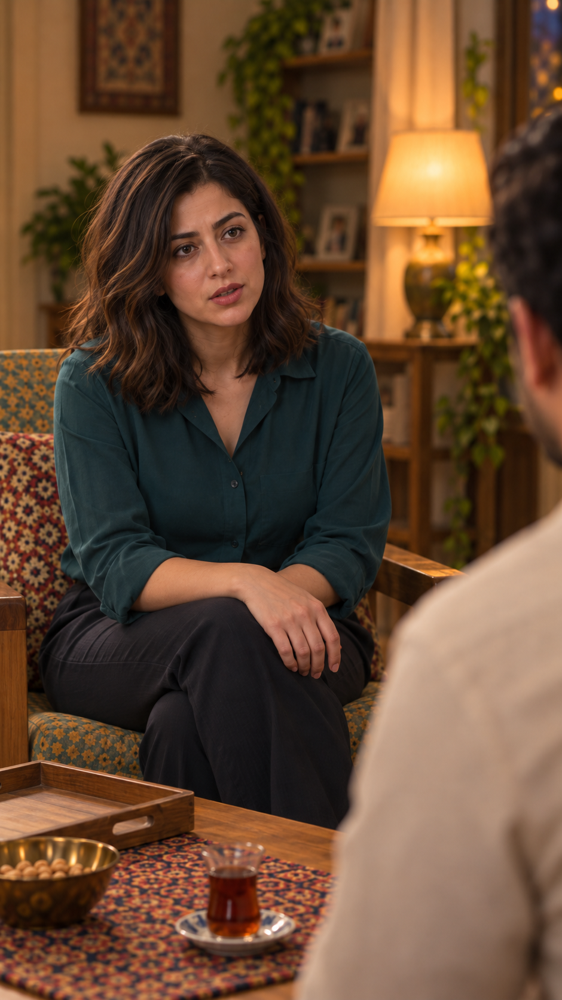

# مرور عکس مستقل — EP03-SH08

تاریخ: ۲۰۲۶/۱۰/۱۴. مرجع `appearance-v1`. وضعیت: پیشنهادی برای مرور؛ تصویر مصوب هویت و نمای جمع پذیرفته‌شده واقعاً ورودی ابزار داخلی `image_gen` بودند. متن و بازی مصوب تغییر نکردند؛ هیچ ویدیو یا مجوز ارسال ثبت نشد.

نازلی با بلوز سبزآبی و موی تا شانه خطاب به فرهاد و دست خالی دیده می‌شود؛ شانهٔ کرم فرهاد در پیش‌زمینه است. چهرهٔ سه‌رخ با مرجع مصوب مقایسه شد و تغییر آشکار تشخیص داده نشد؛ سمت پنهان صورت تأیید کامل ندارد. پارچه و نقش صندلی در عکس تازه با نمای مرجع متفاوت است؛ هندسهٔ نمای معکوس و جای استکان نسبت به سامان نیز باید با پلان ثابت تطبیق داده شوند. این موارد ایراد باز هستند، نه حل‌شده.

[مرجع ثابت شخصیت‌ها](../../../../references/visuals/character-bible.md) · [مرجع چهره‌های خانواده](../../../episode-01/references/01-casting-and-living-room-concept-v1.png) · [چیدمان جمع](../EP03-SH07/images/EP03-SH07-seated-after-tea-v3.png). چهره‌های خارج قاب یا پنهان بررسی کامل نشدند. پذیرش عکس تازه، حرکت، زمان‌گیری و صدای واقعی در انتظارند. وضعیت جمع‌بندی: ایراد باز برای نمای۸؛ بررسی نشده برای حرکت/صدای هر دو نما.
