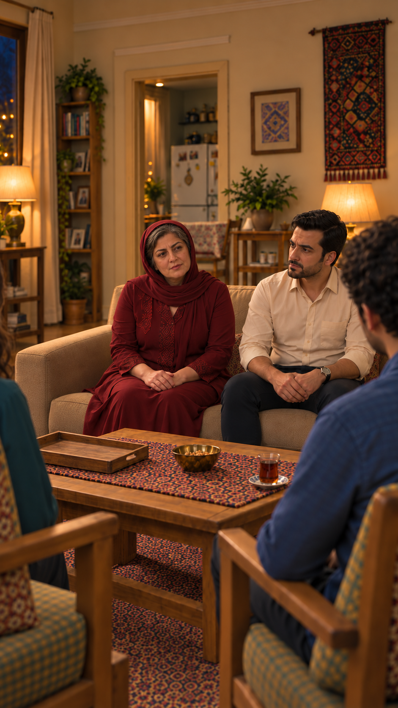

# مرور عکس مستقل — EP03-SH09

تاریخ: ۲۰۲۶/۱۰/۱۴. مرجع `appearance-v1`. وضعیت: پیشنهادی برای مرور؛ تصویر مصوب هویت و نمای جمع پذیرفته‌شده واقعاً ورودی ابزار داخلی `image_gen` بودند. متن و بازی مصوب تغییر نکردند؛ هیچ ویدیو یا مجوز ارسال ثبت نشد.

مادر با روسری واحد و موی نمایان و تونیک زرشکی روی نشیمن چپ، فرهاد روی راست و شانهٔ آبی سامان در پیش‌زمینه است. مو، لباس، سن و ویژگی‌های قابل‌دیدن صورت‌ها با مرجع مصوب و نمای جمع تطبیق داده شدند؛ تغییر آشکار تشخیص داده نشد. فاصلهٔ بازوها بدون تماس دیده می‌شود. پنجره چپ و آشپزخانه عقب و بافته راست حفظ شده‌اند؛ چای جلوی سامان و سینی خالی سمت نازلی است. انتقال نگاه مادر از نازلی به سامان و لب‌خوانی هنوز فقط دستورند، نه حرکت بررسی‌شده.

[مرجع ثابت شخصیت‌ها](../../../../references/visuals/character-bible.md) · [مرجع چهره‌های خانواده](../../../episode-01/references/01-casting-and-living-room-concept-v1.png) · [چیدمان جمع](../EP03-SH07/images/EP03-SH07-seated-after-tea-v3.png). چهره‌های خارج قاب یا پنهان بررسی کامل نشدند. پذیرش عکس تازه، حرکت، زمان‌گیری و صدای واقعی در انتظارند. وضعیت جمع‌بندی: ایراد باز برای نمای۸؛ بررسی نشده برای حرکت/صدای هر دو نما.
