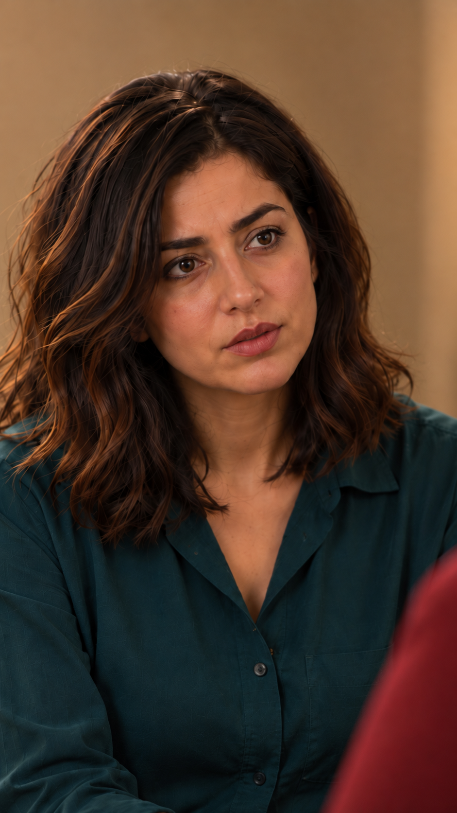

# بررسی مستقل فضا — نمای۱۱، نسخه۵

۲۰۲۶/۱۰/۱۵؛ مشاهدهٔ واقعی تصویر خانه، پلان شماتیک، قاب۱۱قدیمی، نسخه۴و۵ و قاب‌های۱۰و۱۲ انجام شد. پذیرش هنری نسخه۵ و مجوز هزینه ثبت نشده‌اند.

مرجع: [خانه نسخه۲](../../../../house/apartment-cutaway-v2.png)، [پلان نسخه۱](../../../../house/apartment-plan-v1.svg). دوربین نزدیک جای مادر، سمت چپ کاناپه و رو به نازلی در جلو چپ خانه، هم‌ارتفاع چشم نشسته؛ آشپزخانه و کتابخانه پشت دوربین‌اند. دیوار جلوی خانه پشت نازلی است. نسخه۳ کتابخانه را پشت نازلی نشان می‌داد؛ ناسازگار است و مبنای ارسال آینده نیست. نسخه۴ کتابخانه را حذف کرد ولی روکش صندلی همچنان دقیقاً با مرجع تطبیق نداشت؛ برای تولید استفاده نشود. نسخه۵ با همان طرح مصوب متوسط نزدیک، مبلمان/میز/دست‌ها و پنجره را خارج قاب نگه می‌دارد.

| کنترل | نتیجه | شاهد و محدودیت |
|---|---|---|
| جهت معماری و پس‌زمینه | بررسی شد و قبول | فقط دیوار کرم محو؛ آشپزخانه و کتابخانهٔ نادرست دیده نمی‌شوند. قاب برای اثبات ابعاد ساختمان نیست. |
| مالک نشیمن و دوربین | بررسی شد و قبول | نازلی روی نشیمن خودش، مادر پیش‌زمینه راست؛ لنز نزدیک جای مادر رو به نازلی است؛ دوربین ثابت. |
| جهت و فاصله دو صندلی | نامرتبط با دلیل | هیچ صندلی در این قاب نزدیک دیده نمی‌شود؛ جابه‌جایی یا زاویه۹۰درجه از این تصویر قابل‌اندازه‌گیری نیست و تأیید نشده. در پرامپت حفظ چیدمان الزامی است. |
| بدن، دست و اشیا | نامرتبط با دلیل | دست، میز، سینی، چای و پا خارج قاب‌اند؛ کنش فیزیکی یا تماس تازه در این نما وجود ندارد. وضعیت دست روی ران از کارت محفوظ و خارج دید است. |
| جای فرد و نگاه | بررسی شد و قبول | صورت نازلی و شانه مادر؛ سامان و فرهاد خارج میدان دید، بدون صندلی خالیِ در معرض دید؛ نگاه نازلی راست لنز. چشم مادر پوشیده است و برخورد دقیق دو نگاه در حرکت هنوز دیده نشده. |
| اتصال به۱۰و۱۲ | ایراد باز | قاب‌های۱۰و۱۲ دیده شدند؛ کتابخانه پشت سامان در۱۰ با خانه سازگار نیست. ویدیوی منتخب مجاور موجود نیست. این ایراد متعلق به مرز مشترک است و فایل۱۰ ویرایش نشد. |
| هویت و پوشش | بررسی شد و قبول | [گزارش ظاهر](appearance-review-v5.md)، در محدودهٔ واقعاً دیده‌شده. |

تصمیم فنی: هندسهٔ قابل‌دیدن نسخه۵ برای قاب نزدیک قابل‌استفاده است؛ آمادگی کل بسته هنوز مسدود است. بدون ادعای تأیید صندلی پوشیده یا حرکت تولیدنشده. نسخه۳ فقط سابقهٔ پذیرش هنری پیش از کشف ایراد است. مبناهای درست حفظ می‌شوند: چهره، لباس، نگاه و جای افراد؛ نور و لحظهٔ لب مرجع بازی ویدیو نیستند.

اثر انگشت خروجی: `ccee50e6a146bfd61de81de1dc6bcc1d472c5dd85a1316df3b6408d08a76c413`؛ خانه: `3646dc1faad613c957d2b4f70e4125d4ab1cbcffd18ca3591942f4c0b7bdbdf0`؛ پلان: `adcde1ce4fa4127b60d56ec57c0cdf7cf60a7f62e085804b1bdd168a90c85dd8`.
