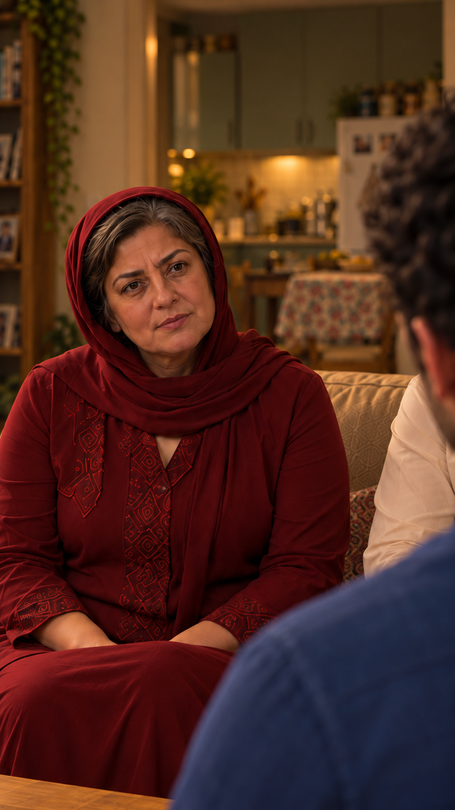

# تطبیق نمای۱۲ با ظاهر و خانه — نسخه۴

۲۰۲۶/۱۰/۱۵؛ خودِ [قاب اصلاحی](images/EP03-SH12-open-kitchen-v4.png)، [قاب قبلی](images/EP03-SH12-mother-awareness-v3.png)، [خانه از بالا](../../../../house/apartment-cutaway-v2.png)، [پلان](../../../../house/apartment-plan-v1.svg) و [چهره‌های مصوب](../../../../episodes/episode-01/references/01-casting-and-living-room-concept-v1.png) واقعاً مشاهده و مقایسه شدند. نسخهٔ ظاهر `appearance-v1`.

دوربین از کنار شانه سامان، سمت صندلی جلوی راست، رو به نیمه چپ کاناپه و هم‌ارتفاع چشم نشسته است. پشت مادر باید آشپزخانه باز، کتابخانه در حاشیه چپ عمق و فرهاد سمت راست کاناپه باشد. خانه نقش هندسه، پنل وسط نقش صورت مادر و قاب قدیمی نقش لباس و ژست را داشتند.

| کنترل | نتیجه | شاهد |
|---|---|---|
| آشپزخانه و پس‌زمینه | بررسی شد و قبول | درگاه باریک قبلی حذف و آشپزخانه باز با کابینت سبز پشت کاناپه دیده می‌شود. هیچ در ورودی پشت مادر نیست؛ کتابخانه حاشیه چپ است. ابعاد واقعی اندازه‌گیری نشده‌اند. |
| جای افراد و مبلمان | بررسی شد و قبول | مادر چپ کاناپه، تکه بدن کرم فرهاد در سمت راست او، سامان پیش‌زمینه راست؛ بدن فرهاد حذف نشده و صورتش به‌طور موجه پوشیده است. |
| صندلی‌های دو جوان و فاصله | نامرتبط با دلیل | پشتی/پایه صندلی‌ها و نازلی خارج قاب‌اند؛ زاویه۹۰درجه از این عکس ثابت اثبات نمی‌شود؛ جابه‌جایی ممنوع است. |
| دست و اشیا | بررسی شد و قبول | بخش بالای دست‌های مادر روی ران، بدون گرفتن شیء؛ پایین میز در لبه قاب و چای/سینی خارج برش‌اند، نه حذف داستانی. حرکت و تماس تازه نداریم. |
| نگاه | بررسی شد و قبول | نگاه مادر راست لنز و به محل سر سامان؛ چشم سامان پوشیده است، هماهنگی حرکت آینده هنوز کنترل نشده. |
| مادر؛ هویت و پوشش | بررسی شد و قبول | شکل چشم/ابرو، بینی، لب، فک، بافت سن و موی خاکستری با پنل مصوب و قاب قبلی تطبیق داده شد. یک روسری زرشکی، بدون نوار داخلی صاف یا کلاه؛ تونیک زرشکی و نقش آن حفظ شدند. |
| فرهاد؛ پوشش | بررسی شد و قبول | تکه پیراهن کرم، همان نشیمن کنار مادر؛ صورت پوشیده و برای این قاب نامرتبط است؛ در حرکت نباید چهره تازه ساخته شود. |
| سامان؛ پشت سر و لباس | بررسی شد و قبول | موی تیره موج‌دار و پیراهن آبی، پشت سر؛ صورت و دهان خارج دید، مرجع هویت تازه ایجاد نمی‌کند. |
| اتصال۱۱←۱۲←۱۳ | بررسی شد و قبول برای طرح | پایان۱۱ نازلی رو به مادر، آغاز۱۲ مادر رو به سامان؛ تغییر مخاطب/زاویه انگیزه روایی دارد. گفتار نازلی تکرار نمی‌شود و پاسخ سامان در۱۳ است. اتصال واقعی ویدیو هنوز ساخته نشده. |

هندسهٔ قابل‌دیدن و ظاهر این قاب برای آماده‌سازی قبول؛ پذیرش هنری تازه و مجوز هزینه هنوز دریافت نشده‌اند. حفظ: صورت، لباس، مکان افراد و پس‌زمینه باز. فقط مرجع: حالت لحظه‌ای لب/نور؛ هیچ قبولیِ حرکت یا صدا از عکس استنتاج نمی‌شود.

اثر انگشت خروجی: `75867f87ca6fbdb393ea336fa1cd4e0951fe23e9a4a7b0f9eb7ac8f8e60e9465`.
