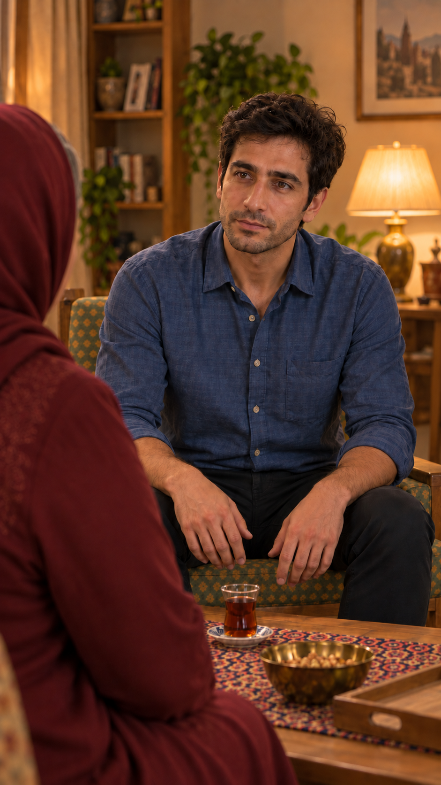

# مرور قاب مستقل `EP03-SH13`

وضعیت: پیشنهادی، ۲۰۲۶/۱۰/۱۵.

## نتیجه مشاهده

سامان در صندلی سبز با نقش طلایی، شانه مادر پیش‌زمینه چپ، نگاه به مادر؛ پشت مهمان کتابخانه و چراغ و دیوار است و آشپزخانه تکرار نشده. دست‌ها روی ران، چای دست‌نخورده. صورت سامان با پرتره مصوب تطبیق بصری شد؛ صورت مادر خارج دید است.

- بررسی شد و قبول در تصویر ثابت: وضعیت بدن و اشیا و لباس قابل‌دیدن، جهت اصلی مخاطب و اتاق طبق شرح بالا.
- مرجع هویت: [مرجع ثابت](../../../../references/visuals/character-bible.md)؛ صورت‌های قابل‌دیدن با تصویر خانواده و پرتره سامان مقایسه بصری شدند، نه سنجش زیست‌سنجی.
- بررسی نشده: حرکت، صدای فارسی، هماهنگی لب، زمان واقعی و اتصال برداشت‌ها؛ هیچ ویدیوی تازه تولید نشده.
- نیازمند تصمیم: پذیرش همین عکس توسط کاربر. قاب فعال فعلی خودکار جایگزین نشد، درخواست ارسال خالی است.
- [پرامپت دقیق](images/EP03-SH13-mother-unaware-reply-v2-prompt.txt)، ابزار داخلی `image_gen`.
- اثرانگشت تصویر: `e09d1ff064026c6373e3b564bea6a70079e2beee380e01071992b6316c82547f`.

## پذیرش

کاربر در ۲۰۲۶/۱۰/۱۵ با «تایید. قدم بعدی» تصویر را پذیرفت؛ به قاب فعال متصل شد. بررسی‌های حرکتی و صوتی همچنان انجام نشده‌اند.
