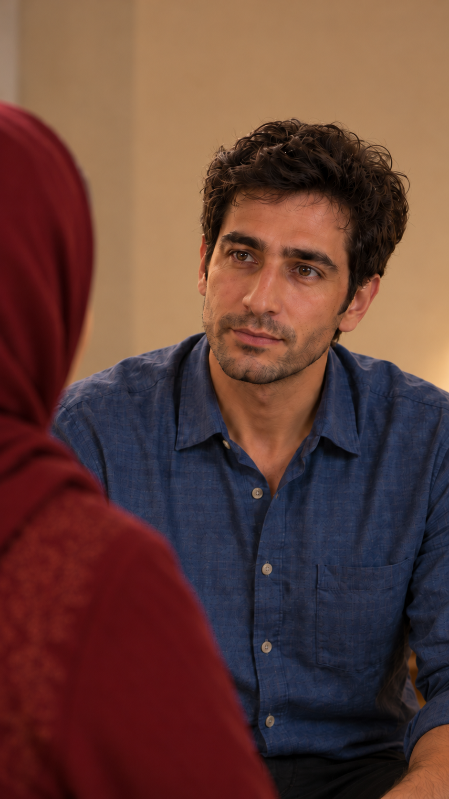

# EP03-SH13

**پذیرش برای ادامه — ۲۰۲۶/۱۰/۱۵:** پس از نمایش مجموعه اصلاح‌ها، کاربر گفت «مرحله بعد رو بریم». این شاهد ادامه با همین قاب‌هاست؛ به معنی تأیید حرکت/صدا یا مجوز هزینه نیست.

[اصلاح پیشنهادی پیوستگی و گزارش مشاهده](continuity-fix-review.md) — با دستور ادامهٔ کاربر فعال شد.

[قاب مستقل تازه و گزارش بازبینی](remaining-frame-review.md) — پیشنهادی؛ جایگزین خودکار قاب فعال نیست.

**پذیرش تصویر — ۲۰۲۶/۱۰/۱۵:** کاربر با «تایید. قدم بعدی» پنج قاب صفحهٔ مرور را پذیرفت. همین نسخه قاب فعال شد؛ تأیید صدا، حرکت یا هزینه نیست.

## وضعیت فعلی

- برداشت منتخب: برداشت۱، نسخهٔ۳٫۵ثانیه‌ای با صدای اصلی — تأییدشده توسط کاربر.
- اجازهٔ ارسال تازه: **مسدود؛ مجوز بستهٔ تازه کامل نیست**.
- مورد باز: [بازبینی برداشت۱](takes/take-01/review.md)، ورود کوچک دست، پذیرش صدا/حرکت و اتصال؛ مجوز یک تلاش مصرف شد.
- قدم بعد: [بستهٔ پیشنهادی نمای۱۳](takes/take-01/preflight.md)، [قاب نزدیک نامزد](images/EP03-SH13-close-house-v4.png) و [پرامپت کامل](takes/take-01/prompt.txt). منتظر مرور و تأیید هزینه؛ ارسال نشده.
- [قاب فعال](images/EP03-SH13-close-house-v4.png)

## اطلاعات فعال برای ابزارها

این بلوک تنها مرجع انتخاب برداشت و درخواست ارسال است؛ جدول‌های قسمت از آن ساخته می‌شوند. `send_request: null` یعنی هیچ درخواست ارسال فعالی وجود ندارد. تأییدهای تاریخی مجوز تازه نیستند.

<!-- shot-state -->
```json
{
  "shot": "EP03-SH13",
  "active": true,
  "order": 19,
  "selected_take": "take-01",
  "selected_video": "takes/take-01/edits/EP03-SH13-review-v1.mp4",
  "selected_sha256": "a557979802bab9dada4c781c4e7d5c44c558c325ea801e23c0dadd61506fb8e2",
  "selection_status": "user_approved",
  "selection_evidence": "User تأیید؛ برو نمای۱۴ after3.5second native-audio preview and disclosed hand entry.",
  "trim": {
    "in": 0,
    "out": 3.5
  },
  "active_frame": "images/EP03-SH13-close-house-v4.png",
  "send_request": null
}
```
<!-- /shot-state -->

## متن و دستور اجرا

مرجع فعال: نسخهٔ۳ مصوب؛ نسخه‌های قدیمی فقط در تاریخچهٔ قسمت محفوظ‌اند.

[پیوستگی قسمت](../../continuity.md) · [قواعد پروژه](../../../../project-rules.md)

<a id="v3-ep03-d13"></a>
### `EP03-D13` — سامان
- متن: «هَنوز باهاشون حَرْف نَزَدَم.»
- مالک گفتار: CH-SAM؛ خطاب به مادر؛ EP03-SH13؛ نوبت 13 از۱۴؛ حضور پیشنهادی در قاب: سامان گویندهٔ داخل قاب؛ پشت سر و شانهٔ مادر در پیش‌زمینه و دهان او خارج دید؛ نازلی و فرهاد خارج قاب.
- طرح قاب، حرکت، اتصال و بازی شنونده‌ها: [EP03-SH13](#camera)؛ طرح تأییدشده؛ نسخهٔ جاری عکس در قاب فعال کارت و گزارش پذیرش مشخص است.
- حالت: صداقت آرام، ۲/۵. قصد: بیان واقعیت بدون ساختن اطلاع یا رضایت مادر خودش. بیان: خبریِ ساده، بدون عذرخواهی طولانی، من‌من یا لبخند شوخی. رفتار: حفظ نگاه به مادر؛ قامت طبیعی.
- وضعیت متن: تأییدشده توسط کاربر در ۲۰۲۶/۱۰/۱۴؛ جهت بازی: تأییدشده با دستور ساخت قاب‌ها در ۲۰۲۶/۱۰/۱۴؛ پذیرش تصویر و برداشت جداست.
- قاب مرجع فعال: [](images/EP03-SH13-close-house-v4.png)؛ عکس جاری از قاب فعال همین کارت خوانده می‌شود. شروع حرکت در بستهٔ برداشت جدا تعیین شود.

<a id="camera"></a>
## دوربین و اتصال اختصاصی

طرح مصوب؛ وضعیت تصویر و اجرای واقعی جداست. [پیوستگی مشترک](../../continuity.md)

| ترتیب | شناسه و نوبت | قاب، زاویه و حرکت | بازی و وضعیت دیگران | ابتدا ← انتها و کارکرد | مصرف تخمینی |
|---|---|---|---|---|---|
| 19 | SH13؛ D13 سامان | متوسط نزدیک از روی شانهٔ مادر، ثابت؛ کمی بازتر از انتهای SH10 با برش روشن | صداقت آرام۲/۵ برای پاسخ واقعی؛ خبری ساده، بدون من‌من؛ نگاه به مادر | دست‌ها ثابت؛ پاسخ هنوز وعدهٔ آوردن مادر نیست؛ چای دست‌نخورده | ۱٫۵–۲٫۵ثانیه |

## برداشت‌ها و تاریخچه


؛ اطلاعات تکراری قدیمی فقط سابقه‌اند.

## آماده‌سازی نسخه۴ —۲۰۲۶/۱۰/۱۵

متن مصوب و بازی محفوظ‌اند؛ [قاب نزدیک با پس‌زمینهٔ کرم](images/EP03-SH13-close-house-v4.png) کتابخانهٔ ناسازگار قبلی را خارج دید نگه می‌دارد. [تطبیق واقعی](appearance-and-space-v4.md). قاب قبلی تا پذیرش بسته تازه عوض نشد؛ درخواست ارسال خالی است.

## خروجی واقعی —۲۰۲۶/۱۰/۱۵

کاربر بستهٔ۴اعتباری را با «تأیید» پذیرفت؛ یک ارسال۴ثانیه‌ای انجام و اصل و نسخهٔ۳٫۵ثانیه‌ای با صدای اصلی ذخیره شدند. [نمونه و محدودیت‌ها](takes/take-01/review.md). هنوز منتخب نیست؛ درخواست ارسال خالی و مجوز یک تلاش مصرف شده است.

## پذیرش کاربر —۲۰۲۶/۱۰/۱۵

کاربر پس از نمونه و توضیح ورود کوچک دست گفت «تأیید؛ برو نمای۱۴». نسخهٔ۳٫۵ثانیه‌ای منتخب شد؛ محدودیت شنیدن دستیار با این تصمیم به ادعای شنیدن تبدیل نمی‌شود.
