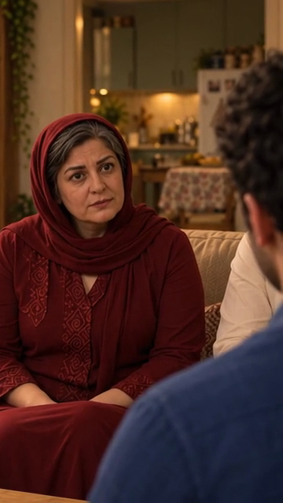

# مرجع شروع نمای۱۴ — استخراج از برداشت پذیرفته‌شده

۲۰۲۶/۱۰/۱۵؛ [قاب شروع](images/EP03-SH14-from-selected-SH12-v1.png) از ثانیه۴٫۵ [نسخه منتخب نمای۱۲](../EP03-SH12/takes/take-02/edits/EP03-SH12-question-review-v2.mp4) استخراج شد؛ بازهٔ منبع اصلی حدود۴٫۷۵ثانیه است. استخراج محلی بدون ویرایش محتوای تصویر یا تولید تازه. محدودیت وضوح واقعی۳۶۰×۶۴۰ حفظ شده، جزئیات تازه ادعا نمی‌شود.

خود قاب استخراجی، قاب قدیمی۱۴، مرجع خانه/پلان و چهره مصوب مادر در این گردش کاری واقعاً دیده و مقایسه شدند؛ ظاهر `appearance-v1`. مرجع‌های مشترک: [خانه](../../../../house/apartment-cutaway-v2.png)، [پلان](../../../../house/apartment-plan-v1.svg)، [هویت‌ها](../../../../references/visuals/character-bible.md). [تطبیق قاب پایهٔ۱۲](../EP03-SH12/appearance-and-space-v4.md).

| کنترل | نتیجه | شاهد و حدود |
|---|---|---|
| معماری و دوربین | بررسی شد و قبول | دوربین سمت سامان رو به کاناپه؛ آشپزخانه باز با کابینت سبز پشت مادر، کتابخانه حاشیه چپ عمق. درگاه باریک قاب تاریخی۱۴ کپی نشد. |
| جای افراد | بررسی شد و قبول | مادر نشیمن چپ، تکه پیراهن کرم فرهاد سمت راست او، پشت سر/شانه آبی سامان راست پیش‌زمینه. صورت فرهاد و سامان به‌طور موجه پوشیده‌اند و شخصی حذف نشده. |
| مبلمان/فاصله | نامرتبط با دلیل برای بخش پوشیده | دو صندلی در قاب نیستند و اندازه‌گیری فاصله/زاویه از آن ادعا نشده؛ نشیمن کاناپه و بدن ثابت‌اند. |
| دست و اشیا | بررسی شد و قبول در محدوده دیده‌شده | دست مادر پایین روی ران نزدیک به هم؛ چای/سینی از پایین قاب بیرون‌اند، هیچ شیء در دست نیست. تماس تازه نداریم. |
| هویت مادر | بررسی شد و قبول در وضوح موجود | همان صورت، موی پیشانی خاکستری، روسری تک‌لایه زرشکی و تونیک پذیرفته‌شدهٔ۱۲. جزئیات ریز خارج قدرت تصویر تأیید زیستی نشده. |
| شنونده‌ها | بررسی شد و قبول برای بخش دیده‌شده | پیراهن کرم فرهاد و آبی سامان؛ دهان هر دو پوشیده. نازلی خارج میدان دید. |
| اتصال۱۳←۱۴ | بررسی شد و قبول برای طرح و قاب شروع | پاسخ۱۳ سامان رو به مادر؛ این برش معکوس دعوت مادر رو به سامان است. قاب مادر از رسانه واقعاً منتخب گرفته شده. اتصال و حرکت ویدیو تازه تا تولید بررسی نشده‌اند. |
| نگاه | بررسی شد و قبول | مادر راست لنز به محل سر سامان نگاه می‌کند؛ چشم شنونده پوشیده است، هماهنگی دقیق در حرکت باید کنترل شود. |

قاب برای آماده‌سازی از نظر بخش قابل‌دیدن قبول؛ حرکت پیشروی بسیار کوتاه در دعوت قید طراحی است، اندازه‌گیری فیزیکی انجام نشده. حرکت/صوت آینده و پذیرش نهایی جداست. حفظ: صورت و لباس، جای افراد و خانه. فقط مرجع: حالت لحظه‌ای لب و نور.

اثر انگشت قاب: `a915294c0c8bf856c767a9fb08d55fc8081343a22736d25400ba4870bb93ee6b`؛ رسانهٔ استخراج: `e34db493a407e70b68193714bba4d76051cfaa63b1acdbffea5cf2ba783f0f9d`.
