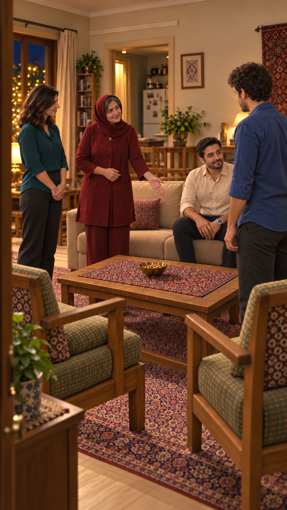

# مرور قاب مستقل `EP03-SH15`

وضعیت: پیشنهادی، ۲۰۲۶/۱۰/۱۵.

## نتیجه مشاهده

مادر ایستاده داخل پذیرایی، فرهاد نشسته در نشیمن راست؛ سامان و نازلی ایستاده. دست‌دادن هنوز شروع نشده، چای و سینی نیست. مسیر کنار میز و صندلی راست مهمان دیده می‌شود. صورت سامان عمدتاً پشت و سه‌رخ است؛ تطبیق کامل اجزای صورت او در این قاب ممکن نیست.

- بررسی شد و قبول در تصویر ثابت: وضعیت بدن و اشیا و لباس قابل‌دیدن، جهت اصلی مخاطب و اتاق طبق شرح بالا.
- مرجع هویت: [مرجع ثابت](../../../../references/visuals/character-bible.md)؛ صورت‌های قابل‌دیدن با تصویر خانواده و پرتره سامان مقایسه بصری شدند، نه سنجش زیست‌سنجی.
- بررسی نشده: حرکت، صدای فارسی، هماهنگی لب، زمان واقعی و اتصال برداشت‌ها؛ هیچ ویدیوی تازه تولید نشده.
- نیازمند تصمیم: پذیرش همین عکس توسط کاربر. قاب فعال فعلی خودکار جایگزین نشد، درخواست ارسال خالی است.
- [پرامپت دقیق](images/EP03-SH15-guided-entry-v3-prompt.txt)، ابزار داخلی `image_gen`.
- اثرانگشت تصویر: `0a9b0678e92529f4f5186fa8eb943833aee2e6ba84cdb2aa9f0363e484c1e3e0`.

## پذیرش

کاربر در ۲۰۲۶/۱۰/۱۵ با «تایید. قدم بعدی» تصویر را پذیرفت؛ به قاب فعال متصل شد. بررسی‌های حرکتی و صوتی همچنان انجام نشده‌اند.
