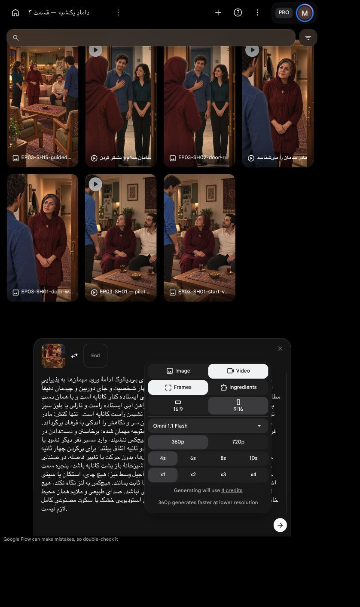

# بستهٔ نمای سوم در ترتیب داستان — هدایت مهمان‌ها

`EP03-SH15` — ترتیب۳. **بسته در زمان ارسال تأیید شد؛ یک برداشت تولید شد.** این نما دیالوگ ندارد.

[](../../images/EP03-SH15-guided-entry-house-v1.png)

مادر ایستاده مهمان‌ها را راهنمایی می‌کند؛ سامان با حرکت کوچک سر متوجه فرهاد می‌شود، نازلی ایستاده و ساکت و فرهاد هنوز روی جای راست کاناپه است. پایان: آمادهٔ برخاستن فرهاد برای دست‌دادن در نمای بعد. عبور طولانی از راهرو با برش روایی حذف می‌شود؛ مکان و علت ورود روشن می‌ماند. برخاستن، تماس دست یا نشستن در این برداشت تولید نشوند.

[پرامپت کامل نهایی](prompt.txt). هیچ گفتار، لب‌خوانی، نریشن یا موسیقی؛ صدای طبیعی محیط خانه و لباس حفظ شود. تبدیل صدای شخصیت لازم نیست و پردازش خشک‌کردن صدای محیط انجام نمی‌شود.

## بررسی پیش از ارسال

| مورد | نتیجه و شاهد |
|---|---|
| داستان و بازی | همان کنش مصوب کارت نما؛ هدایت کوچک و توجه سامان به فرهاد، بدون رویداد تازه |
| دیالوگ و تلفظ و زمان گفتار | نامرتبط؛ هیچ کلمه‌ای گفته نمی‌شود |
| مدت کنش | طراحی یک حرکت کوچک در حدود۱تا۲ثانیه؛ این تخمین طراحی است، نه زمان‌گیری بدن واقعی. کوتاه‌ترین گزینهٔ۴ثانیه حاشیه دارد و سهم تدوین پس از دیدن خروجی کوتاه می‌شود |
| هویت و نگاه | چهره/لباس در اصلاح با قاب قبلی مقایسه و حفظ شدند؛ سامان از پشت/نیم‌رخ و اجزای پوشیده بررسی‌پذیر نیستند. نگاه افراد به یکدیگر، نه لنز |
| فضا و دوربین | [گزارش مشاهده و اصلاح آشپزخانه](../../house-review.md)؛ دوربین ثابت از سمت صندلی‌ها، آشپزخانه باز پشت کاناپه؛ ابعاد دقیق مرجع اندازه‌گیری نشده |
| پیوستگی و فیزیک | مادر و مهمان‌ها ایستاده، فرهاد نشسته در راست؛ آجیل هست، چای/سینی نیست؛ هیچ دست‌دادن، نشستن، عبور بدن یا تعویض جای افراد در این نما |
| بازاستفاده | ویدیوی موجودی از این کنش نیست؛ عکس ثابت جای حرکت واقعی معرفی نمی‌شود. قاب قدیمی فقط از نظر پس‌زمینه اصلاح شد |
| تنظیمات | `Omni 1.1 Flash`، حالت `Frames`، عمودی۹:۱۶، `360p`،۴ثانیه،۱خروجی |
| هزینه | قیمت زنده۴اعتبار `Flow` برای یک ارسال؛ سقف کل۴، بدون تکرار خودکار؛ آماده‌سازی داخلی اعتبار `Flow` مصرف نکرده |
| اجازه | کاربر همین بسته را با «تاییذ» پذیرفت؛ یک ارسال مصرف شد |

قاب و پرامپت از مرورگر داخلی ارسال شدند. گزارش زیر سند وضعیت پیش از ارسال است؛ [بازبینی خروجی](review.md) مرجع کیفیت فعلی است. احتمال خطای حرکت و تغییر چهره را پرامپت تضمین نمی‌کند؛ خروجی باید واقعاً دیده و صدای محیط شنیده شود. نسخهٔ قبلی خانه یا تأیید نمای دوم مجوز ارسال این نما نیست. [جزئیات و اثرانگشت‌ها](review-package.json).


[](ui-prepared.png)


تأیید همین بسته: کاربر با «تاییذ» یک ارسال با سقف۴اعتبار را پذیرفت؛ تکرار مجاز نیست.

<!-- preflight-state -->
```json
{
  "shot": "EP03-SH15",
  "take": "take-01",
  "ready": true,
  "open_issues": [],
  "checks": {
    "dialogue": {
      "status": "pass",
      "evidence": "No dialogue; approved silent action in prompt"
    },
    "delivery": {
      "status": "pass",
      "evidence": "No speech or vocal performance requested"
    },
    "duration": {
      "status": "pass",
      "evidence": "Design estimate1-2sec gesture, not measured rehearsal;4sec shortest provider option, editorial trim after actual output"
    },
    "performance": {
      "status": "pass",
      "evidence": "Small guiding gesture, Saman attention to Farhad; Farhad remains seated; standing handshake reserved for SH19"
    },
    "speaker": {
      "status": "pass",
      "evidence": "All four silent, no speaking lips or narrator"
    },
    "identity": {
      "status": "pass",
      "evidence": "Corrected frame compared to approved prior frame and family reference; house-review.md; Saman back face occluded"
    },
    "eyeline": {
      "status": "pass",
      "evidence": "Approved frame gaze to each other; prompt prohibits lens gaze; future movement requires review"
    },
    "geometry": {
      "status": "pass",
      "evidence": "house-review.md actual frame compared to cutaway: open kitchen behind sofa, window left, two guest chairs; no door mechanics requested"
    },
    "continuity": {
      "status": "pass",
      "evidence": "Editorial cut from entry; no walking crossing or seat changes; no tea, only nuts; Farhad sofa right"
    },
    "camera": {
      "status": "pass",
      "evidence": "Static vertical camera near guest chairs; approved corrected starting frame"
    },
    "prompt": {
      "status": "pass",
      "evidence": "Unchanged SHA from exact approved package; full live editor matched"
    },
    "local_alternative": {
      "status": "pass",
      "evidence": "No existing video of action; corrected still cannot supply actual gesture motion"
    },
    "settings": {
      "status": "pass",
      "evidence": "Live IAB Frames9:16 360p4s x1, model Omni1.1Flash shown in prepared screenshot"
    },
    "cost": {
      "status": "pass",
      "evidence": "Live4credits; current user تاییذ approves exact one-attempt4credit package"
    }
  },
  "consumed_attempts": 1,
  "bundle_sha256": "c11d55a6fc3d86ab6ed8cd3155a5af8149e20273937bd7fc43512cdb15c2b8df",
  "content_approval": {
    "approved": true,
    "bundle_sha256": "c11d55a6fc3d86ab6ed8cd3155a5af8149e20273937bd7fc43512cdb15c2b8df",
    "user_reply": "تاییذ",
    "evidence_ref": "Current approval of exact SH15 silent4second360p x1 package ceiling4credits"
  },
  "cost_approval": {
    "approved": true,
    "bundle_sha256": "c11d55a6fc3d86ab6ed8cd3155a5af8149e20273937bd7fc43512cdb15c2b8df",
    "user_reply": "تاییذ",
    "evidence_ref": "Current approval of exact SH15 silent4second360p x1 package ceiling4credits"
  },
  "submission_state": "submitted_once_waiting"
}
```
<!-- /preflight-state -->
