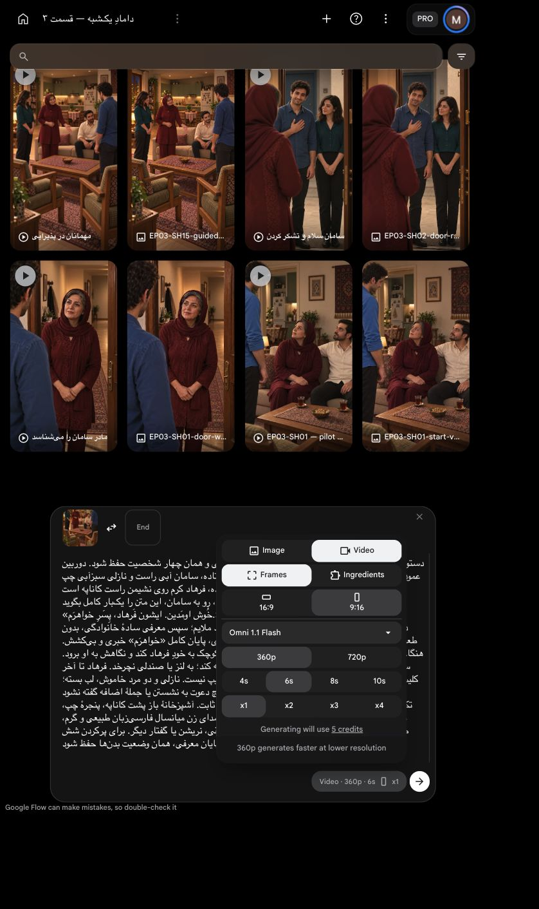

# بستهٔ اصلاح‌شدهٔ خوشامد و معرفی مادر

`EP03-SH15`، ترتیب۳، `take-02`؛ **یک‌بار با تأیید صریح کاربر ارسال شد؛ گزارش زیر سند پیش از ارسال است**. متن و ترتیب با آخرین دستور کاربر ثابت‌اند. این بسته فقط خوشامد و معرفی است.

[](../../images/EP03-SH15-guided-entry-house-v1.png)

قاب موجود بازاستفاده می‌شود؛ تصویر تازه تولید نشده. دست مادر در این برداشت برای معرفی فرهاد است؛ اشاره به نشیمن صندلی و دعوت بعد از دست‌دادن در نمای دیگر می‌آیند. [متن و بازی مالک](../../shot.md)؛ [پرامپت کامل](prompt.txt).

## بررسی پیش از ارسال

| مورد | نتیجه و شاهد |
|---|---|
| متن و نسبت | قبول؛ دو جمله از کارت مادر، نسبت پسر خواهر او/پسرخالهٔ نازلی؛ اعراب و پایان خواهرَم حفظ شده |
| بازی | قبولِ طرح؛ خوشامد گرم۲از۵ و معرفی خانوادگی۲از۵، خبری طبیعی؛ نگاه اول سامان سپس فرهاد و حرکت کوچک همان دست؛ اجرای واقعی هنوز تولید نشده |
| زمان | تمرین مصنوعی محلی با `espeak-ng` و تنظیم۱۶۵،۴٫۰۰۹ثانیه؛ [اندازه‌گیری](timing-guide/scratch-only.json). صدای بازیگر یا اثبات تلفظ طبیعی نیست.۶ثانیه حاشیه دارد؛ سرعت جمله کش نیاید و زمان بی‌کار بعداً محلی حذف شود |
| مالک صدا | مادر تنها گویندهٔ داخل قاب؛ سه شنونده بی‌لب‌خوانی. صدای طبیعی اصلی و محیط حفظ شوند؛ ثبات با صدای مرجع مادر تضمین‌شده نیست، تبدیل خودکار خشک انجام نشود |
| ظاهر | قاب و دو تصویر مرجع چهره واقعاً دیده شدند: صورت مادر، رگهٔ خاکستری، تک‌روسری و تونیک زرشکی؛ نازلی مو و بلوز سبزآبی؛ فرهاد مو/ریش و پیراهن کرم مطابق ویژگی‌های قابل‌دیدن. سامان آبی و مو از پشت مطابق، جزئیات صورت پنهان نامرتبط با این محور؛ ادعای بررسی صورت پوشیده نیست. مرجع‌ها در مرجع ثابت ظاهر ثبت‌اند |
| فضا | قاب و برش خانه واقعاً دیده و مقایسه شدند: آشپزخانه باز پشت مبل، پنجره چپ، یخچال راست آشپزخانه و دو صندلی؛ ابعاد دقیق اندازه‌گیری نشده. [گزارش پیشین همین قاب](../../house-review.md) |
| دست/نگاه/اتصال | دست مادر از بدن خودش، بدون تماس؛ اشارهٔ کوچک به فرهاد، نه دعوت به صندلی. سه نفر ایستاده و فرهاد نشسته؛ تا پایان همین وضعیت، برخاستن در نمای بعد. خطای تکرارِ برخاستن و نگاه دوربین در برداشت قبلی معیار رد صریح این برداشت است |
| بازاستفاده | قاب موجود هزینهٔ تصویر تازه ندارد؛ ویدیوی قبلی فاقد این گفتار و دارای حرکت ناسازگار است، برش یا دوبلهٔ آن کنش و لب‌خوانی تازه را درست نمی‌کند |
| ورودی | فقط قاب شروع مشخص، بدون قاب پایان یا ورودی صوت؛ مرجع مادر برای سنجش پس از تولید است، مدل قفل صدای مرجع را در این بسته دریافت نمی‌کند |
| تنظیمات | قیمت زنده در مرورگر داخلی: `Omni 1.1 Flash`، `Frames`، `9:16`، `360p`،۶ثانیه، `x1`، صدای بومی تولید |
| هزینه | یک ارسال۵اعتبار `Flow`، سقف کل۵اعتبار؛ تکرار یا ارتقا مجاز نیست. آماده‌سازی محلی اعتبار خارجی نداشت |
| مجوز | کاربر با «تأیید» همین بسته و سقف۵اعتبار را پذیرفت؛ یک ارسال مصرف شد |

ریسک مولد: نشستن فرهاد، چشم سامان، مالکیت لب و هویت صدا با نوشتن دستور تضمین نمی‌شوند؛ باید در خروجی واقعی بررسی شوند. قاب ثابت پذیرش حرکت نیست. همهٔ کنترل‌های لازم پیش از ارسال انجام شده‌اند؛ مجوز بسته و هزینه دریافت و مصرف شد؛ [بازبینی واقعی خروجی](review.md) مرجع وضعیت فعلی است.

## پرامپت کامل این بسته

دستور اجرا؛ خوانده نشود: قاب شروع پیوست، همان پذیرایی و همان چهار شخصیت حفظ شود. دوربین عمودی ثابت، بدون برش یا تغییر فاصله. مادر زرشکی ایستاده، سامان آبی راست و نازلی سبزآبی چپ ایستاده، فرهاد کرم روی نشیمن راست کاناپه است.
فقط مادر نازلی، رو به سامان، این متن را یک‌بار کامل بگوید:
«خُوش اومَدین. ایشون فَرهاد، پِسَرِ خواهرَم.»
دستور بازی؛ خوانده نشود: خوشامد گرم و آرام با لبخند ملایم؛ سپس معرفی سادهٔ خانوادگی، بدون طعنه. پس از خوشامد فقط مکث کوتاه طبیعی؛ سرعت عادی، پایان کامل «خواهرَم» خبری و بی‌کشش. هنگام معرفی، مادر با همان دست بازِ داخل تصویر اشارهٔ کوچک به خودِ فرهاد کند و نگاهش به او برود. سامان با حرکت بسیار کوچک چشم و سر به فرهاد توجه کند؛ به لنز یا صندلی نچرخد. فرهاد تا آخر کلیپ کاملاً نشسته بماند؛ برخاستن و دست‌دادن در این کلیپ نیست. نازلی و دو مرد خاموش، لب بسته؛ تنها لب مادر با صدای خودش هماهنگ باشد. هیچ دعوت به نشستن یا جملهٔ اضافه گفته نشود.
تک‌روسری مادر با موی جلوی نمایان، چهره‌ها و لباس‌ها ثابت. آشپزخانهٔ باز پشت کاناپه، پنجرهٔ چپ، صندلی‌ها و آجیل ثابت؛ چای یا سینی اضافه نشود. صدای زن میانسال فارسی‌زبان طبیعی و گرم، صدای ملایم همان خانه و لباس حفظ شود؛ بدون موسیقی، نریشن یا گفتار دیگر. برای پرکردن شش ثانیه جمله را کند نکنید؛ پس از پایان معرفی، همان وضعیت بدن‌ها حفظ شود.

[](ui-prepared.png)


تأیید همین بسته: کاربر با «تأیید» یک ارسال با سقف۵اعتبار را پذیرفت؛ تکرار مجاز نیست.

<!-- preflight-state -->
```json
{
  "shot": "EP03-SH15",
  "take": "take-02",
  "ready": true,
  "open_issues": [],
  "checks": {
    "dialogue": {
      "status": "pass",
      "evidence": "Approved maternal welcome and introduction exact diacritics from shot.md, prompt SHA matches"
    },
    "delivery": {
      "status": "pass",
      "evidence": "Warm welcome2/5 and everyday familial introduction2/5; full خواهرَم ending"
    },
    "duration": {
      "status": "pass",
      "evidence": "Measured local espeak-ng synthetic rehearsal4.009sec, not final acting;6sec gives boundary margin, prompt prohibits slowed pacing"
    },
    "performance": {
      "status": "pass",
      "evidence": "Small guiding gesture, Saman attention to Farhad; Farhad remains seated; standing handshake reserved for SH19"
    },
    "speaker": {
      "status": "pass",
      "evidence": "Only mother speaks and owns lips; other three silent; native voice identity needs post-output review"
    },
    "identity": {
      "status": "pass",
      "evidence": "Corrected frame compared to approved prior frame and family reference; house-review.md; Saman back face occluded"
    },
    "eyeline": {
      "status": "pass",
      "evidence": "Approved frame gaze to each other; prompt prohibits lens gaze; future movement requires review"
    },
    "geometry": {
      "status": "pass",
      "evidence": "house-review.md actual frame compared to cutaway: open kitchen behind sofa, window left, two guest chairs; no door mechanics requested"
    },
    "continuity": {
      "status": "pass",
      "evidence": "Editorial cut from entry; no walking crossing or seat changes; no tea, only nuts; Farhad sofa right"
    },
    "camera": {
      "status": "pass",
      "evidence": "Static vertical camera near guest chairs; approved corrected starting frame"
    },
    "prompt": {
      "status": "pass",
      "evidence": "Unchanged SHA from exact approved package; full live editor matched"
    },
    "local_alternative": {
      "status": "pass",
      "evidence": "No existing video of action; corrected still cannot supply actual gesture motion"
    },
    "settings": {
      "status": "pass",
      "evidence": "Live IAB Frames9:16 360p6s x1, model Omni1.1Flash shown in prepared screenshot"
    },
    "cost": {
      "status": "pass",
      "evidence": "Live5credits; current user تأیید approves exact one-attempt5credit package"
    }
  },
  "consumed_attempts": 1,
  "bundle_sha256": "ae77d28872f43cb53944bef790aa3583cf1fad32e9b6b0e8ca3dc0655ac7ca18",
  "content_approval": {
    "approved": true,
    "bundle_sha256": "ae77d28872f43cb53944bef790aa3583cf1fad32e9b6b0e8ca3dc0655ac7ca18",
    "user_reply": "تأیید",
    "evidence_ref": "Current approval of exact SH15 maternal welcome introduction6second360p x1 ceiling5credits"
  },
  "cost_approval": {
    "approved": true,
    "bundle_sha256": "ae77d28872f43cb53944bef790aa3583cf1fad32e9b6b0e8ca3dc0655ac7ca18",
    "user_reply": "تأیید",
    "evidence_ref": "Current approval of exact SH15 maternal welcome introduction6second360p x1 ceiling5credits"
  },
  "submission_state": "submitted_once_waiting"
}
```
<!-- /preflight-state -->
