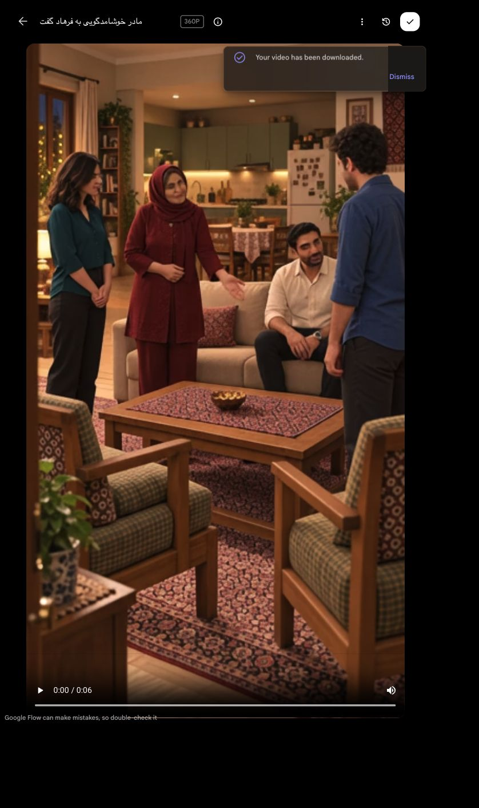

# خوشامد و معرفی مادر — برداشت اصلاحی

**پذیرفته و منتخب:** کاربر پس از نمایش همین نسخهٔ۵٫۲۵ثانیه‌ای با صدای اصلی گفت «خوبه». پذیرش کاربر ثبت شد؛ حدود بررسی فنی و شنیدن انجام‌نشدهٔ دستیار در ادامه محفوظ است. یک ارسال با قیمت اعلام‌شده۵اعتبار `Flow`؛ کسر واقعی حساب مستقلاً بررسی نشده. تکرار یا ارتقای هزینه‌دار انجام نشد.

نسخهٔ مرور۵٫۲۵ثانیه/۱۲۶فریم، از ابتدای منبع تا پس از پایان جمله. زمان بی‌کار پایانی کوتاه شد؛ صدا همان صدای اصلی محیط و گفتار است، فقط برای خروجی برش دوباره `AAC` شده. تبدیل صدا، حذف محیط، افزودن سکوت یا فریم ثابت انجام نشد. [نسخهٔ اصلی حدود۶٫۰۲ثانیه](video.mp4).

## بررسی انجام‌شده

- کل فایل اصلی و نسخهٔ کوتاه بدون خطای رمزگشایی؛ `H264`،۳۶۰×۶۴۰،۲۴فریم‌برثانیه، صدای استریوی۴۸کیلوهرتز.
-۴۸نمونهٔ تصویری با فاصلهٔ۰٫۱۲۵ثانیه در تمام شش ثانیه دیده شد؛ مشاهدهٔ پیوستهٔ همهٔ فریم‌ها انجام نشده و ثبات کامل یا هماهنگی کامل لب ادعا نمی‌شود.
- فرهاد در همهٔ نمونه‌ها روی نشیمن راست نشسته ماند؛ برخاستن زودهنگام برداشت قبلی تکرار نشد. سامان در محور ارتباط با مادر/فرهاد ماند؛ چرخش آشکار قبلی به سمت دوربین دیده نشد.
- مادر حدود۲٫۴تا۴٫۲ثانیه با همان دست باز به طرف فرهاد اشاره می‌کند. دعوت به صندلی و تماس دست در این نما نیست. صورت مادر هنگام خوشامد گاهی رو به جلوی قاب است؛ جهت دقیق مردمک در این وضوح قطعی نیست و باید در مرور پیوسته قضاوت شود.
- آشپزخانهٔ باز پشت کاناپه، پنجرهٔ چپ، یخچال راست، صندلی‌ها و آجیل در مقایسه با قاب شروع و پلان حفظ شدند؛ چای یا سینی اضافه نشد. صورت و لباس شخصیت‌ها در جزئیات قابل‌دیدن نمونه‌ها جابه‌جا نشدند؛ صورت پوشیدهٔ سامان بررسی‌پذیر نیست.
- حرکت دهان مادر هم‌زمان با محدودهٔ گفتار در نمونه‌ها دیده می‌شود؛ لب‌خوانی دقیق و نبود همهٔ حرکت‌های لب شنونده‌ها با نمونه‌برداری اثبات نمی‌شود.
- تشخیص گفتار متن دو جمله را بازیابی کرد و آخرین واژه را در۴٫۲تا۴٫۸ثانیه یافت. املای خروجی «خوهرم» تشخیص ماشینی است و مدرک تلفظ غلط یا درست نیست. ابتدای گفتار زمان صفر گزارش شده؛ آغاز واژه باید شنیداری کنترل شود.

## بررسی‌های باقی‌مانده

شنیدن کامل برای تلفظ، پایان و شروع جمله، ثبات صدای مادر نسبت به مرجع، طبیعی‌بودن محیط و نبود موسیقی انجام نشده است. اصل صدا حفظ شد تا همین خروجی قضاوت شود. تطابق صوت مرجع یا پذیرش نهایی اعلام نمی‌شود. اتصال به برخاستن و دست‌دادن نیز پس از آماده‌شدن رسانهٔ واقعی نمای بعد بررسی شود.

[نمونه‌های اول](edits/contact-1.jpg)، [وسط](edits/contact-2.jpg)، [آخر](edits/contact-3.jpg)، [تشخیص گفتار](edits/asr-check.json)، [تبار برش](edits/lineage.json)، [ثبت تولید](job.json).

