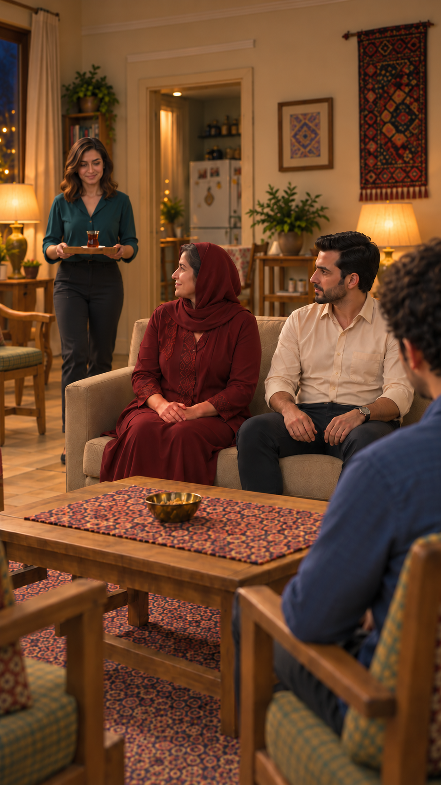

# تطبیق ظاهر و محیط برگشت چای — نسخهٔ۵

تاریخ: ۲۰۲۶/۱۰/۱۴. شناسه: `EP03-SH16`. نسخهٔ مرجع: `appearance-v1`. وضعیت: عکس مستقلِ پیشنهادی برای مرور؛ نه قاب پذیرفته‌شده یا آمادهٔ ارسال. [مرجع ثابت شخصیت‌ها](../../../../references/visuals/character-bible.md) خوانده شد؛ تصویرهای مصوب صورت واقعاً به ابزار داده شدند. یک اقدام با ابزار داخلی `image_gen` انجام شد؛ هیچ ویدیویی تولید نشد.

## ورودی و نسخه

- [هدف اصلاح نسخهٔ۴](images/EP03-SH16-tea-return-spacing-v4.png): فاصلهٔ بدن‌ها و روسری و لباس؛ پنجرهٔ اشتباه آن مرجع محیط نیست.
- [صفحهٔ ادامه نسخهٔ۲](../../references/EP03-continuation-storyboard-v2.png)، قاب۱و۷: نقش مرجع چیدمان خانه؛ قاب۳ ردشدهٔ آن استفاده نشد.
- [چهره‌های مصوب](../../../episode-01/references/01-casting-and-living-room-concept-v1.png): پنل‌های صورت نازلی، مادر و فرهاد؛ پوشش سر و مبلمان قدیمی مرجع اجرای تازه نیستند.
- [چهرهٔ سامان](../../../episode-02/references/01-saman-portrait-v1.png): فقط هویت صورت و مو، نه تی‌شرت قسمت۲.
- [پرامپت همین اقدام](images/EP03-SH16-tea-return-spacing-v5-prompt.txt) و [اثر انگشت ورودی‌ها و خروجی](appearance-review-v5-files.json).

روش: مشاهدهٔ تصویر ثابت ورودی‌ها و خروجی؛ هیچ ادعای شنیدن، پخش حرکت یا کنترل لب‌خوانی وجود ندارد. زمان داستان شبِ روز اول، بعد از نشستن جمع و پاسخ سامان، پیش از قرارگرفتن چای روی میز.

## نتیجهٔ تطبیق

| شخصیت یا مورد | نتیجه | شاهد و محدودیت |
|---|---|---|
| نازلی؛ مو و لباس | بررسی شد و قبول | بلوز سبزآبی، شلوار تیره، موی قهوه‌ای تا شانه؛ نقش حامل سینی با همان هویت مرجع. جزئیات صورت در مقیاس کوچک عقب قاب برای تطبیق ریز همهٔ اجزا کافی نیست. |
| نازلی؛ همهٔ جزئیات صورت | بررسی نشده | صورت عقب قاب است؛ تغییر آشکار تشخیص داده نشد، ولی این نتیجه تأیید کامل جزءبه‌جزء نیست. |
| مادر؛ روسری و لباس و فاصله | بررسی شد و قبول | یک روسری زرشکی با موی واقعی جلو و شقیقه نمایان، تونیک خوش‌دوخت زرشکی، دست‌ها روی پای خودش و فاصله از بازوی فرهاد؛ پذیرش هنری کاربر هنوز ثبت نشده. |
| مادر؛ صورت | بررسی نشده | نیم‌رخ با حفظ سن و مشخصات قابل‌دیدن؛ تصویر مصوب عمدتاً روبه‌رو است. تغییر آشکار تشخیص داده نشد، تطبیق کامل چشم و سمت پنهان صورت ممکن نیست. |
| فرهاد؛ مو، ریش و لباس | بررسی شد و قبول | پیراهن کرم، مو و ریش مرتب، ساعت در همان دست قابل‌دیدن؛ حالت بدن مستقل و بدون تکیه به مادر. |
| فرهاد؛ صورت | بررسی نشده | سه‌رخ و مشخصات قابل‌دیدن با مرجع سازگارند؛ سمت پنهان صورت از همین عکس بررسی نمی‌شود. |
| سامان؛ لباس و موی قابل‌دیدن | بررسی شد و قبول | پیراهن آبی و موی تیره در پیش‌زمینه راست، روی صندلی مقابل فرهاد؛ همان شخصیت در نقش شنونده. |
| سامان؛ جلوی صورت | بررسی نشده | پشت و بخشی از سر دیده می‌شود؛ تطبیق جلوی صورت از این قاب ممکن نیست. مرجع مصوب ورودی حفظ شده ولی وجود ورودی اثبات تطبیق خروجی نیست. |
| محیط؛ اختلاف پنجره | بررسی شد و قبول | پنجره سمت چپ، دیوار و بافتهٔ ایرانی سمت راست، یخچال عقب قاب؛ خطای سمت پنجرهٔ نسخهٔ۴ در نسخهٔ۵ رفع شد. هندسهٔ حرکت و تطبیق تمام ابعاد مبلمان هنوز بررسی نشده. |
| چای و دست‌ها | بررسی شد و قبول | یک استکان روی نعلبکی داخل سینی با دو دست نازلی؛ روی میز چای نیست؛ دست بی‌صاحب آشکار دیده نشد. مسیر حرکت و قرارگرفتن سینی هنوز تولید نشده. |

**جمع‌بندی:** اصلاحِ سمت پنجره و حفظ فاصله در تصویر ثابت انجام شد؛ پذیرش کاربر و بررسی‌های لازم برای تولید همچنان بازند. فهرست بالا عمداً تأیید کامل هویت همهٔ صورت‌های پنهان نیست. این تصویر مرجع هویت تازه ایجاد نمی‌کند. نسخه‌های قبل محفوظ‌اند؛ انتخاب قاب فعال کارت و درخواست ارسال تغییر نکردند.

## اتصال به روایت

نمای قبل `SH06`: سامان جملهٔ مصوب خود را می‌گوید؛ حالت صمیمیت جدی و احترام، قصد بیان علاقه و دلیل حضور، خبری و طبیعی، نگاه به مادر و دست‌ها روی ران — جهت بازی قبلاً مصوب. پس از پایان جمله، این نمای بی‌گفتار برگشت چای می‌آید. بعد `SH17` تماسِ گذاشتن نعلبکی جلوی سامان و نشستن نازلی را روشن می‌کند. سپس `SH07` سؤال فرهاد آغاز می‌شود. متن گفتار مالک همان کارت‌هاست؛ دوباره در این گزارش کپی نشده است.

کنش پیشنهادی همین نما: نازلی با دو دست سینی می‌آورد، آن را روی بخش آزاد نزدیک جای خودش می‌گذارد و دست‌ها آزاد می‌شوند؛ سپس در نمای بعد با دست راست نعلبکی را جلوی سامان می‌گذارد. سینی خالی تا ادامه روی میز می‌ماند. هیچ دیالوگ در برگشت چای خوانده نشود، زمان واقعی هنوز اندازه‌گیری نشده و حرکت به‌عنوان انجام‌شده ثبت نشود.

## پذیرش تصویری کاربر

کاربر پس از نمایش نسخهٔ۵ با «خوبه، برو جلو» ادامه را خواست؛ این تصویر پذیرفته شد و در کارت به‌عنوان قاب فعال وصل شد. محدودیت‌های تطبیق صورت پنهان و بررسی حرکت بالا محفوظ‌اند؛ پذیرش تصویر مجوز ویدیو نیست.
