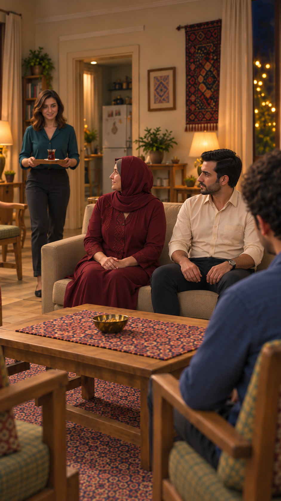

# اصلاح فاصلهٔ نشستن در برگشت چای — ۲۰۲۶/۱۰/۱۴

وضعیت: پیشنهادی؛ در انتظار پذیرش کاربر. مالک تصویر، نمای `EP03-SH16` است. فقط قاب۳ صفحهٔ ادامه هدف اصلاح بود؛ فایل صفحهٔ هشت‌قابی اصلی تغییر نکرد و قاب‌های دیگر بازتولید نشدند. یک تصویر مستقل با ابزار داخلی `image_gen` ساخته شد؛ هیچ ویدیویی تولید نشده و قاب فعال کارت هنوز تغییر نکرده است.

مرجع ورودی: [صفحهٔ ادامهٔ نسخهٔ۱](../../references/EP03-continuation-storyboard-v1.png). خواستهٔ کاربر: فاصلهٔ مادر و فرهاد معمولی و ثابت، بدون چسبیدن و بدون نشیمن خالی میانی؛ ایراد مشخص قاب۳ تماس و تمایل بدن دو نفر به یکدیگر بود.

در خروجی تازه، تنه‌ها مستقل، دست‌های هر نفر روی پای خودش و فاصلهٔ قابل‌دیدن میان بازوهای مادر و فرهاد وجود دارد. هرکدام روی نشیمن خود کاناپهٔ دو نفره‌اند. نازلی با یک استکان روی نعلبکی در سینی آمده و روی میز هنوز چای نیست؛ سامان در پیش‌زمینه نشسته است. فاصلهٔ واقعی به سانتی‌متر از عکس اندازه‌گیری نشده؛ عدد پرامپت، اندازهٔ اثبات‌شده نیست.

محدودیت: پنجره در خروجی تازه سمت راست پس‌زمینه افتاده، درحالی‌که در قاب‌های باز صفحهٔ مرجع سمت چپ است. بنابراین اصلاح فاصله، پذیرش کامل هندسهٔ خانه نیست؛ تصویر هنوز ورودی آمادهٔ تولید نیست. نگاه، آناتومی و حرکت گذاشتن سینی برای ویدیو باید مستقل کنترل شوند. هیچ بازتولید خودکار بعدی انجام نشده است.

[پرامپت اصلاح](images/EP03-SH16-tea-return-spacing-v3-prompt.txt)
