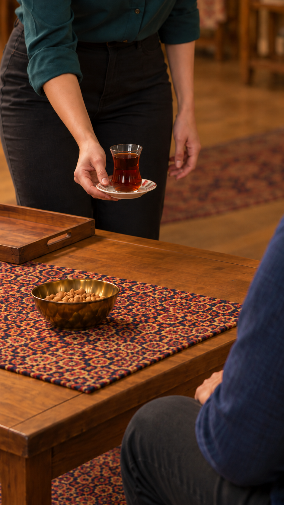

# بررسی پیش از ارسال نمای 17

نسخه نهایی پیشنهادی؛ منتظر تأیید صریح همین بسته و سقف هزینه. هیچ ارسال تازه انجام نشده.

[](../../images/EP03-SH17-serving-start-v5.png)

[پرامپت کامل](prompt.txt) · [مرجع خانه](../../../../../../house/apartment-cutaway-v2.png)

| کنترل | نتیجه و شاهد |
|---|---|
| دیالوگ، اعراب، تلفظ و زمان گفتار | نامرتبط؛ این نما هیچ گفتاری ندارد. |
| حالت و مالک صدا | بررسی شد و قبول در طراحی: تمرکز عادی نازلی؛ همه ساکت. فقط صدای اتاق و تماس ظرف. |
| دوربین و فضا | بررسی شد و قبول در محدوده قابل‌دیدن: دوربین از جلوی جمع؛ در نمای باز آشپزخانه پشت کاناپه و پنجره چپ، دو تک‌صندلی در جلو و کاناپه در عقب. در نزدیک فقط میز و تنه نازلی و سامان دیده می‌شوند؛ معماری پشت دوربین خارج قاب است. |
| مبلمان و مسیر | بررسی شد و قبول: نمای باز صندلی سوم حذف شده، مسیر کنار چپ میز بدون عبور از کاناپه است؛ صندلی‌ها در جای خود می‌مانند. مسیر طولانی آشپزخانه حذف تدوینی دارد، نه نمایش عبور اثبات‌نشده. زاویه عددی از عکس اندازه‌گیری نشده؛ جهت رو به داخل دو صندلی از مرجع حفظ شده است. |
| اشیا و دست | بررسی شد و قبول در عکس: یک استکان و یک نعلبکی، سینی چوبی، آجیل؛ صاحب هر دست مشخص. در نمای نزدیک چای بالای میز است، پایان تماس هنوز اتفاق نیفتاده. |
| هویت و پوشش | بررسی شد و قبول در بخش قابل‌دیدن: نازلی صورت بیضی و موی قهوه‌ای فرق جانبی تا شانه و بلوز سبزآبی؛ مادر سن و صورت و روسری زرشکی یک‌لایه با موی جلوی سر، فرهاد موی مرتب و ریش کوتاه و پیراهن کرم و ساعت چپ. سامان از پشت با موی تیره و پیراهن آبی؛ صورت او در این زاویه پوشیده و نیاز تصویری این نما نیست. در نمای نزدیک همه چهره‌ها خارج قاب‌اند و داوری چهره نامرتبط است؛ لباس و صاحب دست بررسی شدند. تصاویر هویت خانواده و پرتره سامان واقعاً دیده شدند. |
| پیوستگی | بررسی شد و قبول در طراحی: پس از پاسخ سامان، نازلی چای را می‌آورد. پایان۱۶: سینی روی میز و چای داخل آن؛ آغاز۱۷: برداشتن نعلبکی با حذف کوتاه زمانی بین نماها. پایان۱۷: چای جلوی سامان، سینی خالی چپ. نشستن نازلی پس از سرو با برش به جمعِ نشسته قابل حذف است؛ جابه‌جایی چای نباید حذف شود. |
| مدت و ریتم |۴ثانیه حداقل طول زنده قابل انتخاب است. زمان‌بندی پیشنهادی کنش حدود۲تا۳ثانیه؛ زمان‌گیری بازی واقعی ادعا نمی‌شود، چون خروجی نداریم. زمان گفتار نامرتبط است. بازه سالم پس از تولید انتخاب می‌شود؛ مکث اضافه در تدوین حذف شود، نه کندکردن حرکت. |
| جایگزین محلی | بررسی شد: در این دو پوشه ویدیو موجود نیست. عکس تماس پایان نمی‌تواند کنش سالم را بسازد؛ اصلاح فقط قاب شروع با ابزار داخلی انجام شد. |
| ابزار و هزینه | رابط زنده `Frames / Omni 1.1 Flash / 4s / 360p / 9:16 / x1` و۴اعتبار دیده شد. فقط قاب آغاز به ابزار داده می‌شود؛ مراجع دیگر منابع بررسی محلی‌اند. |
| محدودیت آینده | سلامت حرکت، تماس ظرف و لب نزدن شنونده‌ها تنها پس از تولید قابل بررسی‌اند؛ تضمین خروجی یا مجوز تکرار نیست. |

## پرامپت کامل

```text
دستور ساخت؛ خوانده نشود. نمای نزدیک ثابت و عمودی، از همان قاب ورودی. بدون دیالوگ، نریشن، موسیقی یا زیرنویس؛ صدای طبیعی اتاق و تماس آرام نعلبکی روی میز حفظ شود.
شروع: دست راستِ متصل به آستین سبزآبی و تنه نازلی، نعلبکی سفید گل‌قرمز را از زیر گرفته و بالای میز نزدیک سینی چوبی سمت چپ نگه داشته است؛ دقیقاً یک استکان کمرباریک چای روی آن. سینی روی میز خالی است؛ چای دیگری وجود ندارد. دست چپ نازلی آزاد کنار بدن. آستین آبی و زانوی سامان سمت راست، دستش روی ران و دور از استکان.
کنش واحد: نازلی نعلبکی و استکان قائم روی آن را با همان دست راست، در یک مسیر کوتاه و بدون عبور از کاسه آجیل به بخش آزاد سمت راست میز جلوی سامان منتقل می‌کند. نعلبکی آرام روی چوب میز می‌نشیند. فقط پس از تماس و ثبات کامل نعلبکی، انگشتان از زیر آن خارج می‌شوند و دست راست به سمت بدن نازلی برمی‌گردد. دست به شیشه داغ تماس نگیرد؛ استکان تا پایان روی نعلبکی، چای درون آن و سینی در چپ ثابت بمانند.
رفتار تأییدشده: دقت عادی بدون نمایش اغراق‌آمیز؛ سامان دست به استکان نمی‌برد. بدون چرخش صندلی، تکان میز یا جابه‌جایی آجیل و رومیزی. صاحب دست راست همیشه تنه نازلی باشد؛ انگشت یا دست اضافی، نعلبکی شناور پس از رهاکردن و ظهور ناگهانی شیء ممنوع. دوربین ثابت، هیچ برش یا حرکت اضافه. صورت‌ها عمداً خارج قاب‌اند و چهره تازه وارد نشود.
پایان پس از تماس سالم و برگشت دست؛ نازلی فقط آغاز عقب‌کشیدن بدن برای برگشت به صندلی را انجام دهد، نشستن کامل در این نمای نزدیک دیده نمی‌شود. برای پرکردن چهار ثانیه حرکت تکرار یا مصنوعی کند نشود.
```


<!-- preflight-state -->
```json
{
  "shot": "EP03-SH17",
  "take": "take-01",
  "ready": false,
  "open_issues": [],
  "checks": {
    "dialogue": {
      "status": "pass",
      "evidence": "No dialogue; silent action only"
    },
    "delivery": {
      "status": "pass",
      "evidence": "No spoken performance; natural room/tray contact only"
    },
    "duration": {
      "status": "pass",
      "evidence": "No speech timing applicable. Minimum live4seconds; single short tray or saucer action, trim only idle after actual output review"
    },
    "performance": {
      "status": "pass",
      "evidence": "Nazli ordinary concentration, gaze to safe table contact; others quiet"
    },
    "speaker": {
      "status": "pass",
      "evidence": "All characters silent; no narration"
    },
    "identity": {
      "status": "pass",
      "evidence": "Actual frame/identity refs viewed; outfits preserved, occluded faces out of review scope"
    },
    "eyeline": {
      "status": "pass",
      "evidence": "Nazli gaze to tray/table; others brief attention, no lens gaze"
    },
    "geometry": {
      "status": "pass",
      "evidence": "SH16 open kitchen behind sofa/window left/exactly2chairs, path beside left table; SH17 tight insert same left tray/right Saman geometry"
    },
    "continuity": {
      "status": "pass",
      "evidence": "SH16 tray down with tea within; SH17 tea lifted over left tray then placed right in front of Saman; ellipsis of lifting allowed, no duplicated serving"
    },
    "camera": {
      "status": "pass",
      "evidence": "Static vertical near guest side; no camera movement"
    },
    "prompt": {
      "status": "pass",
      "evidence": "Exact approved prompt hash unchanged, live text matches"
    },
    "local_alternative": {
      "status": "pass",
      "evidence": "No existing generated video for either action; local start-frame edits only"
    },
    "settings": {
      "status": "pass",
      "evidence": "Live Omni1.1Flash Frames4s360p9:16 x1 verified"
    },
    "cost": {
      "status": "pass",
      "evidence": "Current exact batch approval8credits: one4credit attempt per shot, no retry"
    }
  },
  "consumed_attempts": 1,
  "bundle_sha256": "940ccf60ca1ac3fb7d5c88d03d6cc6a16fe804aa9a956c1083ad175170b40ef6",
  "content_approval": {
    "approved": true,
    "bundle_sha256": "940ccf60ca1ac3fb7d5c88d03d6cc6a16fe804aa9a956c1083ad175170b40ef6",
    "user_reply": "تأیید",
    "evidence_ref": "User approval immediately following displayed SH16+SH17 v1 package total8credits,4each one attempt"
  },
  "cost_approval": {
    "approved": true,
    "bundle_sha256": "940ccf60ca1ac3fb7d5c88d03d6cc6a16fe804aa9a956c1083ad175170b40ef6",
    "user_reply": "تأیید",
    "evidence_ref": "User approval immediately following displayed SH16+SH17 v1 package total8credits,4each one attempt"
  },
  "submission_state": "completed_one_attempt_no_retry"
}
```
<!-- /preflight-state -->
