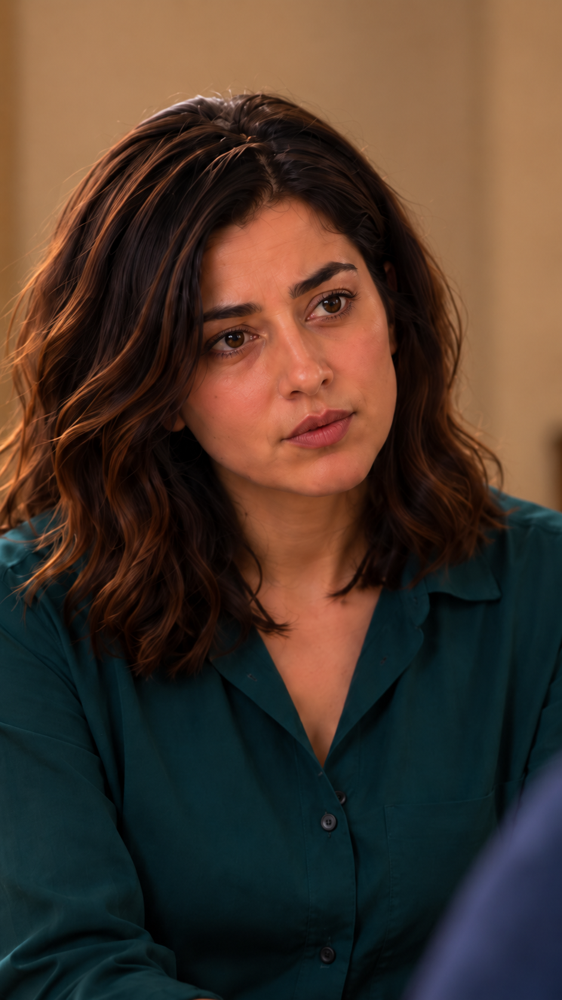

# بررسی فضا و ظاهر واکنش پایانی — نسخه۴

۲۰۲۶/۱۰/۱۵؛ [خروجی نزدیک](images/EP03-SH18-close-house-v4.png) و [عکس پذیرفته‌شدهٔ نسخه۳](images/EP03-SH18-reaction-v3.png) واقعاً دیده و با [مرجع خانه](../../../../house/apartment-cutaway-v2.png)، [پلان](../../../../house/apartment-plan-v1.svg) و مرجع هویت نازلی در [سند ظاهر](../../../../references/visuals/character-bible.md) مقایسه شدند؛ نسخهٔ ظاهر `appearance-v1`.

دستور صریح کاربر دربارهٔ کفایت لب نسخه۳ محفوظ است؛ اصلاح لب درخواست یا تکرار نشد. ابزار داخلی فقط برای اصلاح پس‌زمینه و بستن قاب با قفل صورت/لب/لباس استفاده شد. نتیجه در صورت و حالت لب با مرجع پذیرفته‌شده مقایسه شد؛ تغییر آشکار حالت دهان تشخیص داده نشد، برابری پیکسل‌به‌پیکسل یا بازبینی حرکت ادعا نیست.

دوربین از نزدیک سمت سامان، رو به نازلی روی نشیمن جلوی چپ، هم‌ارتفاع چشم نشسته است. آشپزخانه و کتابخانه پشت دوربین‌اند؛ تصویر قدیمی آنها/چراغ را در عمق نازلی نشان می‌داد و مرجع معماری معتبر نیست. در نسخه۴ فقط دیوار کرم محو دیده می‌شود؛ صندلی و دست و میز از میدان دید قاب نزدیک خارج‌اند، نه حذف داستانی.

| کنترل | نتیجه | شاهد و حدود |
|---|---|---|
| پس‌زمینه و هندسه | بررسی شد و قبول | دیوار کرم، بدون آشپزخانه/کتابخانه/چراغ ناسازگار پشت جوان‌ها؛ جای افراد با پلان تغییر نکرده. |
| چهره/مو/لباس نازلی | بررسی شد و قبول | صورت بیضی و فرم چشم/ابرو/بینی/لب/فک، فرق جانبی و طول موی قهوه‌ای، یقه/دکمه و رنگ سبزآبی با مرجع و عکس پذیرفته مقایسه شد. |
| حالت لب | بررسی شد و قبول برای حفظ مرجع | همان حالت طبیعی مرجع؛ اصلاح ریز یا بازطراحی درخواست نشد. سکوت/عدم لب‌زدن در حرکت هنوز بررسی نشده. |
| سامان | بررسی شد و قبول برای بخش دیده‌شده | لبه محو آبی راست؛ صورت و دهان خارج قاب، هویت بخش پوشیده ادعا نشده. |
| فاصله صندلی‌ها و دست/اشیا | نامرتبط با دلیل | بیرون میدان دیدند و این تصویر تأیید فاصله/زاویه۹۰درجه نیست؛ کنش تماس نداریم. |
| نگاه و مسیر | بررسی شد و قبول برای طراحی | ابتدا محل مادر خارج قاب بالاتر سمت راست، سپس سامان راست پیش‌زمینه؛ چرخش کوچک چشم و نه نگاه مستقیم به لنز. صحت مسیر و توقف در خروجی باید کنترل شود. |
| اتصال۱۴←۱۸ | بررسی شد و قبول برای طرح | دعوت۱۴ کامل تمام می‌شود؛ این واکنش پیامد آن است و گفتار/پاسخ تازه ندارد. اتصال واقعی هنوز تولید نشده است. |

قاب برای آماده‌سازی قبول؛ پذیرش بستهٔ تازه و هزینه مستقل‌اند. حرکت واقعی یا لب‌خوانی از عکس قبول اعلام نشده. اثر انگشت: `a05a3f32f183b91945040a29284a7797d72ac017ac2a68e59d6c48e60ee69c41`.
