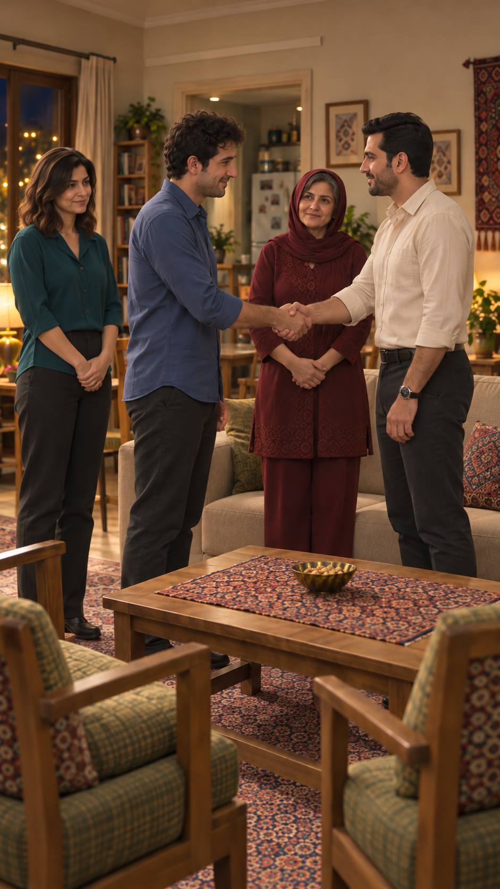

# مرور قاب مستقل ورود — EP03-SH19

تاریخ: ۲۰۲۶/۱۰/۱۴. وضعیت: پیشنهادی، در انتظار مرور کاربر؛ نه مجوز ارسال. [مرجع ظاهر](../../../../references/visuals/character-bible.md)، [چهره‌های مصوب](../../../episode-01/references/01-casting-and-living-room-concept-v1.png)، [پرترهٔ سامان](../../../episode-02/references/01-saman-portrait-v1.png) و [صفحهٔ ورود](../../references/EP03-arrival-storyboard-v5.png) با نقش‌های مشخص ورودی ابزار داخلی `image_gen` بودند.

دو مرد ایستاده در راه آزاد کنار میز دست راست می‌دهند؛ مادر و نازلی ساکت ایستاده و فرهاد سمت همان نشیمن راست کاناپه. چهره و مو و لباس‌های قابل‌دیدن با مرجع ورودی مقایسه شدند و اختلاف آشکار تشخیص داده نشد. دست‌ها در عکس تماس طبیعی دارند؛ حرکت برخاستن، نزدیک‌شدن و رهاکردن هنوز بررسی نشده‌اند. روی میز چای نیست؛ پنجره چپ و آشپزخانه عقب حفظ شده‌اند.

تطبیق مشخصات قابل‌دیدن: بررسی شد و قبول در حد مشاهدهٔ ثابت؛ نگاه نازلی در نمای۲ ایراد باز است. حرکت و صدا و لب‌خوانی: بررسی نشده. پذیرش تصویر تازه هنوز ثبت نشده. زمان‌گیری واقعی و هزینه/مجوز ویدیو وجود ندارد. متن گفتار مصوب بازنویسی نشده است.
