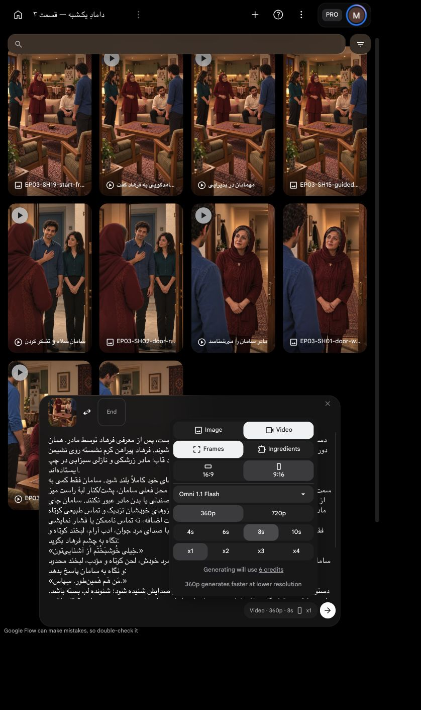

# بستهٔ برخاستن و دست‌دادن

`EP03-SH19`، ترتیب۴، برداشت اول؛ **یک‌بار با تأیید کاربر ارسال شد؛ گزارش زیر سند بررسی پیش از ارسال است**. کاربر آماده‌سازی و تصمیم‌های فنی میانی را مستقل مجاز کرده؛ فقط پیش از ارسال همین بسته به `Flow` تأیید لازم است.

[](../../images/EP03-SH19-start-from-approved-introduction-v1.png)

کنش: فرهاد از همان جای خودش بلند می‌شود؛ سامان در سمت راست قاب به او می‌چرخد؛ دو مرد ایستاده دست راست می‌دهند و به ترتیب جملهٔ مصوب خود را می‌گویند. دست‌ها کوتاه و طبیعی رها می‌شوند؛ پایان هر دو ایستاده‌اند. دعوت به نشستن در نمای بعد است. [متن و بازی مصوب مالک](../../shot.md).

## بررسی پیش از ارسال

| مورد | نتیجه و شاهد |
|---|---|
| دیالوگ | متن مصوب دو مرد، اعراب و نوبت‌ها از کارت مالک منتقل شد؛ مادر و نازلی جمله‌ای ندارند |
| بیان/بازی | سامان ادب اجتماعی۲از۵ و لبخند کوتاه؛ فرهاد پاسخ کوتاه با ادب کنترل‌شده۲از۵؛ نگاه دو مرد به هم، بدون رقابت اغراق‌آمیز یا فشار دست |
| زمان | تمرین مصنوعی محلی: سامان۲٫۷۵۱، فرهاد۲٫۴۰۳، مجموع۵٫۱۵۵ثانیه. اندازه‌گیری اجرای طبیعی نیست. حدود۲ثانیه برای برخاستن و تماس تخمین طراحی است، نه تمرین حرکتی اندازه‌گیری‌شده؛ رهاکردن می‌تواند با انتهای گفتار هم‌پوشانی داشته باشد.۸ثانیه با حاشیه انتخاب شد؛ زمان بی‌کار محلی حذف می‌شود، جمله کش نیاید |
| مالکیت صدا و لب | ابتدا سامان تنها گوینده، پس از پایان جمله فرهاد تنها گوینده؛ شنونده و دو زن لب بسته. دو صدای بومی و محیط حفظ می‌شوند؛ قفل صدای مرجع در این حالت ادعا نمی‌شود |
| ورودی/اتصال | فریم انتهایی نسخهٔ منتخب۵٫۲۵ثانیه‌ایِ مادر، با فرهاد هنوز نشسته؛ بدون پرش به تصویر تماس قدیمی. اثرانگشت منبع و قاب در بسته ثبت شد |
| هویت و لباس | همان فریم واقعی تأییدشده، مو و صورت قابل‌دیدن مادر/نازلی/فرهاد و لباس‌های ثابت؛ صورت سامان در شروع پوشیده است. ظاهرشدن چهرهٔ او در خروجی باید با پرترهٔ مصوب و چهرهٔ فرهاد با مرجع خانوادگی کنترل شود |
| هندسه/دست | [بررسی واقعی قاب و مسیر](../../start-frame-review.md): برخاستن فرهاد همان نشیمن، گردش کوچک سامان در راست، تماس سمت آزاد کنار میز؛ هیچ عبور از میز یا بدن مادر مجاز نیست. ابعاد دقیق اندازه‌گیری نشده؛ حرکت واقعی بررسی پس از تولید می‌خواهد |
| دوربین | همان محور و دوربین ثابتِ پایان نمای قبل؛ قاب قدیمیِ سامان در چپ ورودی نیست؛ تغییر ناگهانی سمت‌ها مجاز نیست |
| محیط/وسایل | آشپزخانه باز، پنجره چپ، دو صندلی و آجیل حفظ؛ چای/سینی غایب. مرجع خانه و ظاهر با گزارش قاب قبل پیوند دارند؛ تصویر قدیمی با درگاه باریک کنار گذاشته شد |
| جایگزین محلی | برخاستن در برداشت ردشدهٔ قبلی موجود است، ولی چرخش سامان به لنز و فقدان تماس و گفتار درست دارد؛ استفاده از آن کنش و لب‌خوانی تازه را تأمین نمی‌کند. قاب شروع از منبع موجود استخراج شد و تولید تصویر تازه نداشت |
| تنظیمات/قیمت | زنده در مرورگر داخلی: `Omni 1.1 Flash`، `Frames`، `9:16`، `360p`،۸ثانیه، `x1`،۶اعتبار |
| مجوز | یک ارسال با سقف کل۶اعتبار؛ بدون تکرار خودکار یا ارتقا. کاربر با «تأیید» همین بسته و سقف۶اعتبار را پذیرفت؛ یک ارسال مصرف شد؛ درخواست ارسال خالی شد |

ریسک صریح مولد: دو گوینده و تماس دست نسبت به نمای تک‌گوینده سخت‌ترند؛ رعایت نوبت و دست‌ها تضمین نیست. یک زنجیرهٔ مرتبط از برخاستن تا آشنایی در یک کلیپ حفظ می‌شود تا هزینه و پرش اتصال زیاد نشوند. در صورت شکست، تکرار خودکار انجام نمی‌شود؛ خروجی موجود و اصلاح محلی ابتدا بررسی می‌شوند. تمام خروجی باید برای حرکت، مالک صدا، تلفظ و لب و صورت و محیط واقعاً دیده/شنیده شود؛ این گزارش، تأیید رسانهٔ تولیدنشده نیست.

## پرامپت کامل

دستور اجرا؛ خوانده نشود: ادامهٔ بی‌واسطهٔ قاب شروع پیوست، پس از معرفی فرهاد توسط مادر. همان دوربین عمودی ثابت و همان چهره‌ها، لباس‌ها و خانه حفظ شوند. فرهاد پیراهن کرم نشسته روی نشیمن راست کاناپه؛ سامان پیراهن آبی ایستاده در راست قاب؛ مادر زرشکی و نازلی سبزآبی در چپ ایستاده‌اند.
فرهاد ابتدا نگاهش را به سامان برگرداند و از همان جای خود کاملاً بلند شود. سامان فقط کمی به سمت فرهاد بچرخد؛ هر دو در فضای آزاد بین جای فرهاد و محل فعلی سامان، پشت/کنار لبهٔ راست میز از دید دوربین، با دست راست دست بدهند؛ از میان میز، صندلی یا بدن مادر عبور نکنند. سامان جای مادر یا سمت چپ قاب نرود. دست‌ها با مسیر آشکار از بازوهای خودشان نزدیک و تماس طبیعی کوتاه داشته باشند؛ نه دست اضافه، نه تماس ناممکن یا فشار نمایشی.
فقط پس از ایستادن کامل هر دو و شروع تماس، سامان با صدای مرد جوان، ادب آرام، لبخند کوتاه و نگاه به چشم فرهاد بگوید:
«خِیلی خُوشبَخْتَم اَز آشنایی‌تون.»
سامان کاملاً جمله را تمام کند. سپس فقط فرهاد با صدای مرد خودش، لحن کوتاه و مؤدب، لبخند محدود و نگاه به سامان پاسخ بدهد:
«مَن هَم هَمین‌طور. سِپاس.»
دستور اجرا؛ خوانده نشود: فقط گویندهٔ هر جمله لب بزند و صدایش شنیده شود؛ شنونده لب بسته باشد. مادر و نازلی در تمام کلیپ خاموش‌اند. دو صدا جابه‌جا یا هم‌زمان نشوند. حرکت دست‌دادن کوتاه باشد، لازم نیست دست‌ها تا آخر پاسخ فرهاد در تماس بمانند؛ در پایان هر دو ایستاده و دست‌ها طبیعی آزاد باشند. کسی ننشیند یا دعوت به نشستن نکند. ریتم طبیعی؛ بدون مکث کش‌دار یا کندکردن جمله برای پرکردن زمان. تک‌روسری مادر و موی جلوی او، آشپزخانهٔ باز پشت کاناپه و پنجرهٔ چپ و آجیل و دو صندلی ثابت؛ چای یا سینی اضافه نشود. صدای طبیعی خانه و لباس و حرکت حفظ شود؛ بدون موسیقی، نریشن، جملهٔ اضافه یا نگاه به لنز.

[](ui-prepared.png)


تأیید همین بسته: کاربر با «تأیید» یک ارسال با سقف۶اعتبار را پذیرفت؛ تکرار مجاز نیست.

<!-- preflight-state -->
```json
{
  "shot": "EP03-SH19",
  "take": "take-01",
  "ready": true,
  "open_issues": [],
  "checks": {
    "dialogue": {
      "status": "pass",
      "evidence": "Approved Saman and Farhad exact two sequential dialogue turns, diacritics from shot.md"
    },
    "delivery": {
      "status": "pass",
      "evidence": "Respect2/5 Saman, restrained courtesy2/5 Farhad, full سپاس ending"
    },
    "duration": {
      "status": "pass",
      "evidence": "Synthetic rehearsal5.155sec speech, not actor timing; about2sec physical allowance design estimate,8sec chosen"
    },
    "performance": {
      "status": "pass",
      "evidence": "Farhad rises from sofa right, turns toward Saman at right, both stand for right-hand handshake then release"
    },
    "speaker": {
      "status": "pass",
      "evidence": "Only Saman first then Farhad, no overlap, women silent; native voice identity needs post-output review"
    },
    "identity": {
      "status": "pass",
      "evidence": "Extracted accepted previous final frame; start-frame-review.md; face refs and wardrobe inherited; Saman back face occluded initially"
    },
    "eyeline": {
      "status": "pass",
      "evidence": "Approved frame gaze to each other; prompt prohibits lens gaze; future movement requires review"
    },
    "geometry": {
      "status": "pass",
      "evidence": "start-frame-review.md: same approved room, open kitchen; contact right beside table, no crossing bodies/furniture; exact distance unmeasured"
    },
    "continuity": {
      "status": "pass",
      "evidence": "Direct continuation of approved SH15 last frame; Farhad starts seated, ends standing with Saman; no tea"
    },
    "camera": {
      "status": "pass",
      "evidence": "Static vertical camera near guest chairs; approved corrected starting frame"
    },
    "prompt": {
      "status": "pass",
      "evidence": "Unchanged SHA from exact approved package; full live editor matched"
    },
    "local_alternative": {
      "status": "pass",
      "evidence": "Rejected prior rise footage has wrong gaze and no correct handshake dialogue; accepted last frame extracted locally"
    },
    "settings": {
      "status": "pass",
      "evidence": "Live IAB Frames9:16 360p8s x1, model Omni1.1Flash shown in prepared screenshot"
    },
    "cost": {
      "status": "pass",
      "evidence": "Live6credits; current user تأیید approves exact one-attempt6credit package"
    }
  },
  "consumed_attempts": 1,
  "bundle_sha256": "4e5753040106c6728f43a99af3bb521a31541e576a3c960ce06051947a34acd8",
  "content_approval": {
    "approved": true,
    "bundle_sha256": "4e5753040106c6728f43a99af3bb521a31541e576a3c960ce06051947a34acd8",
    "user_reply": "تأیید",
    "evidence_ref": "Current approval of exact SH15 standing handshake two sequential speakers8second360p x1 ceiling6credits"
  },
  "cost_approval": {
    "approved": true,
    "bundle_sha256": "4e5753040106c6728f43a99af3bb521a31541e576a3c960ce06051947a34acd8",
    "user_reply": "تأیید",
    "evidence_ref": "Current approval of exact SH15 standing handshake two sequential speakers8second360p x1 ceiling6credits"
  },
  "submission_state": "submitted_once_waiting"
}
```
<!-- /preflight-state -->


نتیجهٔ تولید: [خروجی به علت تکثیر شخصیت رد شد](review.md). سلامت طرح پیش از ارسال، اجرای درست مدل را تضمین نکرد.
