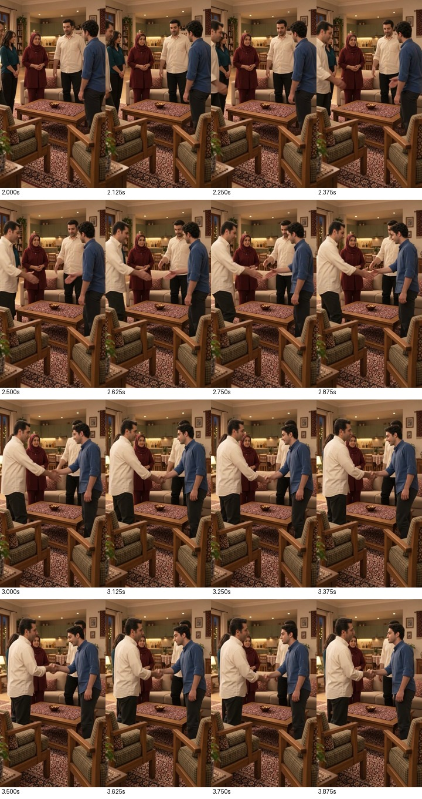

# دست‌دادن — برداشت اول رد شد

**نتیجه: مرد کرم‌پوش اضافی و گسست هویت/حرکت؛ منتخب نیست.** تولید فنی تکمیل و فایل اصلی ذخیره شد؛ کیفیت خلاقه رد است. یک ارسال با قیمت اعلام‌شده۶اعتبار `Flow`؛ کسر واقعی دفتر حساب مستقلاً بررسی نشد. تکرار انجام نشده و مجوزش وجود ندارد.

## شاهد تصویری

۶۴نمونه از تمام۸ثانیه با فاصلهٔ۰٫۱۲۵ثانیه دیده شد؛ بررسی نمونه‌ای است، نه مشاهدهٔ پیوستهٔ همهٔ فریم‌ها. شروع با پایان نمای پذیرفته‌شدهٔ مادر سازگار است و فرهاد در حدود۰٫۴تا۱٫۶ثانیه از همان نشیمن بلند می‌شود.

**از حدود۲٫۱ثانیه مرد دیگری با پیراهن کرم از چپ ظاهر می‌شود؛ حدود۲٫۹ثانیه او با سامان دست می‌دهد، درحالی‌که فرهاد اصلی همچنان عقب سمت راست ایستاده است. دو مرد کرم‌پوش هم‌زمان در نمونه‌های۲٫۲۵تا۴٫۳۷۵ثانیه قابل‌دیدن‌اند.** بنابراین شرط یک فرهاد، مسیر صحیح تماس و مالکیت شخصیت شکسته است. این صرفاً اشکال جزئی انگشت یا نگاه نیست.

[شروع برخاستن](edits/contact-1.jpg)، [ادامهٔ تماس](edits/contact-3.jpg)، [پایان](edits/contact-4.jpg). آشپزخانهٔ باز، میز و صندلی‌ها عمدتاً حفظ شده‌اند؛ سلامت نسبی محیط، خطای شخصیت را جبران نمی‌کند. زمان تماس و رهاشدن به شخصیت صحیح تعلق ندارد و قابل پذیرش نیست.

## صدا و فایل

تشخیص گفتار هر دو جمله را بازیابی کرده؛ این شاهد متن ماشینی است، نه تأیید تلفظ، دو صدای درست، مالکیت لب یا ثبات مرجع صدا. شنیدن انجام نشده. صدای اصلی بدون تبدیل یا حذف محیط حفظ شد. فایل حدود۸٫۰۴ثانیه،۳۶۰×۶۴۰،۲۴فریم‌برثانیه و صدای استریوی۴۸کیلوهرتز است؛ کل فایل بدون خطای رمزگشایی بررسی شد.

## امکان اصلاح محلی و قدم فنی بعدی

برش ساده راه اصلاح نیست: بازهٔ پیدایش و تماس مرد اضافی با کنش اصلی و گفتار آشنایی هم‌پوشان است؛ حذف آن، خودِ دست‌دادن یا جمله را حذف می‌کند. بخش سالم برخاستن به‌تنهایی جای نمای کامل معرفی نمی‌شود. حذف مولد شخص یا جابه‌جایی دیجیتال بدن به‌عنوان اصلاح تضمین‌شده پیشنهاد نمی‌شود. هیچ نسخهٔ ناقص، فریم ثابت یا سکوت به‌جای کنش لازم ساخته نشد.

برای بستهٔ اصلاحی بعدی، گزینهٔ فنی کم‌ریسک‌تر تفکیک برخاستنِ موجود از تماس دونفره در قاب محدودتر است؛ این هنوز طرح بستهٔ تازه نیست. قاب تماس تازه ابتدا باید با خانه و هویت و پایان برخاستن تطبیق داده شود؛ اگر تولید اعتباری لازم شد، بسته و هزینهٔ دقیق مجوز تازه می‌خواهند. فعلاً مصرف تازه صفر و هیچ ارسال دیگری انجام نشده.

[ثبت تولید و اثرانگشت](job.json) · [تشخیص گفتار](edits/asr-check.json) · [شاهد تکمیل](ui-generated.png).
