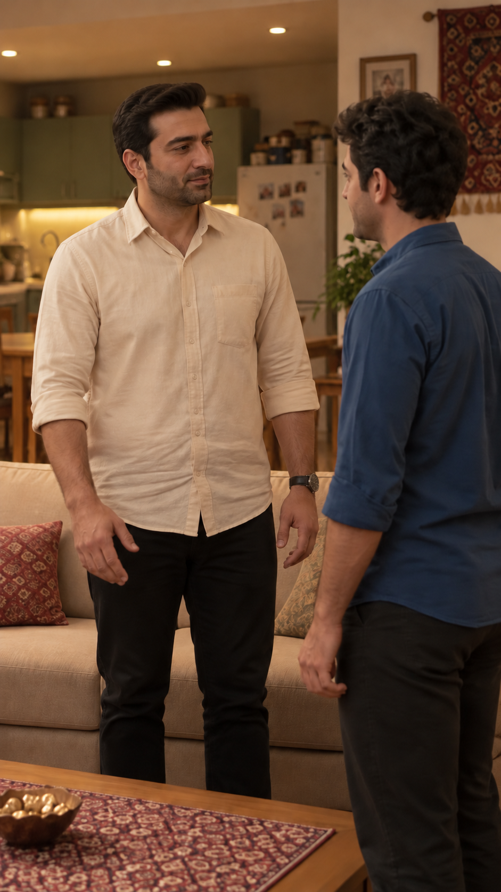
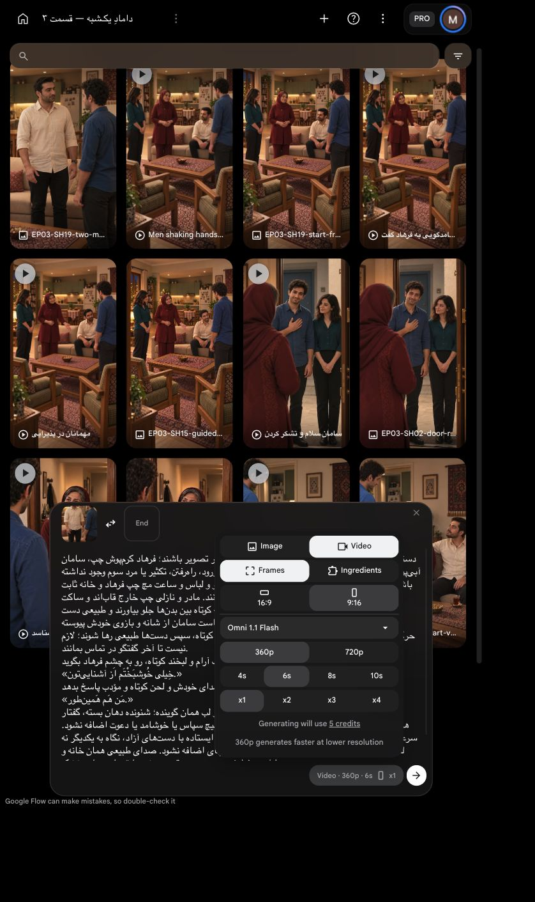

# بستهٔ اصلاح دست‌دادن — بدون سپاس

`EP03-SH19`، `take-02`؛ یک‌بار با تأیید صریح کاربر تولید شد؛ گزارش زیر سند پیش از ارسال است. درخواست آخر کاربر حذف «سپاس» اعمال شد؛ پاسخ متقابل فرهاد حفظ شده است. متن دقیق و بازی در کارت مالک نما هستند.

[](../../images/EP03-SH19-two-men-before-contact-v2.png)

[برخاستن سالم جداشده از منبع موجود](../take-01/edits/EP03-SH19-rise-only-v1.mp4): صفر تا۱٫۹۱۷ثانیه،۴۶فریم. صدای محیط همان منبع؛ این قطعه منتخب کل نما نیست. هیچ هزینهٔ تازهٔ `Flow` برای استخراج یا برش مصرف نشد.

## بررسی پیش از ارسال

| مورد | نتیجه و شاهد |
|---|---|
| دیالوگ و بازی | دو جملهٔ مصوب با اعراب؛ سپاس طبق دستور تازه حذف شد. سامان ادب۲از۵ و فرهاد پاسخ کوتاه۲از۵، نوبت روشن و شنونده خاموش |
| زمان | تمرین مصنوعی محلی با `espeak-ng`۱۶۵: سامان۲٫۷۵۱ و فرهادِ بدون سپاس۱٫۵۲۵ثانیه، مجموع۴٫۲۷۷. تمرین بازیگر نیست. تماس کوچک حدود۰٫۷تا۱ثانیه تخمین طراحی است و رهاکردن با انتهای پاسخ می‌تواند هم‌پوشان باشد.۶ثانیه با حاشیه انتخاب شد؛ جمله کش نیاید |
| راه اصلاح | برخاستن از منبع موجود حفظ شد؛ تولید تازه فقط تماس و دو جمله است. اشتباه قبلی ناشی از خروجی مولد بود؛ علت داخلی مدل معلوم نیست. ساده‌شدن زنجیره خطر را کم می‌کند، تضمین نیست |
| قاب/شخصیت | فریم سالم۱٫۸۷۵ثانیه واقعاً دیده شد؛ از همان جای افراد برای قاب نزدیک‌تر استفاده شد، با مرجع صورت سامان و پنل فرهاد. فقط یک مرد کرم‌پوش و یک آبی‌پوش، دست‌ها جدا، نگاه به هم. ساعت مچ چپ فرهاد در اصلاح دوم بازگردانده شد؛ چهره و ریش و مو و لباس در حد تصویر ثابت تطبیق شدند. نیم‌رخ سامان همهٔ اجزای پوشیده را نشان نمی‌دهد |
| مکان/اتصال | کاناپه پشت فرهاد و آشپزخانه باز و یخچال راست و فرش دیواری راست، لبهٔ میز پایین؛ محور حفظ، فرهاد چپ نسبی قاب و سامان راست. تغییر اندازهٔ نما محل دو زن را بیرون کادر می‌گذارد؛ قرار نیست وارد قاب شوند. ابعاد واقعی اندازه‌گیری نشده؛ قاب پایان برخاستن به قاب دونفره برش تدوینی دارد، اتصال حرکتی نهایی هنوز تولید نشده |
| دست و دوربین | هر دو از قبل ایستاده، دست‌های راست کوتاه به هم؛ دست چپ ساعت‌دار فرهاد پایین. دست راست سامان در شروع تا حدی با تنه پوشیده است؛ مسیر صاحب دست و اتصال در خروجی باید پیوسته دیده شود. دوربین ثابت؛ راه‌رفتن یا جابه‌جایی مردها لازم نیست |
| صدا و لب | یک گوینده در هر نوبت، زنان خارج قاب ساکت. صدای بومی و محیط حفظ؛ مرجع صدا برای قضاوت بعدی است و قفل صوتی در ابزار ادعا نشده |
| هزینه | زنده `Omni 1.1 Flash`، `Frames`، `9:16`، `360p`،۶ثانیه، یک خروجی:۵اعتبار. سقف کل۵، یک ارسال، بدون تکرار. قیمت ابزار داخلی تصویر نمایش داده نشده؛ عدم مصرف اعتبار `Flow` به معنی رایگان‌بودن همهٔ ابزارها معرفی نمی‌شود |
| مجوز | تأیید هزینهٔ قبلی مصرف شده؛ کاربر با «تأیید» همین بسته و۵اعتبار را مجاز کرد؛ یک ارسال مصرف شد |

خروجی باید برای یک فرهاد، دو دست راست با مسیر طبیعی، نوبت گفتار، تلفظ، هویت و محیط بررسی شود. بازبینی ثابت تضمین حرکت یا صدا نیست. اگر خطا رخ دهد تکرار خودکار مجاز نیست.

## پرامپت کامل

دستور اجرا؛ خوانده نشود: فقط همین دو مردِ قاب شروع در تصویر باشند؛ فرهاد کرم‌پوش چپ، سامان آبی‌پوش راست. هر دو از ابتدا ایستاده‌اند، هیچ برخاستن، ورود، راه‌رفتن، تکثیر یا مرد سوم وجود نداشته باشد. دوربین عمودی و ثابت در همان محور، چهره‌ها و مو و لباس و ساعت مچ چپ فرهاد و خانه ثابت بمانند. مادر و نازلی چپ خارج قاب‌اند و ساکت.
تنها حرکت: دو مرد دست راست خودشان را در فاصلهٔ کوتاه بین بدن‌ها جلو بیاورند و طبیعی دست بدهند؛ دست چپ ساعت‌دار فرهاد پایین بماند. دست راست سامان از شانه و بازوی خودش پیوسته حرکت کند؛ هیچ دست اضافه یا عبور از میز و بدن. تماس کوتاه، سپس دست‌ها طبیعی رها شوند؛ لازم نیست تا آخر گفتگو در تماس بمانند.
فقط سامان، با صدای مرد جوان، ادب آرام و لبخند کوتاه، رو به چشم فرهاد بگوید:
«خِیلی خُوشبَخْتَم اَز آشنایی‌تون.»
پس از پایان کامل سامان، فقط فرهاد با صدای خودش و لحن کوتاه و مؤدب پاسخ بدهد:
«مَن هَم هَمین‌طور.»
دستور اجرا؛ خوانده نشود: هر جمله فقط با صدای و لب همان گوینده؛ شنونده دهان بسته، گفتار هم‌زمان یا جابه‌جایی صدا ممنوع. فقط همین دو جمله، هیچ سپاس یا خوشامد یا دعوت اضافه نشود. سرعت عادی و بی‌کشش؛ پایان هر کلمه کامل. پایان هر دو ایستاده با دست‌های آزاد، نگاه به یکدیگر نه لنز. آشپزخانه باز پشت کاناپه، لبهٔ میز و آجیل ثابت، چای اضافه نشود. صدای طبیعی همان خانه و لباس حفظ شود؛ بدون موسیقی، نریشن یا تبدیل صدای خشک.

[](ui-prepared.png)


تأیید همین بسته: کاربر با «تأیید» یک ارسال با سقف۵اعتبار را پذیرفت؛ تکرار مجاز نیست.

<!-- preflight-state -->
```json
{
  "shot": "EP03-SH19",
  "take": "take-02",
  "ready": true,
  "open_issues": [],
  "checks": {
    "dialogue": {
      "status": "pass",
      "evidence": "Approved Saman and Farhad exact two sequential dialogue turns, diacritics from shot.md"
    },
    "delivery": {
      "status": "pass",
      "evidence": "Respect2/5 Saman, restrained courtesy2/5 Farhad, no سپاس; Farhad says only من هم همینطور"
    },
    "duration": {
      "status": "pass",
      "evidence": "Synthetic rehearsal4.277sec speech not actor timing; brief contact physical allowance estimated,6sec chosen; no rise"
    },
    "performance": {
      "status": "pass",
      "evidence": "Both already standing; short right-hand contact and release; no rise or walking"
    },
    "speaker": {
      "status": "pass",
      "evidence": "Only Saman first then Farhad, no overlap, women silent; native voice identity needs post-output review"
    },
    "identity": {
      "status": "pass",
      "evidence": "Two-men framev2 derived from safe standing source and canonical faces; watch restored; preflight.md actual image reviewed"
    },
    "eyeline": {
      "status": "pass",
      "evidence": "Approved frame gaze to each other; prompt prohibits lens gaze; future movement requires review"
    },
    "geometry": {
      "status": "pass",
      "evidence": "preflight.md two-person closer frame same axis sofa and open kitchen, short contact no body/furniture crossing"
    },
    "continuity": {
      "status": "pass",
      "evidence": "Local46frame rise salvage followed by closer standing two-shot; no duplicated Farhad, no tea"
    },
    "camera": {
      "status": "pass",
      "evidence": "Static vertical camera near guest chairs; approved corrected starting frame"
    },
    "prompt": {
      "status": "pass",
      "evidence": "Unchanged SHA from exact approved package; full live editor matched"
    },
    "local_alternative": {
      "status": "pass",
      "evidence": "Rejected prior rise footage has wrong gaze and no correct handshake dialogue; accepted last frame extracted locally"
    },
    "settings": {
      "status": "pass",
      "evidence": "Live IAB Frames9:16 360p6s x1, model Omni1.1Flash shown in prepared screenshot"
    },
    "cost": {
      "status": "pass",
      "evidence": "Live5credits; current user تأیید approves exact one-attempt5credit package"
    }
  },
  "consumed_attempts": 1,
  "bundle_sha256": "ae45c45fc63cef47593e4eb7d377a1d3e035a870a16a7f563374ff0f462a6b6a",
  "content_approval": {
    "approved": true,
    "bundle_sha256": "ae45c45fc63cef47593e4eb7d377a1d3e035a870a16a7f563374ff0f462a6b6a",
    "user_reply": "تأیید",
    "evidence_ref": "Current approval of exact SH15 two standing men handshake without thanks6second360p x1 ceiling5credits"
  },
  "cost_approval": {
    "approved": true,
    "bundle_sha256": "ae45c45fc63cef47593e4eb7d377a1d3e035a870a16a7f563374ff0f462a6b6a",
    "user_reply": "تأیید",
    "evidence_ref": "Current approval of exact SH15 two standing men handshake without thanks6second360p x1 ceiling5credits"
  },
  "submission_state": "submitted_once_waiting"
}
```
<!-- /preflight-state -->


[بازبینی خروجی و مونتاژ برخاستن/تماس](review.md).
