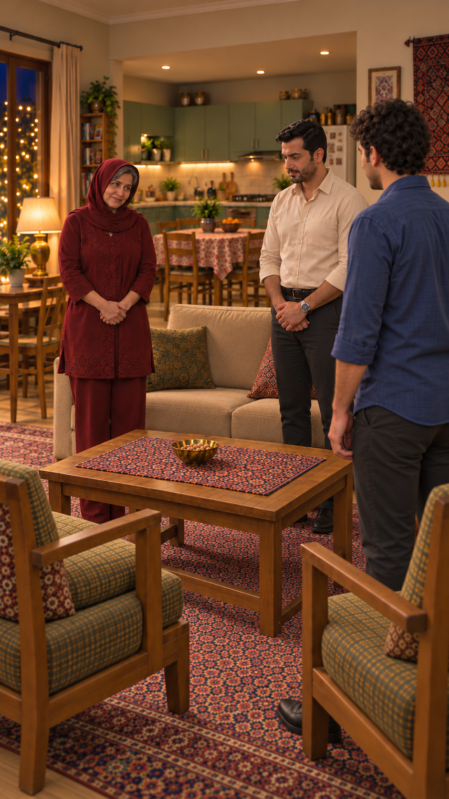
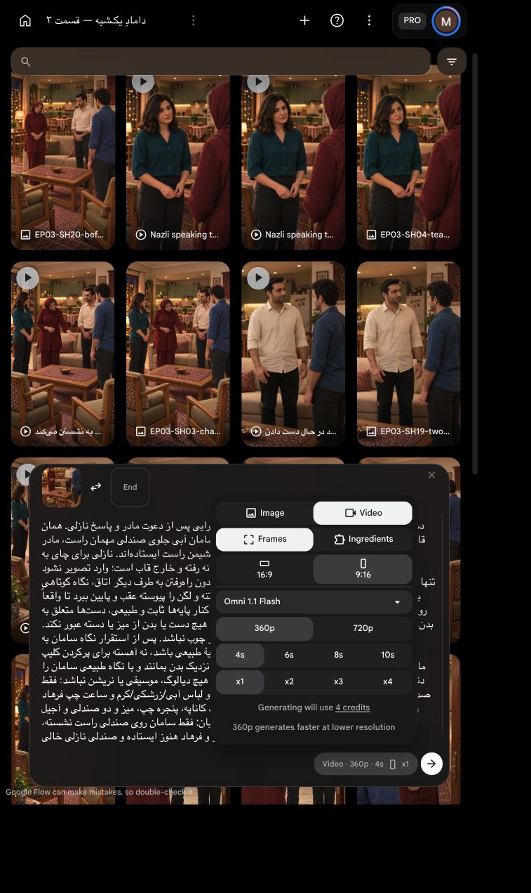

# اتصال نشستن مهمان — برداشت اول

`EP03-SH20`، ترتیب۷؛ **آمادهٔ مرور پیش از ارسال، تولید نشده**. تغییر اندازه/موقعیت با برش روایی بعد از پاسخ نازلی: مسیر قدم‌زدن او و سامان حذف می‌شود، نه خود نشستن مهمان.

[](../../images/EP03-SH20-before-sitting-house-v3.png)

| بررسی | نتیجه و شاهد |
|---|---|
| داستان/بازی | مهمان اول می‌نشیند، میزبان‌ها ایستاده؛ نازلی برای درخواست چای رفته و خارج قاب. رفتار مؤدب و طبیعی، بدون رویداد/گفتار تازه |
| دیالوگ/تلفظ/مالک لب | نامرتبط؛ هیچ گفتاری مجاز نیست و همه لب بسته |
| زمان | یک فرود کوتاه از ایستادهٔ جلوی صندلی تا نشیمن، حدود۲ثانیه تخمین طراحی است، نه تمرین فیزیکی زمان‌گیری‌شده.۴ثانیه کوتاه‌ترین گزینهٔ ابزار؛ زمان بی‌کار بعداً محلی حذف شود |
| تصویر ورودی | قاب پایان قدیمی واقعاً دیده و رد شد برای شروع: سامان از قبل نشسته و آشپزخانه درگاه باریک داشت. قاب تازه با همان چهره/لباس و خانهٔ نمای دعوت ساخته و دیده شد؛ سامان ایستاده، نازلی خارج قاب، صندلی خالی پشت او |
| هویت | مادر مو/سن و تک‌روسری و تونیک زرشکی، فرهاد مو/ریش/پیراهن کرم و ساعت، سامان مو و پیراهن آبی در تطبیق با قاب‌های مرجع؛ صورت سامان از پشت پوشیده است و جزئیات پنهان تأیید نمی‌شود |
| فضا | آشپزخانهٔ باز و کابینت سبز و میز غذاخوری عقب، یخچال راست، پنجره چپ، کاناپه و دو صندلی مقابل با میز آجیل حفظ شدند؛ ابعاد دقیق اندازه‌گیری نشده |
| حرکت/دست | سامان از ابتدا جلوی صندلی است؛ دیگر راه پیچیدهٔ دور میز تولید نمی‌شود. تنها خم‌شدن زانو و پایین‌رفتن روی تشک، دست‌ها روی بدن یا دستهٔ خودش؛ صندلی ثابت. بخشی از تشک پشت بدن پوشیده است؛ هیچ برخورد آشکار در فریم شروع دیده نشد، اما مسیر کامل و تماس لگن/تشک باید در خروجی پیوسته کنترل شود |
| اتصال | پذیرش پاسخ نازلی و رفتن برای چای علت برش است؛ حذف مسیر قدم‌ها تصمیم تدوینی است، نه ادعای تولید خروج کامل او. پایان این نما سامان نشسته، مادر/فرهاد ایستاده؛ نشستن میزبان‌ها فقط نمای۲۱ |
| دوربین/نگاه | همان سمت صندلی‌ها رو به کاناپه؛ دوربین ثابت، تغییر محور/چرخاندن صندلی ممنوع. نگاه سامان پس از نشستن به میزبان‌ها |
| راه کم‌هزینه | ویدیوی سالمی از نشستن موجود نیست؛ فریم ثابتِ پایان جای حرکت واقعی نیست. فقط قاب لازم اصلاح شد؛ ابزار داخلی تصویر قیمت نمایش نداد و اعتبار `Flow` مصرف نکرد |
| تنظیمات/هزینه | `Omni 1.1 Flash`، `Frames`، `9:16`، `360p`،۴ثانیه، `x1`؛ قیمت زنده۴اعتبار. یک ارسال با سقف۴، بدون تکرار خودکار |
| مجوز | این بستهٔ جدید هنوز تأیید هزینه ندارد؛ درخواست ارسال خالی و هیچ ارسال تازه انجام نشده |

ریسک مولد: نشست روی تشک، سلامت پا و دست و عدم نشستن زودهنگام میزبان‌ها باید واقعاً دیده شود. فریم ثابت تضمین حرکت نیست. صدای طبیعی محیط حفظ و نبود گفتار/موسیقی شنیداری کنترل شود؛ آماده‌سازی به معنی پذیرش ویدیوی تولیدنشده نیست.

## پرامپت کامل

دستور اجرا؛ هیچ متن یا جمله‌ای خوانده نشود: ادامهٔ پذیرایی پس از دعوت مادر و پاسخ نازلی. همان قاب شروع و دوربین عمودی ثابت. فقط سه نفر در قاب: سامان آبی جلوی صندلی مهمان راست، مادر زرشکی کنار نشیمن چپ کاناپه و فرهاد کرم کنار نشیمن راست ایستاده‌اند. نازلی برای چای به آشپزخانه رفته و خارج قاب است؛ وارد تصویر نشود.
تنها کنش: سامان از همین موقعیت جلوی صندلی خودش، بدون راه‌رفتن به طرف دیگر اتاق، نگاه کوتاهی به نشیمن پشت خودش کند، زانوها را طبیعی خم کند و تنه و لگن را پیوسته عقب و پایین ببرد تا واقعاً روی تشک همان صندلی راست بنشیند. پاها روی زمین و کنار پایه‌ها ثابت و طبیعی، دست‌ها متعلق به بدن خودش و در صورت نیاز فقط روی دستهٔ همان صندلی؛ هیچ دست یا بدن از میز یا دسته عبور نکند. صندلی جابه‌جا یا نچرخد، بدن معلق یا فرورفته در چوب نباشد. پس از استقرار نگاه سامان به میزبان‌ها، بدون نگاه به لنز. حرکت حدود دو ثانیهٔ طبیعی باشد، نه آهسته برای پرکردن کلیپ.
مادر و فرهاد تا پایان ایستاده و ساکت با دست‌های آرام نزدیک بدن بمانند و با نگاه طبیعی سامان را دنبال کنند؛ روی کاناپه ننشینند. هیچ‌کس لب‌خوانی نکند، هیچ دیالوگ، موسیقی یا نریشن نباشد؛ فقط صدای ملایم خانه و لباس و نشستن طبیعی. چهره‌ها و مو و لباس آبی/زرشکی/کرم و ساعت چپ فرهاد و تک‌روسری مادر با موی جلو ثابت. آشپزخانهٔ باز پشت کاناپه، پنجره چپ، میز و دو صندلی و آجیل ثابت؛ چای یا سینی یا شخص اضافی ظاهر نشود. پایان: فقط سامان روی صندلی راست نشسته، مادر و فرهاد هنوز ایستاده و صندلی نازلی خالی.

[](ui-prepared.png)


تأیید همین بسته: کاربر با «تأیید» یک ارسال با سقف۴اعتبار را پذیرفت؛ تکرار مجاز نیست.

<!-- preflight-state -->
```json
{
  "shot": "EP03-SH20",
  "take": "take-01",
  "ready": true,
  "open_issues": [],
  "checks": {
    "dialogue": {
      "status": "pass",
      "evidence": "No dialogue; approved silent action in prompt"
    },
    "delivery": {
      "status": "pass",
      "evidence": "No speech or vocal performance requested"
    },
    "duration": {
      "status": "pass",
      "evidence": "Design estimate2sec sitting, not measured physical rehearsal;4sec minimum option with margin"
    },
    "performance": {
      "status": "pass",
      "evidence": "Only Saman sits in guest chair right; hosts remain standing; Nazli offscreen in kitchen"
    },
    "speaker": {
      "status": "pass",
      "evidence": "All four silent, no speaking lips or narrator"
    },
    "identity": {
      "status": "pass",
      "evidence": "Actually viewed standing startv3 with corrected house, same faces/clothes, Saman face hidden by angle"
    },
    "eyeline": {
      "status": "pass",
      "evidence": "Approved frame gaze to each other; prompt prohibits lens gaze; future movement requires review"
    },
    "geometry": {
      "status": "pass",
      "evidence": "preflight.md: open kitchen behind sofa, window left, two chairs; Saman positioned in front of right chair; exact hidden seat contact requires output review"
    },
    "continuity": {
      "status": "pass",
      "evidence": "Editorial cut omits Nazli walk and Saman approach; only sitting generated; hosts standing; no tea"
    },
    "camera": {
      "status": "pass",
      "evidence": "Static vertical camera near guest chairs; approved corrected starting frame"
    },
    "prompt": {
      "status": "pass",
      "evidence": "Unchanged SHA from exact approved package; full live editor matched"
    },
    "local_alternative": {
      "status": "pass",
      "evidence": "No valid video of Saman sitting; old seated still not motion"
    },
    "settings": {
      "status": "pass",
      "evidence": "Live IAB Frames9:16 360p4s x1, model Omni1.1Flash shown in prepared screenshot"
    },
    "cost": {
      "status": "pass",
      "evidence": "Live4credits; current user تأیید approves exact one-attempt4credit package"
    }
  },
  "consumed_attempts": 1,
  "bundle_sha256": "477cdbfa208ccaf3b4e28246e1b902bf1be49046a962a51fd5cd3377621d1098",
  "content_approval": {
    "approved": true,
    "bundle_sha256": "477cdbfa208ccaf3b4e28246e1b902bf1be49046a962a51fd5cd3377621d1098",
    "user_reply": "تأیید",
    "evidence_ref": "Current approval of exact SH15 silent Saman sitting4second360p x1 ceiling4credits"
  },
  "cost_approval": {
    "approved": true,
    "bundle_sha256": "477cdbfa208ccaf3b4e28246e1b902bf1be49046a962a51fd5cd3377621d1098",
    "user_reply": "تأیید",
    "evidence_ref": "Current approval of exact SH15 silent Saman sitting4second360p x1 ceiling4credits"
  },
  "submission_state": "submitted_once_waiting"
}
```
<!-- /preflight-state -->
