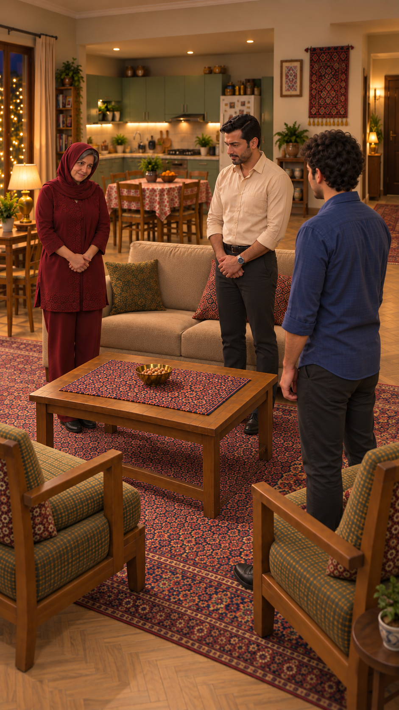
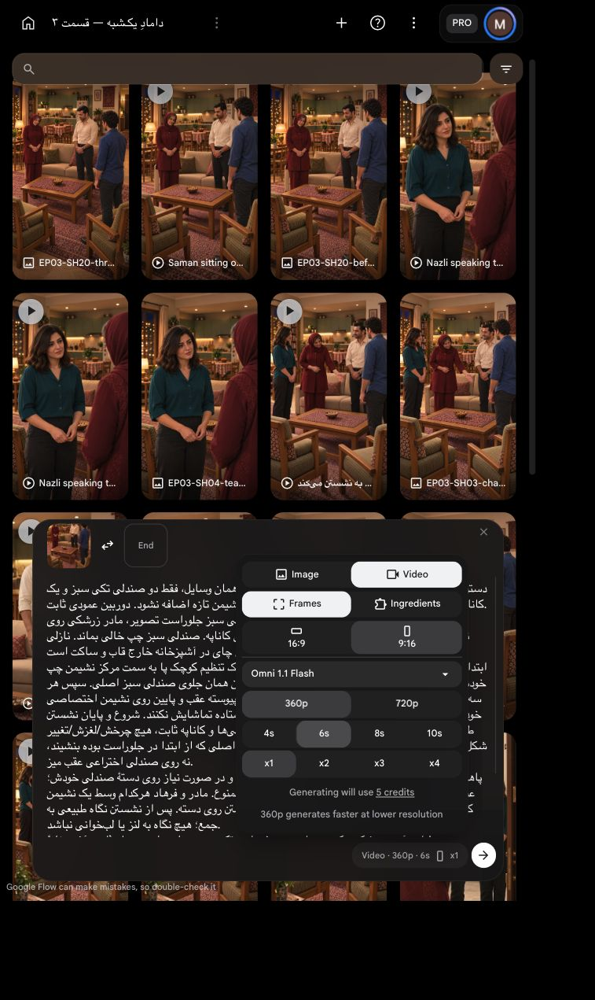

# نشستن هم‌زمان سه نفر — بستهٔ اصلاحی

`EP03-SH20`، برداشت دوم؛ **پس از تأیید هزینه یک‌بار تولید و سپس با نظر کاربر پذیرفته شد**. مطابق تصحیح صریح کاربر هر سه با هم می‌نشینند. `SH21` ادغام و غیرفعال شده تا نشستن میزبان‌ها دوباره تولید نشود.

[](../../images/EP03-SH20-three-standing-two-chairs-v4.png)

| بررسی | نتیجه و شاهد |
|---|---|
| متن/گفتار | نامرتبط؛ همه ساکت؛ فقط محیط طبیعی |
| کنش/زمان | هر سه زانوها را در بازهٔ مشترک خم و روی جای خود بنشینند؛ هم‌زمان طبیعی، نه مکانیکی. حدود۱ثانیه تنظیم و۲تا۳ثانیه نشستن تخمین طراحی است، نه زمان‌گیری فیزیکی.۶ثانیه حاشیه دارد؛ زمان بی‌کار بعداً محلی کوتاه شود |
| خطای قبلی | ویدیوی قبلی واقعاً دیده شد: دو صندلی جلو ماندند و صندلی سوم برای سامان عقب ظاهر شد. منبع رد و انتخاب نشد؛ برش ساده این کنش را اصلاح نمی‌کند |
| شمارش/ورودی | قاب تازه واقعاً دیده شد: دقیقاً دو صندلی تکی سبز جلو، یک کاناپهٔ دونفره عقب؛ سامان بین میز و صندلی اصلی راست با تشک پشتش، نه پشت صندلی. سطح و دسته‌های همان صندلی قابل‌ردیابی‌اند |
| مقصدها/فیزیک | سامان صندلی اصلی راست، فرهاد نشیمن راست کاناپه؛ مادر کمی سمت چپ نشیمن خودش است و تنظیم کوچک پا به داخل لازم دارد. حرکت عقب/پایین بدون عبور از میز یا دسته، دست صاحب‌دار؛ تماس واقعی لگن/تشک و پاها پس از تولید باید پیوسته دیده شود. فاصلهٔ دقیق اندازه‌گیری نشده |
| ظاهر | چهره/مو و لباس از قاب مرجع و اصلاح واقعی دیده و حفظ؛ مادر تک‌روسری و موی جلو و زرشکی، فرهاد کرم و ساعت، سامان آبی و مو از پشت. صورت پوشیدهٔ سامان بررسی‌پذیر نیست |
| خانه/دوربین | قاب با برش خانه و قاب‌های مصوب مقایسه شد: آشپزخانهٔ باز پشت کاناپه، پنجره چپ، یخچال راست، میز غذاخوری عقب، راهرو راست؛ دوربین کمی بازتر همان سمت صندلی‌ها. پلان اندازه‌گیری‌شده نیست |
| اتصال | پس از پاسخ نازلی، راه‌رفتن به آشپزخانه و رسیدن سامان به صندلی با برش حذف می‌شود؛ نازلی خارج قاب است. پایان سه نفر نشسته، صندلی چپ خالی، هیچ چای یا سینی |
| تنظیمات/هزینه | `Omni 1.1 Flash`، `Frames`، `9:16`، `360p`،۶ثانیه، `x1`؛ قیمت زنده۵اعتبار، سقف کل۵، یک ارسال بدون تکرار |
| مجوز | تأیید هزینهٔ قبلی مصرف شده؛ همین برداشت با «تأیید» برای سقف۵اعتبار مجاز و یک‌بار ارسال شد؛ سپس خروجی پذیرفته شد |

خطر حرکت سه بدن و تعداد وسایل صفر نیست؛ هیچ تضمین مصنوعی داده نمی‌شود. پیش از پذیرش، شمارش دقیق دو صندلی، پایان نشستن همه، فاصلهٔ مادر/فرهاد، دست و پا، هویت و محیط باید در خروجی بررسی شود. ابزار داخلی تصویر اعتبار `Flow` مصرف نکرد، قیمت داخلی نمایش داده نشده بود.

## پرامپت کامل

دستور اجرا؛ هیچ گفتاری نباشد: همان قاب شروع و دقیقاً همان وسایل، فقط دو صندلی تکی سبز و یک کاناپهٔ دونفره؛ هیچ صندلی سوم، صندلی پشت سامان یا نشیمن تازه اضافه نشود. دوربین عمودی ثابت.
سه نفر با هم می‌نشینند: سامان آبی روی همان صندلی سبز جلوراست تصویر، مادر زرشکی روی نشیمن چپ کاناپه و فرهاد کرم روی نشیمن راست همان کاناپه. صندلی سبز چپ خالی بماند. نازلی برای چای در آشپزخانه خارج قاب و ساکت است.
ابتدا هر سه نگاه کوتاهی به جای خود بیندازند؛ مادر فقط یک تنظیم کوچک پا به سمت مرکز نشیمن چپ خودش انجام دهد، فرهاد همان جلوی نشیمن راست، سامان همان جلوی صندلی سبز اصلی. سپس هر سه در یک بازهٔ زمانی مشترک زانوها را خم کنند و بدن‌ها پیوسته عقب و پایین روی نشیمن اختصاصی خود فرود بیاید؛ سامان جدا زودتر ننشیند و دو میزبان ایستاده تماشایش نکنند. شروع و پایان نشستن طبیعی و تقریباً هم‌زمان، نه حرکت رباتیک یکسان. صندلی‌ها و کاناپه ثابت، هیچ چرخش/لغزش/تغییر شکل یا ظاهرشدن مبلمان تازه نباشد. سامان روی صندلی اصلی که از ابتدا در جلوراست بوده بنشیند، نه روی صندلی اختراعی عقب میز.
پاها واقعی روی زمین، دست‌ها فقط از بازوی صاحب خود و در صورت نیاز روی دستهٔ صندلی خودش؛ عبور بدن/دست از میز و چوب یا فرو رفتن و معلق‌ماندن ممنوع. مادر و فرهاد هرکدام وسط یک نشیمن کاناپه با فاصلهٔ عادی خانوادگی، بدون چسبیدن یا نشستن روی دسته. پس از نشستن نگاه طبیعی به جمع؛ هیچ نگاه به لنز یا لب‌خوانی نباشد.
چهره و مو و لباس آبی، زرشکی، کرم و ساعت چپ فرهاد و تک‌روسری مادر با موی جلو ثابت. آشپزخانهٔ باز پشت کاناپه، پنجره چپ، میز آجیل و همان دو صندلی حفظ؛ چای یا سینی یا شخص اضافه نشود. هیچ دیالوگ، موسیقی یا نریشن؛ فقط صدای طبیعی خانه و لباس و نشستن. حرکت با ریتم عادی، بدون کندکردن برای پرکردن زمان. پایان هر سه واقعاً نشسته‌اند، صندلی نازلی همچنان خالی.

[](ui-prepared.png)


تأیید همین بسته: کاربر با «تأیید» یک ارسال با سقف۵اعتبار را پذیرفت؛ تکرار مجاز نیست.

<!-- preflight-state -->
```json
{
  "shot": "EP03-SH20",
  "take": "take-02",
  "ready": true,
  "open_issues": [],
  "checks": {
    "dialogue": {
      "status": "pass",
      "evidence": "No dialogue; approved silent action in prompt"
    },
    "delivery": {
      "status": "pass",
      "evidence": "No speech or vocal performance requested"
    },
    "duration": {
      "status": "pass",
      "evidence": "Design estimate1sec small foot setup and2-3sec shared sitting, not measured physical rehearsal;6sec margin"
    },
    "performance": {
      "status": "pass",
      "evidence": "All3 sit in shared interval: Saman original chair right, mother sofa left, Farhad sofa right; Nazli offscreen"
    },
    "speaker": {
      "status": "pass",
      "evidence": "All four silent, no speaking lips or narrator"
    },
    "identity": {
      "status": "pass",
      "evidence": "Actually viewed standing startv4 from corrected house and house cutaway, same faces/clothes, Saman face partially hidden"
    },
    "eyeline": {
      "status": "pass",
      "evidence": "Approved frame gaze to each other; prompt prohibits lens gaze; future movement requires review"
    },
    "geometry": {
      "status": "pass",
      "evidence": "preflight.md: counted exactly2armchairs and1sofa; Saman between table and original right chair, hosts before sofa seats; mother small foot setup required; actual contact needs review"
    },
    "continuity": {
      "status": "pass",
      "evidence": "Editorial cut omits Nazli walk and Saman approach; all3sit, guest-first superseded by user; SH21 absorbed, no tea"
    },
    "camera": {
      "status": "pass",
      "evidence": "Static vertical camera near guest chairs; approved corrected starting frame"
    },
    "prompt": {
      "status": "pass",
      "evidence": "Unchanged SHA from exact approved package; full live editor matched"
    },
    "local_alternative": {
      "status": "pass",
      "evidence": "No valid video of Saman sitting; old seated still not motion"
    },
    "settings": {
      "status": "pass",
      "evidence": "Live IAB Frames9:16 360p6s x1, model Omni1.1Flash shown in prepared screenshot"
    },
    "cost": {
      "status": "pass",
      "evidence": "Live5credits; current user تأیید approves exact one-attempt5credit package"
    }
  },
  "consumed_attempts": 1,
  "bundle_sha256": "b8a16eed5cfef2220694e64bde8b813dab35f24189e51dc39ee11efc2e5a9345",
  "content_approval": {
    "approved": true,
    "bundle_sha256": "b8a16eed5cfef2220694e64bde8b813dab35f24189e51dc39ee11efc2e5a9345",
    "user_reply": "تأیید",
    "evidence_ref": "Current approval of exact SH15 silent simultaneous3person sitting6second360p x1 ceiling5credits"
  },
  "cost_approval": {
    "approved": true,
    "bundle_sha256": "b8a16eed5cfef2220694e64bde8b813dab35f24189e51dc39ee11efc2e5a9345",
    "user_reply": "تأیید",
    "evidence_ref": "Current approval of exact SH15 silent simultaneous3person sitting6second360p x1 ceiling5credits"
  },
  "submission_state": "submitted_once_waiting"
}
```
<!-- /preflight-state -->


[پذیرش خروجی و کنترل فایل/چیدمان](review.md).
