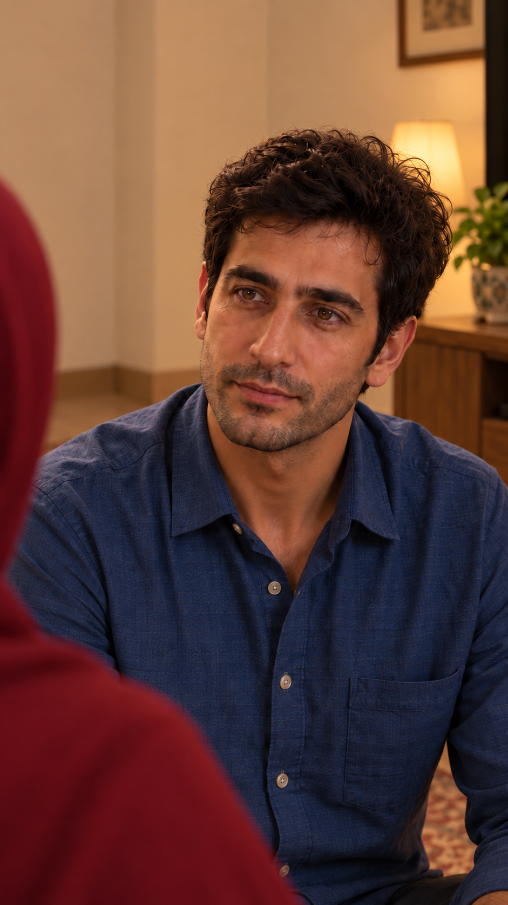
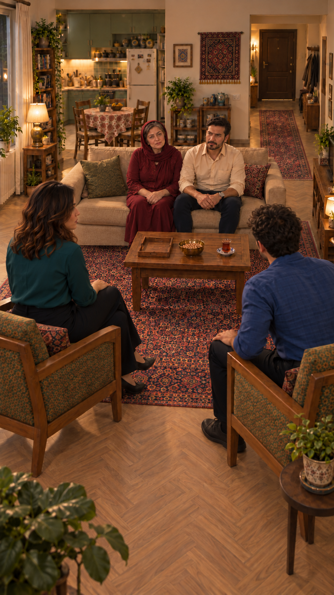
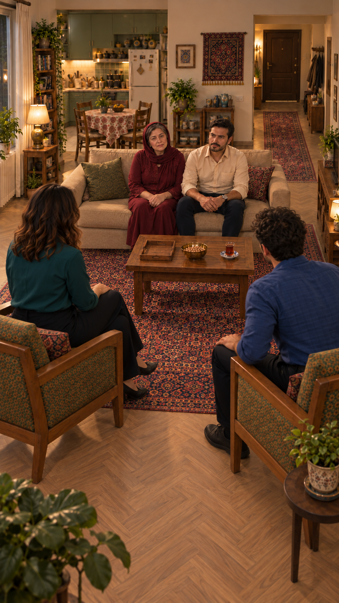
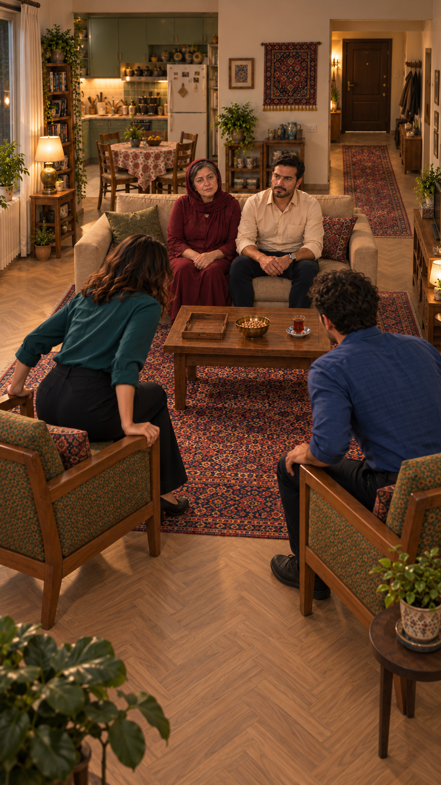
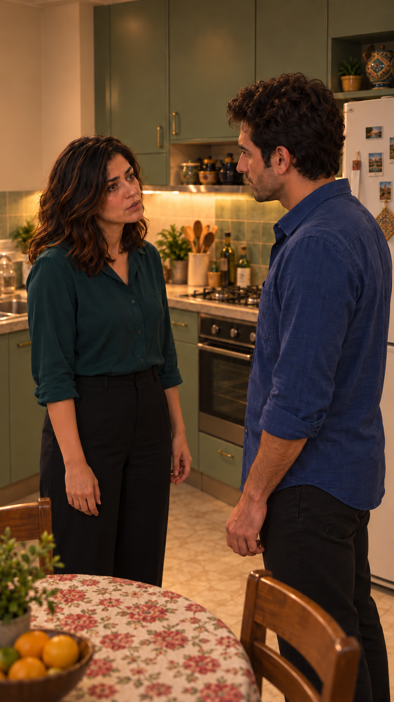
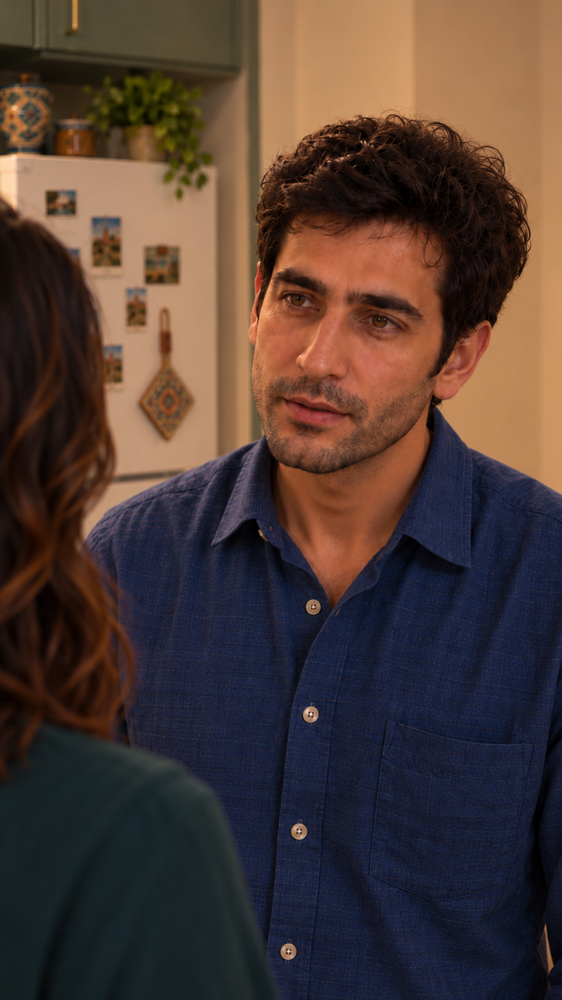
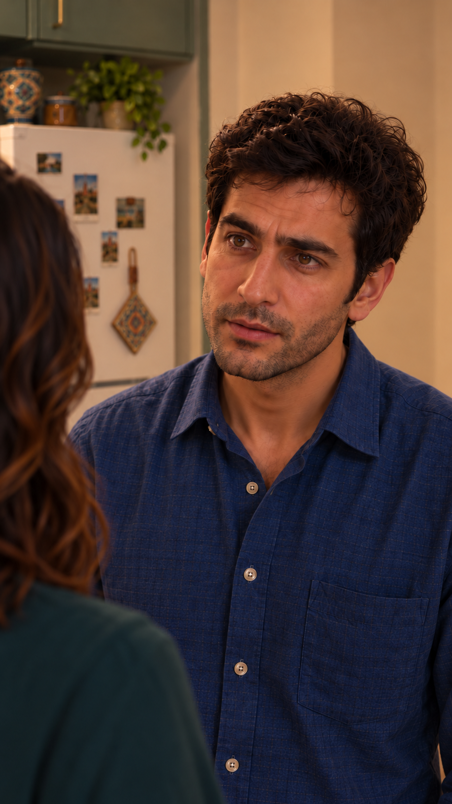
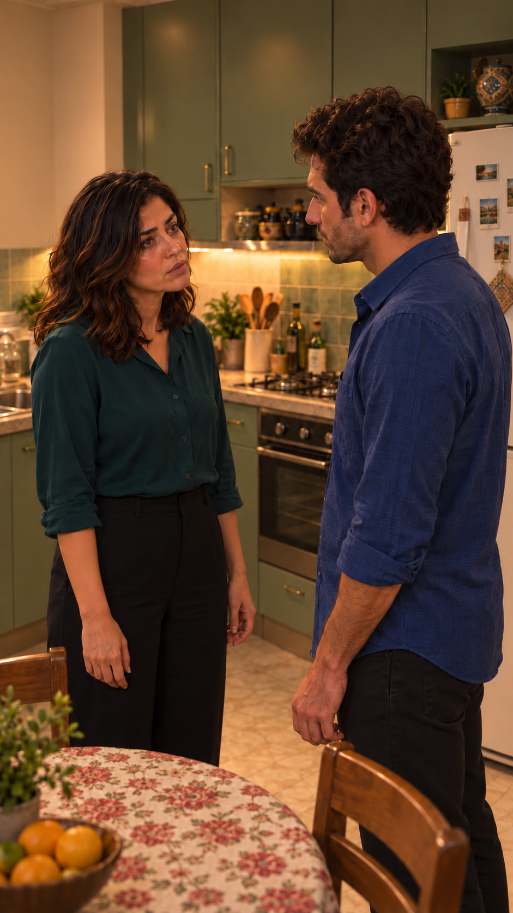

# بستهٔ کامل قاب‌های قسمت چهار

۱۵کارت نما دارای قاب شروع هستند؛ نمای۱۵ از قاب۱۴ استفاده می‌کند، بنابراین۱۴تصویر منتخب مستقل داریم. متن و کنش مصوب تغییر نکرده‌اند. تصویر ثابت بررسی‌شده، مجوز ویدیو و تضمین حرکت نیست. [مرجع مشترک خانه](../../house/README.md) · [نتیجهٔ مرحله و موارد باز](frame-package-review.md).

## 1 — نمای01

[کارت و جهت اجرا](shots/EP04-SH01/shot.md)

## 2 — نمای02

[کارت و جهت اجرا](shots/EP04-SH02/shot.md)

## 3 — نمای03

[کارت و جهت اجرا](shots/EP04-SH03/shot.md)

## 4 — نمای04

[کارت و جهت اجرا](shots/EP04-SH04/shot.md)

## 5 — نمای13

[کارت و جهت اجرا](shots/EP04-SH13/shot.md)

## 6 — نمای05

[کارت و جهت اجرا](shots/EP04-SH05/shot.md)

## 7 — نمای06

[کارت و جهت اجرا](shots/EP04-SH06/shot.md)

## 8 — نمای07

[کارت و جهت اجرا](shots/EP04-SH07/shot.md)

## 9 — نمای08

[کارت و جهت اجرا](shots/EP04-SH08/shot.md)

## 10 — نمای09

[کارت و جهت اجرا](shots/EP04-SH09/shot.md)

## 11 — نمای10

[کارت و جهت اجرا](shots/EP04-SH10/shot.md)

## 12 — نمای11

[کارت و جهت اجرا](shots/EP04-SH11/shot.md)

## 13 — نمای14

[کارت و جهت اجرا](shots/EP04-SH14/shot.md)

## 14 — نمای12

[کارت و جهت اجرا](shots/EP04-SH12/shot.md)

## 15 — نمای15

[کارت و جهت اجرا](shots/EP04-SH15/shot.md)

وضعیت پذیرش۲۰۲۶/۱۰/۱۵: کاربر سایر تصاویر را پذیرفت؛ قاب۲ با اصلاح جهت صندلی نسخهٔ۵ جایگزین شد. [مرحلهٔ بعد: پیش‌نویس بستهٔ ویدیو](video-preparation.md).
